# 编程基础：03：平行列表与字符串 📚

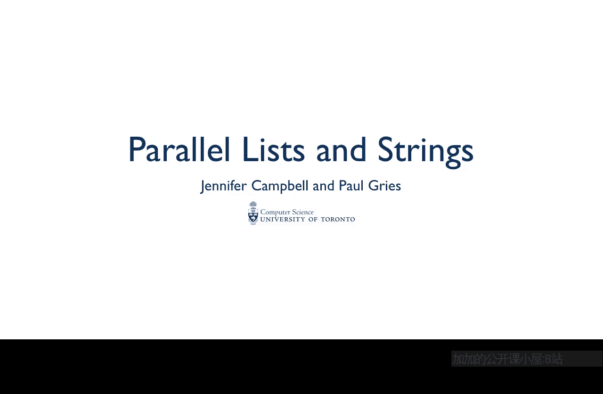

在本节课中，我们将学习如何使用索引循环来同时处理两个不同的列表或字符串。我们将通过编写两个具体的函数来实践这一概念：一个用于对两个列表中对应位置的元素求和，另一个用于统计两个字符串中对应位置字符相同的次数。

---

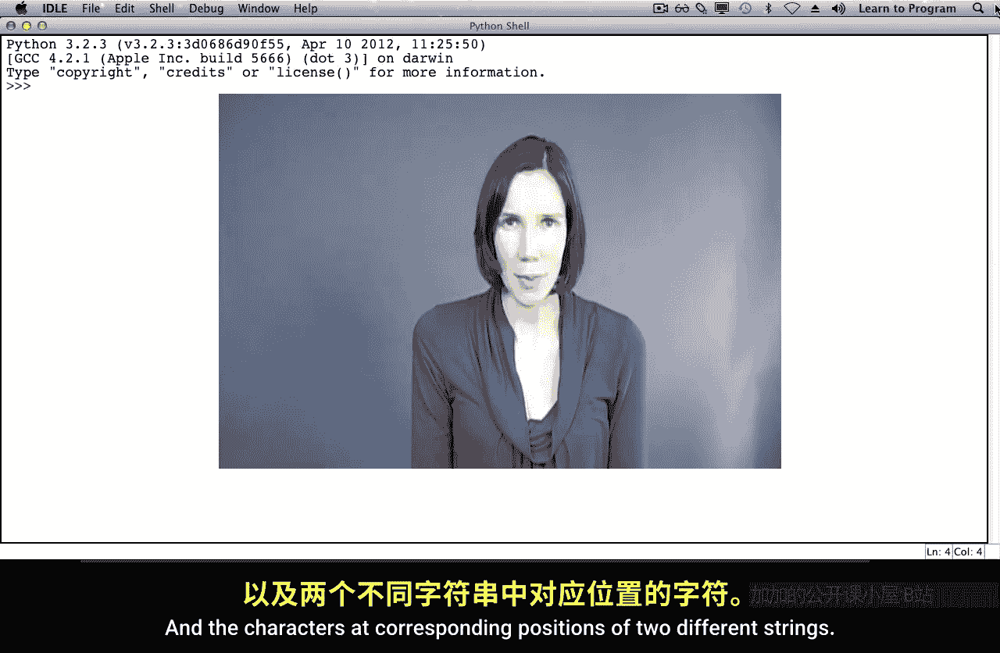

我们已经学习过如何对单个字符串或列表使用索引循环。

本节中，我们将使用索引循环来访问两个不同列表中对应位置的元素，以及两个不同字符串中对应位置的字符。

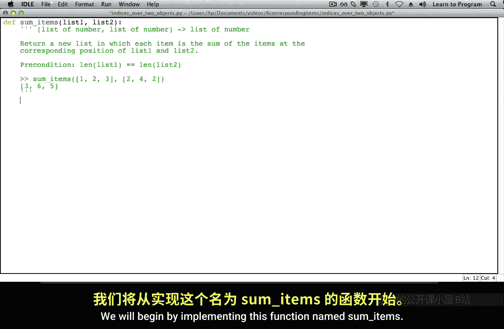

---

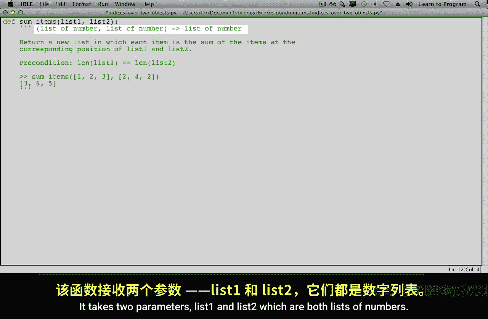

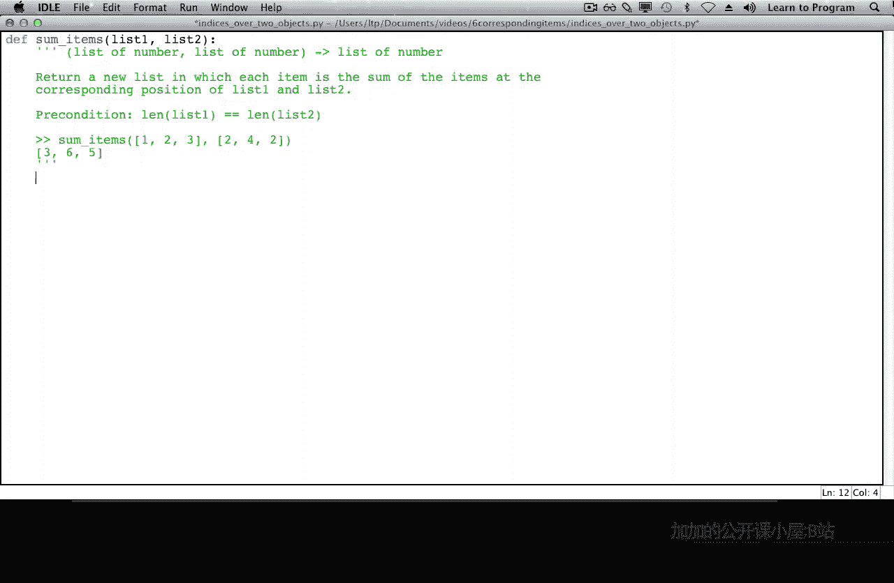

我们将从实现一个名为 `sum_items` 的函数开始。


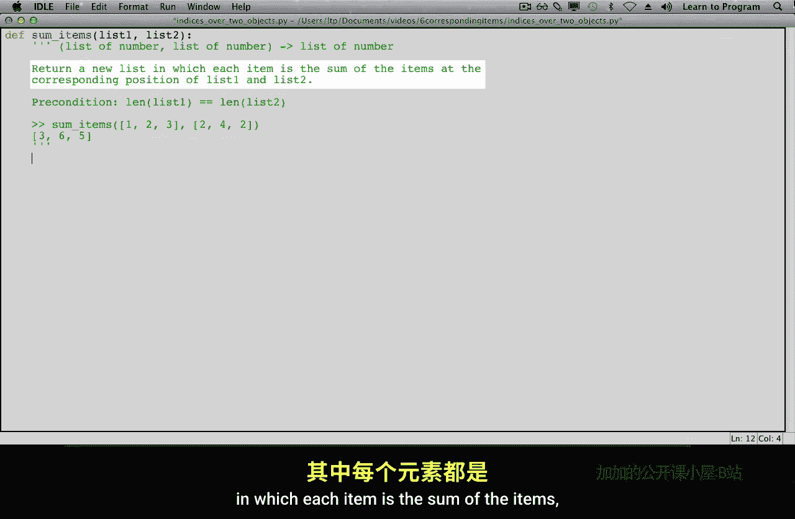

它接收两个参数 `list1` 和 `list2`，它们都是数字列表，并返回一个新的数字列表。


该函数的任务是返回一个新列表，其中每个元素是 `list1` 和 `list2` 在对应位置上元素的和。

---

让我们探讨一下“对应位置”的含义。

如果 `list1` 是一个包含三个元素 `[1, 2, 3]` 的列表，而 `list2` 是一个包含三个元素 `[2, 4, 2]` 的列表。

那么每个列表都有三个元素，索引分别为 0、1 和 2。

当我们说要考虑 `list1` 和 `list2` 的对应元素时，我们指的是位于相同索引处的元素。

例如，在索引 0 处，值 1 和 2 相加得到 3。在索引 1 处，值 2 和 4 相加得到 6。在索引 2 处，值 3 和 2 相加得到 5。

这些结果组成了函数返回的新列表 `[3, 6, 5]`。

现在，让我们来编写这段代码。

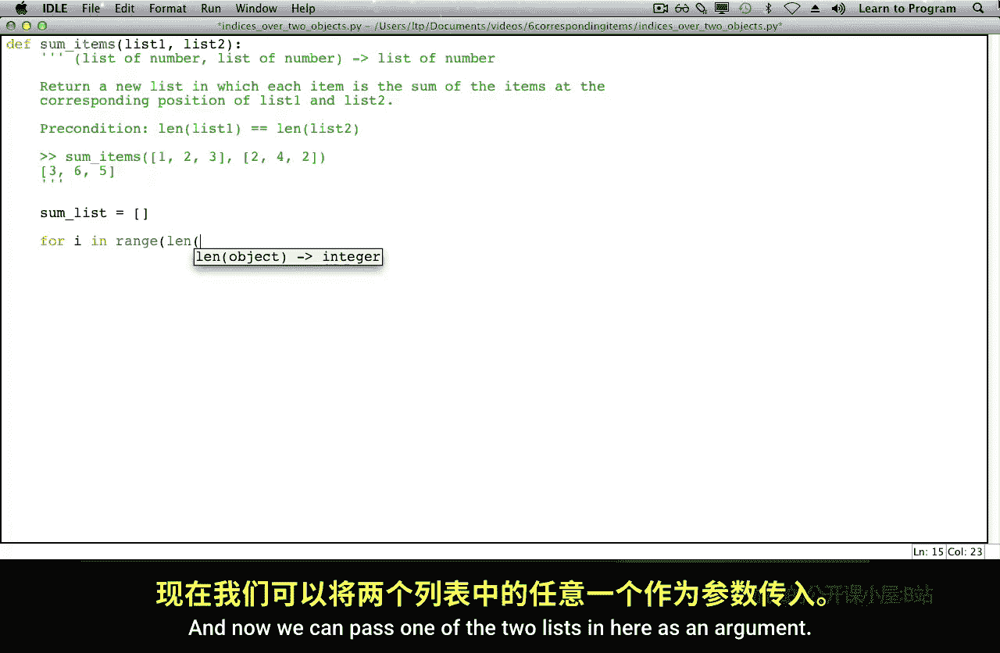

我们将返回一个新列表，因此创建一个变量 `sum_list`，初始指向一个空列表 `[]`。

这个列表将在函数执行过程中逐个元素地构建。

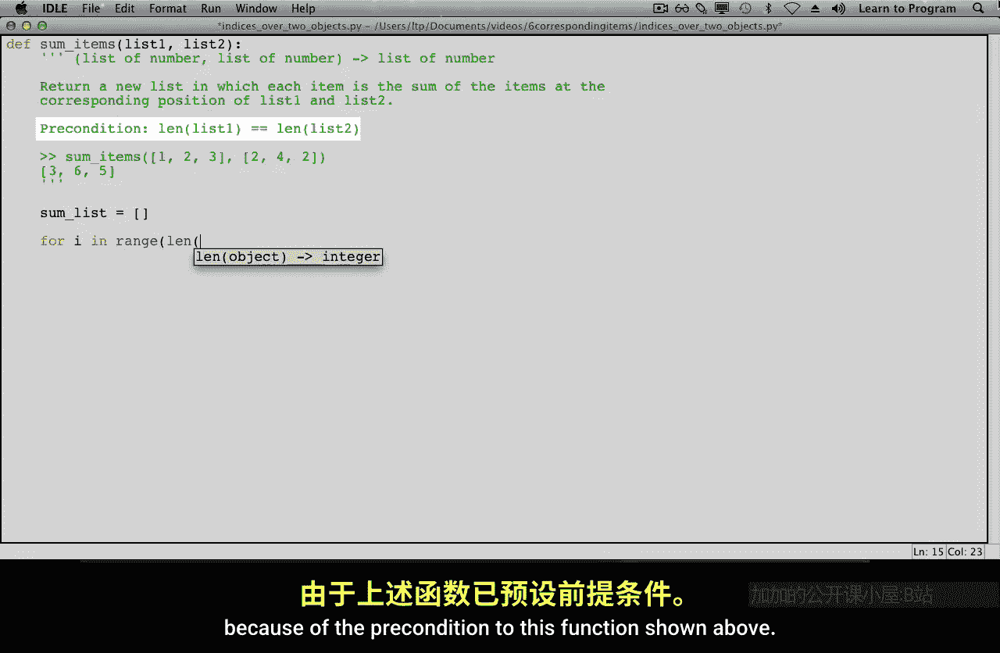

从示例中我们看到，需要使用索引 `i` 来访问 `list1` 和 `list2` 的元素。

因此，我们需要遍历索引。

以下是实现步骤：

1.  创建一个空列表 `sum_list` 作为累加器。
2.  使用 `for` 循环遍历列表的索引范围。
3.  在循环体内，计算两个列表在相同索引处元素的和。
4.  将每次计算的和添加到 `sum_list` 中。
5.  循环结束后，返回 `sum_list`。

```python
def sum_items(list1, list2):
    sum_list = []
    for i in range(len(list1)):
        total = list1[i] + list2[i]
        sum_list.append(total)
    return sum_list
```

注意，由于函数的前提条件是 `list1` 和 `list2` 长度相同，因此我们可以选择任意一个列表的长度来生成索引范围。


现在让我们运行一个示例函数调用。首先导入模块，然后在交互式环境中调用函数，可以看到它返回了列表 `[3, 6, 5]`。

---

接下来，让我们实现另一个函数。

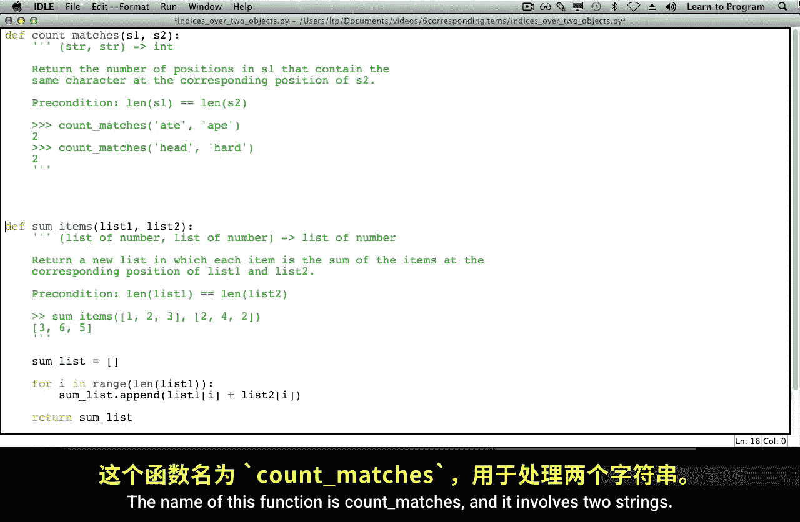

这个函数名为 `count_matches`，它涉及两个字符串。它有两个字符串参数 `s1` 和 `s2`，并返回一个整数，表示在字符串 `s1` 中有多少个位置上的字符与 `s2` 对应位置上的字符相同。

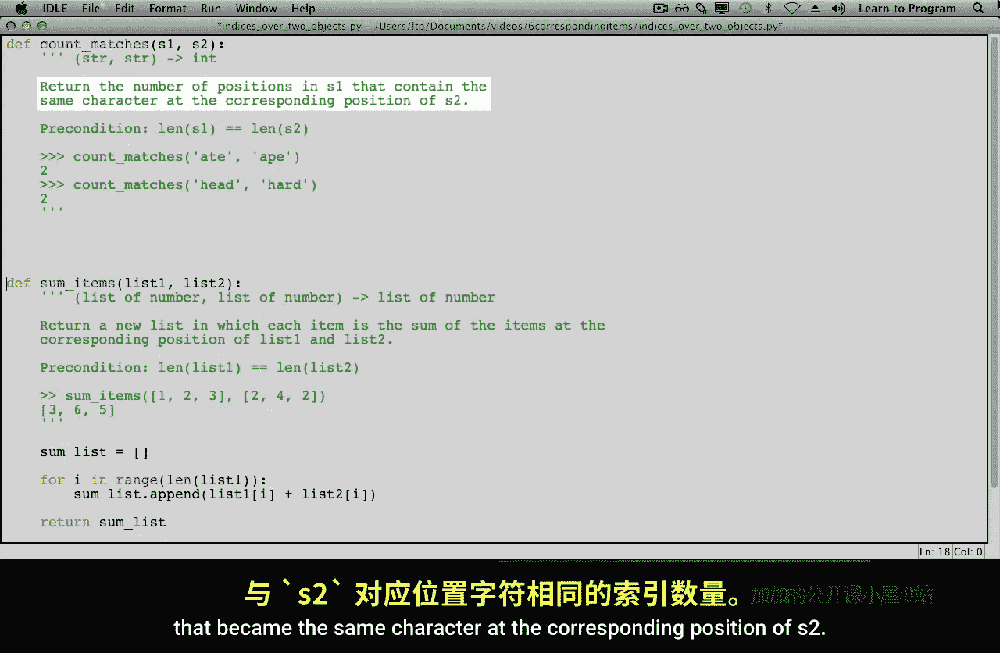


例如，对于字符串 `"ape"` 和 `"ate"`，在索引 0 处都有 `'a'`，在索引 2 处都有 `'e'`，所以有两个匹配。对于字符串 `"head"` 和 `"hard"`，在索引 0 处都有 `'h'`，在索引 3 处都有 `'d'`，同样有两个匹配。

实现这个函数的第一步是创建一个累加器。我将其命名为 `num_matches`，初始值为 0。这个变量将用于累加匹配的数量。

从示例中我们看到，需要比较字符串在相同索引处的字符。

这意味着我们将编写一个遍历字符串索引的循环。

以下是实现步骤：

1.  创建一个整数变量 `num_matches` 并初始化为 0。
2.  使用 `for` 循环遍历字符串 `s1` 的索引范围。
3.  在循环体内，比较 `s1[i]` 和 `s2[i]` 是否相等。
4.  如果相等，则将 `num_matches` 加 1。
5.  循环结束后，返回 `num_matches`。

```python
def count_matches(s1, s2):
    num_matches = 0
    for i in range(len(s1)):
        if s1[i] == s2[i]:
            num_matches = num_matches + 1
    return num_matches
```

让我们运行示例函数调用。首先测试 `"ape"` 和 `"ate"`，返回 2。然后测试 `"head"` 和 `"hard"`，同样返回 2。

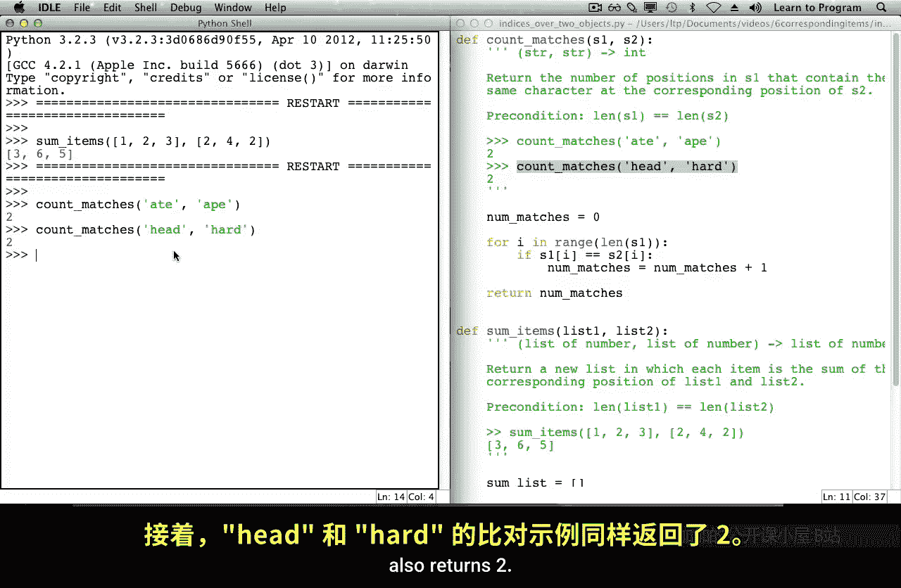

---


本节课中，我们一起学习了如何使用索引循环处理平行列表和字符串。我们实现了两个函数：`sum_items` 用于计算两个列表对应元素的和，`count_matches` 用于统计两个字符串对应位置字符相同的次数。关键在于使用 `range(len(...))` 生成索引，并在循环体内通过相同的索引访问两个数据结构中的对应元素。