# 特伦托大学【中英⚡学习编程：基础知识｜Learn to Program： The Fundamentals】 p35 P35 01_嵌套列表 -BV1kQ11B5EWa_p35-

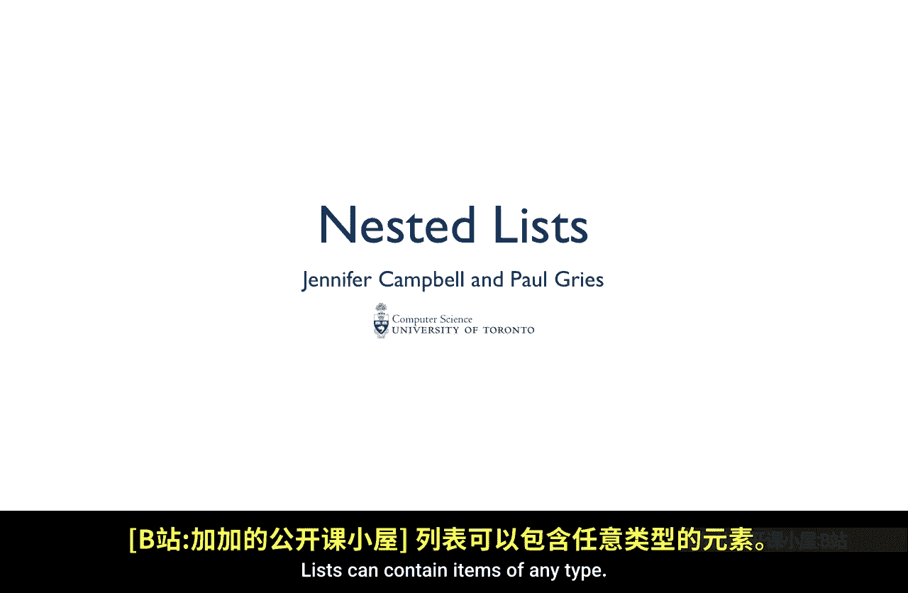

Lists can contain items of any type。 In this lecture。

 we're going to work with lists that have items of type list。 These lists are known as nested。

 with one list inside another。

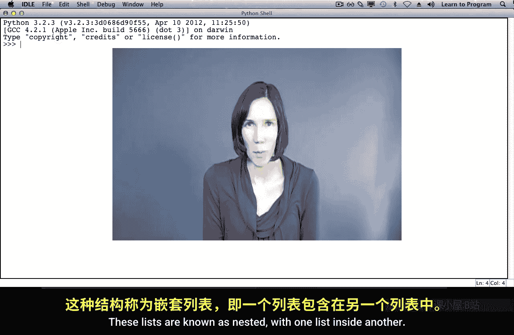

Our first example of a nested list is one in which each element has the name of an assignment。

 for example， assignment1。And upgrade for that assignment。 So each item will be a two item list。

The length of list grades is 3。It has three items。Each of the items is itself a two element list。

We can see this using indexing。

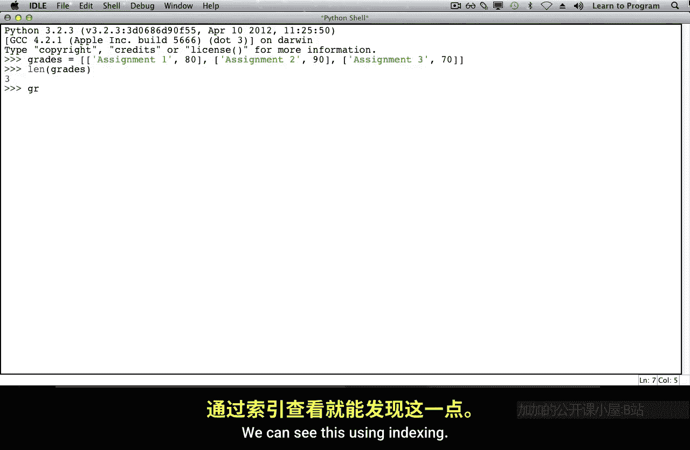

Grades at index 0 is the list with string assignment 1 and int 80。

Gras at index 1 is assignment 2 and 90， and grades at index 2 is assignment 3 and 70。

 The length of each of these items， also known as inner lists is 2。

 And we can see that by passing the list at index 0 as an argument to the length function。

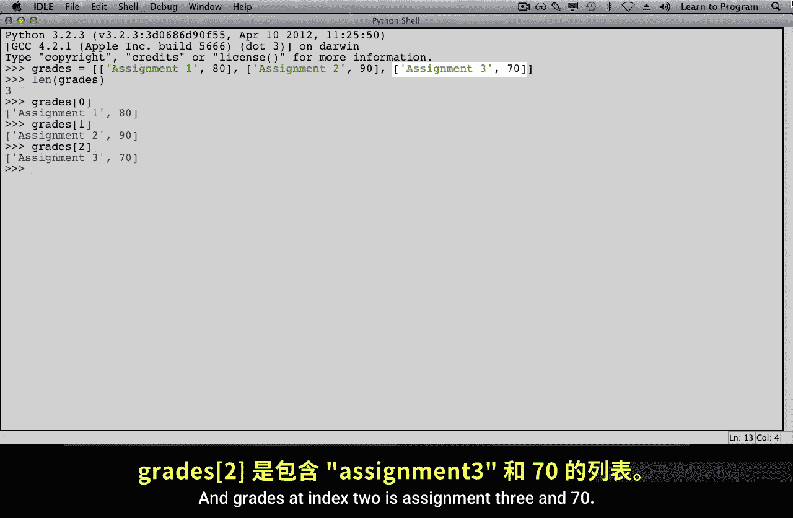

Another way to access the items of grades is to use a for loop， just like we would。

 if the list had strings or ints as elements。So we can say for each item in braids。Print that item。

And the item that is printed will be a two element list。Since each item of grades is a list。

 it can also be indexed。

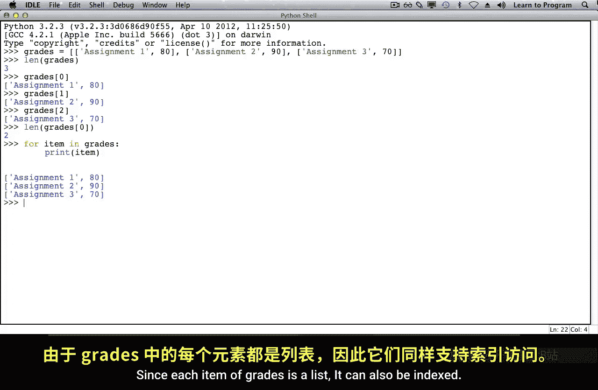

So the list at index0 gives a two element list with string assignment 1 and grade 80。

 and we can use a second index to access each part。So at grades at index0 and index0 is assignment1。

And grades at index 0 and index 1 is 80。

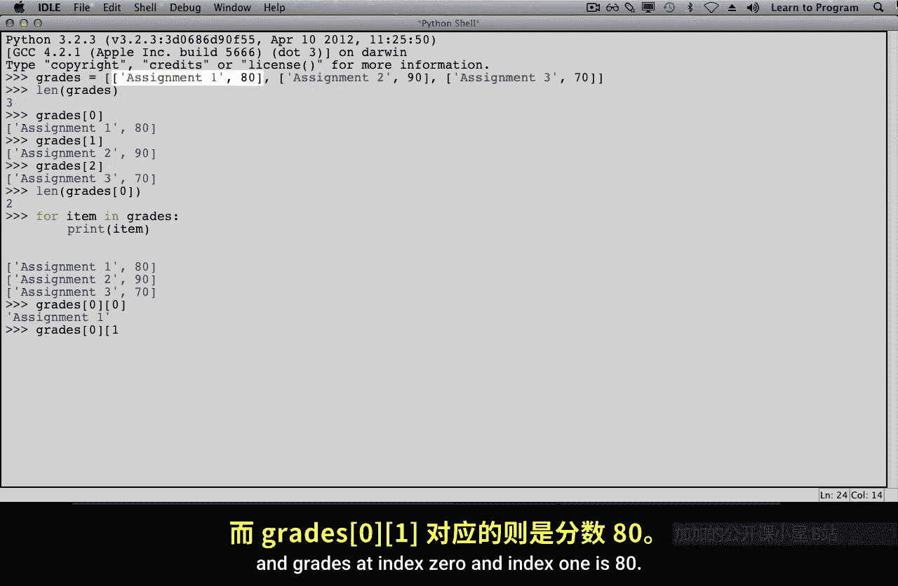

Similarly， for the element of grades at index 1， we can access the first value using index 0。

 so grades at 10 gives assignment 2。

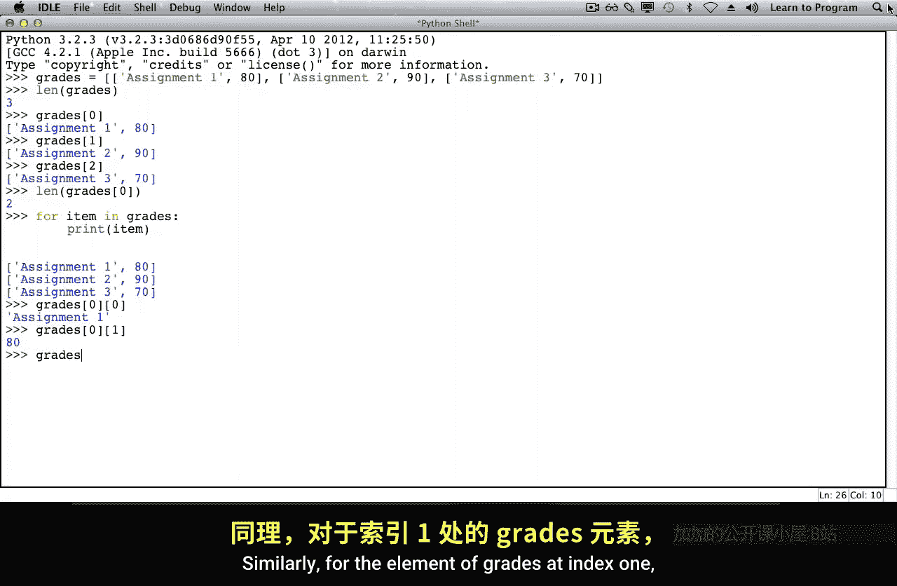

And grades at 1，1 is 90。Gras at 2。And zero is assignment3。And grades at 2 and1。

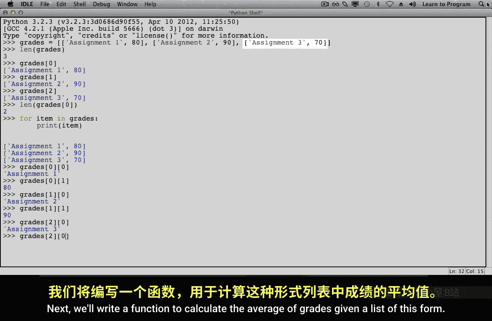

Is 70。Next， we'll write a function to calculate the average of grades given a list of this form。

The function is named calculateulate average， and notice the type contract。

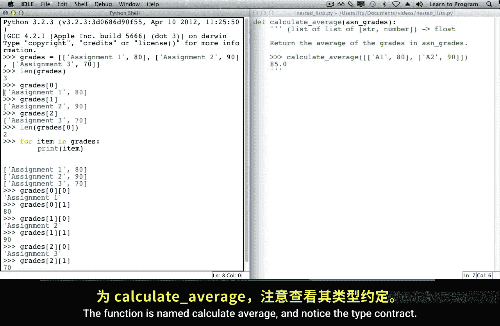

We've got one parameter， which is a list of list of stirern number。

 that describes the type of list we've been working with。This function will return a float。

 which is the average of the grades in the given list。

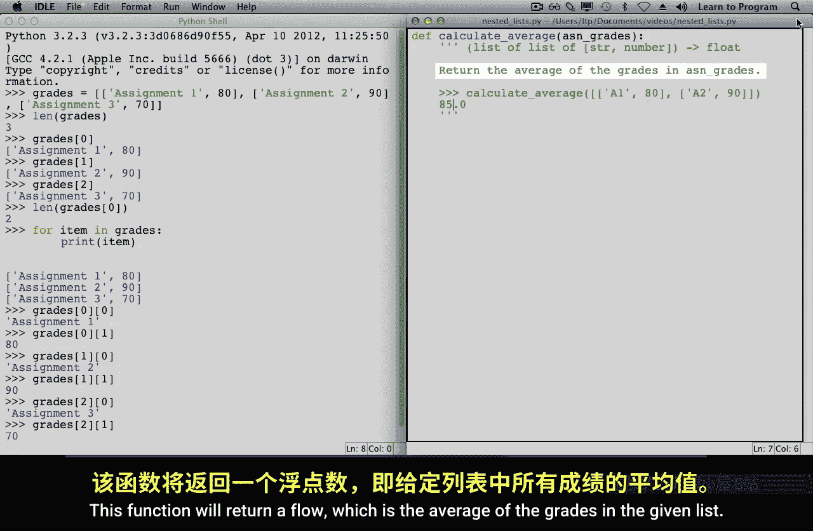

To calculate the average will sum the grades and then divide by the number of grades。

The variable total will be used to keep track of the sum of the grades。

 and it will have an initial value of 0。We're going to pass over the list of assignment grades for item in assignment grades。

And each item is a two element list with a string and an int。So to the total。

 we want to add the current value of total plus the list item at index 1， which is the great。

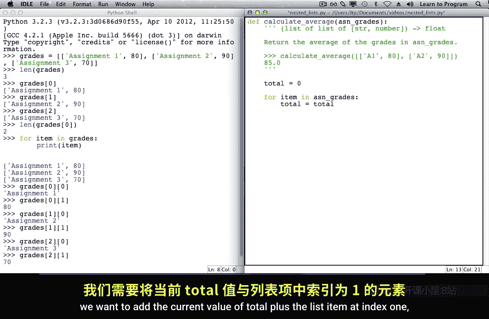

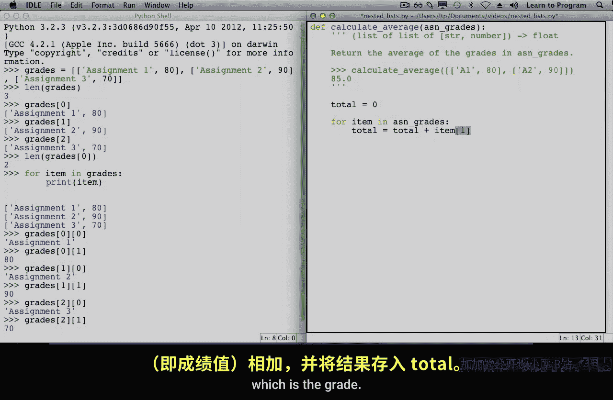

Once the for loop has executed， we will divide the total by the number of grades and that number of grades is equal to the length of the list assignment grades。

And then， we can return that average。Let's run the example call First， run the module。

And then we'll execute calculate average。Confirming that it does return 85。0。

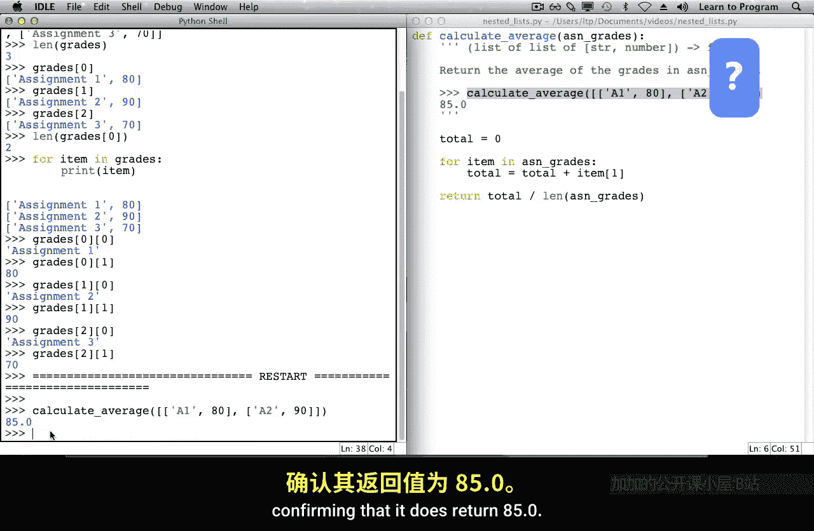