# 编程基础：第35讲：嵌套列表 📚

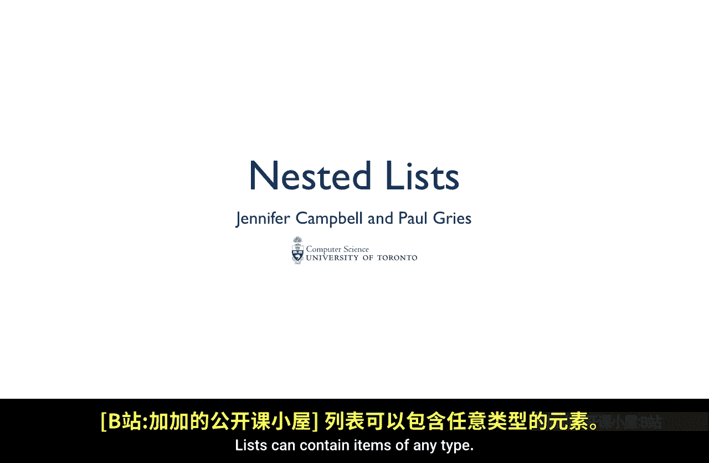

在本节课中，我们将要学习一种特殊的列表结构——**嵌套列表**。我们将了解什么是嵌套列表，如何访问其中的元素，并编写一个函数来计算嵌套列表中数值的平均值。

---


## 什么是嵌套列表？ 📦

列表可以包含任何类型的元素。在本讲中，我们将处理那些元素本身也是列表的列表。这种列表被称为**嵌套列表**，即一个列表包含在另一个列表之中。

我们的第一个例子是一个嵌套列表，其中每个元素都包含一个作业名称（例如 `assignment1`）和该作业的成绩。因此，列表中的每一项都是一个包含两个元素的列表。

```python
grades = [['assignment1', 80], ['assignment2', 90], ['assignment3', 70]]
```

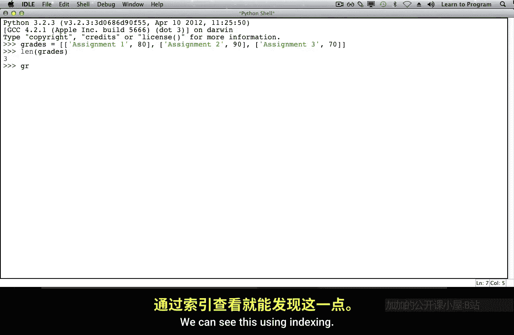

列表 `grades` 的长度是 3，因为它有三个项。而每一项本身又是一个包含两个元素的列表。

---

## 访问嵌套列表的元素 🔍

我们可以通过索引来查看这一点。

```python
grades[0]  # 结果是列表 ['assignment1', 80]
grades[1]  # 结果是列表 ['assignment2', 90]
grades[2]  # 结果是列表 ['assignment3', 70]
```

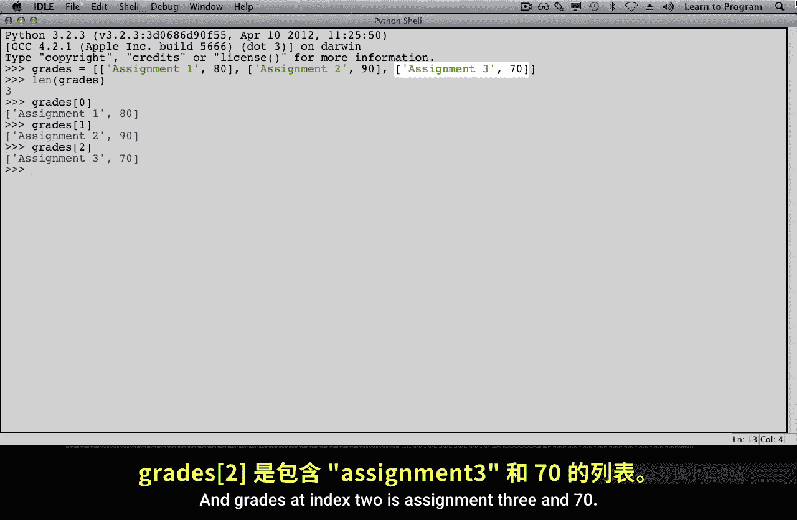

这些内部列表（或称为项）的长度都是 2。我们可以通过将索引 0 处的列表传递给 `len` 函数来验证：

```python
len(grades[0])  # 结果是 2
```

---

## 使用循环遍历嵌套列表 🔄

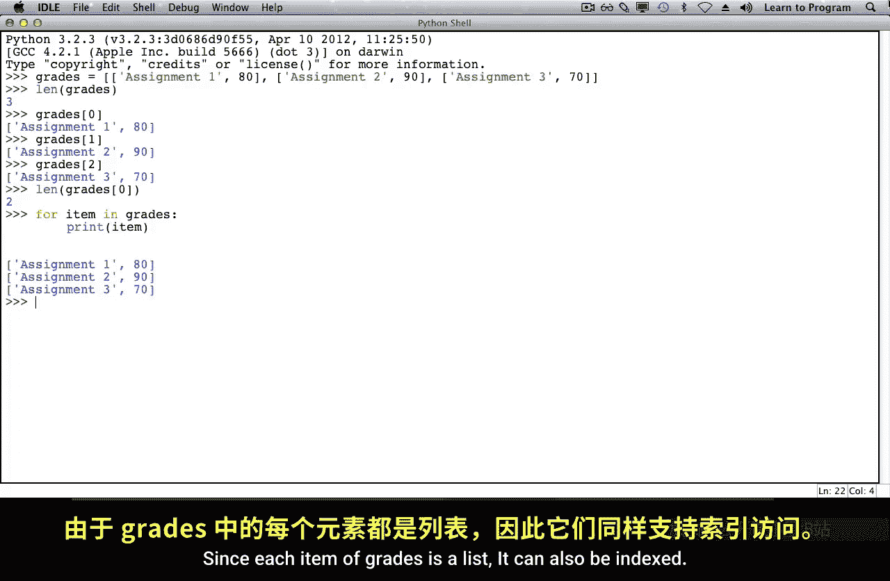

访问 `grades` 中元素的另一种方法是使用 `for` 循环，就像列表元素是字符串或整数时一样。

```python
for item in grades:
    print(item)
```

打印出的每个 `item` 都将是一个包含两个元素的列表。由于 `grades` 的每一项都是一个列表，它也可以被进一步索引。

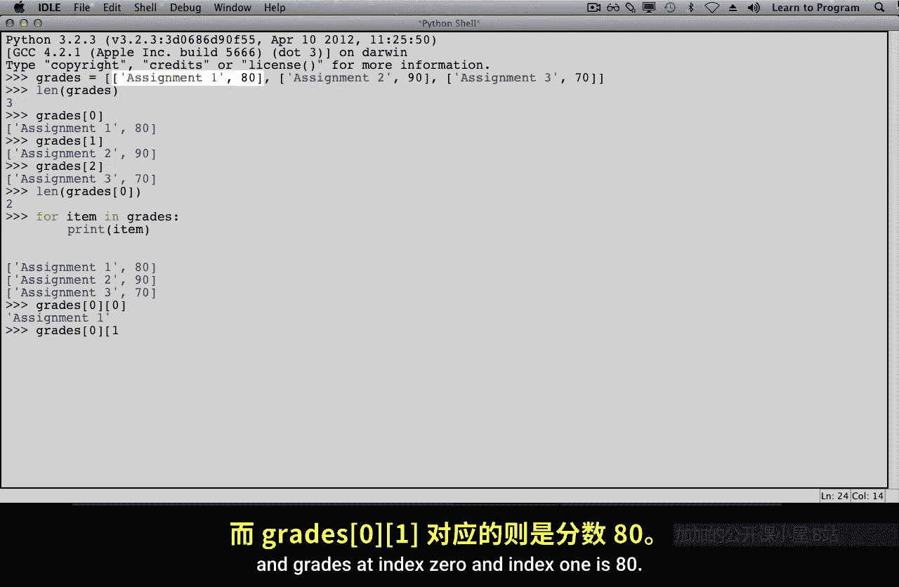

---

## 双重索引访问内部值 🎯

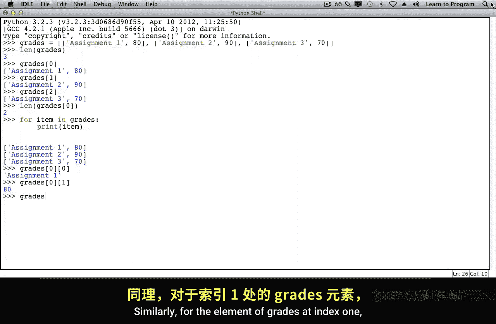

因为索引 `grades[0]` 得到一个包含字符串 `'assignment1'` 和成绩 `80` 的列表，所以我们可以使用第二个索引来访问每个部分。

```python
grades[0][0]  # 结果是 'assignment1'
grades[0][1]  # 结果是 80
```

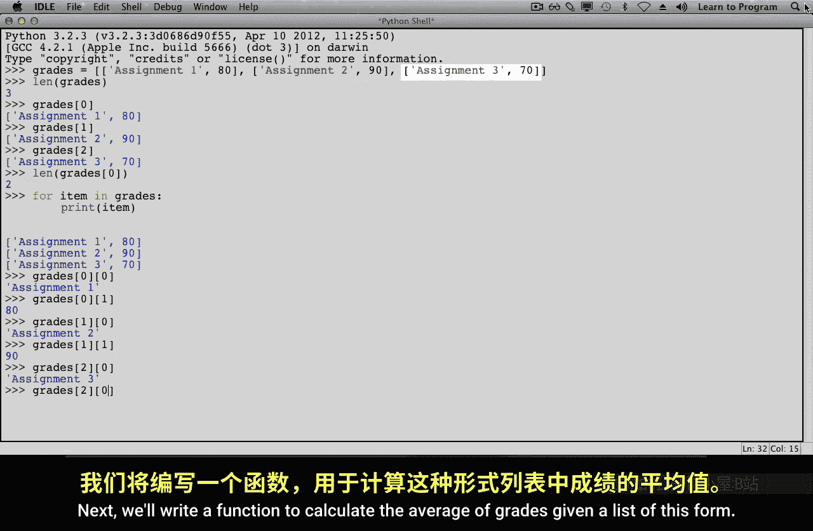

类似地，对于 `grades` 中索引 1 处的元素：

```python
grades[1][0]  # 结果是 'assignment2'
grades[1][1]  # 结果是 90
```

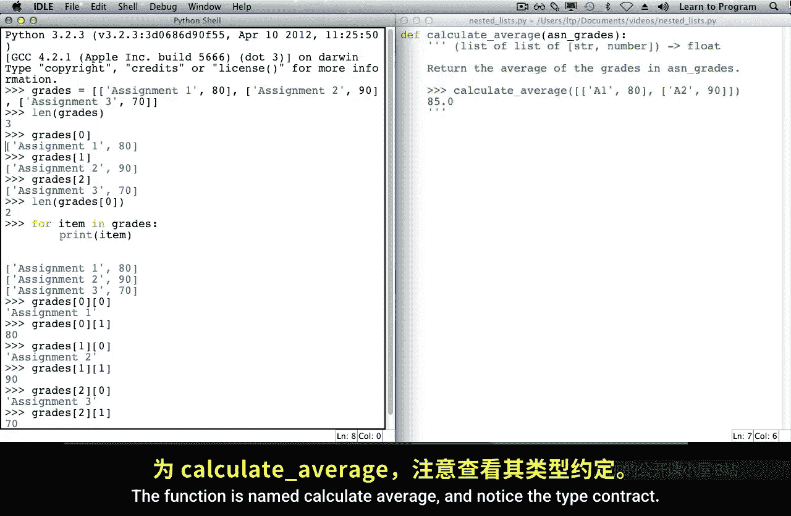

对于索引 2 处的元素：

```python
grades[2][0]  # 结果是 'assignment3'
grades[2][1]  # 结果是 70
```

---

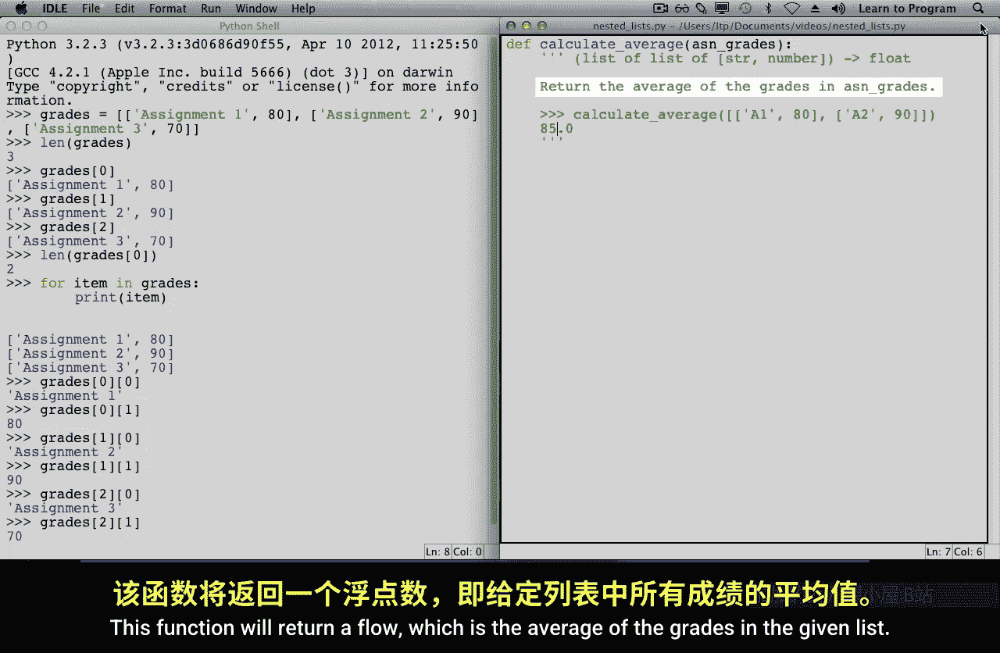

## 编写函数：计算平均成绩 📊

接下来，我们将编写一个函数，来计算这种形式列表中的平均成绩。

函数名为 `calculate_average`。请注意其类型约定：它接收一个参数，该参数是一个“列表的列表”，其中内部列表包含字符串和数字，这描述了我们一直在处理的列表类型。该函数将返回一个浮点数，即给定列表中成绩的平均值。

```python
def calculate_average(assignment_grades):
    """
    计算嵌套列表中所有成绩的平均值。
    参数: assignment_grades (list of list of [str, number]): 作业名称和成绩的列表。
    返回: float: 成绩的平均值。
    """
    total = 0  # 用于累加成绩总和
    for item in assignment_grades:
        total = total + item[1]  # item[1] 是成绩
    average = total / len(assignment_grades)  # 总和除以成绩数量
    return average
```

要计算平均值，我们需要将所有成绩相加，然后除以成绩的数量。变量 `total` 用于跟踪成绩的总和，初始值为 0。我们遍历作业成绩列表，每个 `item` 都是一个包含字符串和整数的两元素列表。因此，我们将当前 `total` 加上列表项在索引 1 处的值（即成绩）。

`for` 循环执行完毕后，我们将总和 `total` 除以成绩的数量（即列表 `assignment_grades` 的长度），然后返回这个平均值。

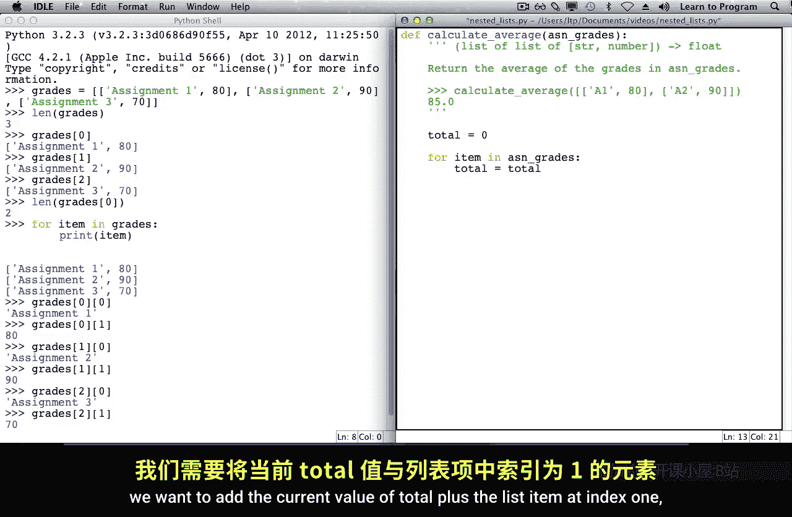

让我们运行一个示例调用：

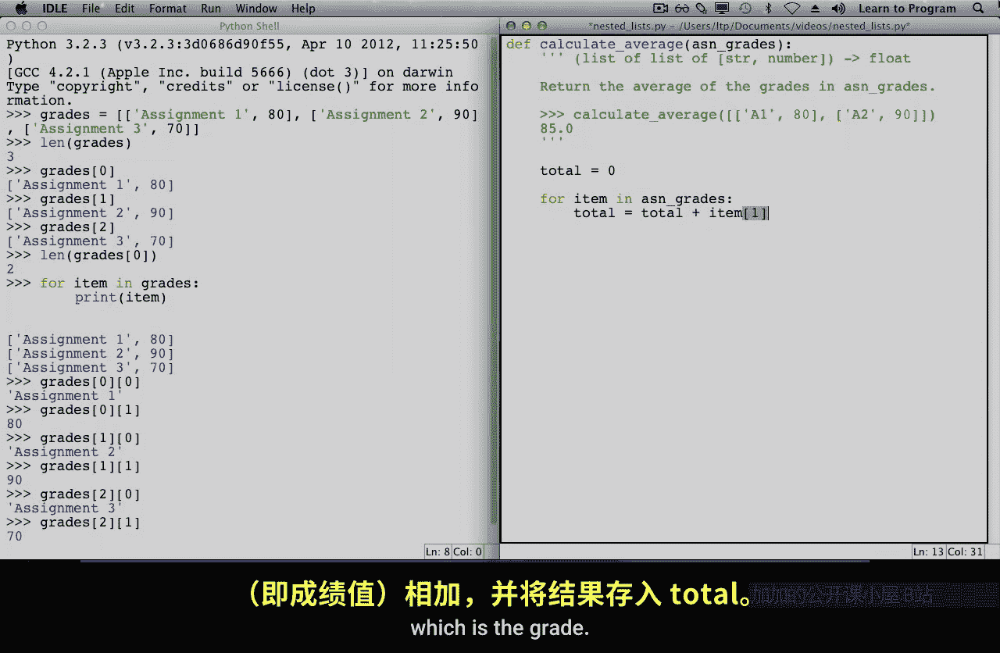

```python
grades = [['assignment1', 80], ['assignment2', 90], ['assignment3', 70]]
result = calculate_average(grades)
print(result)  # 输出 80.0
```

确认它确实返回了 `80.0`。

---

## 总结 ✨

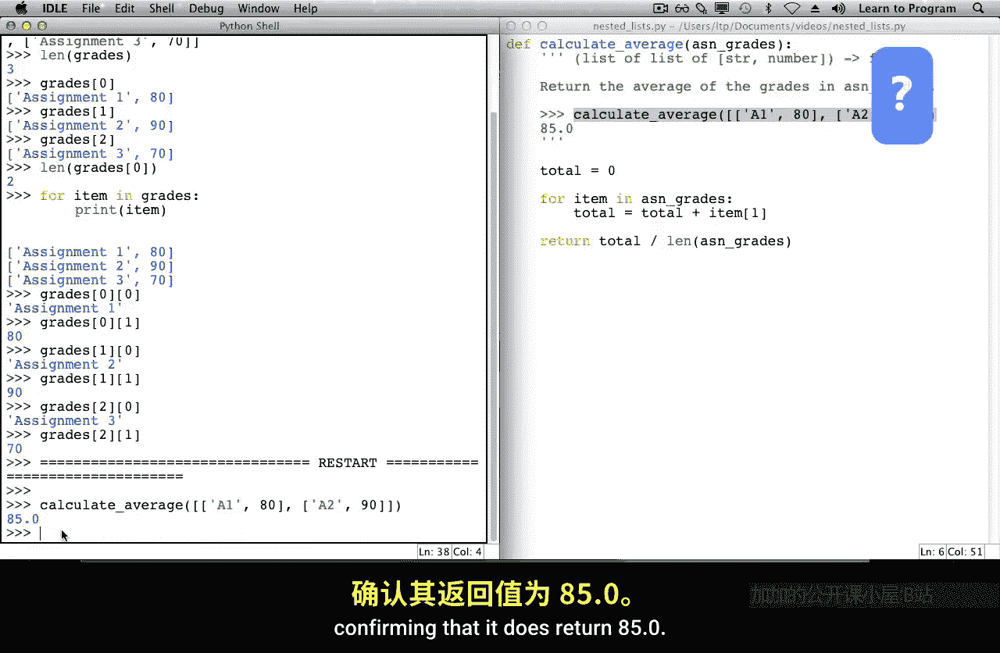

本节课中我们一起学习了**嵌套列表**。我们了解到嵌套列表是包含其他列表作为元素的列表。我们学习了如何使用**双重索引**（例如 `list[0][1]`）来访问内部列表的值，以及如何使用 `for` 循环遍历它们。最后，我们应用这些知识编写了一个 `calculate_average` 函数，用于计算嵌套列表中数值数据的平均值。掌握嵌套列表是处理更复杂、结构化数据的重要一步。