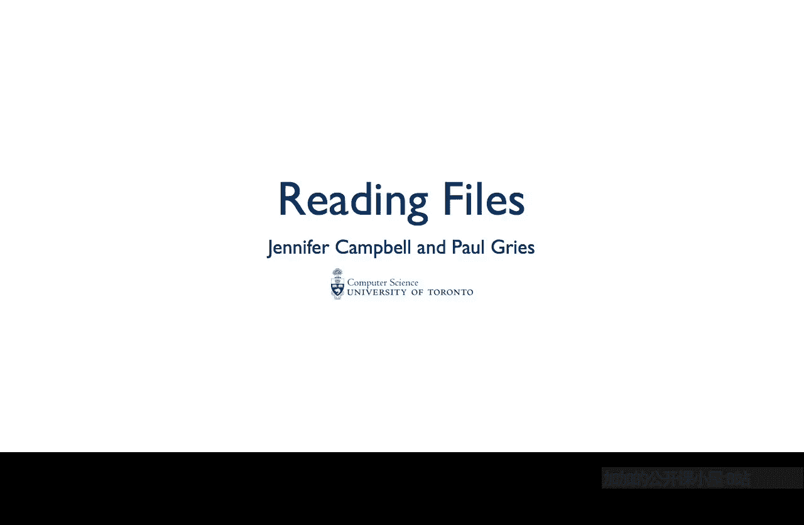
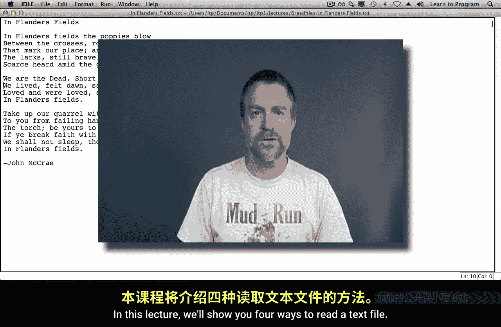
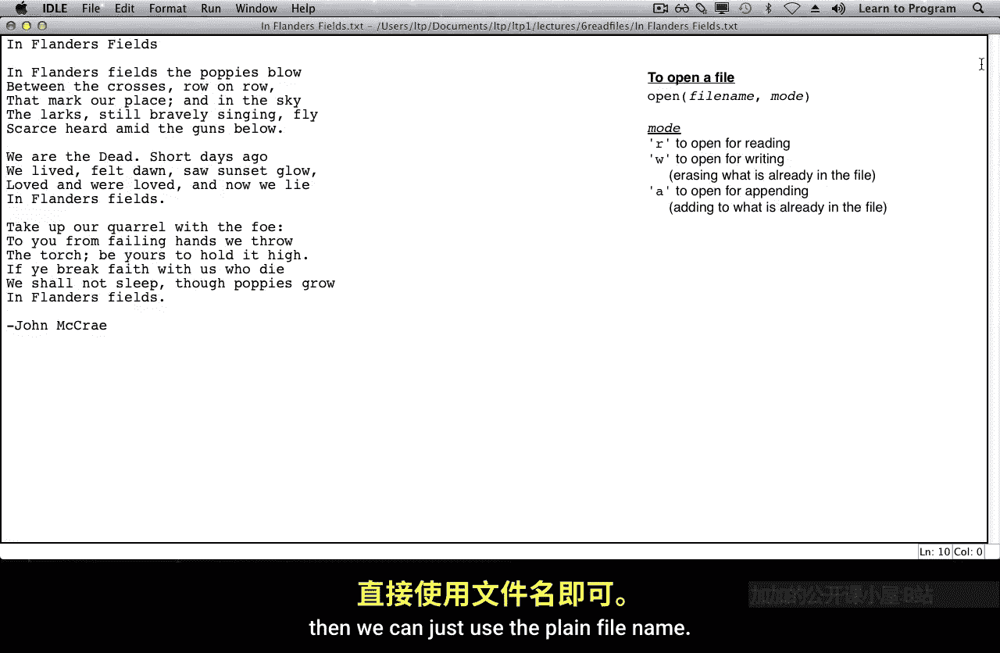
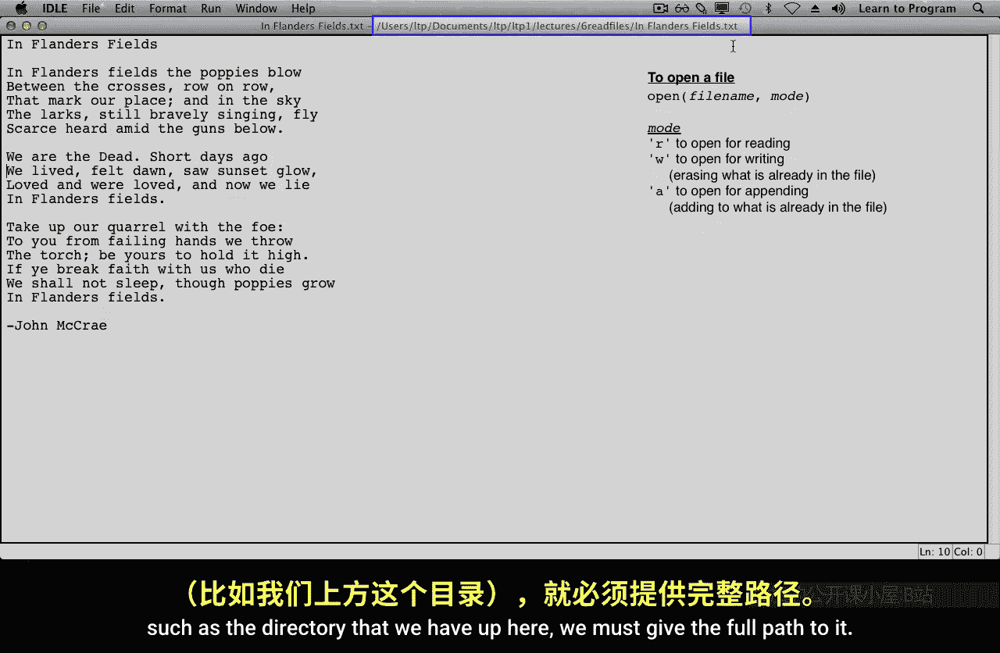
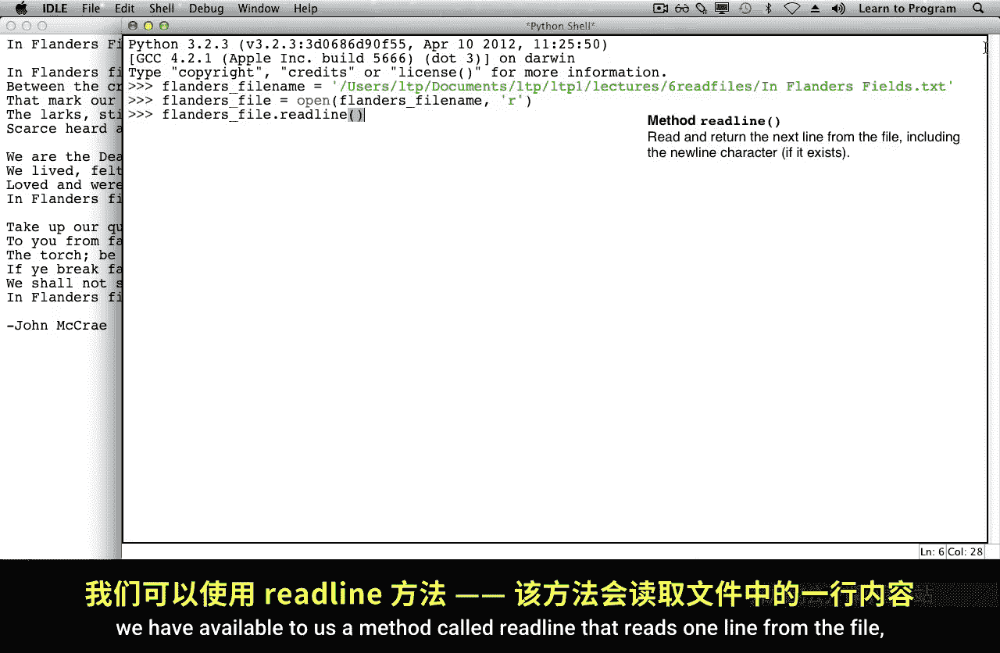
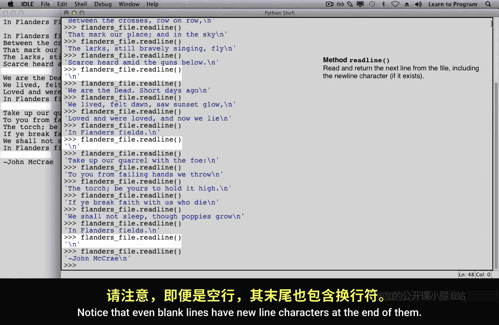
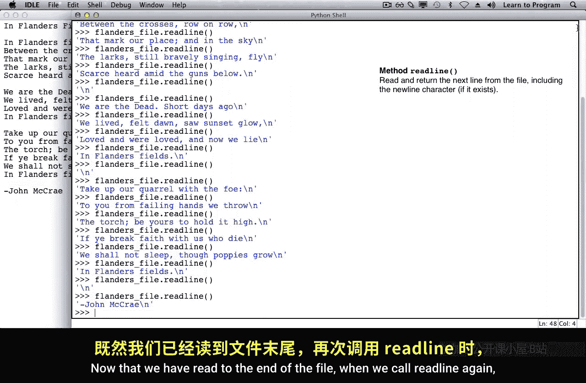
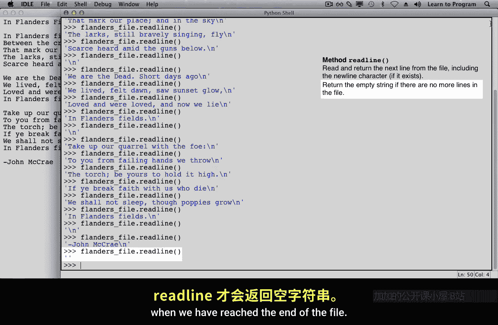
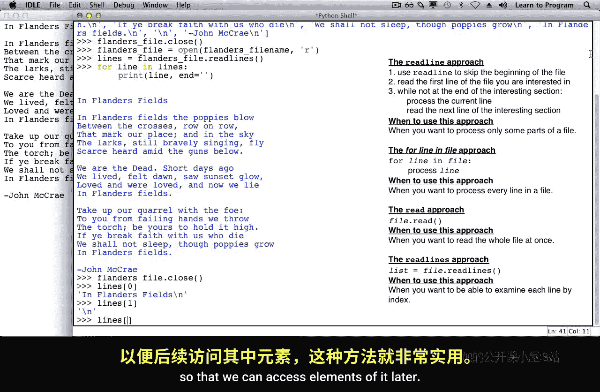

# 特伦托大学【中英⚡学习编程：基础知识｜Learn to Program： The Fundamentals】 p37 P37 01_读取文件 -BV1kQ11B5EWa_p37-

So far， our programs have used computer memory to store information。

 but most information is stored in files on your computer。In this lecture。

 we'll show you four ways to read a text file。

We will use a file containing in Flandander's Field。

 So poem written in 1915 by Canadian lieeutenant Colonel John McCray。Before we can read a file。

 we need to tell Python to open it。 The built and function open does this。 It takes as arguments。

 the name of the file and the letter are to indicate that we want to read from that file。

 as opposed to writing to it。If the file is in the same directory as the program。

 then we can just use the plain file name， but if the file name is in a different directory such as the directory that we have up here。

 we must give the full path to it。

We will now read this file， in various ways。We will save it in a variable so that we don't have to keep retyping it。

First， we open the file for reading。When we open a file for reading。

 we have available to us a method called read line that reads one line from the file。

 including the new line character at the end of that line and returns it。

We can read this entire poem by calling Readline again and again。

Notice that even blank lines have new line characters at the end of them。

Now that we have read to the end of the file， when we call read line again。

 we get back the empty string。 The only time that read line returns the empty string is when we have reached the end of the file。

That means that we can use a wild loop to read the lines from a file。

We will close the file and reopen it so that we can start at the top。

We will read the first line of the file。 And then until we have reached the end of the file。

 we will print the line we read and then move on to read the next line。When we run this loop。

 watch carefully， you're going to see blank lines between every line of the file。

The reason for this is that a read line will return the entire line。

 including the new line character at the end。 And then when we print that line。

Print adds another new line。In order to prevent this from happening。

 we will use exactly the same format that we did before。

 except then in our call on the print function， we will use the empty string as the end marker to print after。

Print prints the line。Let's now explore how to read just the first stanza。We read the title。

 and the blank line。And then the first line of the poem。Let's check。

We'll read each line until we find the line containing nothing but the new line tower。

This read line approach allows us to read only the parts of the file we are interested in and allow us to stop processing a file as soon as we have found the parts of it that we want。

If we know we would like to read every line in a file， there is a simpler way。

 Python's 4 loop works with files， retrieving one line at a time， including the new line。

If your file isn't huge， you can actually read it all at once using method read turns the entire file contents as a single string。

The fourth and last way that we will show you how to read the contents of a file is using method read lines。

 which returns a list of all the lines in the file。

We can use this to print all the lines in the file。We， get our list。And then go through that list。

 printing， as we did before。This approach is useful if we want to keep the list around so that we can access elements of it later。

