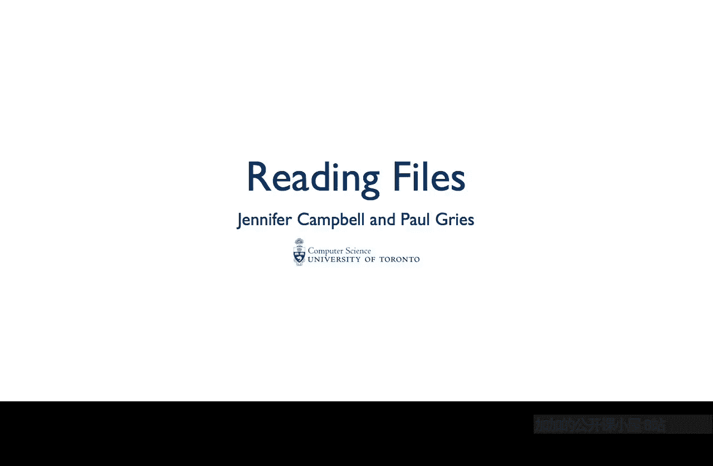
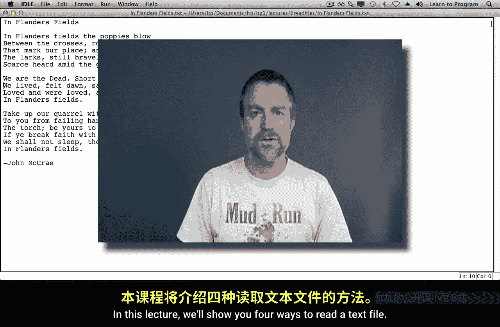
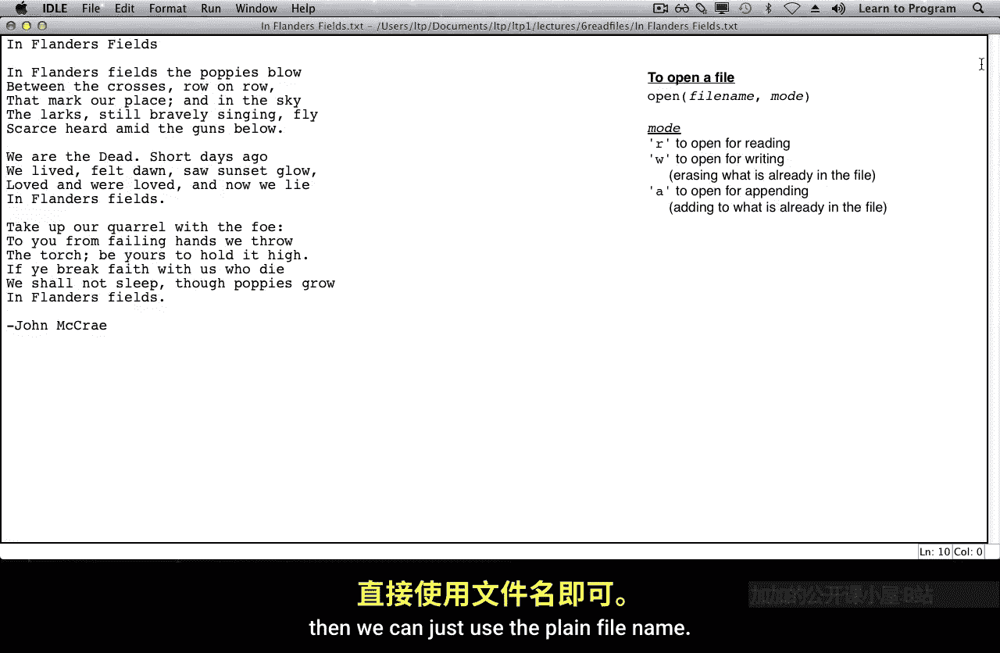
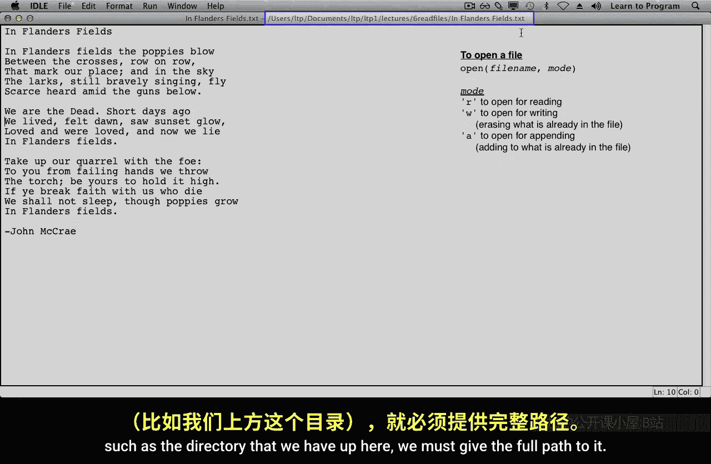
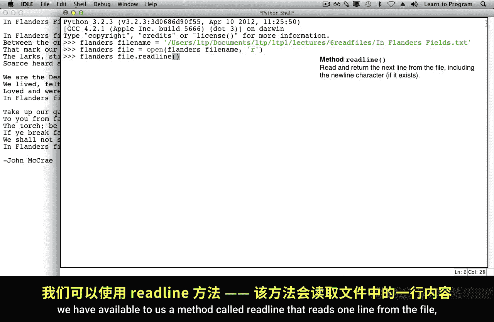
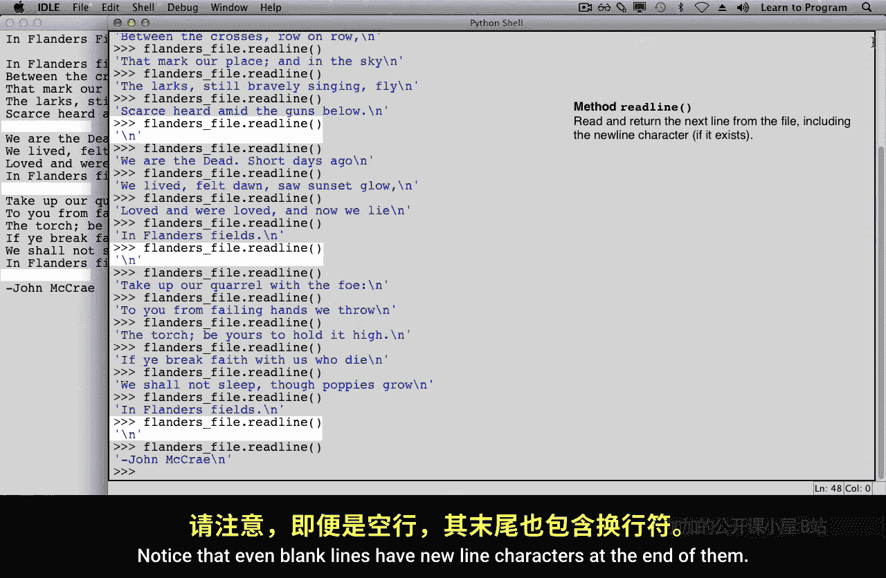
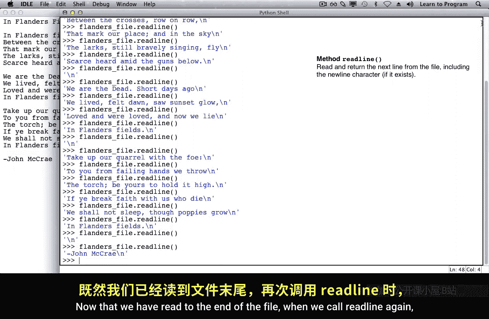
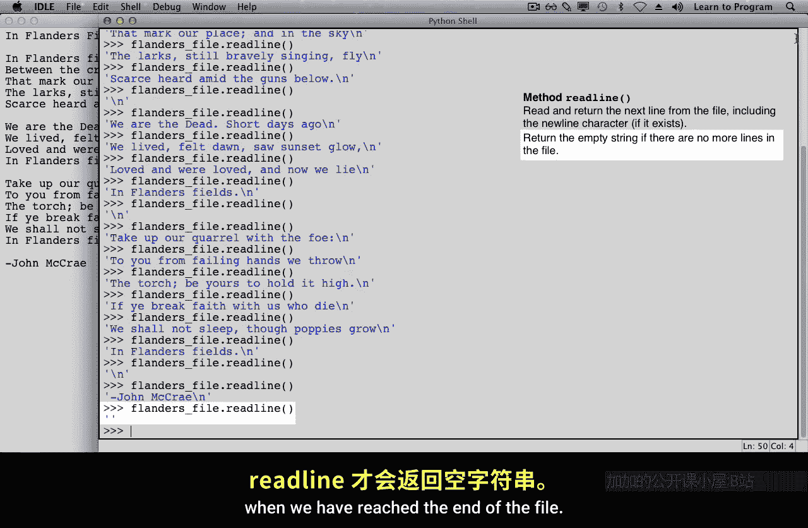
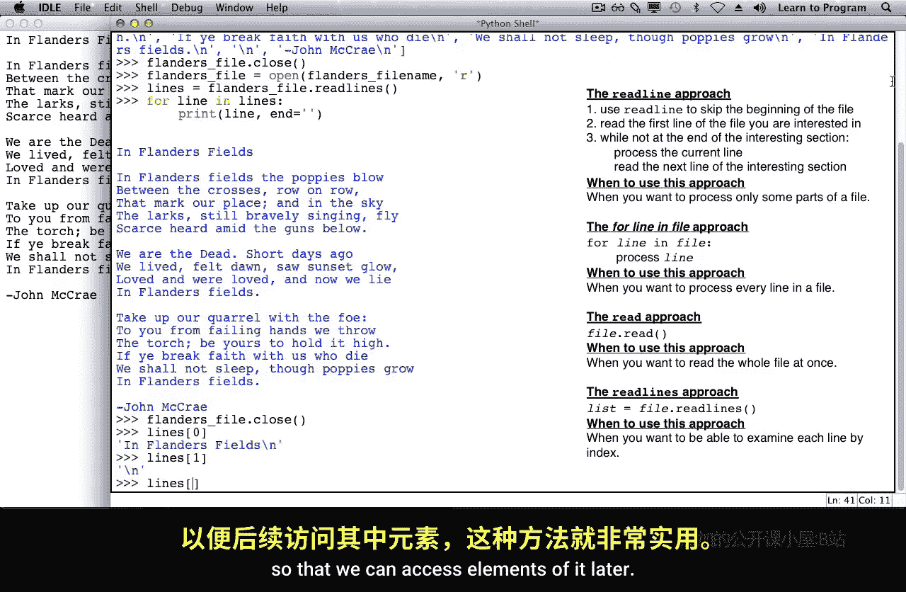

# 学习编程：基础知识：P37：读取文件 📖



在本节课中，我们将要学习如何在Python程序中读取文本文件。到目前为止，我们的程序都使用计算机内存来存储信息，但大多数信息实际上存储在计算机的文件中。本节将介绍四种读取文本文件的方法。



## 打开文件

在读取文件之前，我们需要告诉Python打开它。内置函数 `open` 可以完成这个任务。它接受两个参数：文件名和一个表示我们想要读取（而非写入）该文件的字母 `'r'`。

如果文件与程序在同一目录下，我们可以直接使用文件名。如果文件位于其他目录（例如我们这里显示的目录），则必须提供文件的完整路径。

```python
file_handle = open('文件名.txt', 'r')
```



## 方法一：使用 `readline` 逐行读取



打开文件后，我们可以使用一个名为 `readline` 的方法。该方法从文件中读取一行，包括该行末尾的换行符，并将其返回。

```python
line = file_handle.readline()
```

我们可以通过反复调用 `readline` 来读取整个文件。请注意，即使是空行，其末尾也包含换行符。



当读取到文件末尾时，再次调用 `readline` 会返回一个空字符串。`readline` 返回空字符串的唯一情况就是我们已到达文件末尾。



这意味着我们可以使用一个 `while` 循环来读取文件中的所有行。我们将关闭并重新打开文件，以便从文件开头开始读取。

以下是使用循环读取文件的示例：





```python
file_handle = open('文件名.txt', 'r')
line = file_handle.readline()
while line != '':
    print(line, end='')
    line = file_handle.readline()
file_handle.close()
```

运行此循环时，你可能会看到文件行之间出现空行。这是因为 `readline` 返回的整行包含末尾的换行符，而 `print` 函数默认又会添加一个换行符。为了防止这种情况发生，我们在调用 `print` 函数时，将 `end` 参数设置为空字符串 `''`。

## 方法二：使用 `for` 循环遍历文件

如果我们知道需要读取文件中的每一行，有一种更简单的方法。Python的 `for` 循环可以直接用于文件对象，每次迭代获取一行（包括换行符）。

```python
file_handle = open('文件名.txt', 'r')
for line in file_handle:
    print(line, end='')
file_handle.close()
```

## 方法三：使用 `read` 一次性读取整个文件

如果你的文件不是特别大，可以使用 `read` 方法一次性将整个文件内容读取为一个单独的字符串。

```python
file_handle = open('文件名.txt', 'r')
entire_content = file_handle.read()
print(entire_content)
file_handle.close()
```

## 方法四：使用 `readlines` 读取所有行到列表

我们将展示的第四种也是最后一种读取文件内容的方法是使用 `readlines` 方法。该方法返回一个列表，其中包含文件中的所有行。

```python
file_handle = open('文件名.txt', 'r')
lines_list = file_handle.readlines()
file_handle.close()
```

我们可以使用这个列表来打印文件中的所有行，方法与之前类似。如果我们希望保留这个列表以便后续访问其中的元素，这种方法非常有用。

```python
for line in lines_list:
    print(line, end='')
```

## 总结



本节课中，我们一起学习了在Python中读取文本文件的四种主要方法：使用 `readline` 逐行读取、使用 `for` 循环遍历、使用 `read` 一次性读取整个文件，以及使用 `readlines` 将文件内容读取到列表中。每种方法都有其适用场景，你可以根据具体需求选择最合适的一种。