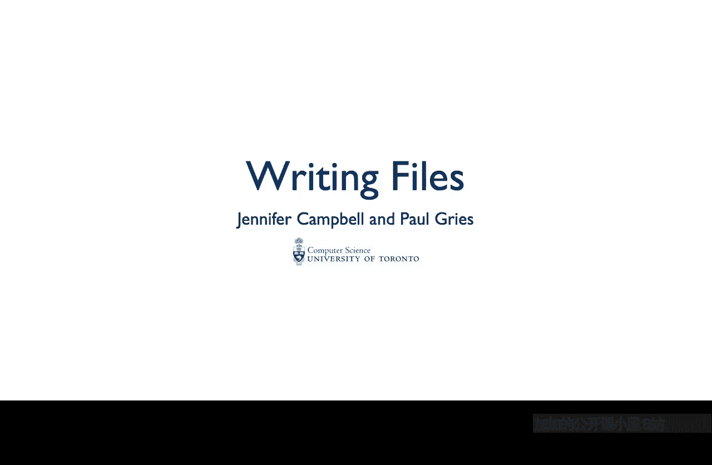
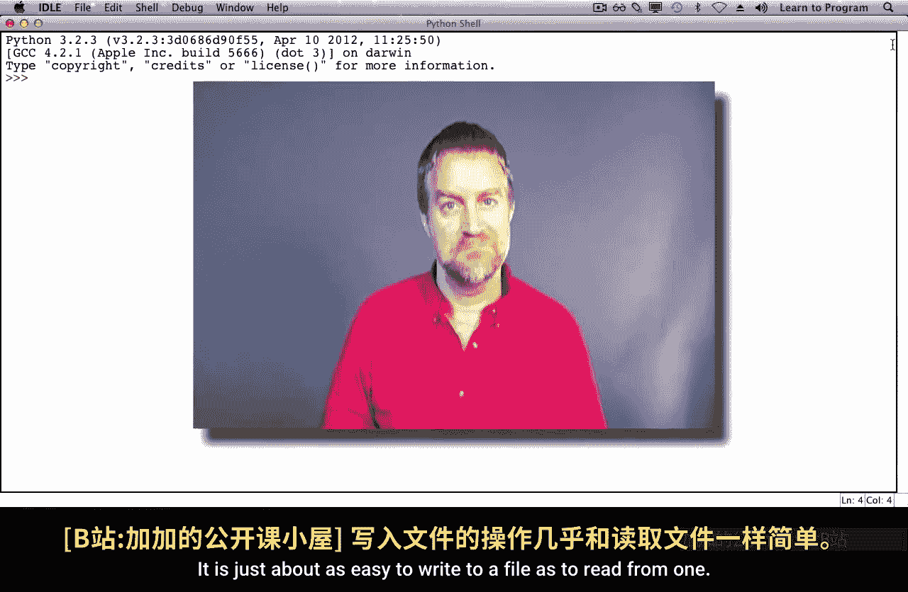
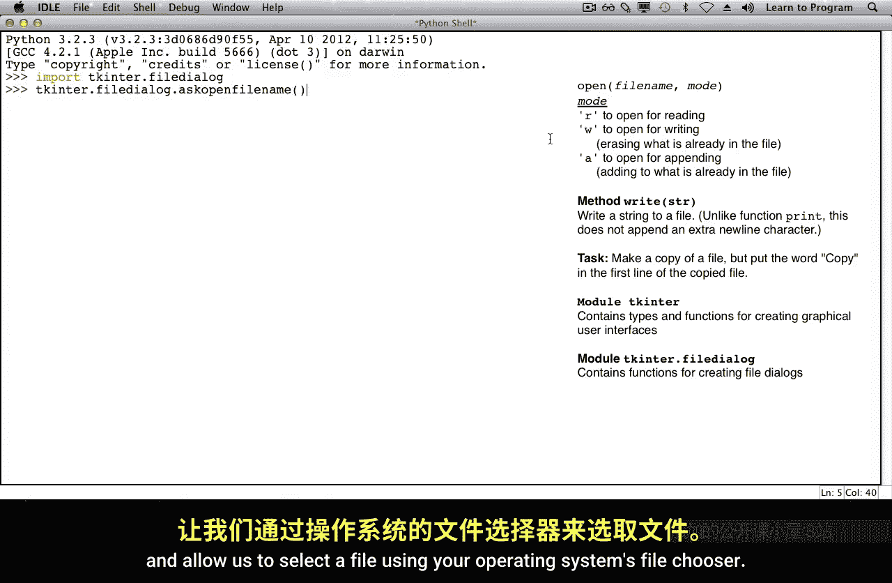
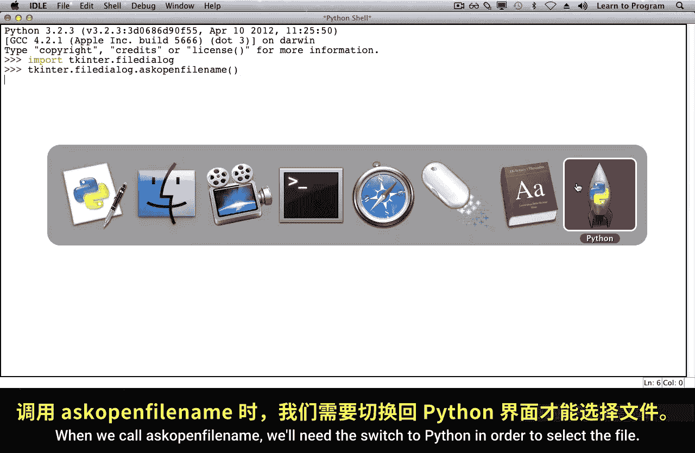
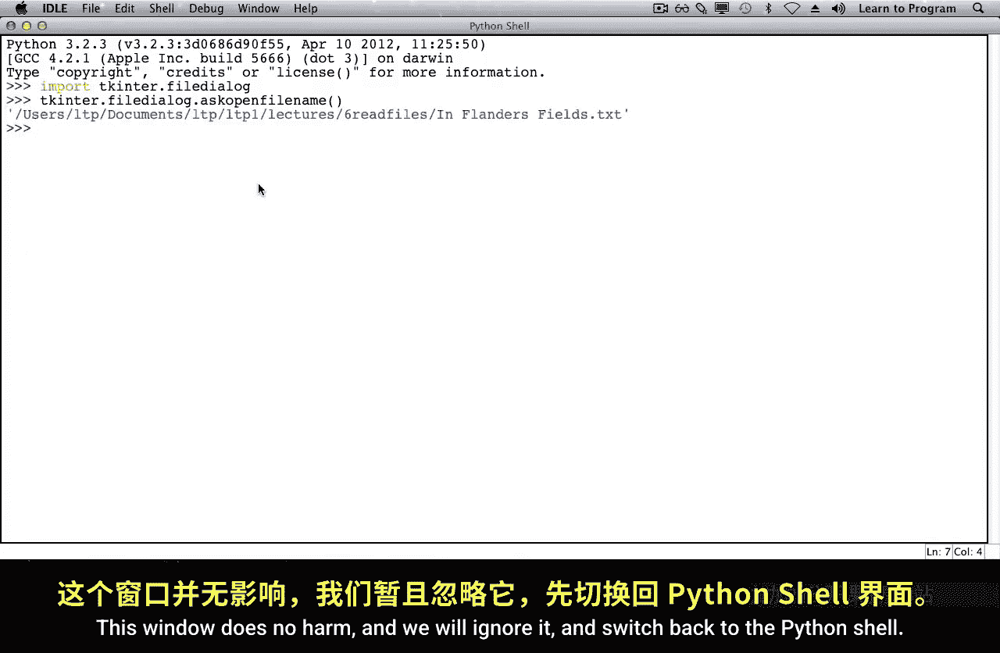
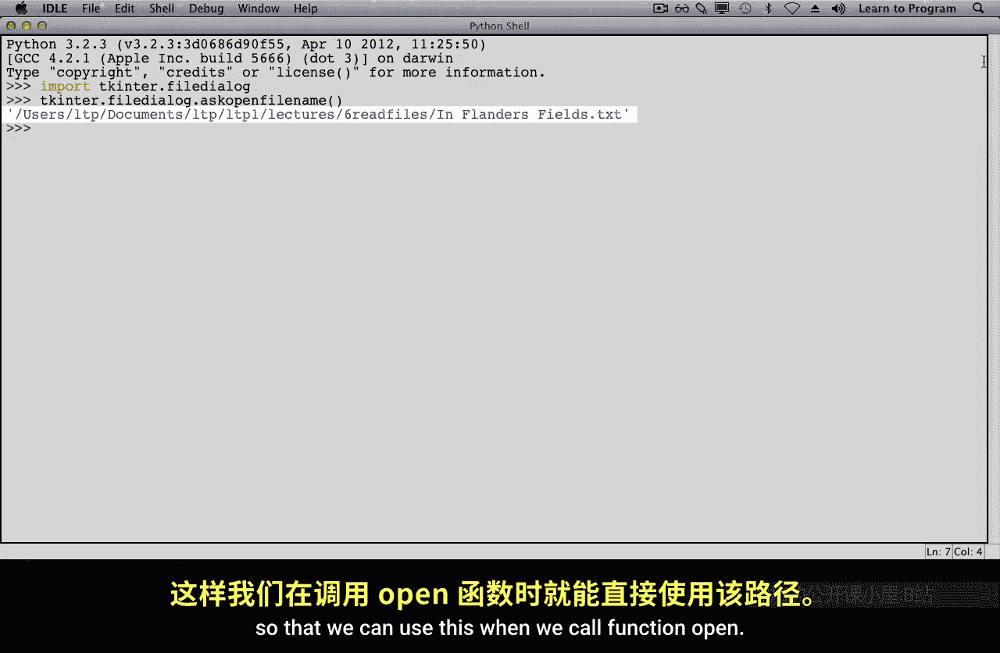
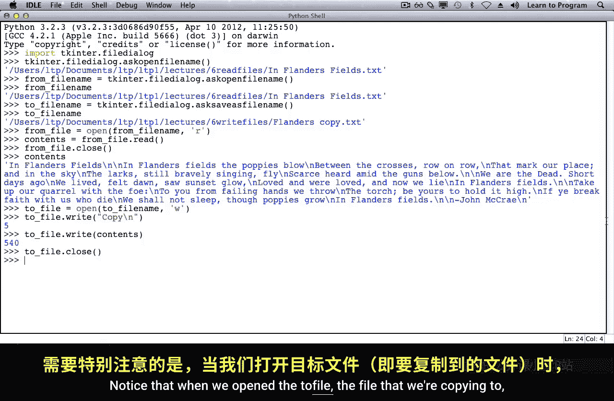
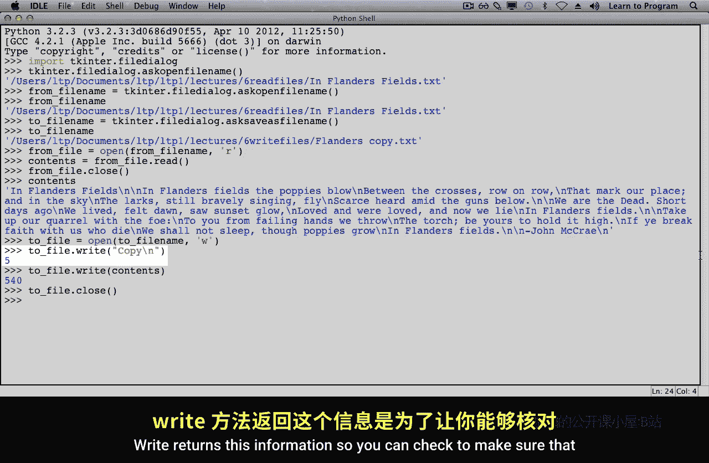
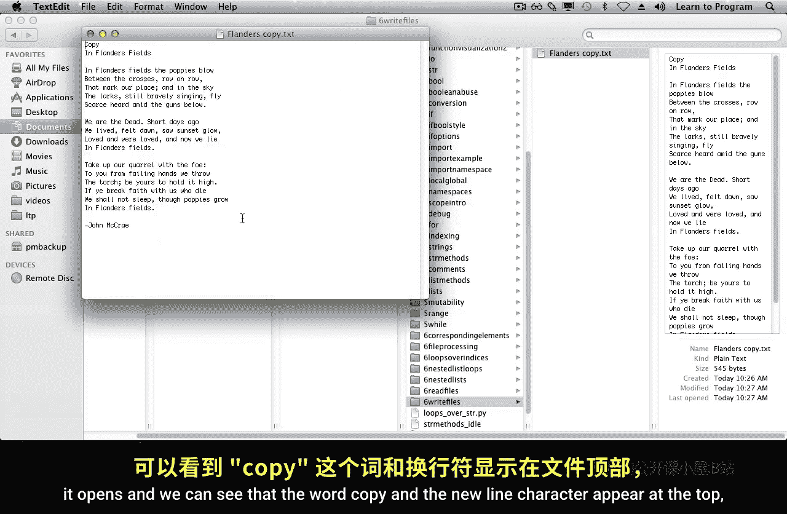
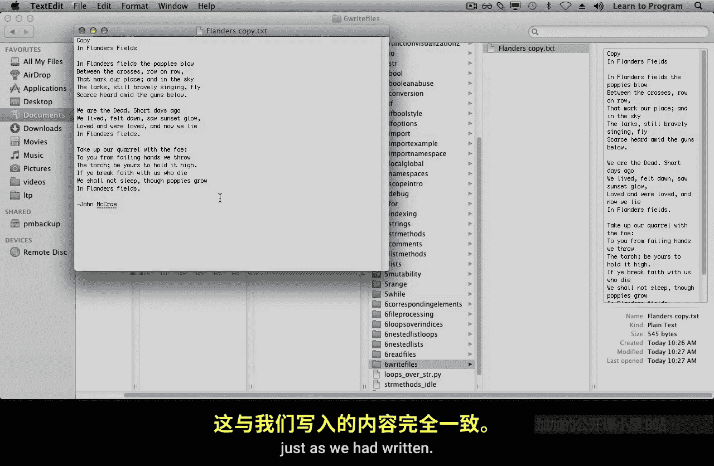

# 特伦托大学【中英⚡学习编程：基础知识｜Learn to Program： The Fundamentals】 p38 P38 03_写入文件 -BV1kQ11B5EWa_p38-

It is just about as easy to write to a file as to read from one。 Here we go。

As a reminder， function open takes the name of a file。

 either a full path or just a name If the file is in the same directory as the programme and a mode one of read。

 write and a pen。Much like files have read and read line and read lines methods。

 They have a right method。 If we've opened them for writing。

Method right works much like Python's print function。

 except that it doesn't add a new line character。We're going to write a short bit of code that makes a copy of a file。

 but puts the word copy as the first line in the new copied file。

We will start by showing you how to prompt a user for a file module T。

 K enter has a sub module called file dial。 We import it like this。Inside that module is a function。

 ask open file name。 This will pop open a dialogue and allow us to select a file using your operating systems file chooser。

When we call Ascopen file name， we'll need to switch to Python in order to select the file。

We will go find in Flanders fields， by T X T。When we select open。

 we see that the the file dialogue disappears， but we are left with this window with title T K。

This window does no harm， and we will ignore it and switch back to the Python shell。

Ascopen file name has returned a string containing the full path to the file that we chose。

So that we can use this when we call function open。

We will call this again。And。Remember the string that was returned。

We need to switch back to Python in order to select our file。Now。

 from file name is the path to that file。We will use a new function in the same file dialogue module in order to choose a file that we would like to write to。

Instead of ask open file name， we will ask， save as file name。

Ask savead's file name allows us to choose a new file name to save to。

 But if we choose a file that already exists， we will be prompted to confirm that we really do want to replace that file。

We'll switch back to Python， and。You'll notice that it says save as with a place to type the name of the new file。

 Well， I don't want to save it in six read files because this lecture is6 write files。

We'll call this one。Fleder's copy。ピXスティ。And here is what we chose。We will now open from file name。

 in read mode。Read the contents。Close the file。And checked to make sure that we got what we expected and indeed contents is a string containing what was in that file。

 including all of the new line characters。Next， we will open the file that we want to write to。

Write the word copy and a new line。 Remember that we have to add any new lines that we want。Because。

 unlike print。The right method does not add any extra characters。Then， we'll write the contents。

And finally， close the file。

Notice that when we opened the two file， the file that were copying2。

 we used the character W when we opened the file。And the right method。Returned information。

 It returned in int。 In particular， it returned the number of characters that were written。

Notice that this shows that the back slash N is treated as a single character because C， O， P。

 Y and the new line make five characters。

W returns this information so you can check to make sure that the length of your string is the number of characters that were successfully written。

We will now verify that。 that file。Was written successfully。There's our Fllanderss copy dot T， X， T。

When I double click on it， it opens， and we can see that the word copy and the new line character appear at the top just as we had written。

