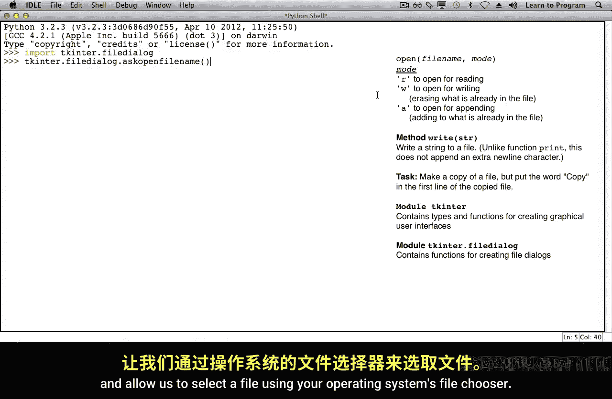
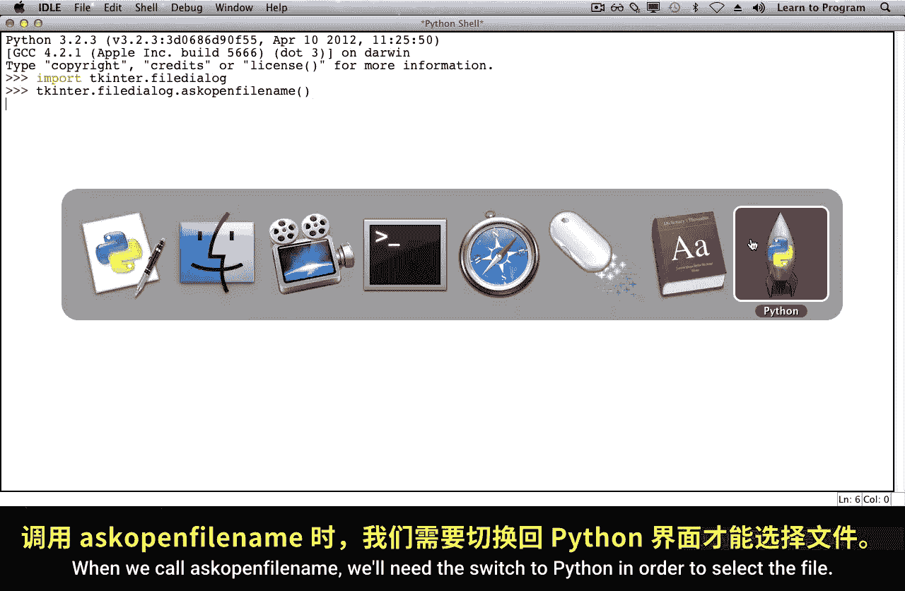
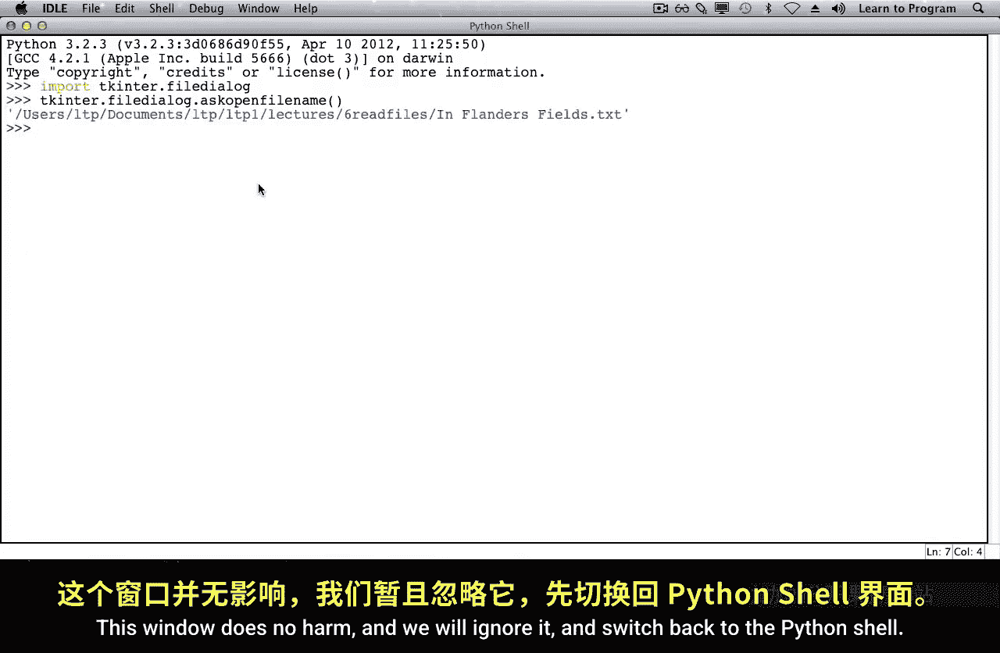
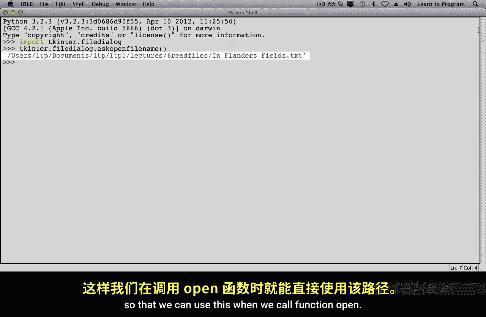
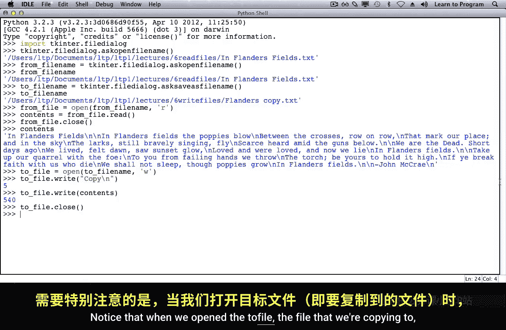
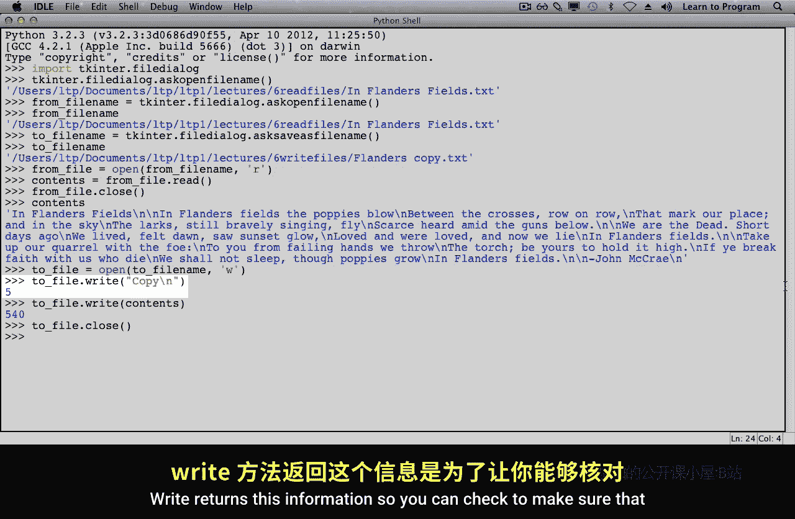
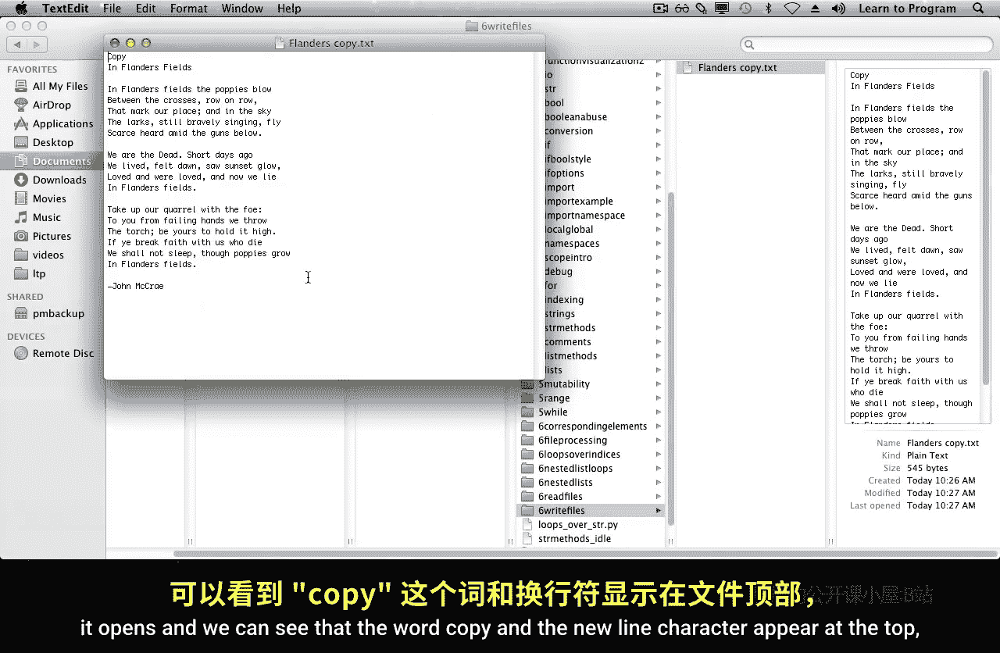
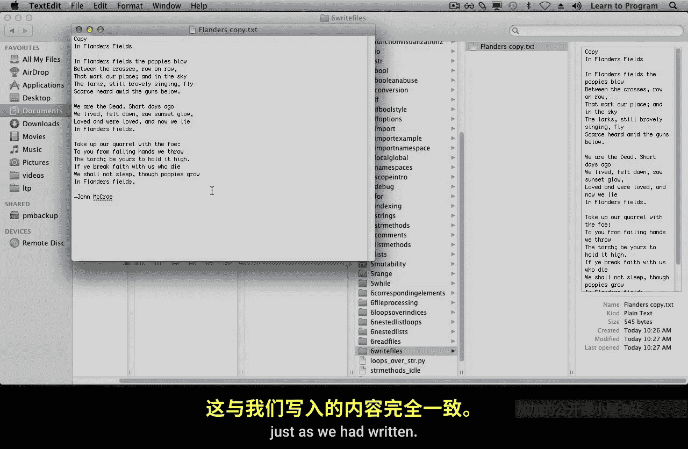

# 学习编程：基础知识：03：写入文件 📝


在本节课中，我们将要学习如何向文件中写入数据。写入文件的操作与读取文件几乎一样简单。我们将通过一个具体的例子，演示如何复制一个文件，并在新文件的开头添加一行文本。

## 概述

上一节我们介绍了如何从文件中读取数据。本节中我们来看看如何向文件中写入数据。我们将学习使用 `open` 函数以写入模式打开文件，并使用文件的 `write` 方法写入内容。核心操作包括打开文件、写入字符串以及关闭文件。

## 打开文件与写入模式

与读取文件类似，写入文件的第一步是使用 `open` 函数。该函数接收两个主要参数：文件名和模式。

*   **文件名**：可以是文件的完整路径，也可以是文件名（如果文件与程序在同一目录下）。
*   **模式**：指定文件的打开方式。对于写入，我们主要使用：
    *   `'w'`：写入模式。如果文件已存在，会**覆盖**原有内容；如果文件不存在，则创建新文件。
    *   `'a'`：追加模式。在文件**末尾**添加新内容，不会覆盖原有数据。

打开文件后，我们可以使用 `write` 方法向文件中写入字符串。需要注意的是，`write` 方法不会自动在字符串末尾添加换行符 `\n`，这与 Python 的 `print` 函数不同。

## 文件复制与修改示例



我们将编写一段代码，复制一个文件，并在新复制的文件第一行添加单词 “copy”。



### 获取源文件路径

首先，我们需要获取用户想要复制的源文件路径。Python 的 `tkinter` 模块提供了一个方便的文件对话框功能。

以下是导入和使用文件对话框的步骤：



1.  从 `tkinter` 导入 `filedialog` 子模块。
2.  调用 `filedialog.askopenfilename()` 函数。这会弹出一个系统文件选择器，让用户选择文件。
3.  该函数会返回一个字符串，即所选文件的完整路径。



```python
import tkinter.filedialog

# 弹出文件选择对话框，让用户选择要复制的文件
from_filename = tkinter.filedialog.askopenfilename()
```

执行上述代码后，会切换到 Python 界面并弹出文件选择器。例如，我们选择名为 `flanders_fields.txt` 的文件。选择后，函数返回该文件的路径字符串，并赋值给变量 `from_filename`。

### 获取目标文件路径

接下来，我们需要确定将文件复制到哪里，并指定新文件名。我们使用 `filedialog.asksaveasfilename()` 函数。

```python
# 弹出“另存为”对话框，让用户指定新文件的保存位置和名称
to_filename = tkinter.filedialog.asksaveasfilename()
```

执行这行代码会再次弹出对话框，这次是“另存为”对话框。我们可以输入新文件名，例如 `flanders_copy.txt`。如果指定的文件名已存在，系统会提示是否覆盖。函数返回新文件的路径字符串，并赋值给变量 `to_filename`。

### 执行文件复制与写入

现在，我们有了源文件路径 `from_filename` 和目标文件路径 `to_filename`。可以开始执行复制和写入操作了。

操作步骤如下：

1.  **打开源文件并读取内容**：以读取模式 `'r'` 打开源文件，读取其全部内容到一个字符串变量中，然后关闭文件。
2.  **打开目标文件并写入**：以写入模式 `'w'` 打开目标文件。
3.  **写入新内容**：首先使用 `write` 方法写入字符串 `"copy\n"`。注意，我们需要手动添加换行符 `\n`。
4.  **写入原内容**：接着，将之前读取的源文件内容字符串写入目标文件。
5.  **关闭目标文件**：完成写入后，关闭文件以确保所有数据都保存到磁盘。

```python
# 1. 读取源文件内容
read_file = open(from_filename, 'r')
contents = read_file.read()
read_file.close()



# 2. 打开目标文件用于写入
write_file = open(to_filename, 'w')

# 3. 写入第一行“copy”
chars_written1 = write_file.write('copy\n')
# 4. 写入源文件的所有内容
chars_written2 = write_file.write(contents)

# 5. 关闭目标文件
write_file.close()
```

**重要提示**：`write` 方法在成功写入后会返回一个整数，表示写入的字符数。例如，写入 `'copy\n'` 会返回 `5`，因为 `c`, `o`, `p`, `y`, `\n` 共5个字符。这个返回值可以用来验证写入是否按预期完成。



### 验证结果

完成代码执行后，我们可以在文件系统中找到新创建的文件 `flanders_copy.txt`。打开该文件，可以看到第一行是 “copy”，之后是原文件 `flanders_fields.txt` 的全部内容，这证实了我们的操作是成功的。

## 总结

本节课中我们一起学习了如何向文件写入数据。关键点包括：
*   使用 `open(filename, 'w')` 以写入模式打开文件。
*   使用文件对象的 `write(string)` 方法写入字符串，该方法**不会自动添加换行符**。
*   `write` 方法会返回成功写入的字符数，可用于调试。
*   操作完成后，务必使用 `close()` 方法关闭文件。
*   通过结合 `tkinter.filedialog` 模块，可以方便地实现图形化界面下的文件选择功能，使程序更友好。





通过复制文件并添加前缀行的例子，我们完整实践了读取、处理和写入文件的流程。