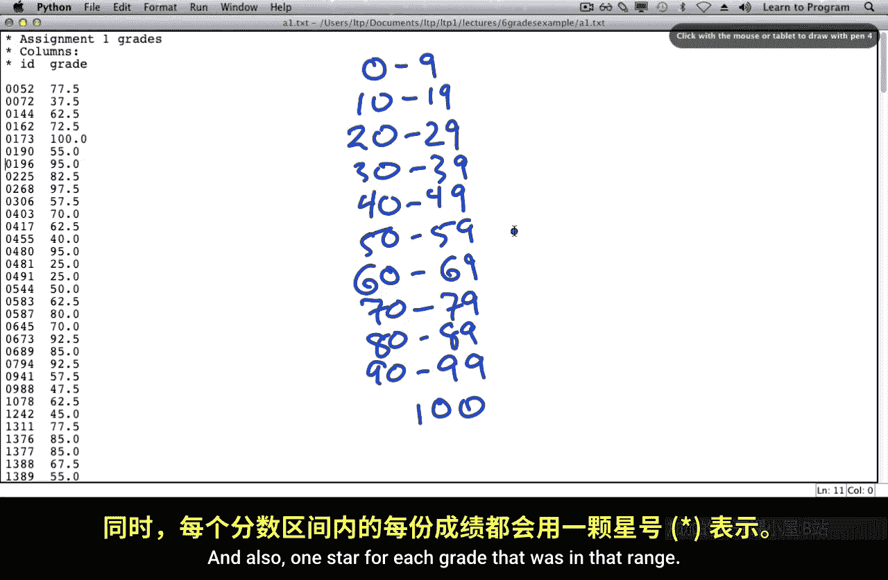
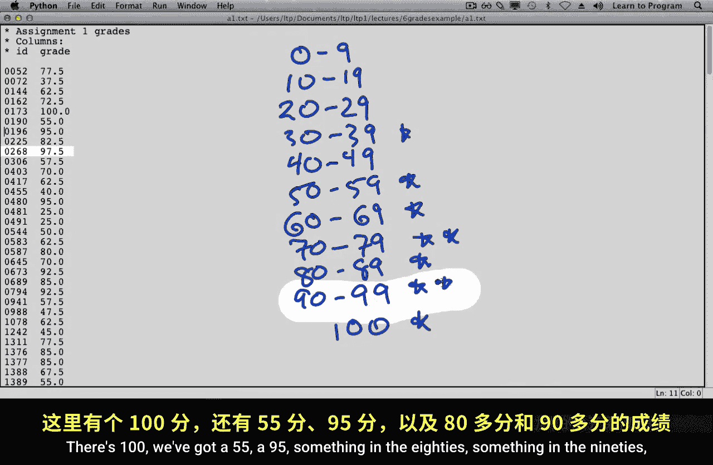
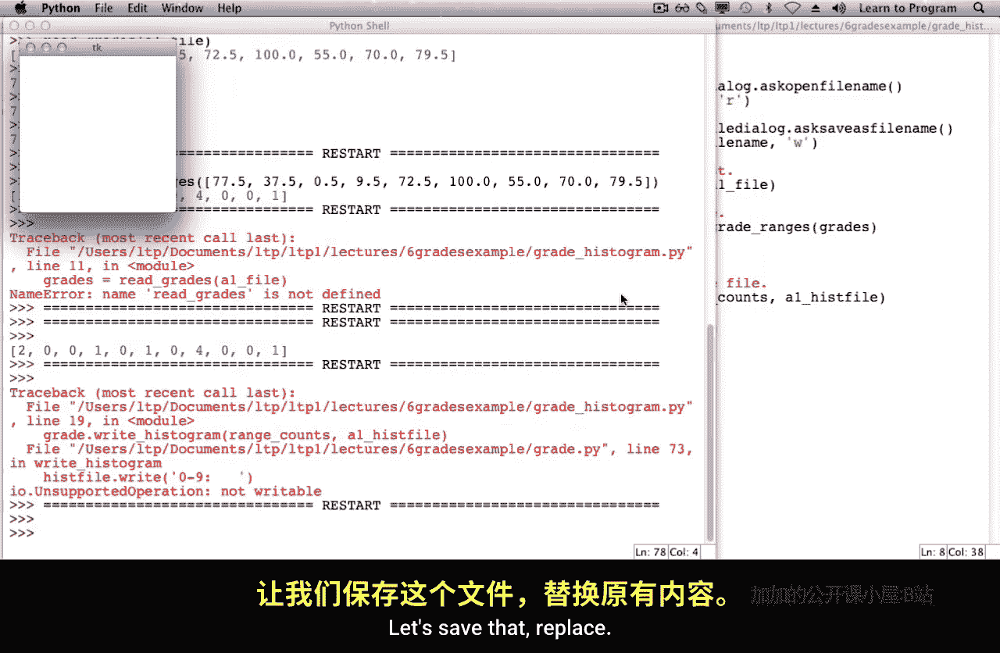
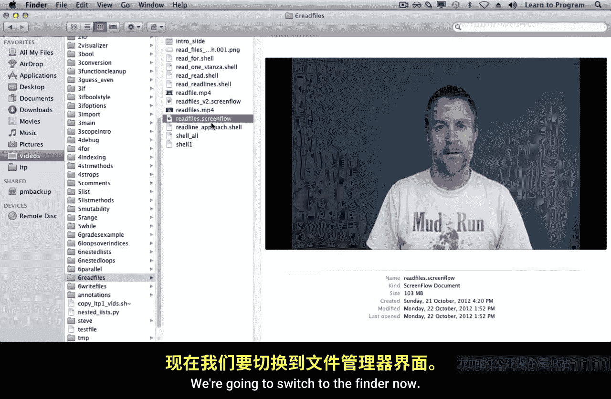
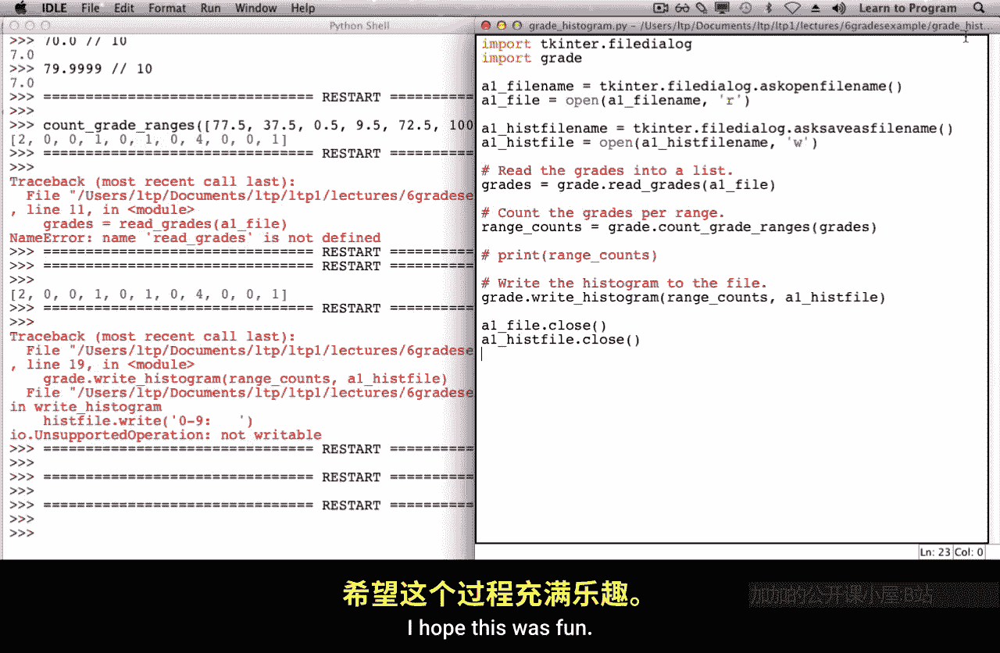

# 特伦托大学【中英⚡学习编程：基础知识｜Learn to Program： The Fundamentals】 p39 P39 01_开发一个程序 -BV1kQ11B5EWa_p39-

This lecture is huge。 However， it does not introduce any new Python tools。

 And so you can consider this to be optional， if you like。In it。

 I am going to be developing a program from the beginning。

I'm going to figure out what information I need to read。

 and I need to figure out how I'm going to store it and what functions I'm going to write。

 This is meant to give you a taste of the thought process that I go through when I write a program。

This file contains a bunch of assignment1 great。There is a header followed by a blank line。

 followed by a list of student number and grade on assignment1。

We would like to know the distribution of these grades， so。We're going to keep track of categories。

 How many。Ended up in the range 0 to 9。10 to 19。20 to 29， and so on。

And we will have also a category for the people who got 100。We ultimately， in this program。

 want to create a new file containing this information。And also。

1 star for each grade that was in that range。 So we see a 77。5。 That means that in our output file。

 we'd like a star there。 There's a 37。5。 That's in that range。

We see a 62。5。72。5 ser of two numbers in the 70 range so far， there's 100。We've got a 55， 95。

 something in the 80s， something in the 90s， and so on。

Eventually， we will have one star for each number in the file。

So that we can see the distribution of grains。In order to get a program that does this。

We need to do the following step。Step 1 is going to be。Read the grades。

And this is a natural list into a list。 It's a list situation。

 So we're going to read the grades into a list。 That's step 1。Step 2 is going to be。

Count the number of grades。Prange。And step 3 is going to be。Write the histogram。To the file。

Whichever file the user picks。This process of writing down the steps at a very high level。

 is called pop down design。When we first get a problem。

 it's often a bit overwhelming wondering how we're going to accomplish this the whole task。

 So we break it down into steps。Once we decide on how we're going to store our data。

We can do these steps in any order that we like， because they are roughly independent。

 and we can test each of them separately。Let's start a new program。And let's take some notes。

Get those scribbles down into text。Writing stuff out by hand， what we did here。

 just the example of the output that we want。 and then the list of steps that we think we need to take in order to get this program to work actually has a huge benefit。

 It allows you to step away from the programming environment。

 And just think about how you might solve the problem。This is essential。

 programs are just expressions of algorithms that you have in your head。

And if you figured out what you need to do， you'll have a much easier time writing the code。

Let's make a note。About the format that we want， we want zero to nine。And then。A star or2，10 to 19。

 We want those to line up。20 to 29， maybe。With that many。And so on all the way up to 90 to 99。

 which we want that outended。And then。The hundreds。Now that I have that。

 I can get rid of this crppus。We're going to be reading from files。

 and there' are going to be files that the user selects。

 We want this to work with any assignment file of this format， not just this particular file。 and so。

We're going to use TK enters file dial。We'll start by asking the user for a file and then just reading the file。

We now have variable A1 file name being what T K enter do file dial that Ascopen file returns。

 So let's open the file。We're going to for line an a1 file， just print the line。

 just make sure that we are in good shape。This process of checking frequently about how our programme is doing is a very good habit to get into because it allows you to catch syntax errors and logic errors early before you've made a mess of things。

So weve run the module。Can we see invalid syntax。 Oh， yes。Wrong kind of print statement。

 That was in my old Python 2。7 days。Now save that and try one more time。

I've made a shorter braids file just so that we don't have to work with so many numbers at once。

And I have a type error。The problem here is that I'm usingco and file instead of Asco and file name。

 Ascopen file actually opens the file for you。I like to do it in two steps because I think it's more explicit for people who are just learning how to program。

I'll select run， run module， again。It has us。Pick our input file and few。 We have it。

 This file has about maybe 9 grades in it。This process of running frequently has found two errors early on in only my six or so lines of code。

And yet， it's going to have saved me a ton of time later on when I have a hundred and 50 lines of code。

 If I had tried to wait until I had most of the programme written。

I would have been much less clear about where I needed to go to look to see where my problems were。

I can get rid of these lines of code now， because。I know now that I have my file open for reading properly。

I need to do the same thing with my histogram file。To need better names for the histogram file。

 that seems。为什么不？嗯。I like to keep my main program separate from the functions that I rely on in my main program。

 So just like with assignment 1 and assignment 2， I will start a file just to contain the functions。

Ill call it grade dot po。And I know I'm going to have to import it。

My steps are reading the grades into a list， counting the grades per range and writing the histogram to the file。

We will start。With reading the grades into a list。Because I'm reading from a file。

 it's hard to get an example。So we'll start with the type contract。

I know that I have a file open for reading。And I know that it's going to return a list and that these。

 all these numbers in this file are floats， so。It's a list of float。Yeah。Ex space there。

 Get landdentation proper。And what this is going to do is read and return the list of grades in the file。

Well， I need a header。Read grades is what I'm doing。 It's a nice verb phrase。 And I'll call this。

Crety file。So， now， I can。Finish up my doc string grade file。 There we go。

I need to know that this file is in the right format。

So a precondition to calling this function is that。Card file。Great file。Starts with a header。

No blank lines。Then has a blank line because I need to be able to skip that header。

And then I need to know that the each line is in this format where there's a student number and a grade。

In order to accomplish this， I first need to skip over the head。And then， read the grades。

Accumulating them。Into a list。On following the same top down approach。

 I'm writing out the steps that I need to do in order to accomplish this smaller task。

But it's the same approach， the same top down design。In order to skip over the header。

We will read the first line。 and then as long as that line is not the new line character。

 I need to read the next line。Now， I have just read the blank line。 So now I need to read the grades。

 Acccumulating them into a list。 Well， I know I'm going to be reading that first grade。And then。嗯。

As long as what I read， as long as I haven't reached the end of the file， and I read it like that。

 if you recall， while line is not the empty string， then I want to do the same thing。 I want to。

Do grade file that read。So this is going to read every line in the rest of the file。

What I need to do now is into this pattern。 I need to accumulate the grades。

In order to make that happen。I need that my accumulator ver。 I'll start off with an empty list。

 This is going to contain all of the grades in the font。As long as I haven't reached the end。

 I know I have a grape。 So now we have a string。Containing the information for a single student。

We're going to find。The last space in the line。 That's the space right before the number。

And extract only the rest of the characters after that。

 So find the last space and take everything after that。Space。Well， I know that。Line dot R find。

 finds from the right。So I'm looking for the rightmost space。

 That gives me back the index of the rightmost space in the line。I would like to slice the line。

 starting at one past that position， the first digit and go up until the end of the string。

 So this will extract。That for me。Well， save that in a variable。I have the number。

 but it's currently a string because line is a string。 And when I slice， I get a string， so。

When I appended to my grades list， I would like to turn that into a float。I think we're almost done。

I have my list of grades， now。And so that。Is what I'm going to return。Let's try it out。

I'm going to run this so that I have access to re grades in the shell。I'm going to。不是。

I'm going to ask for。T K entered out filed viy to import this。I'm going to ask for a file。

We will take our test file。Now， I。Need to come here and open that file。And， finally。

I'm going to call read grades on that open file。This is going to return to me。 hopefully。

 a list of the floats that we see on the screen here。And it looks like we have all of them。

With that quick test。I think I'm ready to call read grades from my main program。 Now。

 I know how to read the grades into a list。Yeah。The next task is to count the grades for each of the the range categories that we see here。

屌。Let's go start designing it。With this one， we actually can have an example。

We have to decide what we're going to call this。There may be great ranges。

 We can always change our mind later， and。We now know that if we give it a list like this。

We actually have an example of this。 What we would like it to do is maybe return a new list with the counts。

So we know that we have how many zeros。 we've got two in the zero to9 point something range。

We have nothing in the 20s。W。We have one number in the 30s。 We have no numbers in the 40s。

1 number in the 50s，2 numbers，1，2，3，4 numbers in their 70 ring。No， 80s。No 90s and 1，100。

 So this hopefully is what we're going to be able to return。 We're going to 0。 There's 1，2，3，4，5，6，7。

8，9。0，1020。Wop some off by one。Zeros。No tens， no 20s，1，30， No 40s，1，50， No 60s，470s， No 80s。

 no 90s and 1，100s。 So 2，3，4。8，9 numbers，1，2，3，4，5，6，7，8，9 numbers。

 So I think I've constructed my example correctly。I'm going to move this over here for just a minute。

 so I can examine。对。Histogram here， so。This is the histogram that I ultimately want。

 And what I've seemed to have decided here is that at index 0。

 I'm going to count all the numbers that are in range 0 to 9。At index  one。

 in my result of this grade ranges function。 I'm going to count the number of。Ts number of 20s。

 number of 30s and so on， and。Index 0 is the zeros。 Index 1 is the tens。 Inex 2 is the 20s。

 index 3 is the 30s。 So I seem to have the index number be the first be the tens digit，30s。

40s at index 4，50s at index 5，90s at index 9，100s at index 10。 So， yes。

 that does seem to be what I'm getting。Understanding this data representation。

 how I'm storing information and what each index means and how it corresponds to these ranges here。

Is going to， again， save me a ton of time later on when I try to implement this function。

I'm going to grab this here， and I'm going to take a few notes about what I just figured out。

0 to 9 is index 0。 This is index 1。 This is index 2 and so on。 This is index 9， and this is index 10。

 in my result。Well， I seem to be giving it。系。Fix that there。

 I seem to be giving this a list of float， and it's giving me back a list of itt。

And this seems to be returning a list of。In where each index in。Indicates how many。

Gras were in these。Ranges。Grade ranges doesn't seem to quite capture the idea。

 So I'm going to put count grade ranges。Takes in the list of rates。

That means I need to change my example。Here。And that does seem a better verb freeze。

My result is 11 numbers long。And I want to keep track of this count。 So range。I going to be well。

 they all start off at zero。So this will give me a list of length 11 of hints that are all zero。

 and I'm going to update this as I look at each number。

And I need to figure out how I'm going to take that 77。

5 and just get that first the tens digit there so that I can use that as an index into this range counts list。

Any number from 70 up through 79。9 should end up with just the 7。

 So I'm going to come over here and experiment a little bit，77。5 and just divide by 10。

 I'll end up with 7。75。 I want to get rid of that。75。 So I'll use the the。Other form of division。

 where I throw away the fractional portion。Does that work if I just have a 70。Yep， how about a 79。9。

Good。😡，Coming back to my programme， that means that once I have a grade from my list。

 I want to use this division， and then I'm going to be using that as an index into range count。

 So I need to cast that result to an end。For each grade in the grades file。

I need to know which range I want to add one to in range counts。Well。

 I had just figured out that I can take that grade。

And divide it by 10 and turn that result into an int。

 So this will tell me the index into the range count list that I want to increment。

 So range counts is。opR counts at index。 which range。Is what was there。Plus， one。

After I've looked at all of the grades。I'm done。So I'll just return that list。It's time to test it。

 So let's grab that list there。Run this module。Call this。And compare。2，0，0，1，0，1，0，4，0，0，1， awesome。

😊，Two steps down，1 to go。I know in my main programme here that I want to count the grades per range。

 I now have a lovely little function to do that for me。

 So range counts is going to be what I get back from count grade ranges。Passing in greats。

Let's try it out。All we're going to do is print range counts and see how we see whether we seem to be making progress。

 Let's go to run， run module。It says， O， which one do we want to open We open our test file here。

And where do we want to save it， Well， I'm going to eventually save it in A1 test dot his his for histogram。

 But we're not actually writing anything to that file。

 but I still need to select it because I was asked to do so。

And it says name readed grades is not defined。 How can that be。I see。 I need to。Use these。

Through the name of the module。I also noticed that I want to ask save as file name。

 because this is the output file。Let's restart it that。

Kills our Python programme so that's not hanging around and we'll try one more time。

OrAsked for our input file。 There it is。Were asked for our output file。 We'll chooseose that one。

 And it says， are you sure you want to do that， check my name。 That is the 1 I want to place。

We get the same list printed here。 So our main program is now working so far。

NowThat I have my list of counts for each range。It's time to write the histogram to the file。

 I'm done with this print statement， so I will comment it out just in case I need to uncom it later on。

Come back to my function file。 I am storing on my functions' end。I need to write the histogram， so。

防问员。Design process。I know that I'm going to call it and pass in that the grade range list that I have generated。

 So I get the this range counts information and also the file that's been opened for writing， so。

I know that I've got a list event。And a file open for writing。Doesn't return anything。

All it does is it writes the file。Histogram。Of stars。

having trouble pipe in the day of grades in each range。

Wonder if it's frustrating watching me make these mistakes。Well， I have an example of。

The output that I want。And I'll just paste this so that。

Whoever calls help on this can see what is expected。What does this do It bites a histogram。 So right。

Itagram seems a reasonable mate。I know this is the range counts and that we。

Have a histogram file that we're going to be right。

The first line of output and the last line of output are slightly different。

 There are more spaces after the number。 I want these to line up。 So I want these stars to line up。

 So when I print the first line and when I print， I just write the last line。

 I need to write a few extra spaces。 So I'm going to deal with them separately。Here we go。

We first want to write。0 to 9。And then we want to write how many spaces，1，2，3。

Wright does not put a new line character at the end。

 which is good because now I want to write some stars。So I know I want to write some stars。

 and how many are there。 Well， it's， however many。Grades were in that range。

So we're going to multiply the asterisk by whatever is in range counts at index 0。

 which is the number of grades that were in the range 0 through 9。

I then want to start a new line because， as you can see。

 the 10 through 19 grades appear on the next line。I'll take care of the other special case， now。

And here， we want to write。100。And rather than range counts at index 0。

 it's actually range counts at the last index that'll give me the number of 1 hundred0s that were found in the file。

In between， I want to write one line for each of the indices，1 through 9， so。Or I in rain。啊。1， up to。

 but not including 10。 And what does this do。啊 thisす。Writes the two digit ranges。1s，20s。

30s and so on。I need to figure out the low number and the high number for the current range。

 So when I is 1， I need to figure out the whoops， the 10。And the 19th， when I is 2。

 I need 20 and 29 and so on。 So the low index is just。I times 10。The high index is。I times 10。Plus 9。

 just to check，9 times 10 is 90 plus 9 is 99。 So that'll work for 90 as well。 So yep。

 that seems to give me the low and the high。I'm going to。Right。Low， but I need to give it a string。

 So low。Stir of low plus the hyphen in between the low and the high。And then。Hi。Followed by。

A colon in a space。Once I've written that。Then it's time to write thee。Esters。

So I want to multiply that by range counts at which index will index I。And， finally。

I want to write the new one。Tests this in one of two ways。

 I can do what I was doing before and run this and then come up with an example of range counts and a an output file and make sure that that file is written。

 but。This is the last step in my program。 So I actually can do that here。 Now。

 I've got this information elsewhere。 So I'm going to delete it。What I want to do now is。Yeah。

Write the histogram with。The range counts。 and my。But file， which is a one hist file。

I verified that my program seems to be working so far。

 I can just run this in order to check to make sure that this new function does what I want。

We'll try our A1 test， dot T X T。And we want to write it to a1 test， do hist。Yep。

 we want to replace it。哦哦。I have a not rightriable problem here。

It seems to be saying that when I call histophil thought right。

 it says that that is an unsupported operation that histile is not writeriable。

And that makes sense because I opened it for reading because I copied and pasted and forgot to change that。

Let's run this one more time。There's my test input。 No， I don't want to write my programme there。

 Let's save that replace。Okay， no errors。

We're going to switch to the finder now。 there I am。 Don't look。

哼。Gras examples。 And I just wrote a one test， gott hist。Will'll open this in。Texted it。

And it's empty。Now I need to go find out why。Let's go back and take a look at the program。

Oh， I think I forgot to close my files。If you don't close your files。

 then the data may not be written right away。We'll try one last time。And back， see how we did。

And there's our information。Let's try running it。On our larger gaifier。A1 dot T X T is our large one。

And we will save it to a1 hist。Yeah， I'd like to replace that。Switching back to the finder。

He went hised。 aha， beautiful。 Look at that。And that is really kind of how I write programs。

I start out at the very beginning with only a vague idea of what I want。

 and I have a bunch of decisions to make。 What are my steps。

 What data am I going to be storing and how am I going to be storing it。

 And which order am I going to write my functions in and how am I going to test them。

I hope this was fun。

