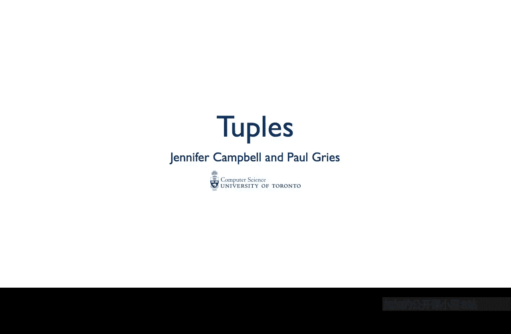
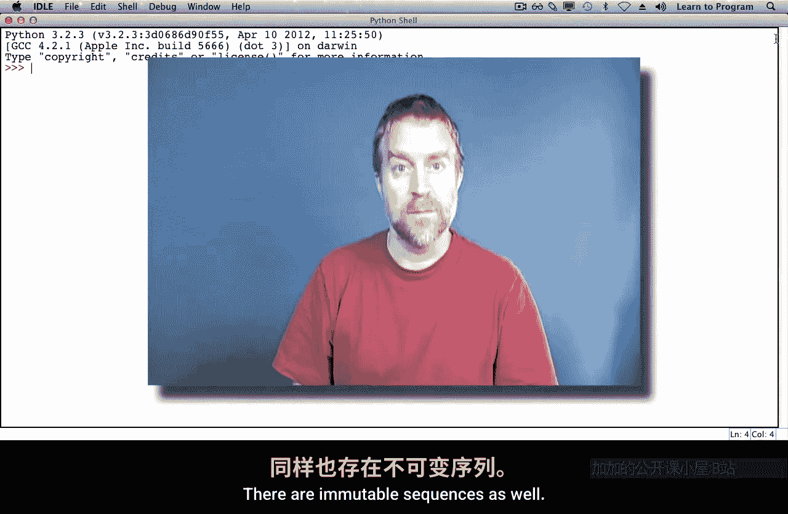
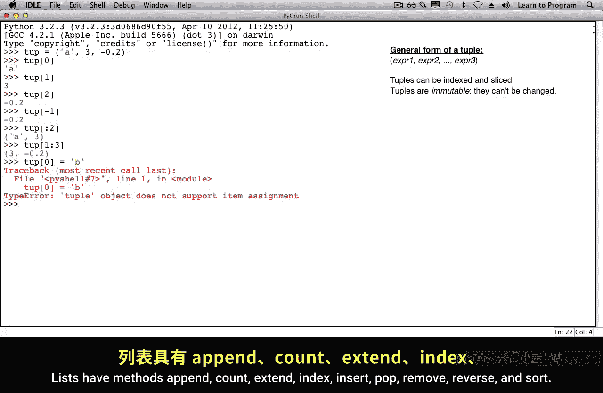
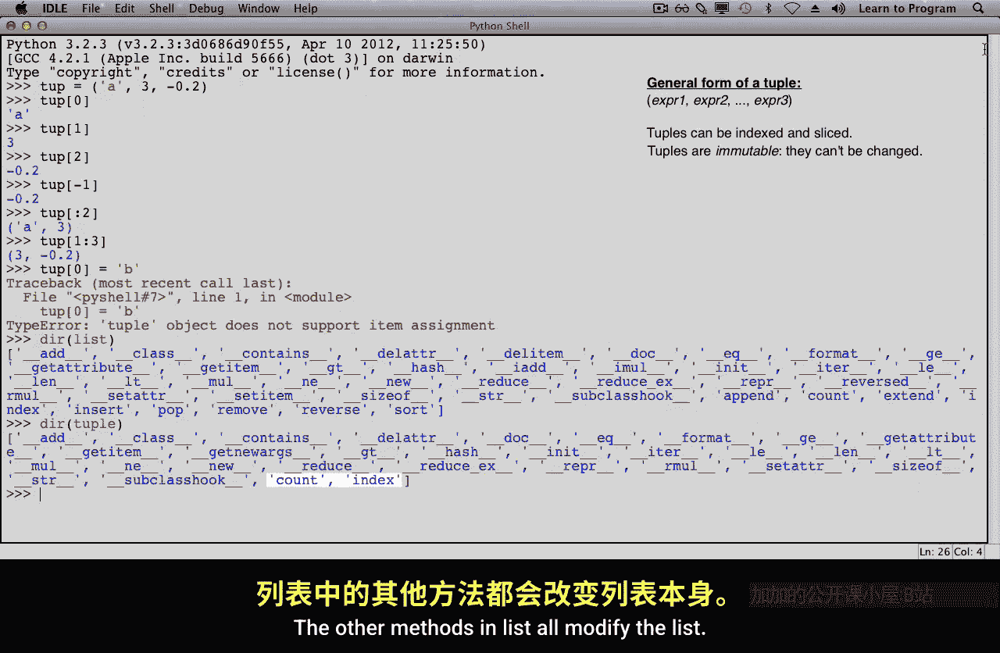
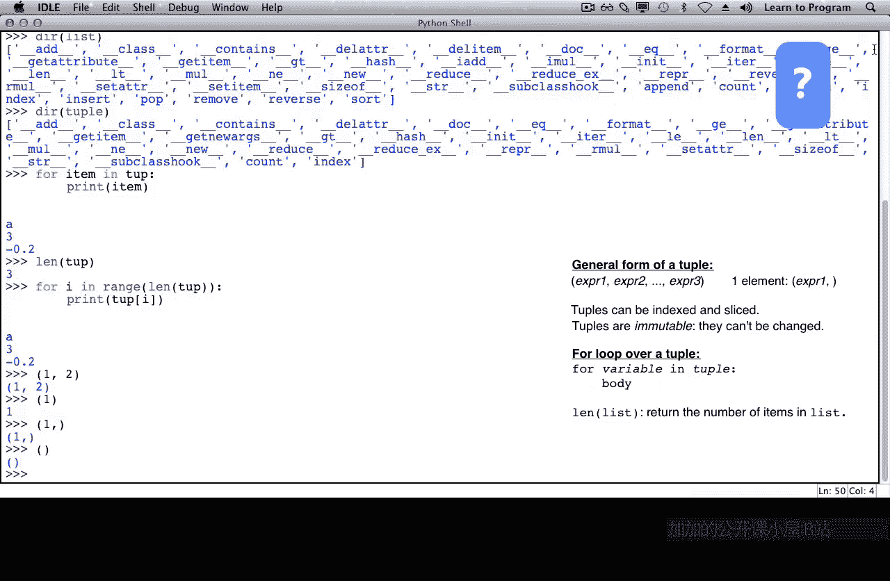

# 特伦托大学【中英⚡学习编程：基础知识｜Learn to Program： The Fundamentals】 p40 P40 01_元组 -BV1kQ11B5EWa_p40-

Lists are mutable sequences。 There are immutable sequences as well。 These are called ps。

Here we create a tuple with a3 and minus 0。2 in it， and we assign it to variable top。

Tuples and lists use the same index notation here。 we look at tuple at index0， index 1， index 2。

And also， we can use negative indices such as cup at index -1。Slicing a tuple produces a tuple here。

 We slice top up through， but not including index 2， and we can also slice top from index 1 up to。

 but not including index 3。We cannot change a tuple。 Tples are immutable。

Assigning into a tuple produces a type error。 Tple object does not support item assignment。

Listists have methods append， count， extend， index， insert， proper moveu reverseverse and sort。

 but couples only have count and index。 The other methods in list all modify the list。

Like lists， we can iterate over the items in a coupleple。Function L works on tuples。

We can iterate over the indices of a couple。To create a couple。

 put a comma separated list of values in between parentheses。What about one element Tuples。

 If we just put a value in between parentheses that just says parenthesize this mathematical expression。

 and it gives us back the value。To create a one element tuple。

 put a comma after the value inside the parentheses。Empty couples do not require this comma。

