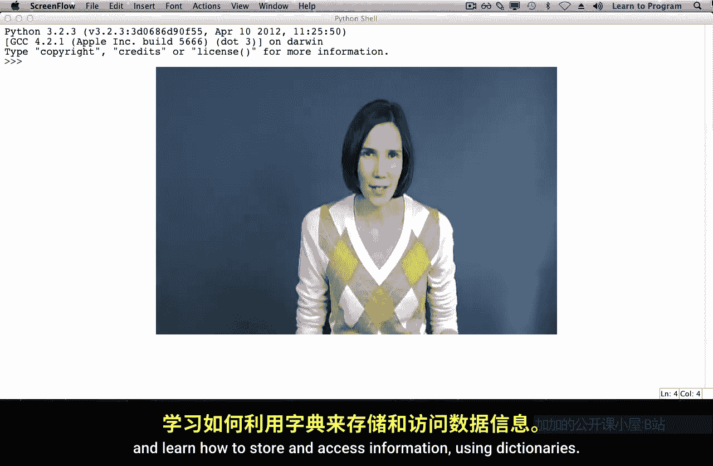
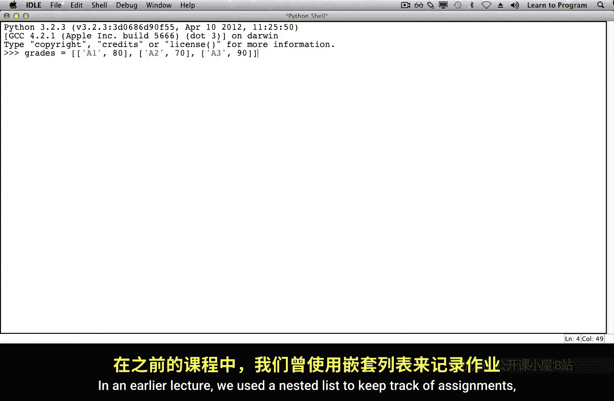
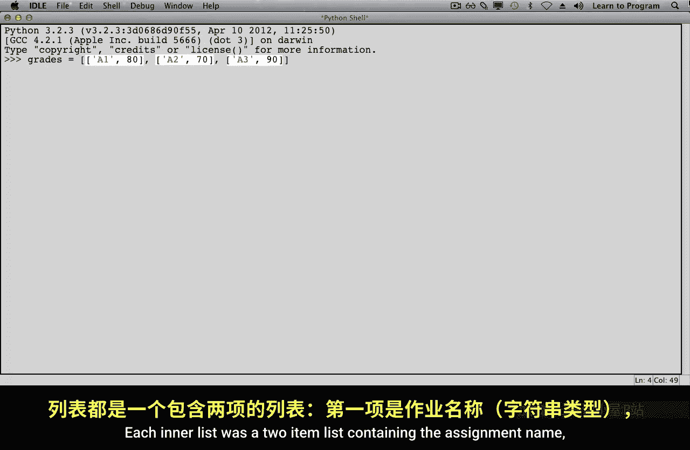
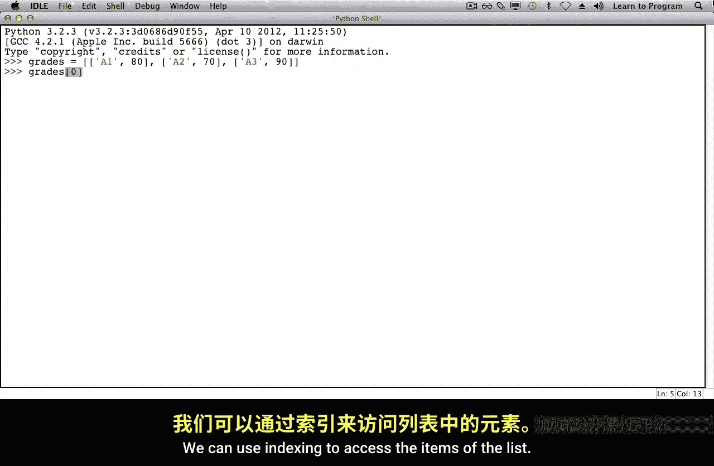
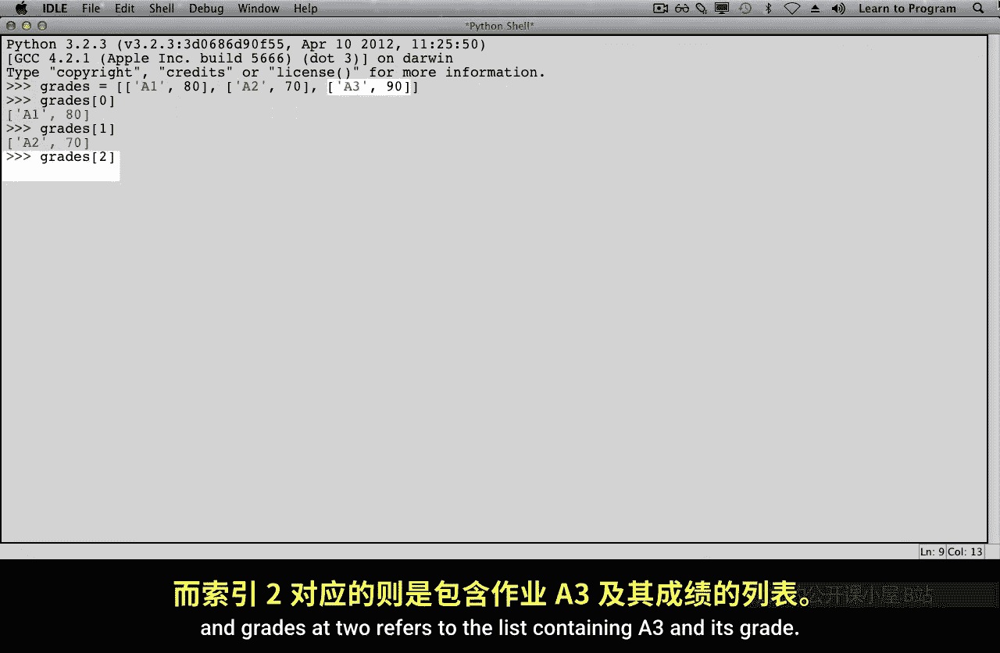
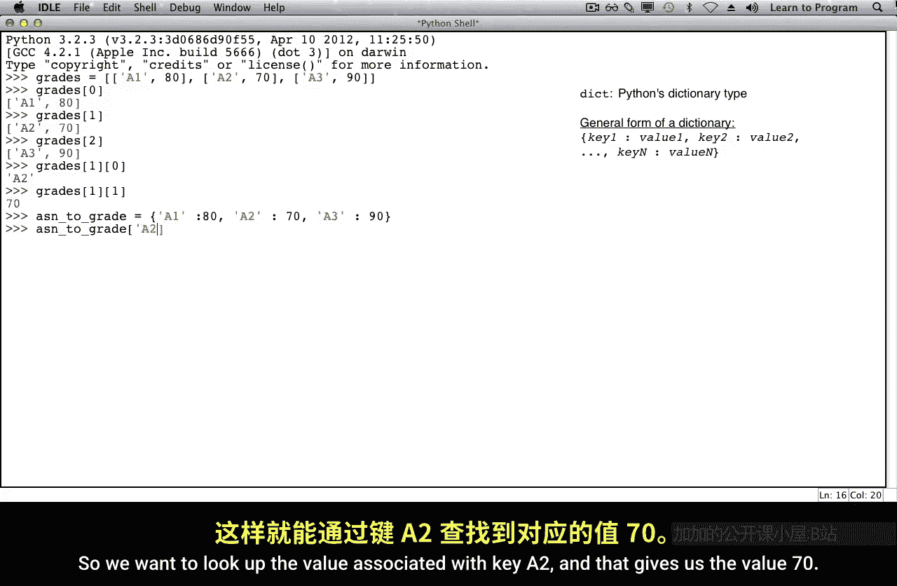
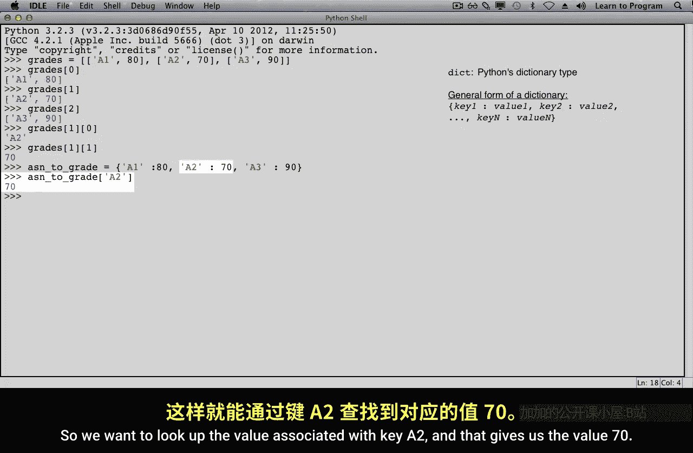
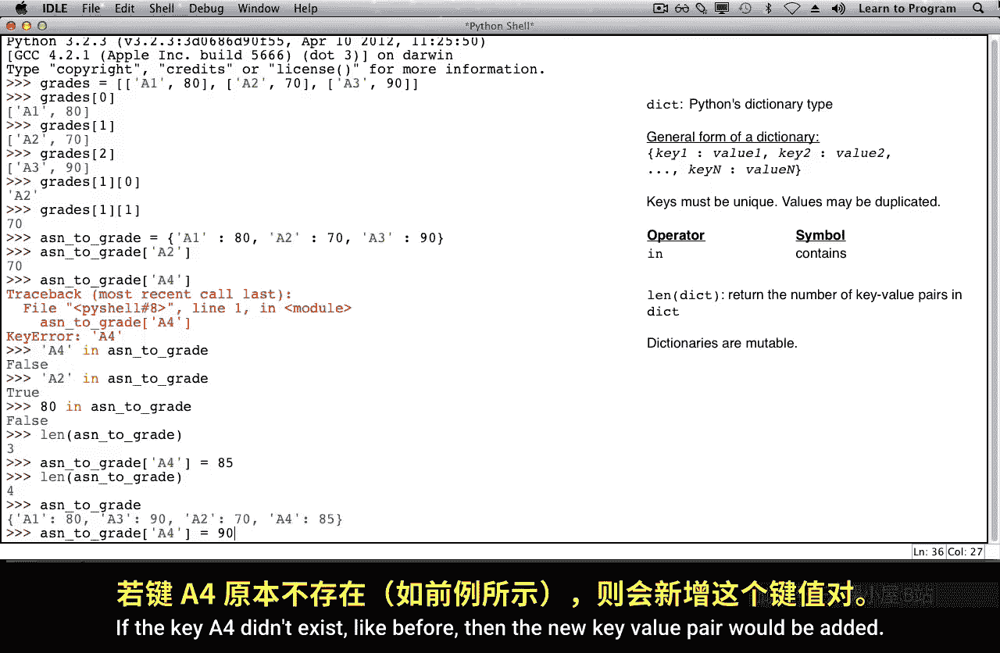
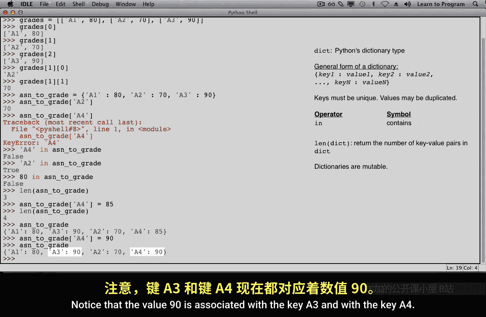
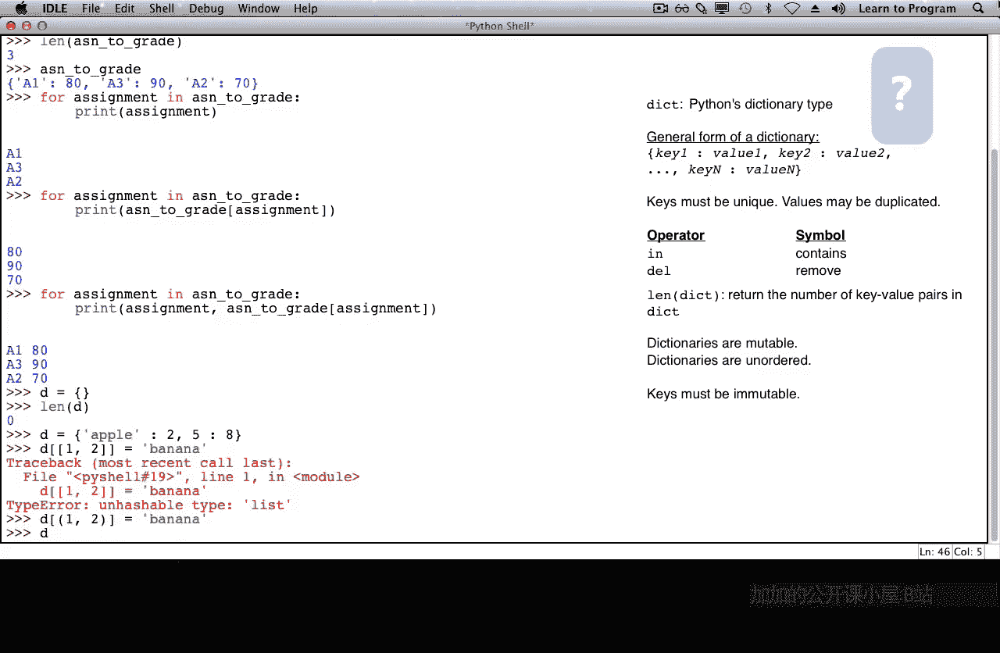

# 特伦托大学【中英⚡学习编程：基础知识｜Learn to Program： The Fundamentals】 p41 P41 03_类型字典 -BV1kQ11B5EWa_p41-

We have stored collections of data using lists and have used indices to access the items of lists In this lecture。

 we will explore Python's dictionary type and learn how to store and access information using dictionaries。

In an earlier lecture， we used a nested list to keep track of assignments and grades on those assignments。

Each inner list was a two item list containing the assignment name， a string， and a grade。

 which is a number。

We can use indexing to access the items of the list。

Graadedes at 0 refers to the list with a 1 and its grade。

 grades at1 refers to the list containing a 2 and its grade。

 and grades at 2 refers to the list containing a 3 and its grade。

To find out the name of a particular assignment， we need to use the first index of that two element list。

 So， for example， to find the name of the assignment for grades app index 1。

 we use index 0 to get the name。To access the grade associated with that assignment。

 we use index1 of the inner list。We will now use a dictionary to store the same grades information。

 and we'll see that accessing the mark associated with a particular assignment is going to be simpler when working with the dictionary。

The variable assignment to G will refer to the new dictionary。

And the notation for a dictionary is braces。Each entry of a dictionary has two parts。

 and the two parts are separated by columns。嗯。嗯。This dictionary has three key value pairs。

A1 is a key。A2 is a key and A3 is a key。80 is a value， it is the value associated with key A1。

70 is a value。 It is the value associated with King A2。And 90 is a value。

 It is the value associated with key A3。To look up the grade associated with assignment A2。

 we can use the bracket notation that we used with the nested list。 However。

 rather than put an index between the brackets， we will put a key。

So we want to look up the value associated with key A2。

And that gives us the value，70。

This notation for looking up a mark associated with an assignment is much simpler than the two indices needed to look up the mark associated with an assignment using the nested list。

However， it reveals something about dictionaries in order to be able to look up a particular value associated with a key。

 That key must be unique。 It can only occur once in the dictionary。So assignment names A1， A2。

 and A3 are unique names。The marks associated with those assignments or the values of the dictionary could be duplicated。

 So it's possible that a 1 and a2， those keys could have the same value， say 80。

If we try to access a list at an index that does not exist， an error occurs。

And the same is true for dictionaries if we try to access a dictionary using the key that does not exist。

Then a key error occurs。 The key A 4 is not present in the dictionary that assignment to grade refers to。

Before accessing a key of a dictionary， we can check for its existence in the dictionary。

 so we could have checked to see whether A4 is in assignment to grade。

It's not so false is the value that that expression evaluates to。Of course。

 A2 is a key in the dictionary， so this expression will evaluate it to true。

This in operator is checking for the presence of keys， not values。

 so if we check whether  AD is in assigned to grade。This expression will also evaluate the false。

 since 80 is not a key in that dictionary。Currently。

 there are three key value pairs in the dictionary。

The lens built in function returns the number of key value pairs。Like lists。

 dictionaries are mutable。 That means that key value pairs can be added to a dictionary。

The value associated with a key could be changed， and key value pairs can be removed from a dictionary。

Let's start by adding another key value pair to this dictionary。We're going to add the assignment A4。

And we indicate this using the same bracket notation that we use to access the value at a particular key。

But we use it in conjunction with an assignment statement。

 So the dictionary that assigned to grade refers to will get a new key A4。

 and the value associated with that key is 85。The L function now returns four because there are four key value pairs in assigned to grades。

嗯。Using the same notation， we can also update the value associated with a key。So for key A 4。

 we're going to change its value now from 85 to 90， because a 4 already exists in the dictionary。

 This becomes a change。 If the key A 4 didn't exist like before。

 then the new key value pair would be added。

He A4 originally had the value 85 associated with it， and now it has the value 90 associated with it。

Notice that the value 90 is associated with the key A3 and with the key A4。

Values can be duplicated， as mentioned before， but keys cannot。Now。

 let's remove a key value pair from the dictionary To do this， we will use the operator Dell。

 and then the dictionary reference。And the key using the same bracket notation。

 So we'll move remove key A 4。Along with its value from the dictionary。

The dictionary's length is now going to be three。Okay。

And the dictionary no longer has the key value pair， A4 and 90。

We can use a for loop to loop over the keys of a dictionary。

 like we did to loop over the characters of a string or the items of a list。

Because we're looping over the keys， the variable name that I'm going to choose here will be representative of the key of the dictionary。

 I'm going to use the word assignment for my variable name for each assignment in the dictionary。

 assigned to grade。We'll print that assignment to that key。The keys， A1， A3， and A2 are printed。

However， this doesn't match the order in which we added the key value pairs to the dictionary。

 We put a 1 in its value first， then a 2 with its value and a 3 with its value。

The order that key value pairs are added to the dictionary has no effect on the order in which the for loop accesses the keys。

Therefore， when looping over the keys of a dictionary。

 we cannot rely on the keys being accessed in any particular order。 In this case。

 we can't rely on a1 being printed before A 2 and a 2 being printed before A 3。This time。

 rather than printing the keys of the dictionary， let's print the values。

All of the four loops that we write over dictionaries will be loops over the keys。

 so we're going to leave the header exactly the same。Rather than printing the key assignment。

 we'll look up the value associated with that key in the dictionary and print that value instead。

The values 80， 90 and 70 are printed。And finally， let's print both the key and the value。

When we call print， we can pass two arguments。The key assignment。

And then the value associated with that key。That prints each assignment and the mark associated with it。

Our introduction to dictionaries is almost complete。

 but there are a couple more important things to point out。 First， a dictionary can be empty。

 and we use just the opening and closing braces to indicate this with nothing in between。

 the length of an empty dictionary is 0。Finally， we need to make an important note about the types that the keys and values of a dictionary may have。

Keys and values can be of different types， so we could have a string for a key。

 and another key could be an int。However， the type of keys must always be immutable。

Since lists are mutable， a list cannot be used as a dictionary key。This assignment statement。

 which attempts to add a list with numbers 1 and 2 as a key， along with a value banana。

 will result in an error。When we want to use a sequence as a key， rather than using a list。

 we can use a tuple because tuples are immutable。The following is acceptable。

