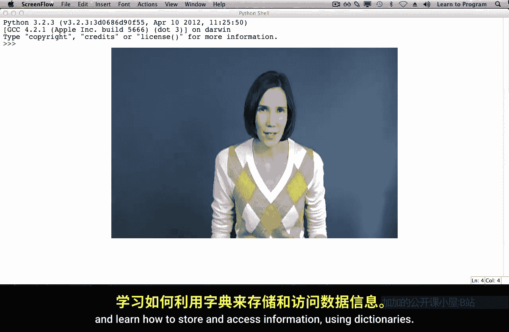
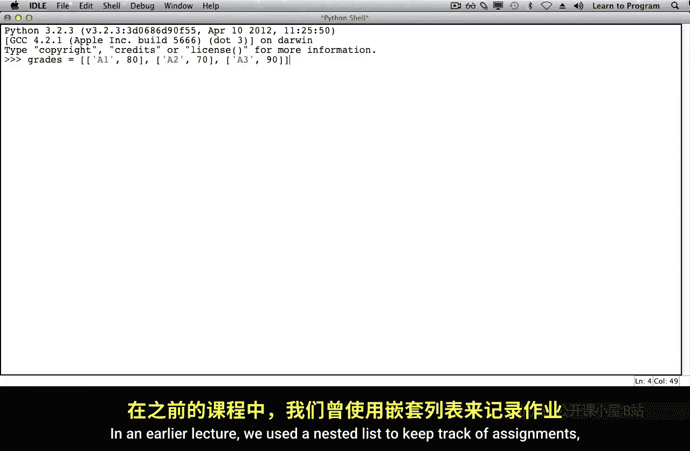
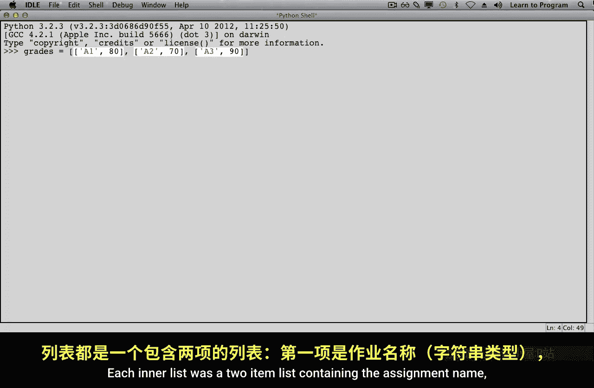
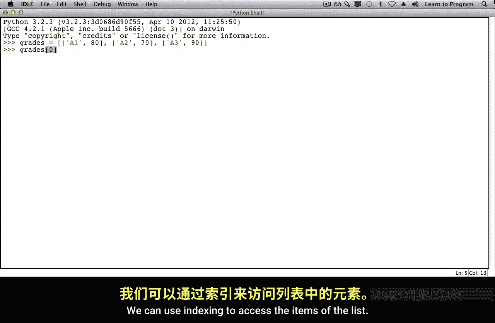
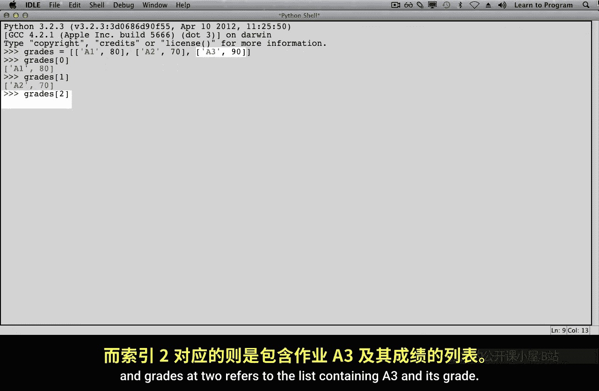
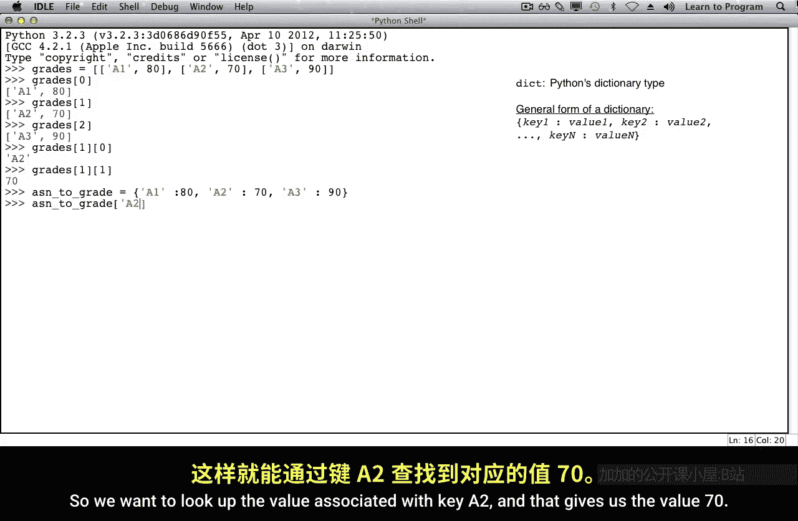
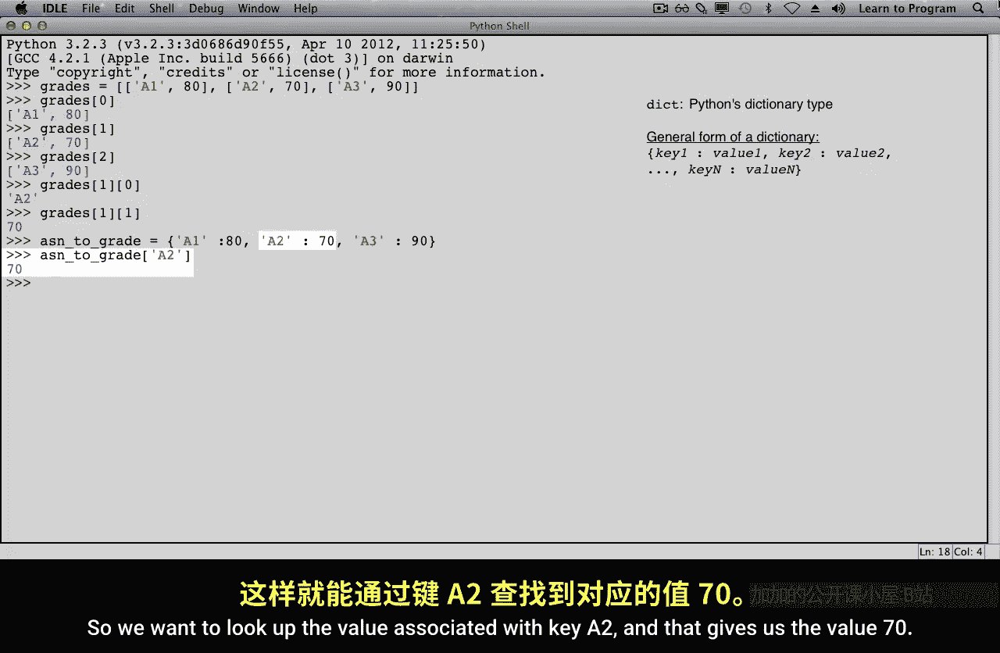
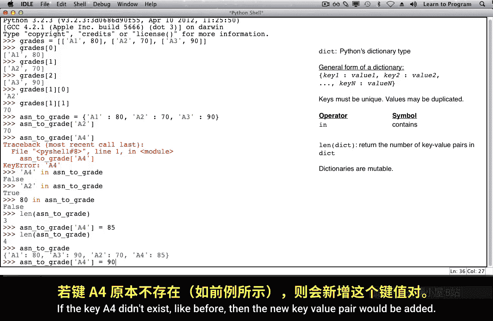
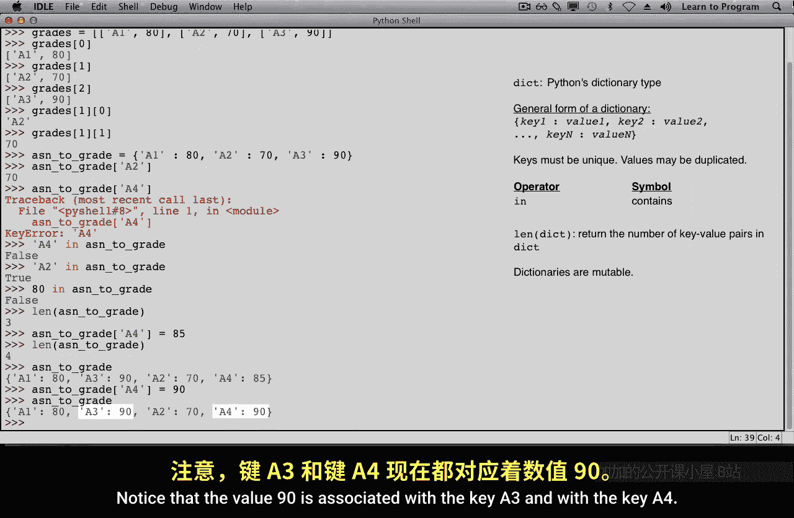
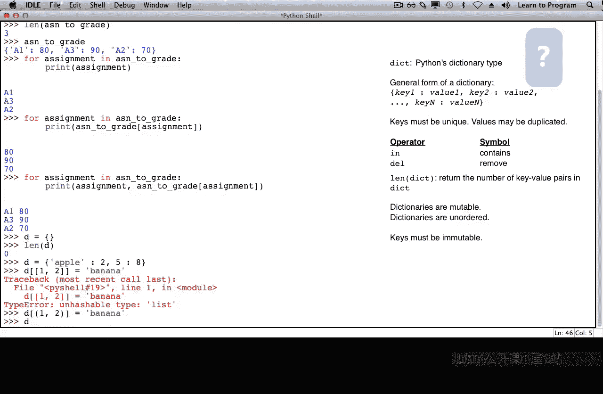

# 学习编程：基础知识：03：类型字典 📚


在本节课中，我们将要学习Python中的字典类型。我们将探索如何使用字典来存储和访问信息，并比较字典与之前学过的列表在存储数据集合时的不同之处。



## 概述

之前我们已经学习了使用列表来存储数据集合，并通过索引来访问列表中的项目。本节中，我们来看看Python的另一种数据结构——字典。字典提供了一种通过“键”来存储和查找“值”的更直观方式。



## 从列表到字典



在之前的课程中，我们使用了一个嵌套列表来记录作业名称及其对应的分数。



```python
grades = [['A1', 80], ['A2', 70], ['A3', 90]]
```



每个内部列表都是一个包含两个项目的列表：作业名称（字符串）和分数（数字）。我们可以使用索引来访问列表中的项目。例如，`grades[0]` 指向包含 `A1` 及其分数的列表。要获取特定作业的名称，我们需要使用该双元素列表的第一个索引。例如，要获取 `grades[1]` 的作业名称，我们使用索引 `0`。要访问与该作业关联的分数，我们使用内部列表的索引 `1`。

现在，我们将使用字典来存储相同的分数信息。我们将看到，在处理字典时，访问特定作业的分数会变得更简单。

## 创建字典

变量 `assignment_to_grade` 将引用这个新字典。字典的表示符号是花括号 `{}`。字典中的每个条目都有两部分，由冒号 `:` 分隔。

```python
assignment_to_grade = {'A1': 80, 'A2': 70, 'A3': 90}
```

这个字典有三个键值对。`A1`、`A2` 和 `A3` 是键。`80` 是与键 `A1` 关联的值，`70` 是与键 `A2` 关联的值，`90` 是与键 `A3` 关联的值。

## 访问字典中的值

要查找与作业 `A2` 关联的分数，我们可以使用与嵌套列表类似的方括号表示法。但是，我们不是在括号内放入索引，而是放入一个键。

```python
assignment_to_grade['A2']
```

这将返回值 `70`。这种查找与作业关联的分数的表示法，比使用嵌套列表所需的两个索引要简单得多。然而，这也揭示了字典的一个特性：为了能够查找与特定键关联的值，该键必须是唯一的，在字典中只能出现一次。因此，作业名称 `A1`、`A2` 和 `A3` 是唯一的名称。与这些作业关联的分数（即字典的值）可以重复。例如，键 `A1` 和 `A2` 可以具有相同的值，比如 `80`。



## 处理不存在的键



如果我们尝试访问一个不存在的列表索引，会发生错误。字典也是如此。如果我们尝试使用一个不存在的键访问字典，则会发生 `KeyError`。

```python
# 这将引发 KeyError，因为 ‘A4’ 不存在
# assignment_to_grade[‘A4’]
```

在访问字典的键之前，我们可以检查该键是否存在于字典中。

```python
‘A4’ in assignment_to_grade  # 返回 False
‘A2’ in assignment_to_grade  # 返回 True
```

这个 `in` 运算符检查的是键的存在，而不是值。因此，检查 `80 in assignment_to_grade` 也会返回 `False`，因为 `80` 不是该字典中的键。

## 字典的长度

目前，字典中有三个键值对。内置函数 `len()` 返回键值对的数量。

```python
len(assignment_to_grade)  # 返回 3
```

## 字典的可变性

与列表一样，字典是可变的。这意味着可以向字典中添加键值对，可以更改与键关联的值，也可以从字典中删除键值对。

### 添加键值对

让我们首先向这个字典添加另一个键值对。我们将添加作业 `A4`。

```python
assignment_to_grade[‘A4’] = 85
```

我们使用与访问特定键的值相同的方括号表示法，但将其与赋值语句结合使用。现在，`len(assignment_to_grade)` 返回 `4`。

### 更新值

使用相同的表示法，我们也可以更新与键关联的值。

```python
assignment_to_grade[‘A4’] = 90
```

因为 `A4` 已经存在于字典中，所以这是一个更改。如果键 `A4` 之前不存在，那么新的键值对就会被添加。现在，键 `A4` 关联的值从 `85` 变成了 `90`。请注意，值 `90` 同时与键 `A3` 和 `A4` 关联。值可以重复，但键不能。

### 删除键值对



现在，让我们从字典中删除一个键值对。为此，我们将使用 `del` 运算符，然后是字典引用和键（使用相同的方括号表示法）。

```python
del assignment_to_grade[‘A4’]
```



字典的长度现在变回 `3`。字典中不再有键值对 `A4: 90`。

## 遍历字典

我们可以使用 `for` 循环来遍历字典的键，就像我们遍历字符串的字符或列表的项目一样。

```python
for assignment in assignment_to_grade:
    print(assignment)
```

因为我们在遍历键，所以我选择的变量名 `assignment` 代表字典的键。这将打印出键 `A1`、`A3` 和 `A2`。然而，这个顺序与我们向字典添加键值对的顺序（先 `A1`，然后 `A2`，然后 `A3`）并不匹配。键值对添加到字典的顺序，不影响 `for` 循环访问键的顺序。因此，在遍历字典的键时，我们不能依赖键以任何特定顺序被访问。

这次，我们不打印字典的键，而是打印值。

```python
for assignment in assignment_to_grade:
    print(assignment_to_grade[assignment])
```

所有我们为字典编写的 `for` 循环都是对键的循环，因此我们保持循环头完全相同。我们不是打印键 `assignment`，而是在字典中查找与该键关联的值并打印该值。这将打印出值 `80`、`90` 和 `70`。

最后，让我们同时打印键和值。

```python
for assignment in assignment_to_grade:
    print(assignment, assignment_to_grade[assignment])
```

当我们调用 `print` 时，可以传递两个参数：键 `assignment` 和与该键关联的值。这将打印每个作业及其关联的分数。

## 其他重要概念

我们对字典的介绍即将完成，但还有几个重要事项需要指出。

### 空字典

首先，字典可以是空的。我们只用一对空的花括号 `{}` 来表示。

```python
empty_dict = {}
len(empty_dict)  # 返回 0
```

### 键和值的类型

其次，我们需要注意字典键和值可以具有的类型。键和值可以是不同的类型。例如，一个键可以是字符串，另一个键可以是整数。然而，**键的类型必须是不可变的**。

由于列表是可变的，因此列表不能用作字典键。以下尝试将列表 `[1, 2]` 作为键并关联值 `‘banana’` 的赋值语句将导致错误。

```python
# 这将引发 TypeError
# d = {[1, 2]: ‘banana’}
```

当我们想使用序列作为键时，可以使用元组而不是列表，因为元组是不可变的。

```python
# 这是可以接受的
d = {(1, 2): ‘banana’}
```

## 总结



本节课中，我们一起学习了Python的字典类型。我们了解了如何创建字典、通过键访问和修改值、添加和删除键值对，以及遍历字典。我们还学习了字典键必须是唯一且不可变的这一重要特性。与列表相比，字典在通过特定标识符（键）快速查找关联信息时提供了更大的便利性和可读性。