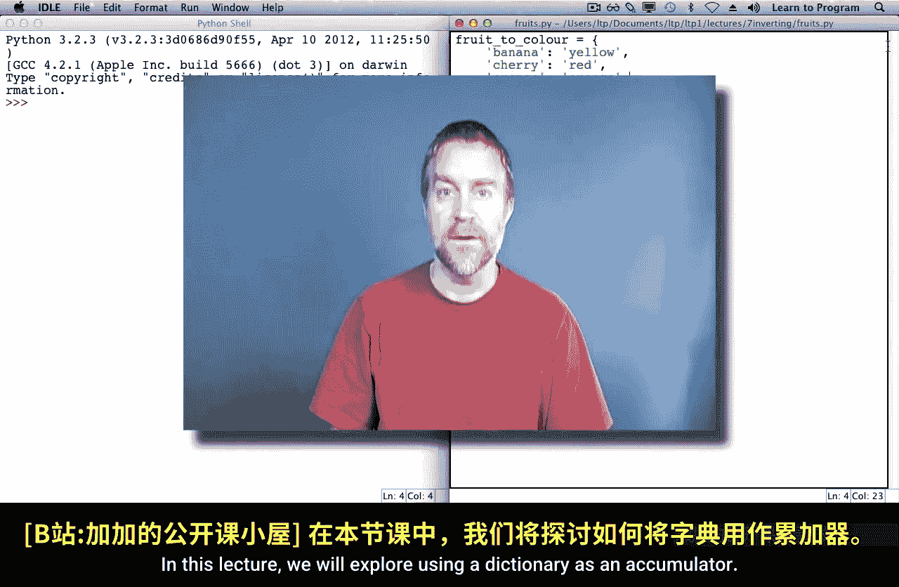
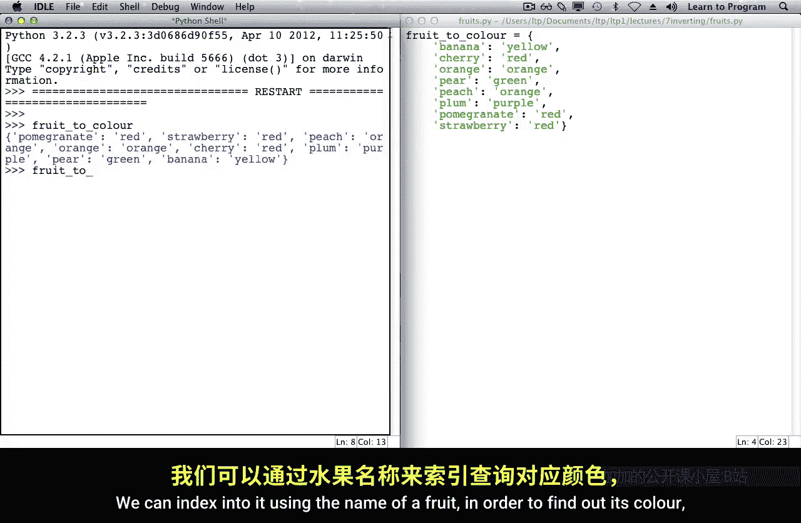
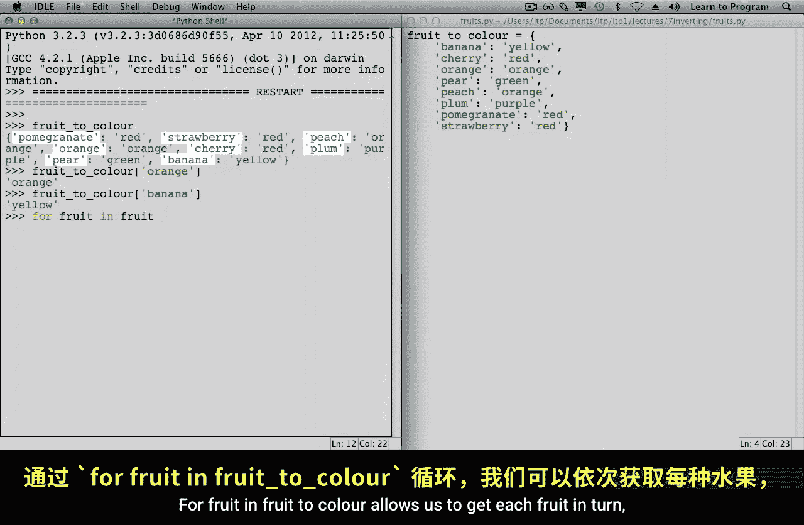
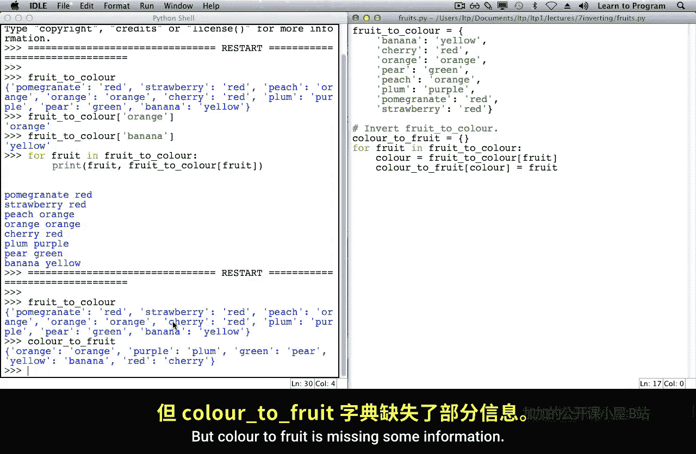
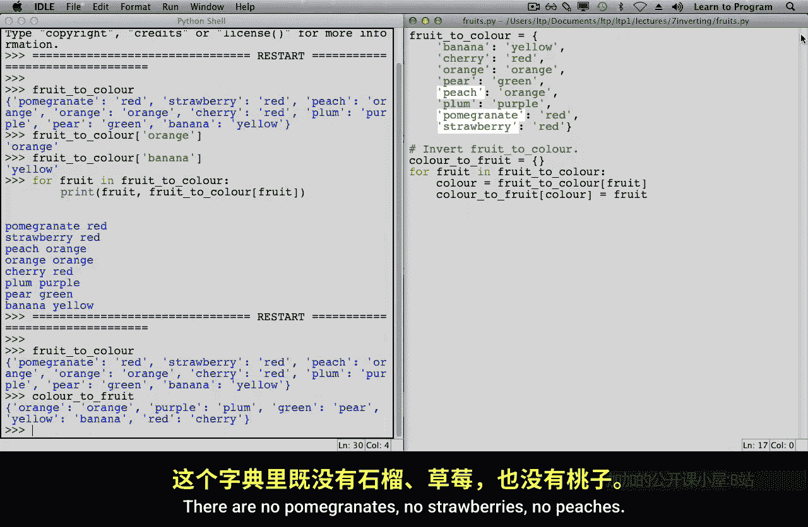
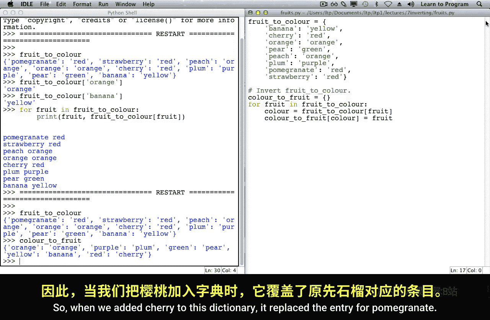
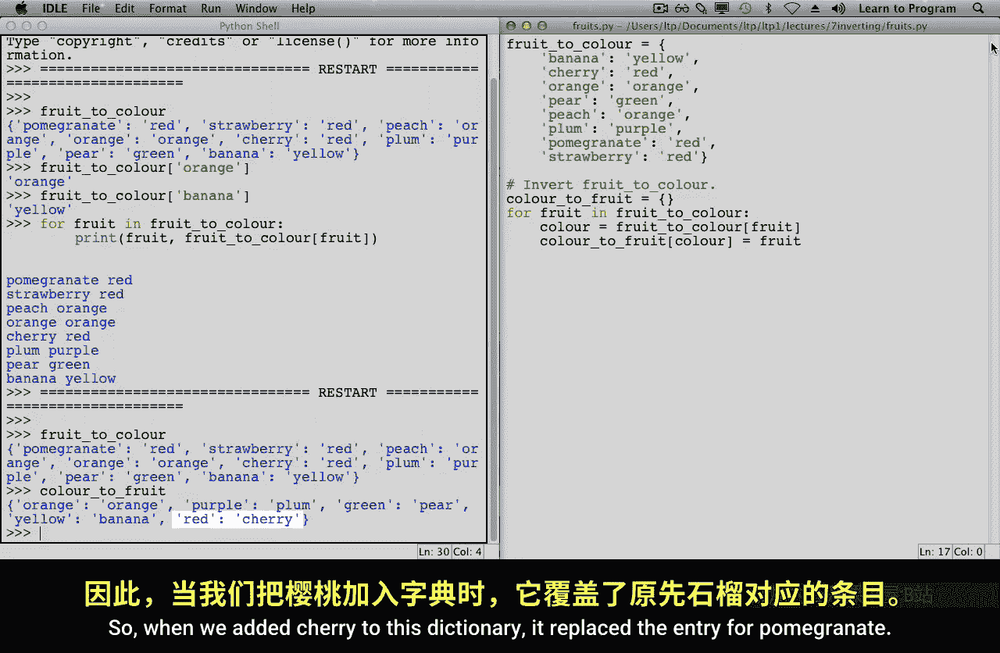
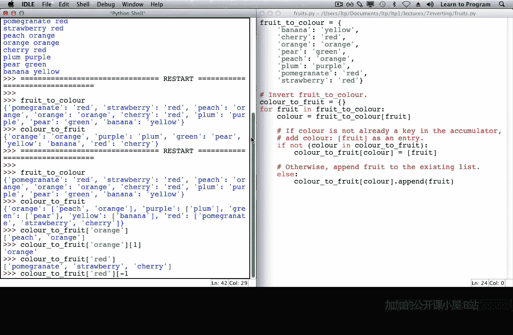

# 特伦托大学【中英⚡学习编程：基础知识｜Learn to Program： The Fundamentals】 p42 P42 05_反转字典 -BV1kQ11B5EWa_p42-

In this lecture， we will explore using a dictionary as an accumulator。

Here we create a dictionary mapping fruits to colors。

We will run this in order to explore fruit to color so that we can be a little bit more familiar with it。

Here is the fruit to color dictionary。These dictionary entries are not sorted by key or by value。

We can index into it using the name of a fruit in order to find out its color。

 So fruit to color of orange is orange。 Fru to color of banana is yellow。

We can also iterate over the keys in this dictionary for fruit in fruit to color allows us to get each fruit in turn。

 as well as use that fruit as an index into the dictionary in order to look up the corresponding value。

And now we get to the problem we're going to explore today。

We are going to turn this dictionary inside out， or invert。Fooruit。2 color。

We want to build a new dictionary that maps colors to fruits。To do this。

 we will iterate over the keys and the fruit to color dictionary。

Extract the color corresponding to that fruit。And then add to our new color to fruit dictionary。

 the color to fruit entry。Variable color to fruit is our accumulator。We run this again。

And examine fruit to color。And color to fruit。But color to fruit is missing some information。

There are no pomegranates， no strawberries， no peaches。

The problem is that there are more than one fruit for each of the colors associated with those three missing fruits。

 For example， pomegranates are red， but so are cherries。 So when we added cherry to this dictionary。

 it replaced the entry for pomegranate。

Instead of this straight inversion， we need to be a bit careful。

 We will build a dictionary that maps each color to a list of fruits of that color。

If color is not already a key in the accumulator， we will add a color to a list with one item in it。

 the current fruit as an entry。Otherwise， if color is already a key。

 that means that it already has a list of fruit of that color。

 We need to append fruit to that existing list。Here is the code， expressing that algorithm。

If it is not the case that color is a key in the colored to fruit dictionary。

 then we will add an entry。Mapping color to a list containing fruit。On the other hand。

 if color is already a key in the dictionary， then we would like to get the list that that color maps to。

And append variable fruit。We will also delete the old code。Let's explore how we've done。

Fruit to color is what it always has been。Colored to fruit now。

Has keys being strings and values being lists of strings。Which fruit is colored orange。

How do we get to the fruit orange， Well， we index into the dictionary using string orange。

 And then that gives us a list。 We then index into that， using the regular list indexing way。

To get orange。How can we get to Cheerrry？ Well， we'll index into our dictionary using red And cherry is the last item in the list that is returned。

