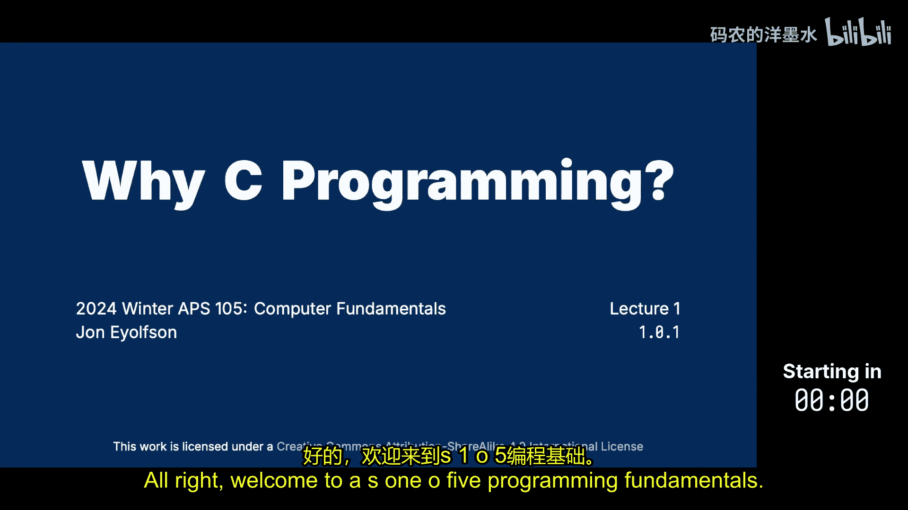
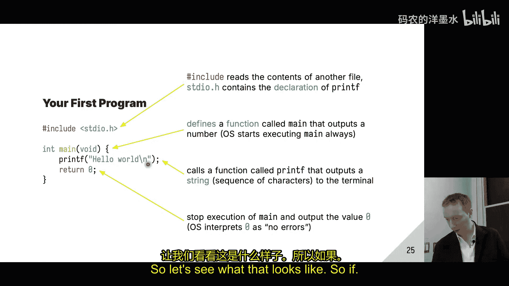
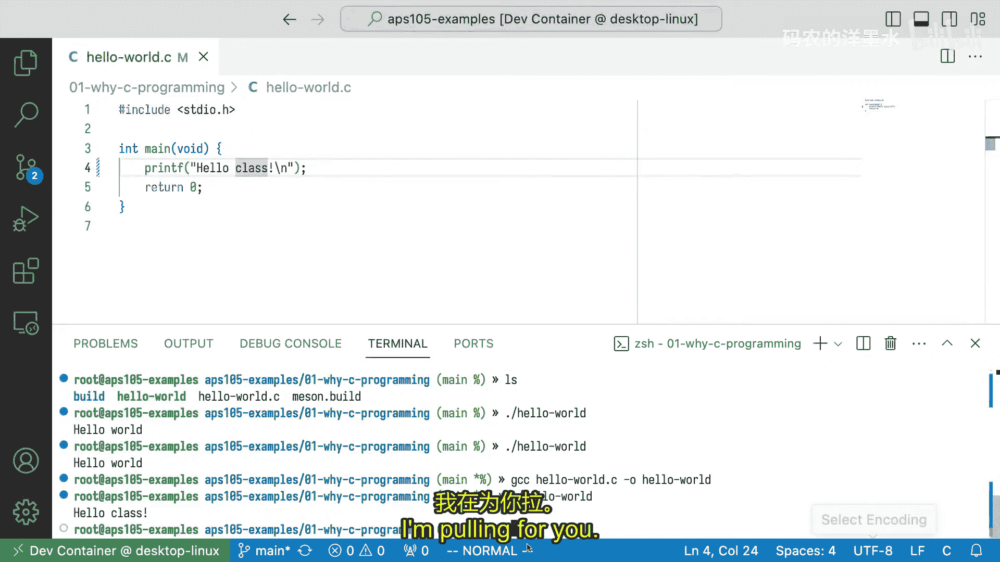

# 001：导论 🎬



在本节课中，我们将要学习编程的基本概念，了解课程结构，并编写我们的第一个C语言程序。

## 课程结构与建议 📅

上一节我们介绍了课程的基本信息，本节中我们来看看课程的具体安排和学习建议。

课程时间表包含四个部分：
*   **讲座**：学习所有核心概念，并向讲师提问。
*   **辅导课**：助教将带领大家练习与考试题目非常接近的问题。
*   **实验预备讲座**：助教主讲，内容与实验材料直接相关，提供额外练习。
*   **实验课**：获得助教的现场帮助，完成软件编写。

以下是关于实验安排的建议：
*   实验材料会在截止日期前两周发布。
*   建议在材料发布后立即查看。
*   实验所需的所有内容会在截止日期前一周的讲座中覆盖。
*   你应该在材料覆盖后立即开始实验。
*   实验截止时间为周六午夜。

## 学术诚信 ⚖️

上一节我们讨论了学习节奏，本节中我们必须谈谈学术诚信这个严肃的话题。

规则是你可以讨论课程内容，但不能互相抄袭。抄袭代码会损害你自己的学习，因为本课程最好的学习方式就是实践。此外，抄袭代码比抄袭其他作业更容易被检测到。

## 评分与资源 📊

现在我们来谈谈评分标准和可用资源。

你的总成绩中，考试占70%（期中30%，期末40%），实验占30%。实验分为9个，权重逐渐增加：
*   实验0（设置实验）：权重0%。
*   实验1-3：每个占2%，共6%。
*   实验4-6：每个占3%，共9%。
*   实验7-9：每个占5%，共15%。

本课程的官方资源是课程网站和在线教材。此外，还有一些额外资源：
*   讲座会进行直播并录制上传至YouTube。
*   讲义幻灯片发布在讲师个人网站。
*   有一个非官方的Discord社区供大家交流。

## 编程基础概念 💻

在了解了课程框架后，我们现在深入探讨编程的核心概念。

**程序**是计算机可以**执行**（或运行）的东西。编写程序的艺术称为**编程**。

人类使用**编程语言**来编写程序，C语言就是其中一种。我们选择C语言是因为它是一门小巧的语言，特性不多，并且更接近计算机的工作原理。

**计算机**由两部分组成：**硬件**（你可以触摸的物理部件）和**软件**（计算机运行所需的信息）。硬件主要包括：
*   **CPU**：中央处理器，进行计算。
*   **RAM**：随机存取存储器，短期记忆，CPU直接与之交互。
*   **存储设备**：如SSD，长期记忆，用于存储文件。

我们将计算机建模为一个**黑箱**，它接收**输入**（如键盘、鼠标），经过内部处理（计算、内存、存储），产生**输出**（如显示器上的图像）。

## 计算机如何表示信息 🔢

上一节我们了解了计算机的组成，本节中我们来看看计算机内部如何表示信息。

计算机使用一系列数字来存储所有信息。在最基本的层面上，计算机只能存储 **1** 或 **0**，这称为一个**位**。

我们通常用十进制表示数字，而计算机使用**二进制**。二进制是一种只使用位（0和1）的数字系统。

一个**字节**由8个位组成。由于每个位有2种可能，一个字节可以表示 **2^8 = 256** 种不同的东西。

在编程语言中，我们通常直接写十进制数字。如果要写二进制数字，会以前缀 `0b` 开头，例如 `0b101` 表示十进制的5。

计算机使用数字来表示键盘上的字符。例如，大写字母‘A’在计算机内部被表示为十进制数字 **65**。

## 软件开发工具链 ⚙️

理解了信息表示后，我们来看看如何将我们的想法变成计算机可以运行的程序。

**代码**是用编程语言编写的文本。特定软件的代码称为**源代码**。

我们使用**编译器**这个程序将源代码转换为操作系统可以运行的**程序**。这个过程称为**编译**。编译器输出的**机器码**是CPU能够理解的二进制指令。

我们还需要处理输入和输出。在本课程中，我们将主要使用**终端**，它是一个文本界面，使用键盘进行输入，在屏幕上显示文本作为输出。

## 第一个C程序 👋

最后，让我们将所有概念结合起来，编写并运行我们的第一个C程序。

以下是一个典型的第一个程序，它会在屏幕上输出“Hello World”：

```c
#include <stdio.h>



int main(void)
{
    printf("Hello World\n");
    return 0;
}
```

代码解析：
1.  `#include <stdio.h>`：告诉编译器包含标准输入输出库的文件，以便使用 `printf` 函数。
2.  `int main(void)`：定义了一个名为 `main` 的函数，它是每个C程序的起点。`int` 表示这个函数执行完毕后会返回一个整数。
3.  `printf("Hello World\n");`：调用 `printf` 函数，输出字符串“Hello World”。`\n` 是一个特殊字符，表示换行。
4.  `return 0;`：结束 `main` 函数的执行，并向操作系统返回值0，通常表示程序成功运行，没有错误。

要运行这个程序，你需要：
1.  将代码保存为 `.c` 文件（如 `hello.c`）。
2.  使用编译器（如GCC）进行编译：`gcc hello.c -o hello`
3.  运行生成的可执行文件：`./hello`

## 总结 🎯



本节课中我们一起学习了APS105课程的结构与学习建议，理解了程序、编程语言、计算机硬件与软件的基本概念，知道了计算机如何使用二进制表示信息，认识了编译器的作用，并成功编写和运行了我们的第一个C语言程序——“Hello World”。