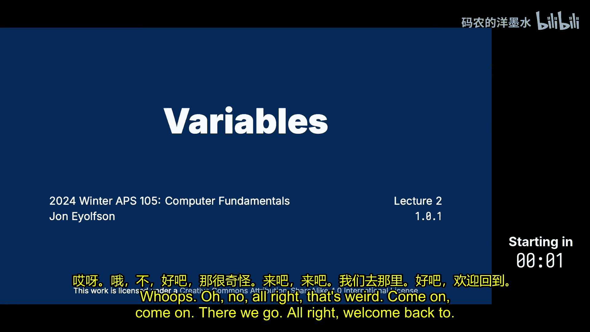
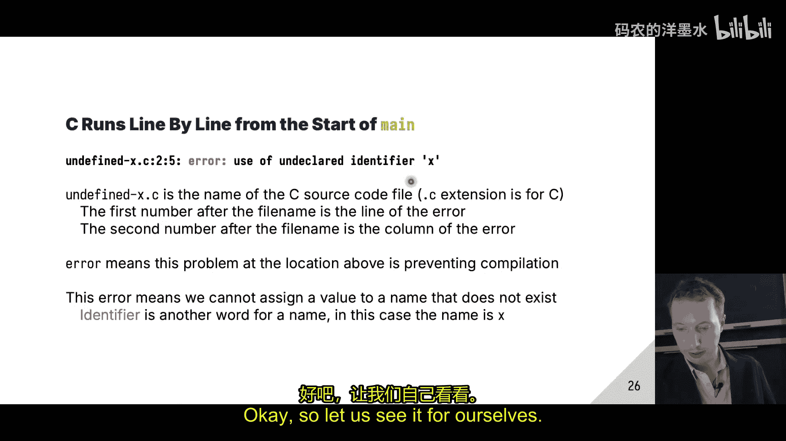
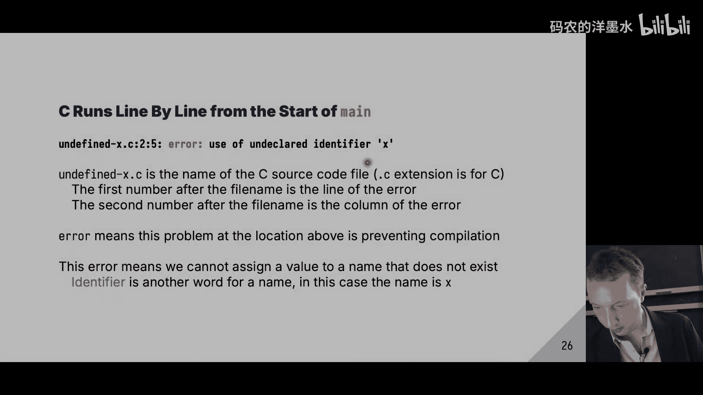
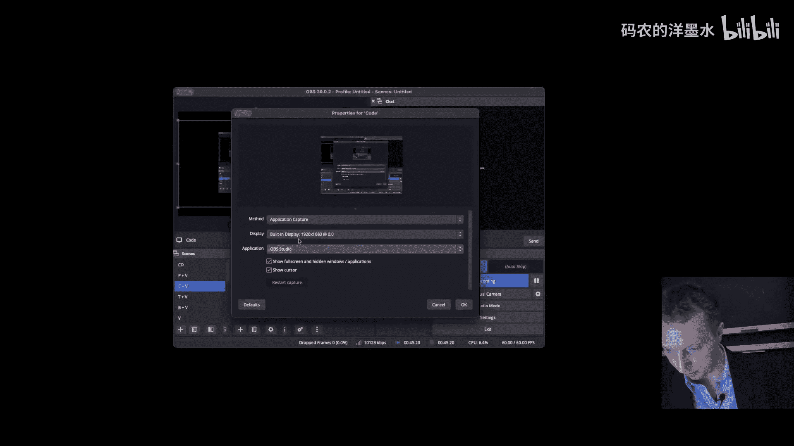
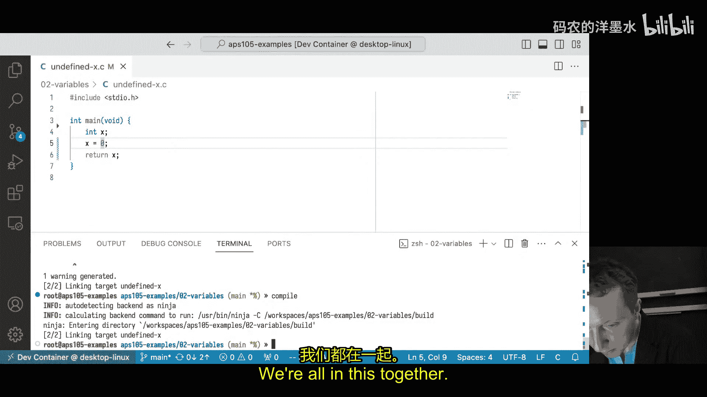

# 002：变量 🧠




在本节课中，我们将要学习C语言中一个非常核心的概念：**变量**。我们将从计算机如何存储信息的基础知识开始，逐步理解变量是什么、如何声明它们，以及C语言中几种基本的数据类型。

---

## 计算机内存基础

上一节我们介绍了程序的基本结构，本节中我们来看看计算机是如何存储和访问信息的。

程序总是在访问内存。这里所说的“内存”，指的是**RAM（随机存取存储器）**，也称为主内存。计算机通过一种叫做**字节**的单位来访问内存。

一个字节由8个比特组成。由于每个比特可以是0或1，所以一个字节可以表示 `2^8 = 256` 种不同的可能性。

在内存中，每个字节都有一个唯一的**地址**，就像房子的门牌号一样。内存是**字节可寻址**的，这意味着最小的可访问单元是一个字节，而不是单个比特。

CPU有专门的指令来读写内存中的字节。不过，在C语言中，这些底层细节被语言本身处理了，我们无需直接操作。

计算机能访问的地址数量取决于CPU的“位宽”。例如，一个64位CPU可以寻址高达 `2^64` 个字节，这是一个非常巨大的数字。为了便于理解，我们使用千字节（KB）、兆字节（MB）、吉字节（GB）等单位。需要注意的是，在计算机中：
*   1 KB = 1024 字节 (`2^10`)
*   1 MB = 1024 KB (`2^20`)
*   1 GB = 1024 MB (`2^30`)

---

## C语言中的类型

我们已经知道内存存储的是字节，但如何区分一个字节是代表字母‘A’还是数字65呢？这就要靠**类型**来告诉计算机如何解释这些字节。

一个类型主要告诉我们两件事：
1.  该值**代表什么**（例如，是整数还是字符）。
2.  它需要占用**多少内存**。

以下是本课程中将使用的基本类型：

### 整数类型：`int`

`int` 类型代表整数（没有小数点的数字）。在C语言中，一个 `int` 通常占用 **4个字节**（32位）。

由于需要表示正数和负数，最高位（第31位）被用作**符号位**：0代表正数，1代表负数。因此，`int` 可以表示的范围是：
**`-2^31` 到 `2^31 - 1`**

### 字符类型：`char`

`char` 类型代表单个字符，例如字母、数字、标点符号或控制字符（如换行符）。一个 `char` 总是占用 **1个字节**。

在代码中，字符值用单引号定义：
```c
char c = 'A';
```
对于无法直接输入的字符（如换行、制表符），需要使用**转义字符** `\`：
*   换行符：`\n`
*   制表符：`\t`
*   反斜杠本身：`\\`
*   单引号：`\'`

字符在内存中实际上存储为一个数字（0-255），其对应关系由 **ASCII** 标准定义。

### 浮点数类型：`double`

`double` 类型代表带有小数点的数字。它占用 **8个字节**，提供了较高的精度。在C语言中，只要需要小数，就应该使用 `double`。
```c
double pi = 3.141592;
```

### 布尔类型：`bool`

`bool` 类型代表逻辑值，只有两种可能：`true`（真）或 `false`（假）。虽然理论上只需1比特，但实际上它占用 **1个字节**。

要使用 `bool` 类型，需要在代码开头添加：
```c
#include <stdbool.h>
```
然后就可以声明布尔变量：
```c
bool isRaining = true;
```

---

## 声明与使用变量

理解了类型之后，我们就可以在程序中创建和使用变量了。

### 变量的声明

在C语言中声明变量的语法是：
**`类型 变量名;`**

例如，声明一个整数变量 `x`：
```c
int x;
```
执行这行代码后，C语言会在内存中为 `x` 预留4个字节的空间。但此时 `x` 的值是**未定义的**（可以理解为随机值）。

### 变量的赋值

我们可以使用**赋值语句**来改变变量的值，语法是：
**`变量名 = 值;`**

需要注意的是，编程中的等号 `=` 是**赋值操作**，意味着“将右边的值存入左边的变量”，而不是数学中的恒等关系。
```c
x = 1; // 现在x的值是1
```

### 变量的初始化

为了避免使用未定义的随机值，最佳实践是在声明变量的同时就给它一个初始值，这称为**初始化**。
```c
int x = 1; // 声明并初始化x为1
```
这行代码等价于先声明 `int x;` 再赋值 `x = 1;`。

---

## 程序开发流程与错误

在编写软件时，我们通常遵循一个开发周期：

1.  **编辑代码**：编写或修改你的C程序。
2.  **编译代码**：使用编译器将源代码转换为可执行程序。
3.  **判断**：编译是否成功？
    *   如果失败，会产生**编译时错误**。这意味着代码语法或规则有问题，编译器无法生成程序。你需要返回第1步修改代码。
    *   如果成功，则可以运行程序。
4.  **运行与测试**：运行程序，检查输出是否符合预期。
    *   如果不符合，会产生**运行时错误**或逻辑错误。这意味着程序能运行，但行为不对。你需要返回第1步修改代码逻辑。

一个常见的编译时错误是使用了未声明的变量。例如，如果直接写 `x = 1;` 而没有先声明 `int x;`，编译器会报错：
`error: use of undeclared identifier 'x'`
这表示标识符（变量名）‘x’尚未声明。








---

## 总结

本节课中我们一起学习了：
*   计算机内存以**字节**为单位组织，每个字节有唯一地址。
*   **类型**决定了数据如何被解释以及占用多少内存。
*   C语言的基本类型：表示整数的 `int`，表示字符的 `char`，表示小数的 `double`，以及表示真/假的 `bool`。
*   如何通过 **`类型 变量名;`** 的语法来**声明**变量。
*   如何使用 **`变量名 = 值;`** 的语法来**赋值**，以及更安全的**初始化**方式 `类型 变量名 = 值;`。
*   程序开发的基本流程和两种主要错误：**编译时错误**与**运行时错误**。




变量是存储和操作数据的基石，理解它们是迈向有效编程的关键一步。下一讲，我们将学习如何让程序与用户交互——输出信息。