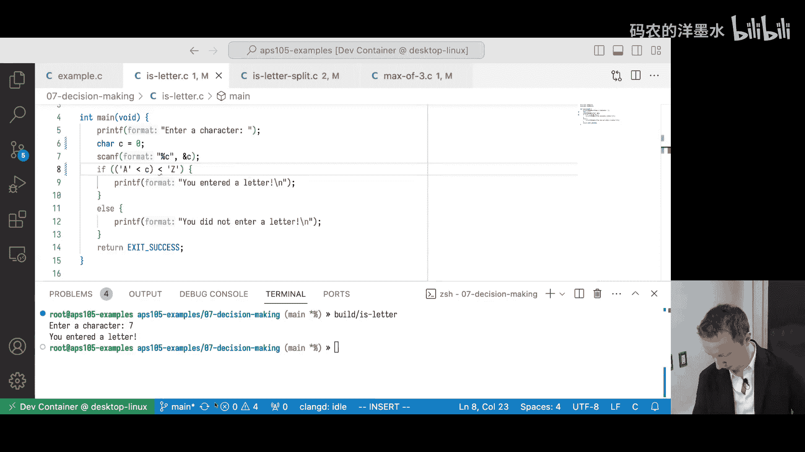
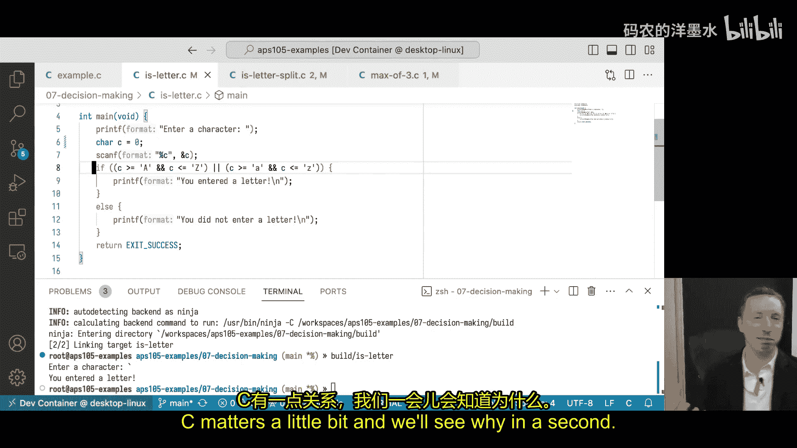
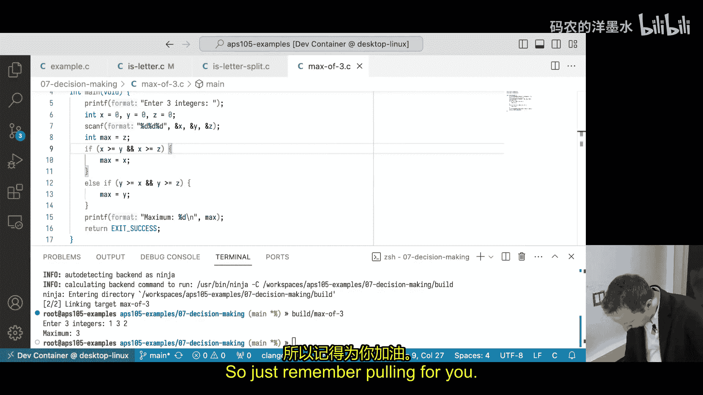
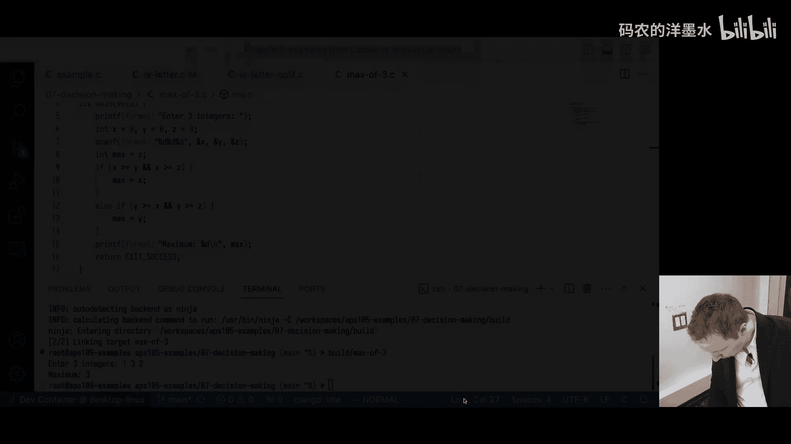

# 007：决策判断 👨‍💻


在本节课中，我们将继续学习如何让计算机做出决策，而不仅仅是按顺序执行语句。我们将深入探讨关系运算符、逻辑运算符，并学习如何编写更复杂的条件判断程序。

---

## 字符的比较与运算

上一节我们介绍了关系运算符和逻辑运算符。本节中我们来看看如何将这些概念应用到字符上。

计算机将字符编码为数字（ASCII码）。虽然我们无需记住每个字符的具体编码，但了解它们的顺序很重要，因为我们可以比较字符。

以下是字符顺序的核心规则：
*   数字字符 `‘0’` 到 `‘9’` 是连续且按顺序排列的。
*   大写字母 `‘A’` 到 `‘Z’` 是连续且按顺序排列的。
*   小写字母 `‘a’` 到 `‘z’` 是连续且按顺序排列的。
*   数字字符的值小于大写字母，大写字母的值小于小写字母。

由于字符本质上是数字，我们可以对它们进行算术运算。例如：
*   `‘0’ + 2` 的结果是字符 `‘2’`。
*   `‘A’ + 2` 的结果是字符 `‘C’`。
*   `‘o’ - 1` 的结果是字符 `‘n’`。

---

## 实践：判断输入是否为字母

现在，让我们编写一个程序来判断用户输入的是否为字母。




程序的核心逻辑是：我们需要检查输入的字符是否落在大写字母或小写字母的范围内。

如果我们直接用数学逻辑描述，可能是：“字符 >= ‘A’ 且 字符 <= ‘Z’”。但在C语言中，我们不能直接写成 `‘A’ <= c <= ‘Z’`，因为C语言会从左到右依次计算。它会先计算 `‘A’ <= c`，得到一个布尔值（真或假），然后再用这个布尔值与 `‘Z’` 比较，这并非我们想要的结果。

正确的做法是使用逻辑运算符 **`&&`** (与) 来连接两个条件。

以下是判断字符是否为字母的步骤：
1.  提示用户输入一个字符。
2.  读取用户输入的字符。
3.  使用 `if` 语句进行判断。
4.  条件应为：`(c >= ‘A’ && c <= ‘Z’) || (c >= ‘a’ && c <= ‘z’)`。
5.  根据条件结果输出相应信息。

初始代码可能如下所示，但它只检查了大写字母：

```c
#include <stdio.h>
int main() {
    char c = ‘\0’; // 初始化为空字符
    printf(“Enter a character: “);
    scanf(“%c”, &c);
    if (c >= ‘A’ && c <= ‘Z’) {
        printf(“You entered a letter.\n”);
    } else {
        printf(“You did not enter a letter.\n”);
    }
    return 0;
}
```

为了同时检查小写字母，我们需要使用逻辑运算符 **`||`** (或) 来组合两个条件。完整的条件语句如下：

```c
if ( (c >= ‘A’ && c <= ‘Z’) || (c >= ‘a’ && c <= ‘z’) ) {
    printf(“You entered a letter.\n”);
} else {
    printf(“You did not enter a letter.\n”);
}
```

---




## 提升代码可读性：使用布尔变量

当条件判断变得复杂时，代码会难以阅读。一个提高可读性的好方法是使用布尔变量为条件命名。

我们可以创建两个布尔变量来清晰地表达我们的意图：
*   `is_uppercase`：检查字符是否为大写字母。
*   `is_lowercase`：检查字符是否为小写字母。

改进后的代码片段如下：

```c
int is_uppercase = (c >= ‘A’ && c <= ‘Z’);
int is_lowercase = (c >= ‘a’ && c <= ‘z’);
if (is_uppercase || is_lowercase) {
    printf(“You entered a letter.\n”);
}
```

这种方式让 `if` 语句的意图一目了然，即使几个月后回看代码，也能立刻理解其逻辑。

---

## 逻辑运算的“短路”求值

C语言在计算逻辑表达式时采用“短路”求值（Lazy Evaluation），这会影响程序的执行效率，有时甚至影响结果。

**对于 `||` (或) 运算：**
如果第一个条件为真，整个表达式已经确定为真，编译器将不会计算第二个条件。
例如，在 `is_uppercase || is_lowercase` 中，如果字符是大写字母，程序就不会再去检查它是否是小写字母。

**对于 `&&` (与) 运算：**
如果第一个条件为假，整个表达式已经确定为假，编译器将不会计算第二个条件。
例如，在 `(c >= ‘A’) && (c <= ‘Z’)` 中，如果字符小于 `‘A’`，程序就不会再去检查它是否小于等于 `‘Z’`。

了解短路求值有助于我们编写更高效的代码，例如将更可能使表达式短路（为真或为假）的条件放在前面。

---

## 德摩根定律与条件改写

有时，复杂的条件判断可以通过德摩根定律进行改写，使其更清晰。德摩根定律是逻辑学中的基本定律，在编程中非常实用。

定律如下：
*   `!(A || B)` 等价于 `!A && !B`
*   `!(A && B)` 等价于 `!A || !B`

应用实例：如果我们想判断一个字符“不是字母”，原始写法是 `if ( !(is_uppercase || is_lowercase) )`。应用德摩根定律后，可以改写为 `if ( !is_uppercase && !is_lowercase )`。后者有时更易于理解。

**重要提示：** 改写时必须注意运算符优先级并使用括号。随意移除括号可能导致逻辑错误。例如，`!is_uppercase || is_lowercase` 与 `!(is_uppercase || is_lowercase)` 的含义完全不同。

---

## `if` 语句的常见陷阱

在使用 `if` 语句时，有几个常见的错误需要避免。

**陷阱一：多余的分号**
在 `if` 条件后直接跟一个分号 `;`，会被视为一个空语句。这意味着无论条件是否成立，后面的代码块都会执行。
```c
if (condition); // 错误！这个分号是一个空语句
{
    printf(“This always prints!\n”);
}
```
**正确做法是** 在条件后直接使用花括号 `{}`。

**陷阱二：复杂的嵌套**
过度嵌套 `if` 语句会使代码难以阅读和维护。应优先考虑使用逻辑运算符组合条件。
```c
// 不推荐：嵌套过深
if (a) {
    if (b) {
        // 执行操作
    }
}
// 推荐：使用逻辑运算符
if (a && b) {
    // 执行操作
}
```

---

## 多分支判断：`else if`

当需要从多个互斥的条件中选择一个执行时，可以使用 `else if` 语句链。

其结构如下：
```c
if (condition1) {
    // 条件1为真时执行
} else if (condition2) {
    // 条件1为假且条件2为真时执行
} else if (condition3) {
    // 条件1、2为假且条件3为真时执行
} else {
    // 所有条件都为假时执行
}
```
程序会从上到下依次检查条件，一旦某个条件为真，就执行对应的代码块，然后跳过整个 `else if` 链。

---

## 综合练习：求三个整数的最大值

让我们运用所学知识，编写一个程序，找出用户输入的三个整数中的最大值。

**程序思路：**
1.  读取三个整数 `x`, `y`, `z`。
2.  使用条件判断找出最大值。
3.  我们可以分情况讨论：最大值可能是 `x`，可能是 `y`，否则就是 `z`。

一种清晰的实现方式是直接比较：
*   如果 `x` 大于等于 `y` 并且 `x` 大于等于 `z`，那么最大值是 `x`。
*   否则，如果 `y` 大于等于 `x` 并且 `y` 大于等于 `z`，那么最大值是 `y`。
*   否则，最大值就是 `z`。

示例代码：
```c
#include <stdio.h>
int main() {
    int x, y, z, max;
    printf(“Enter three integers: “);
    scanf(“%d %d %d”, &x, &y, &z);
    if (x >= y && x >= z) {
        max = x;
    } else if (y >= x && y >= z) {
        max = y;
    } else {
        max = z;
    }
    printf(“The maximum is %d.\n”, max);
    return 0;
}
```
另一种思路是先将 `max` 初始化为 `z`，然后只检查 `x` 或 `y` 是否比它大，这样代码更简洁。

---

## 总结 🎯

本节课中我们一起学习了C语言中决策判断的核心知识：
1.  **字符运算**：理解了字符基于ASCII码的顺序，并可以对其进行算术和关系运算。
2.  **逻辑组合**：熟练使用 `&&` (与)、`||` (或) 来构建复杂的条件表达式。
3.  **代码可读性**：通过使用有意义的布尔变量名来提升代码清晰度。
4.  **短路求值**：了解了C语言逻辑运算的执行特点，可以借此编写更高效的代码。
5.  **德摩根定律**：掌握了改写复杂逻辑条件的有效工具。
6.  **避免陷阱**：认识了 `if` 语句后误加分号等常见错误。
7.  **多分支结构**：学会了使用 `if-else if-else` 链来处理多个互斥条件。
8.  **综合应用**：通过“求三个数最大值”的练习，将以上知识点融会贯通。





记住，编写清晰、易读的代码与编写正确的代码同等重要。不断练习，你就能熟练地让程序做出智能的决策。