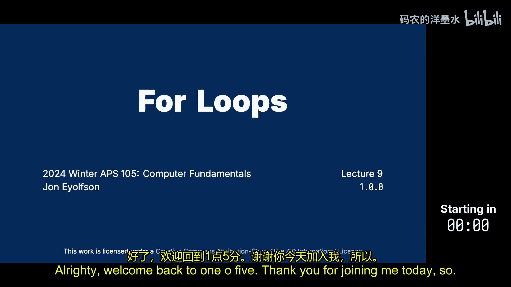
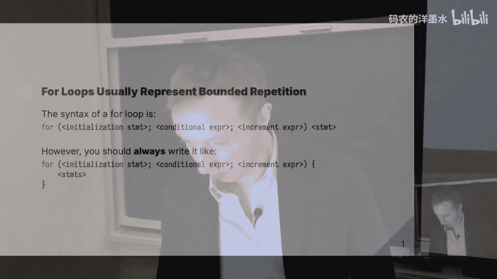
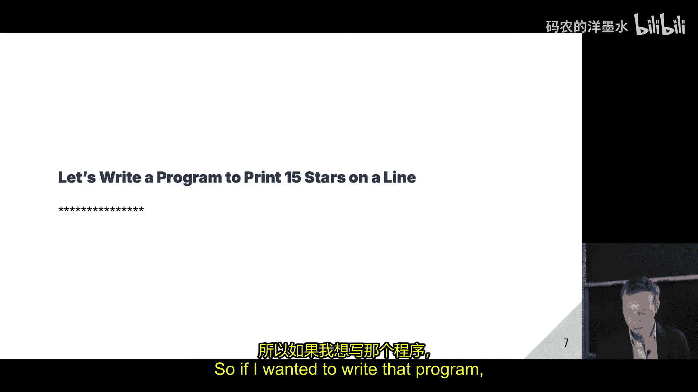
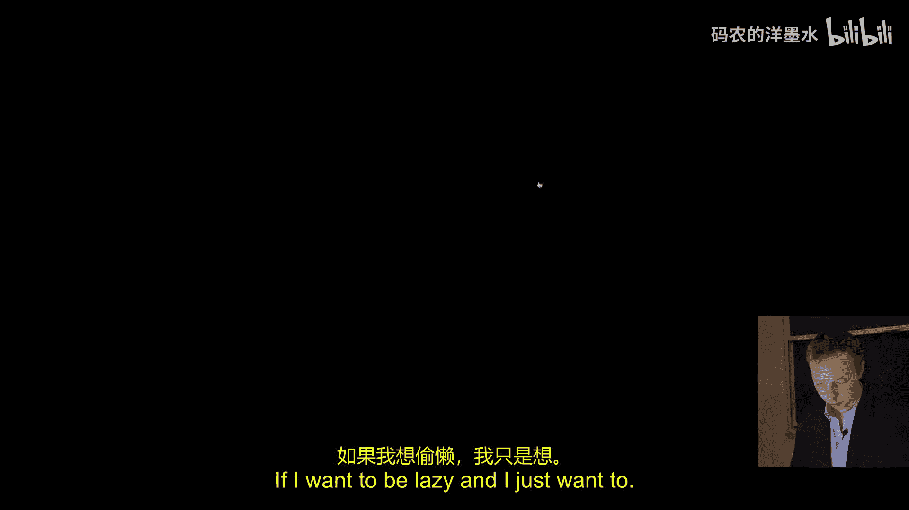
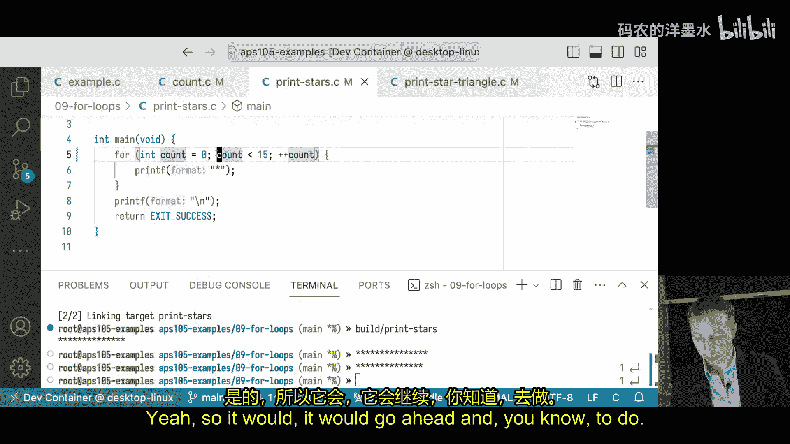
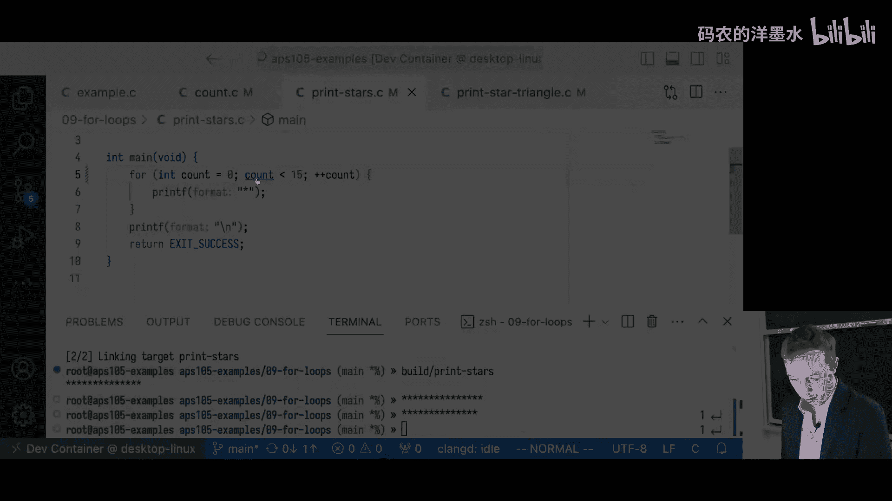
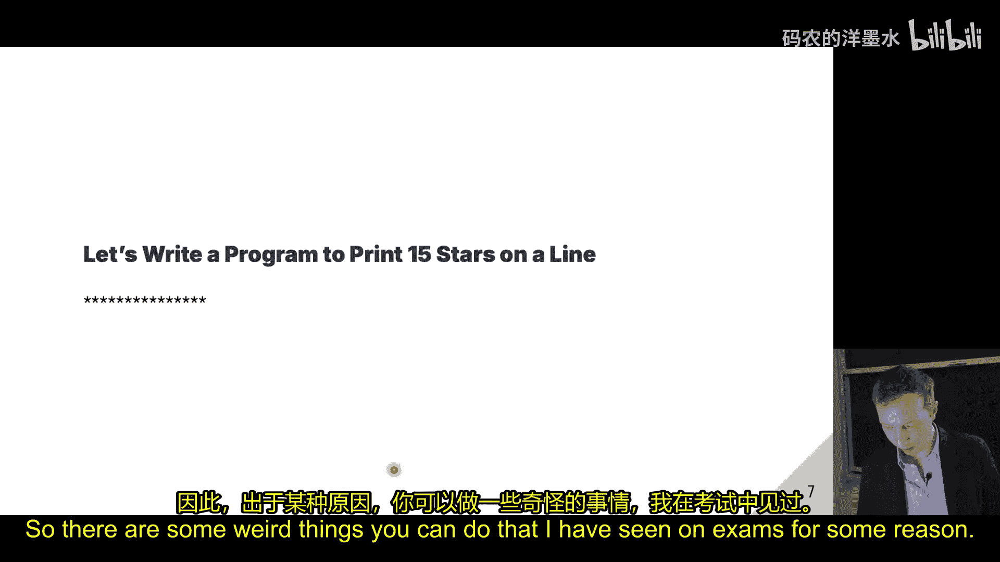
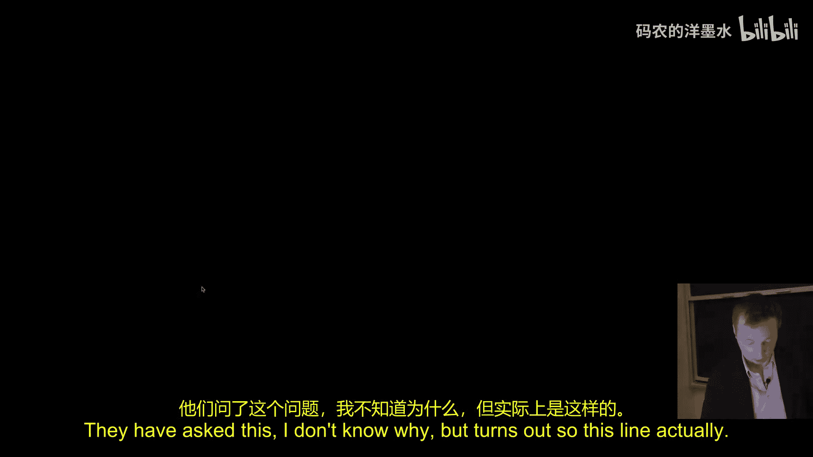
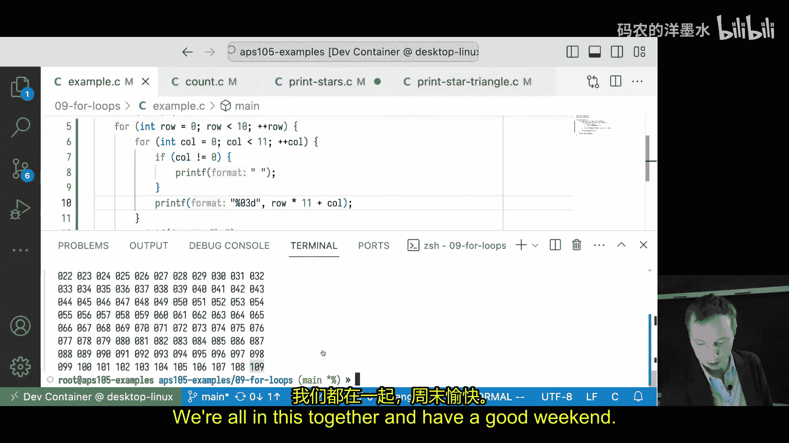

# 009：For循环 🔄






在本节课中，我们将要学习C语言中的`for`循环。`for`循环是一种用于实现**有界重复**的控制结构，特别适用于我们预先知道循环需要执行多少次的情况。它与我们之前学过的`while`循环功能相似，但语法更紧凑，通常更易于阅读。

## 语法与执行流程

`for`循环的语法初看可能有些复杂，但其核心逻辑与`while`循环一致。其基本结构如下：

```c
for (初始化语句; 条件表达式; 增量表达式) {
    // 循环体：每次迭代要执行的语句
}
```

*   **初始化语句**：在循环开始前执行一次，通常用于初始化一个循环计数器。
*   **条件表达式**：在每次迭代开始前检查。如果为真（非零），则执行循环体；如果为假（零），则退出循环。
*   **增量表达式**：在每次迭代结束后执行，通常用于更新循环计数器。

其执行流程可以概括为：
1.  执行**初始化语句**（仅一次）。
2.  检查**条件表达式**。
3.  若条件为真，则执行循环体内的语句。
4.  执行**增量表达式**。
5.  返回步骤2，再次检查条件。

## 与While循环的对比

上一节我们介绍了`while`循环，本节中我们来看看`for`循环如何简化某些场景下的代码。

例如，使用`while`循环打印数字0到9：

```c
int count = 0;
while (count < 10) {
    printf("%d\n", count);
    count = count + 1; // 或 count++
}
```





使用`for`循环实现相同功能：

```c
for (int count = 0; count < 10; count++) {
    printf("%d\n", count);
}
```

可以看到，`for`循环将循环计数器`count`的初始化、条件检查和更新都集中在一行内，使得代码意图（循环10次）一目了然，减少了在代码不同位置寻找相关语句的麻烦。





## 基础应用示例





以下是`for`循环的一些基础应用。

### 打印一行星号

假设我们需要打印15个星号在一行上。

```c
for (int i = 0; i < 15; i++) {
    printf("*");
}
printf("\n"); // 在最后换行
```

### 打印星号三角形

现在，我们来完成一个更复杂的任务：打印一个由星号组成的三角形。这需要用到**嵌套循环**。

思路分析：
1.  外层循环控制行数（例如5行）。
2.  对于每一行，内层循环控制打印的星号数量，其数量等于当前行号。

```c
int total_rows = 5;
for (int row = 1; row <= total_rows; row++) {
    // 内层循环：打印当前行所需的星号
    for (int star = 1; star <= row; star++) {
        printf("*");
    }
    printf("\n"); // 每打印完一行后换行
}
```

运行此代码，将输出一个5行的星号三角形。如果想改变三角形的大小，只需修改`total_rows`变量的值即可。

## 进阶示例：打印数字网格

为了展示从0开始计数的优势，我们尝试打印一个10x10的数字网格（0到99）。

```c
for (int row = 0; row < 10; row++) {
    for (int col = 0; col < 10; col++) {
        // 计算当前应打印的数字：行号*10 + 列号
        int number = row * 10 + col;
        printf("%2d ", number); // %2d确保每个数字占2位宽度，使网格对齐
    }
    printf("\n"); // 每打印完10个数字后换行
}
```

这个例子清晰地展示了如何通过行索引和列索引的组合来生成连续的数字序列。

## 注意事项与不推荐写法

在编写`for`循环时，有一些做法需要避免，以保持代码的清晰和可维护性。

*   **避免在条件或增量表达式中进行复杂操作**：例如，`for (int i=0; i++ < 10; )` 这种写法容易导致差一错误（off-by-one error），不推荐初学者使用。
*   **避免使用逗号运算符将多个操作塞进一个表达式**：虽然语法允许，如 `for (int i=0; i<10; printf("*"), i++)`，但这会严重降低代码可读性，在实际编程中应杜绝。
*   **关于`break`和`continue`**：这两个关键字可以用于更精细地控制循环（`break`立即终止整个循环，`continue`跳过当前迭代的剩余部分）。在本课程中，通常不鼓励使用它们，但了解其含义是必要的。

## 总结



本节课中我们一起学习了C语言的`for`循环。我们了解了它的语法结构、执行流程，并通过与`while`循环的对比，理解了它特别适合处理**有界重复**的场景。我们练习了从打印单行字符到构建星号三角形和数字网格等例子，掌握了嵌套循环的使用。最后，我们强调了一些需要避免的编码习惯，以写出更清晰、健壮的代码。记住，多练习是掌握循环的关键。