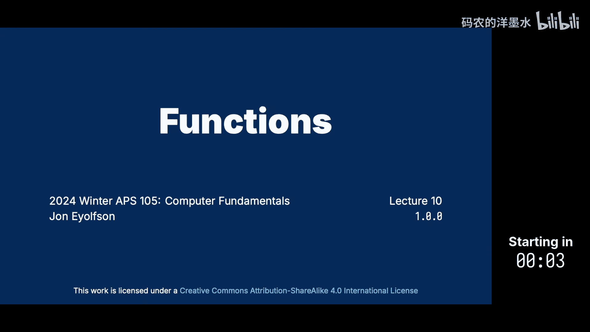
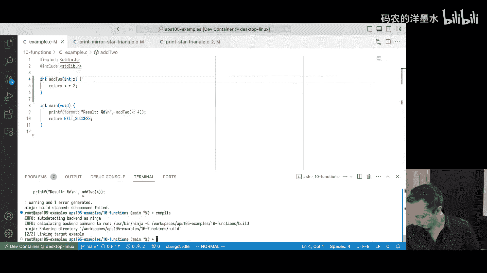
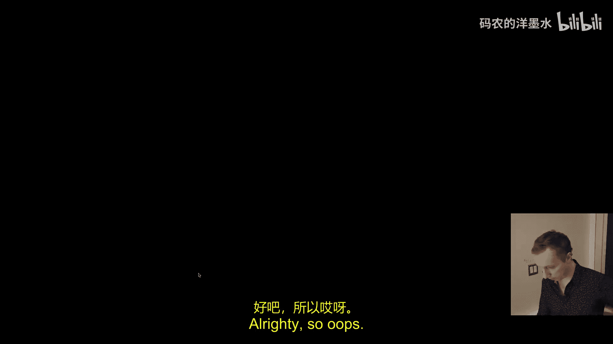
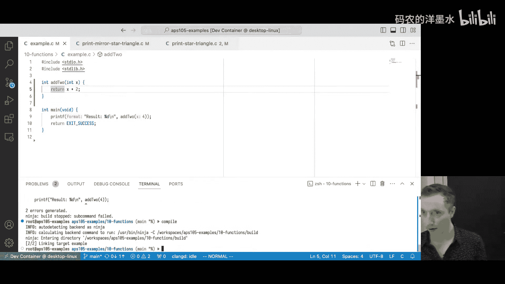
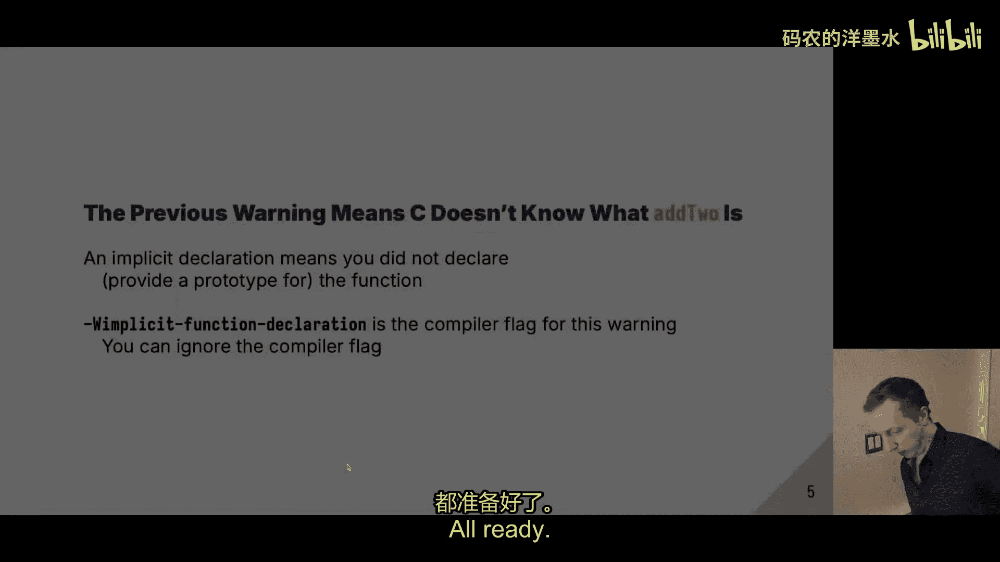
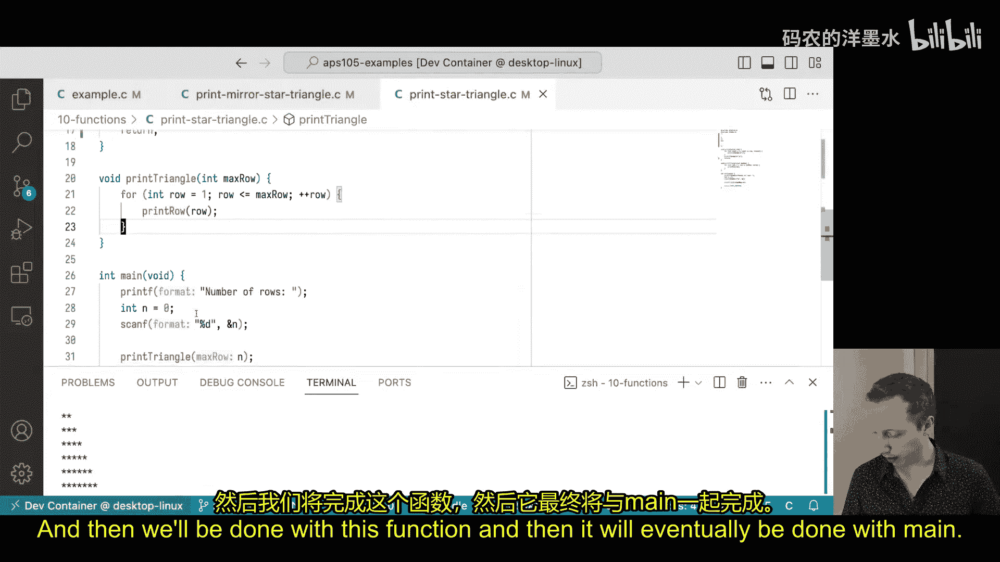
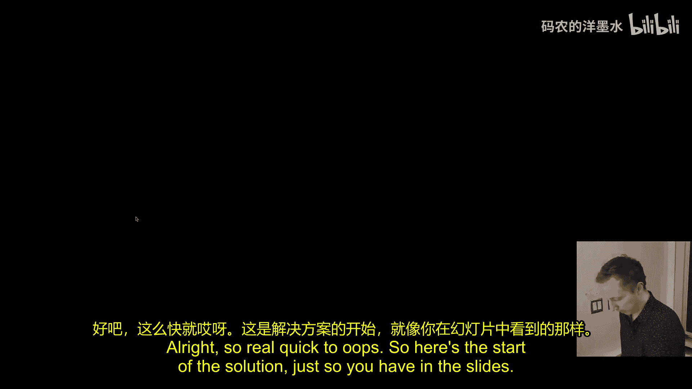
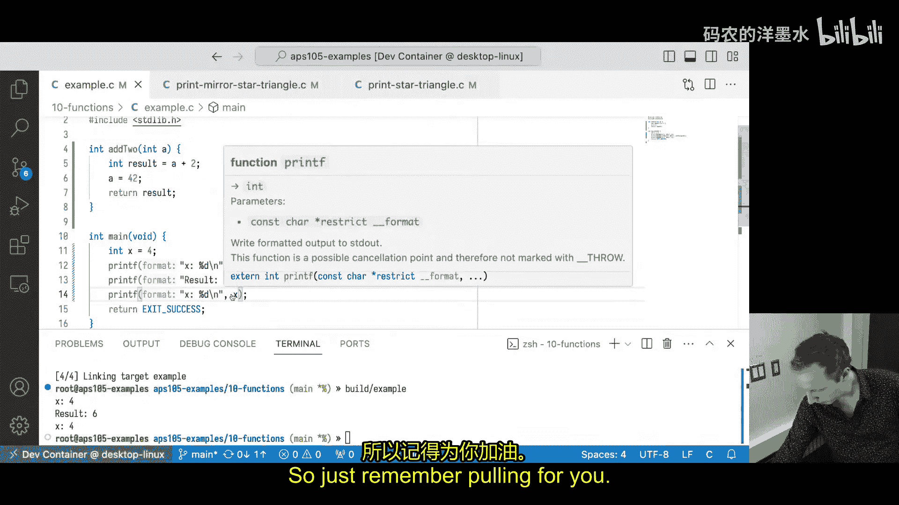

# 010：函数 🧩



在本节课中，我们将要学习C语言中一个非常重要的概念：函数。函数可以将复杂的程序分解成更小、更易于理解和管理的部分，使代码更清晰、更易于复用。

## 函数基础

上一节我们介绍了程序的基本结构，本节中我们来看看如何创建和使用函数。

函数通过**函数原型**来声明。原型告诉编译器函数的名称、输入参数的类型以及返回值的类型。例如，一个名为 `add2` 的函数，它接收一个整数并返回一个整数，其原型如下：

```c
int add2(int x);
```

要定义这个函数（即告诉C语言函数具体做什么），我们需要在原型后使用花括号 `{}`，并在其中编写代码。函数内部使用 `return` 语句来返回一个值并结束函数的执行。

```c
int add2(int x) {
    return x + 2;
}
```



## 函数的顺序与声明



编译器按从上到下的顺序读取代码。然而，程序执行总是从 `main` 函数开始。因此，如果一个函数在 `main` 函数之后定义，但在 `main` 中被调用，编译器在读取到调用语句时还不知道这个函数的存在，会导致编译错误。

以下是解决此问题的两种方法：





**方法一：将函数定义放在 `main` 函数之前。**
这样，编译器在遇到 `main` 函数中的调用时，已经知道了该函数的定义。

**方法二：使用函数原型提前声明。**
在 `main` 函数之前，只写出函数的原型（以分号结尾），而将完整的函数定义放在后面。这相当于告诉编译器：“请相信我，稍后我会定义这个函数。”

```c
// 函数原型声明
int add2(int x);

int main() {
    // 使用函数
    printf("%d", add2(4));
    return 0;
}

// 函数定义
int add2(int x) {
    return x + 2;
}
```

## 函数的返回类型：`void`

函数可以没有返回值，这时其返回类型应声明为 `void`。`void` 函数内部可以使用 `return;` 语句提前结束，也可以不写 `return`，函数在执行完最后一条语句后会自动返回。

```c
void printMessage() {
    printf("Hello, World!\n");
    // 可以没有return语句
}
```

注意，`void` 函数不能返回一个值，也不能将其调用结果用作需要值的表达式的一部分。

## 实践：打印星号三角形

为了理解函数的实际应用，让我们尝试编写一个程序来打印一个右对齐的星号三角形。例如，输入5，输出如下：
```
    *
   **
  ***
 ****
*****
```

我们可以将问题分解。首先，思考如何打印单行星号。这可以写成一个函数 `printRow`，它接收一个整数参数 `row`，表示该行应打印的星号数量。

```c
void printRow(int row) {
    for (int count = 1; count <= row; count++) {
        printf("*");
    }
    printf("\n"); // 每行结束后换行
}
```

接着，我们编写另一个函数 `printTriangle`，它接收一个整数 `maxRow`，表示三角形的总行数。这个函数循环调用 `printRow` 来打印每一行。

```c
void printTriangle(int maxRow) {
    for (int row = 1; row <= maxRow; row++) {
        printRow(row);
    }
}
```

最后，在 `main` 函数中获取用户输入，并调用 `printTriangle`。

```c
int main() {
    int n = 0;
    printf("Enter number of rows: ");
    scanf("%d", &n);
    printTriangle(n);
    return 0;
}
```

通过这种方式，我们将一个复杂问题分解成了 `main`、`printTriangle` 和 `printRow` 三个逻辑清晰的部分。如果打印单行出错，我们只需检查 `printRow` 函数；如果三角形行数不对，则检查 `printTriangle` 函数。

## 参数传递：按值传递

在C语言中，当我们将一个变量作为参数传递给函数时，传递的是该变量**值的副本**，而不是变量本身。这被称为“按值传递”。

请看以下示例：





```c
int add2(int a) {
    int result = a + 2;
    a = 42; // 修改函数内部的副本
    return result;
}

int main() {
    int x = 4;
    printf("x: %d\n", x); // 输出 x: 4
    int sum = add2(x);    // 传递x的值（4）的副本给函数
    printf("Result: %d\n", sum); // 输出 Result: 6
    printf("x: %d\n", x); // 输出 x: 4 （main中的x未改变）
    return 0;
}
```

即使函数 `add2` 内部将参数 `a` 改为了42，`main` 函数中的变量 `x` 依然保持为4。这是因为函数接收到的只是 `x` 的值（4）的一个独立副本，对副本的任何修改都不会影响原始的 `x`。

---



本节课中我们一起学习了C语言函数的核心概念：如何声明和定义函数，`void` 返回类型的作用，以及通过分解“打印三角形”问题来实践函数的使用。我们还初步了解了C语言中**按值传递**的参数机制，这是理解函数如何与数据交互的关键。在下一讲中，我们将更深入地探讨函数参数和作用域的细节。