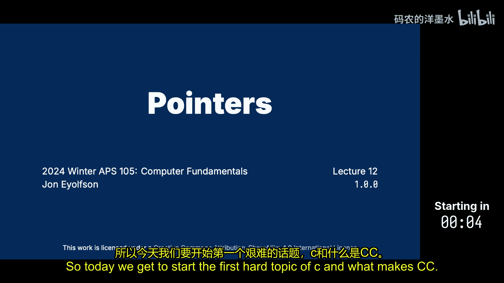
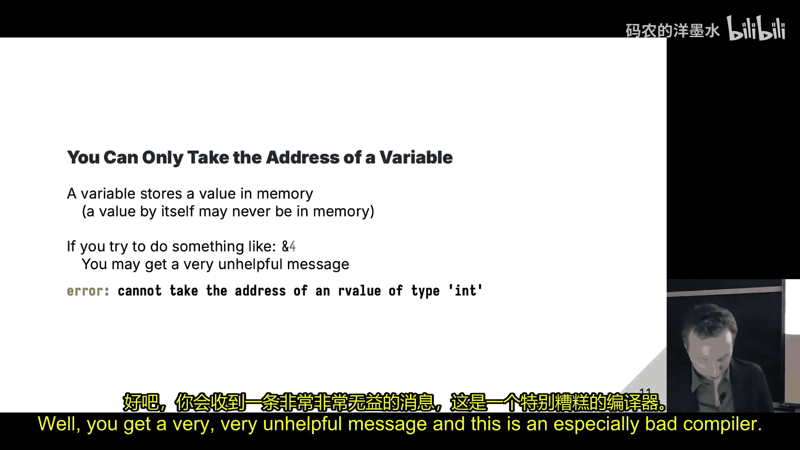
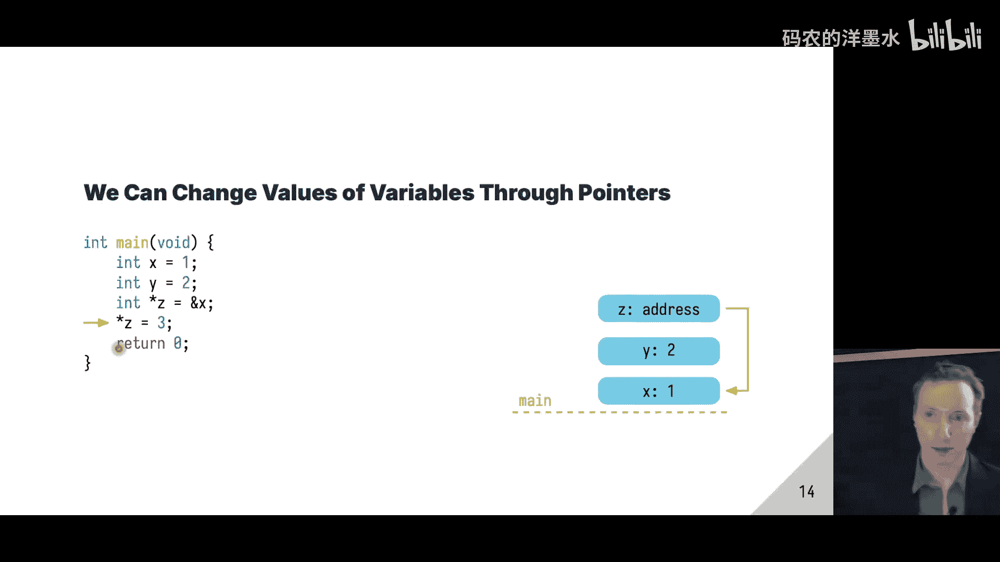
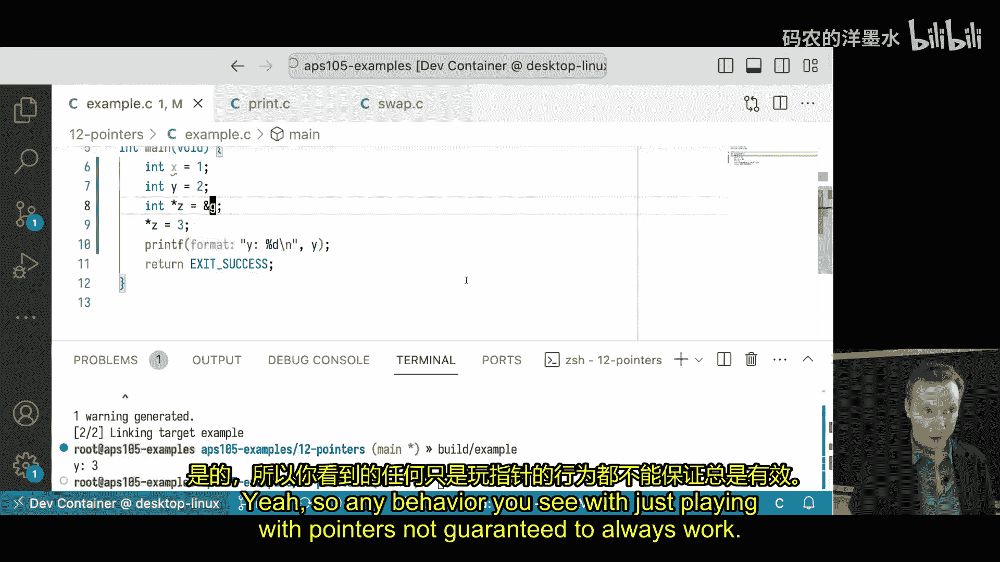
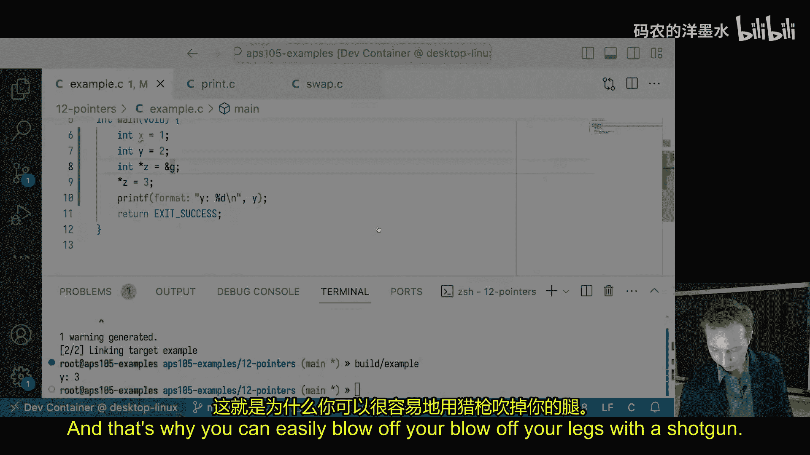
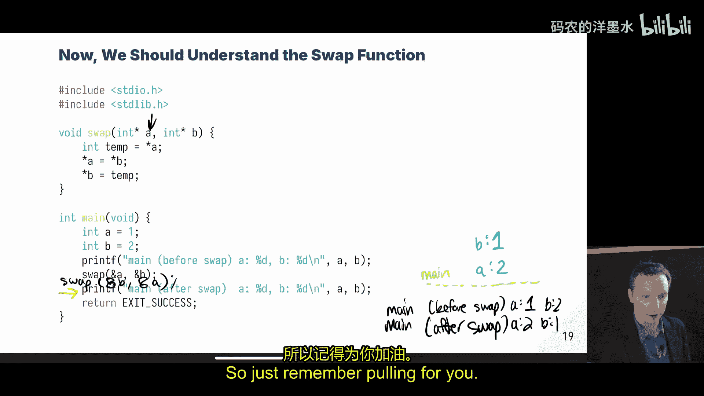

# 012：指针 🧭



在本节课中，我们将要学习C语言中一个核心且强大的概念——指针。指针赋予程序员对内存的直接控制能力，但同时也是许多错误的来源。我们将从计算机如何存储数据的基础知识开始，逐步理解指针的概念、语法和实际应用。

## 计算机内存与十六进制

上一节我们回顾了计算机存储数据的基本原理。本节中，我们来看看一种更便于人类理解计算机内存的表示方法——十六进制。

计算机以二进制（0和1）存储所有数据。一个64位的数字由64个二进制位组成，直接读写非常不便。十六进制（基数为16）系统则更为方便，因为它与二进制有天然的对应关系。

以下是十六进制数字系统的规则：
*   使用16个字符表示数字：0-9 代表数值0-9，A-F 代表数值10-15。
*   在C语言中，十六进制数以 `0x` 开头，例如 `0xF4`。
*   每个十六进制位（0-F）对应4个二进制位。
*   两个十六进制位（例如 `0xFF`）正好对应一个字节（8位）。

将十六进制数 `0xF4` 转换为十进制的方法是：`F`（15）乘以16，加上 `4` 乘以1，结果为 `244`。

## 内存地址与指针基础

理解了内存的表示方式后，我们来看看内存地址和指针的基本概念。

计算机内存中的每个字节都有一个唯一的地址，就像街道上的门牌号。在C语言中，当我们创建一个变量（例如 `int x;`），系统会在内存中为它分配空间。一个 `int` 类型通常占用4个字节。

**指针**就是一个变量，它存储的是另一个变量在内存中的**起始地址**。我们可以使用取地址运算符 `&` 来获取一个变量的地址。

```c
int x = 1;        // 声明一个整型变量x
int *z = &x;      // 声明一个指向整型的指针z，并将其初始化为x的地址
```




这里，`z` 的类型是 `int *`，读作“指向整型的指针”。`z` 中存储的值就是变量 `x` 在内存中第一个字节的地址。

**重要限制**：只能对变量使用 `&` 运算符，不能对字面量（如 `&4`）或表达式结果使用，否则编译器会报错。

## 解引用与通过指针修改变量

知道了如何获取地址，接下来我们学习如何通过地址来访问或修改其指向的值。

为了通过指针访问它指向的内存中的值，我们使用**解引用运算符 `*`**。

```c
int x = 1;
int *z = &x; // z 存储了 x 的地址

int y = *z;  // 解引用z：获取z所指向地址的值（即x的值），并赋给y。现在 y = 1。
*z = 3;      // 解引用z：将z所指向地址的值（即x）修改为3。现在 x = 3。
```



每次使用 `*` 运算符，都会从指针类型中“移除”一个 `*`。例如，如果 `z` 的类型是 `int **`（指向指针的指针），那么 `*z` 的结果类型就是 `int *`。


**危险操作**：切勿将指针随意设置为一个硬编码的地址（如 `int *z = 5;`），然后尝试解引用它。这很可能访问到非法内存区域，导致程序崩溃（段错误）。

## 指针在函数中的应用

之前我们介绍了函数参数按值传递的规则。本节中我们来看看如何利用指针让函数修改其外部变量的值。

这是指针最重要的用途之一。回想一下 `scanf` 函数，我们需要传递变量的地址（`&x`）而不是变量本身，这样 `scanf` 才能将读取的值写入我们指定的内存位置。

以下是一个自定义函数通过指针修改外部变量的例子：

```c
void set_to_3(int *p) {
    *p = 3; // 修改p所指向的变量值为3
}

int main(void) {
    int x = 1;
    set_to_3(&x); // 传递x的地址
    printf("%d\n", x); // 输出：3
    return 0;
}
```

函数 `set_to_3` 接收一个 `int` 指针 `p`。当在 `main` 中调用 `set_to_3(&x)` 时，`p` 获得了 `x` 地址的一个副本。通过解引用 `p`（`*p`），函数就能访问并修改 `main` 函数作用域内的变量 `x`。





## 实战示例：交换函数

让我们通过一个经典的例子——交换两个变量的值——来巩固对指针的理解。

如果不使用指针，仅靠按值传递的参数无法实现真正的交换。以下是使用指针的正确实现：

```c
void swap(int *a, int *b) {
    int temp = *a; // 步骤1：取出a指向的值
    *a = *b;       // 步骤2：将b指向的值赋给a指向的地址
    *b = temp;     // 步骤3：将暂存的值赋给b指向的地址
}

int main(void) {
    int x = 1, y = 2;
    printf("Before: x=%d, y=%d\n", x, y); // 输出: 1, 2
    swap(&x, &y); // 传递x和y的地址
    printf("After: x=%d, y=%d\n", x, y);  // 输出: 2, 1
    return 0;
}
```

1.  `temp = *a`：将 `a` 指针指向的值（即 `main` 中的 `x`，值为1）保存到临时变量 `temp`。
2.  `*a = *b`：将 `b` 指针指向的值（即 `main` 中的 `y`，值为2）写入 `a` 指针指向的地址（即 `x` 的内存）。现在 `x` 变为2。
3.  `*b = temp`：将 `temp` 中保存的原始值（1）写入 `b` 指针指向的地址（即 `y` 的内存）。现在 `y` 变为1。

这样，通过操作内存地址，我们成功地在函数内部交换了外部两个变量的值。

## 打印指针地址

最后，我们学习如何查看指针本身存储的地址值。

C语言提供了 `%p` 格式说明符来打印指针（地址）值。它期望的参数类型是 `void *`（通用指针类型）。通常我们需要进行强制类型转换。

```c
int x = 10;
int *p = &x;

printf("The address of x is: %p\n", (void *)&x);
printf("The value stored in p is: %p\n", (void *)p);
printf("The value p points to is: %d\n", *p);
```

输出将是类似 `0x7ffee3a5a8bc` 的十六进制数，这就是变量 `x` 在内存中的地址。`p` 中存储的值与 `&x` 相同。

---



本节课中我们一起学习了C语言指针的核心知识。我们了解了内存地址的十六进制表示，掌握了指针变量（`int *p`）的声明、取地址（`&`）与解引用（`*`）操作。最关键的是，我们明白了如何利用指针让函数修改调用者的变量，并通过 `swap` 函数加深了理解。记住，指针是强大的工具，但使用不当（如访问非法地址）会导致程序崩溃。始终确保你操作的指针指向有效的内存区域。