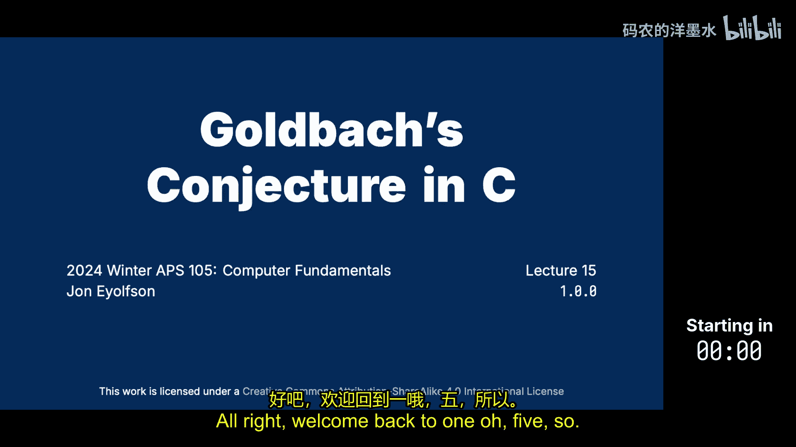
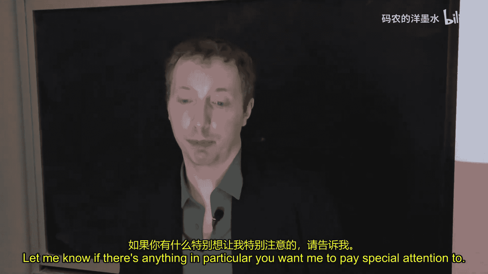
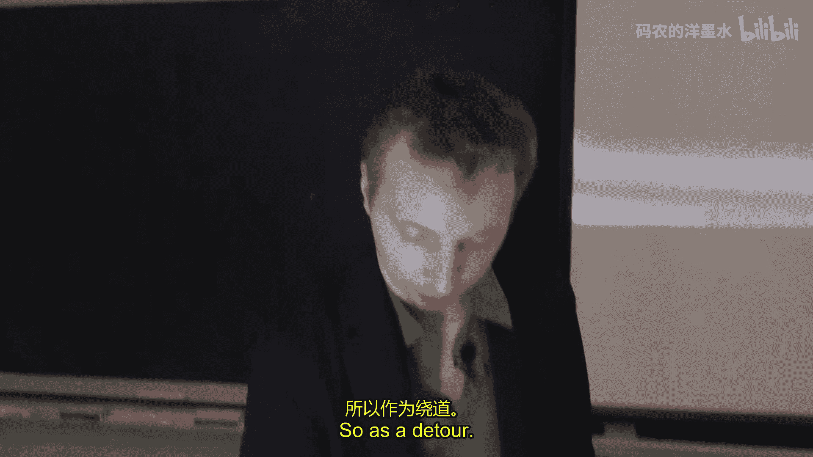
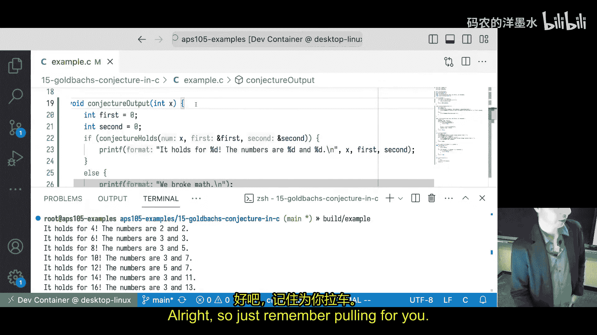

# 015：用C语言实现哥德巴赫猜想







在本节课中，我们将学习如何编写一个完整的C语言程序来验证著名的哥德巴赫猜想。我们将从零开始，逐步构建程序，涵盖用户输入、函数设计、循环逻辑以及指针的应用。通过这个过程，你将学会如何将一个复杂问题分解为多个小步骤，并用代码实现。

## 概述

哥德巴赫猜想是一个尚未被证明的数学命题，它指出：**每一个大于2的偶数都可以表示为两个质数之和**。本节课的目标是编写一个C语言程序，来验证对于用户输入的偶数，这个猜想是否成立。我们将通过构建几个核心函数来完成这个任务。

## 用户输入函数

首先，我们需要一个函数来获取用户的输入。这个输入必须是一个大于2的偶数。

```c
int get_user_input(void) {
    int input = 0;
    printf("Enter an even integer greater than two: ");
    scanf("%d", &input);

    while (input <= 2 || input % 2 != 0) {
        printf("Invalid input. Enter an even integer greater than two: ");
        scanf("%d", &input);
    }
    return input;
}
```

这个函数使用一个`while`循环来确保用户输入的数字符合要求。如果输入无效，程序会提示用户重新输入。

## 判断质数函数

接下来，我们需要一个函数来判断一个给定的整数是否是质数。质数是只能被1和自身整除的大于1的自然数。

```c
bool is_prime(int x) {
    if (x == 1) {
        return false;
    }
    for (int divisor = 2; divisor < x; divisor++) {
        if (x % divisor == 0) {
            return false;
        }
    }
    return true;
}
```

函数从2开始，检查`x`是否能被任何小于它的数整除。如果能，则返回`false`；如果循环结束都没有找到能整除的数，则返回`true`。我们特别处理了数字1，因为它不是质数。

## 寻找下一个质数函数

为了验证猜想，我们需要从一个质数开始，寻找下一个质数。这个函数接收一个（假设是质数的）整数，并返回比它大的下一个质数。

```c
int next_prime(int x) {
    do {
        x++;
    } while (!is_prime(x));
    return x;
}
```

函数使用一个`do-while`循环，不断将输入值加1，直到`is_prime`函数确认它是一个质数为止。

## 验证猜想的核心逻辑

现在，我们可以编写核心函数来验证哥德巴赫猜想。这个函数接收一个偶数`num`，并尝试找到两个质数使其和等于`num`。

```c
bool conjecture_holds(int num, int *first, int *second) {
    *first = 2;
    *second = num - *first;

    while (*first <= *second) {
        if (is_prime(*second)) {
            return true;
        }
        *first = next_prime(*first);
        *second = num - *first;
    }
    return false;
}
```

函数从最小的质数2开始，计算`second = num - first`。然后检查`second`是否是质数。如果是，猜想成立。如果不是，则将`first`更新为下一个质数，重新计算`second`，并继续循环。当`first`大于`second`时，意味着已经尝试了所有可能的组合仍未找到，则返回`false`。注意，这里使用了指针`*first`和`*second`来将找到的两个质数传递回主调函数。

## 整合与输出

最后，我们创建一个输出函数来展示结果，并在`main`函数中整合所有部分。

```c
void print_conjecture_result(int num) {
    int first, second;
    if (conjecture_holds(num, &first, &second)) {
        printf("Conjecture holds for %d. Numbers are %d and %d.\n", num, first, second);
    } else {
        printf("Conjecture does NOT hold for %d. Math is broken!\n", num);
    }
}

int main(void) {
    // 测试单个输入
    int number = get_user_input();
    print_conjecture_result(number);

    // 批量测试一段范围内的偶数
    for (int x = 4; x < 1000; x += 2) {
        print_conjecture_result(x);
    }
    return 0;
}
```

在`main`函数中，我们首先测试用户输入的单个数字。然后，我们使用一个`for`循环来批量验证从4到1000的所有偶数，以更全面地观察猜想是否成立。

## 总结



本节课中，我们一起学习了如何用C语言实现哥德巴赫猜想的验证程序。我们从问题分析开始，将其分解为获取输入、判断质数、寻找下一个质数以及验证猜想等几个步骤，并分别用函数实现。我们复习了循环、条件判断、函数定义以及指针的用法。最终，我们整合这些函数，构建了一个可以验证猜想并输出结果的完整程序。通过这个练习，你不仅加深了对C语法的理解，也锻炼了解决复杂编程问题的结构化思维能力。