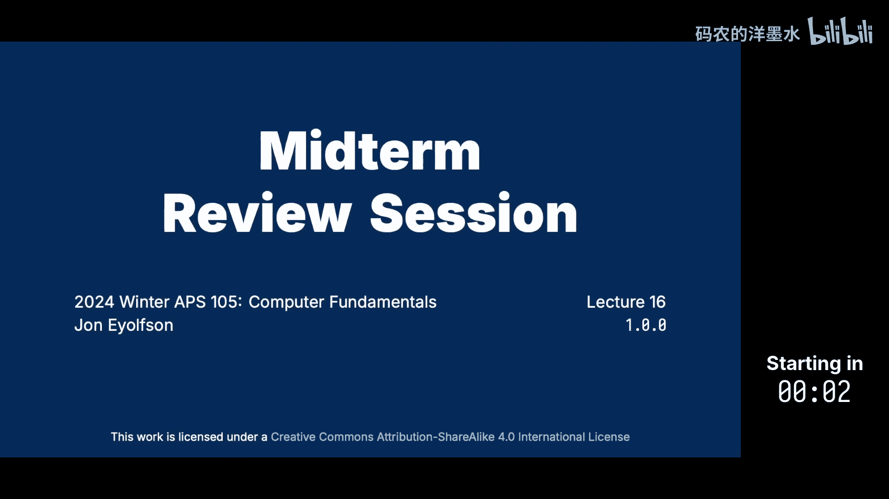
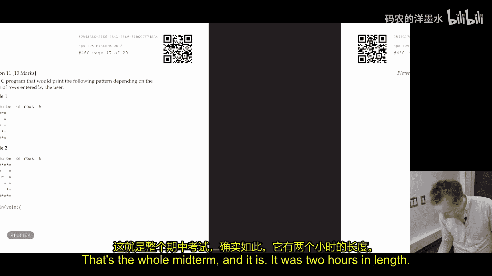
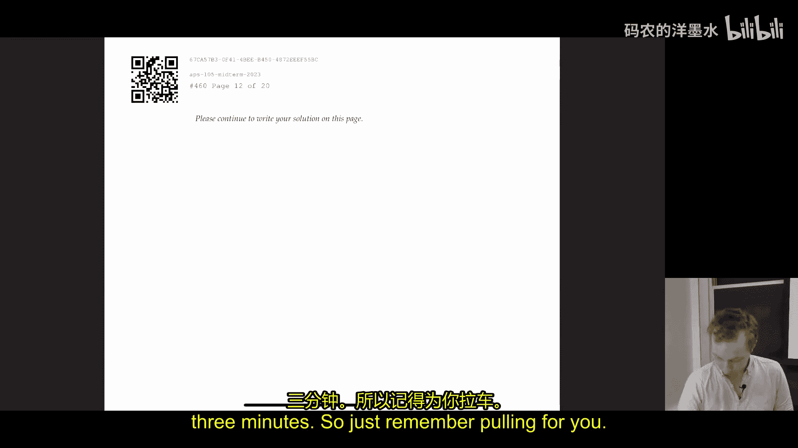

# 016：期中复习课 Part 1



在本节课中，我们将一起复习C语言编程的一些核心概念，包括基本语句、布尔逻辑、指针操作、数组遍历以及函数实现。我们将通过分析一份期中考试样题来巩固这些知识。

## 基本语句与运算

首先，我们来看一个简单的题目：编写一条C语句，计算一个两位数中每个数字的平方根之和，并将结果赋值给一个双精度浮点数变量。

以下是解题步骤：
*   使用 `num / 10` 获取十位数。
*   使用 `num % 10` 获取个位数。
*   调用 `sqrt()` 函数计算平方根并求和。

**代码示例：**
```c
double square = sqrt(num / 10) + sqrt(num % 10);
```

## 布尔逻辑与条件判断

上一节我们处理了数值运算，本节中我们来看看如何用一条语句声明并初始化一个布尔变量，用于判断一个数是否为正奇数。

以下是解题步骤：
*   检查数字是否大于0，以确定其正负。
*   检查数字除以2的余数是否为1，以确定其奇偶性。
*   使用逻辑与运算符 `&&` 连接两个条件。

**代码示例：**
```c
bool positive_odd = (num > 0) && (num % 2 == 1);
```

## 指针与数组操作

接下来，我们分析一段包含指针和数组操作的代码，并找出其中的错误。

以下是代码中存在的错误：
*   **第7行**：`array = 8;` 错误。数组名是一个常量指针，不能被重新赋值。
*   **第9行**：`k = array[p];` 错误。数组索引必须是整数，而 `p` 是一个指针。
*   **第10行**：`array[9] = 0;` 错误。数组越界访问。该数组的有效索引范围是0到8。

## 指针算术与循环

现在，我们来看一个使用指针算术遍历数组的程序，并推断其输出。

程序的核心是一个 `for` 循环，它使用指针 `p` 遍历数组 `my_array`。在循环体内，它检查 `p` 指向的值是否为偶数。如果是，则计算当前指针 `p` 与数组起始地址之间的偏移量（以元素个数计），并将该值作为索引，在 `another` 数组中存储当前偶数值，最后打印出来。

根据给定的数组 `{2, 4, 5, 7, 8}`，程序的输出将是：
```
another[0] = 2
another[1] = 4
another[4] = 8
```

## 函数调试与修正

本节我们将调试一个存在错误的函数。该函数旨在找出一个整数中最大的数字。

原函数存在以下问题：
1.  **第4行**：循环条件 `while (num < 0)` 错误。这会导致循环仅在输入为负数时执行。应改为 `while (num > 0)`。
2.  **第6行**：变量 `largest_digit` 被初始化为 `9`。这会导致函数总是返回9。应初始化为 `0`。
3.  **第9行**：比较语句 `if (num > largest_digit)` 错误。这里应该比较当前提取出的数字 `digit`，而不是原始数字 `num`。应改为 `if (digit > largest_digit)`。

修正后的函数能正确遍历数字的每一位，并记录遇到的最大值。

## 指针作为函数参数

这是一个综合性的题目，涉及指针作为函数参数、按值传递以及作用域。我们需要逐步跟踪程序的执行，以确定其输出。

关键点在于理解 `modify` 函数接收的是 `main` 函数中变量地址的副本。在函数内部：
*   通过指针可以修改 `main` 函数中变量的值。
*   指针变量本身（存储的地址）也可以被修改。
*   对函数内局部变量的修改不会影响 `main` 函数。

经过逐步分析，程序的输出为：
```
In modify: *a = -5, *b = 7, c = 3
In main: a = -5, b = 12, c = 3
```

## 数组遍历与点积计算

最后，我们实现一个计算两个向量点积的函数。向量的数组表示以 `-1` 作为结束标记。

解题思路是同时遍历两个数组。我们使用一个 `while` 循环，只要两个数组在当前索引处的值都不等于 `-1`，就继续循环。在循环中，我们累加对应元素的乘积。当循环退出后，检查两个数组在当前索引处的值是否都等于 `-1`。如果是，说明两个向量长度相同，返回累加结果；否则，返回 `-1`。

**代码示例：**
```c
int dot_product(int arr1[], int arr2[]) {
    int i = 0;
    int result = 0;
    while (arr1[i] != -1 && arr2[i] != -1) {
        result += arr1[i] * arr2[i];
        i++;
    }
    if (arr1[i] == -1 && arr2[i] == -1) {
        return result;
    } else {
        return -1;
    }
}
```

## 总结





本节课中我们一起学习了C语言期中考试涉及的多个核心主题。我们练习了编写基础运算和逻辑判断语句，分析了指针和数组操作中的常见错误，跟踪了指针在函数调用中的行为，并实现了一个处理数组的实用函数。掌握这些概念对于理解和编写更复杂的C程序至关重要。