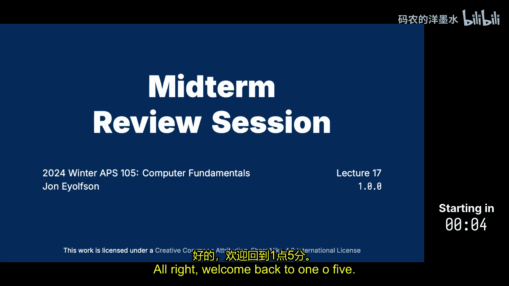
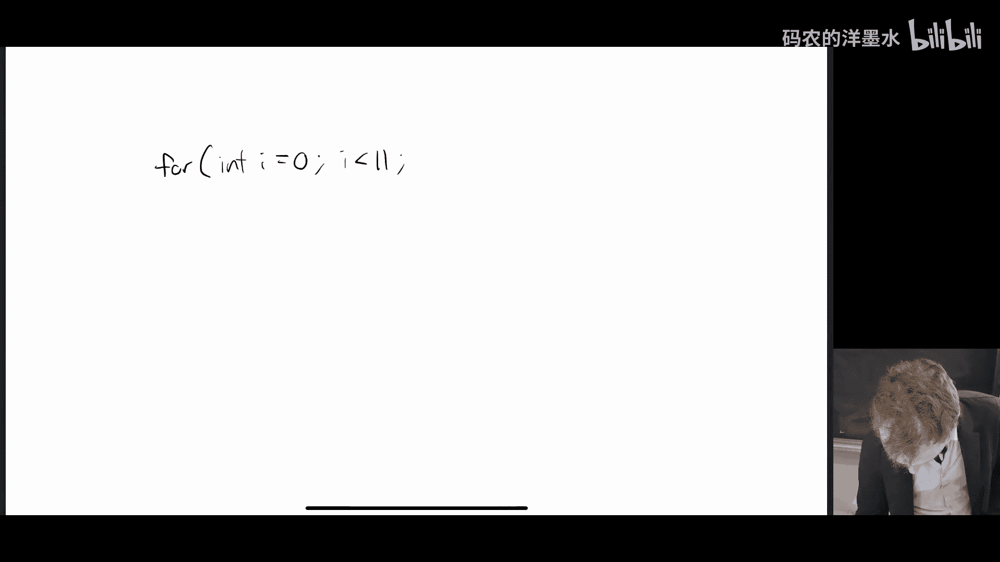
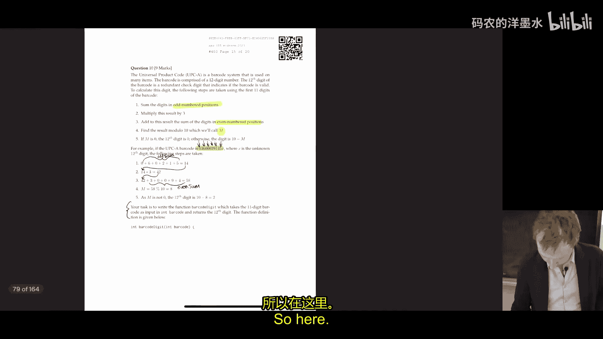
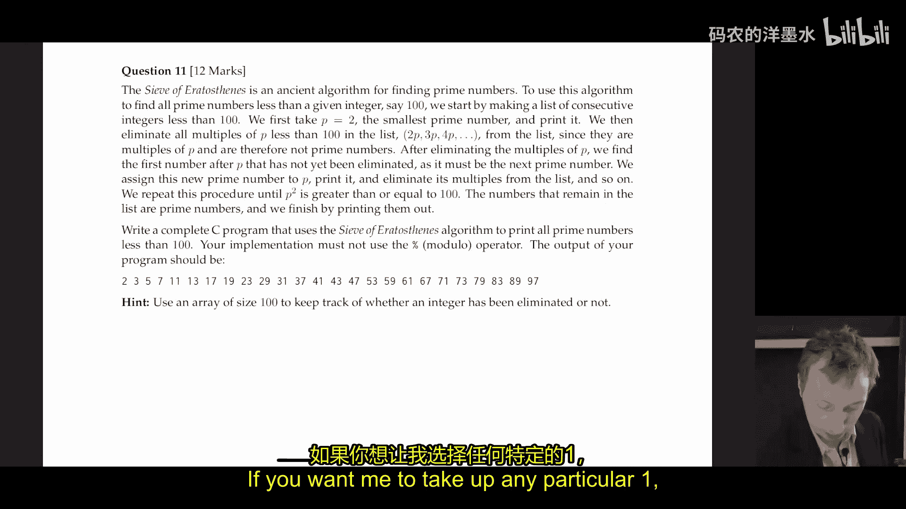

# 017：期中复习课 Part 2



在本节课中，我们将继续复习期中考试内容，通过分析2023年考试中的编程题和概念题，来巩固对C语言核心知识的理解。我们将重点关注函数编写、循环控制、条件判断以及指针基础。

## 通用产品代码校验位计算





上一节我们回顾了基础概念，本节中我们来看看一个具体的编程问题：计算通用产品代码的校验位。

题目要求编写一个函数，接收一个11位的整数条形码，并根据特定规则计算出第12位校验位。规则如下：
1.  将所有奇数位上的数字相加，将结果乘以3。
2.  将所有偶数位上的数字相加。
3.  将步骤1和步骤2的结果相加。
4.  计算步骤3结果对10取模的值，记为 `M`。
5.  如果 `M` 为0，则第12位为0；否则，第12位为 `10 - M`。

以下是解决此问题的一种方法，使用循环遍历每一位数字：

```c
int barcode_digit(int barcode) {
    int odd_sum = 0;
    int even_sum = 0;
    bool is_odd = true; // 从第一个（奇数）位开始

    for (int i = 0; i < 11; i++) {
        int digit = barcode % 10; // 获取最后一位数字
        barcode = barcode / 10;   // 移除最后一位数字

        if (is_odd) {
            odd_sum += digit;
            is_odd = false;
        } else {
            even_sum += digit;
            is_odd = true;
        }
    }

    int value = (odd_sum * 3) + even_sum;
    int M = value % 10;

    if (M == 0) {
        return 0;
    } else {
        return 10 - M;
    }
}
```

另一种更简洁的方法是使用 `while` 循环，直接交替处理奇偶位：

```c
int barcode_digit(int barcode) {
    int odd_sum = 0;
    int even_sum = 0;
    bool is_odd = true;

    while (barcode > 0) {
        int digit = barcode % 10;
        barcode /= 10;

        if (is_odd) {
            odd_sum += digit;
        } else {
            even_sum += digit;
        }
        is_odd = !is_odd; // 切换奇偶状态
    }
    // ... 后续计算M和返回值的代码同上
}
```

## 打印特定图案

接下来，我们分析一个需要打印复杂图案的程序。用户输入行数，程序需要打印出一个由星号(`*`)和空格组成的菱形边框图案。

首先，我们需要观察图案的行列关系。对于输入行数 `n`，总列数为 `2 * n - 1`。图案由顶部边框、底部边框、左右边框以及两条对角线组成。

解决思路是使用嵌套循环遍历每一个“单元格”（行和列的位置），并根据其位置决定打印星号还是空格。

以下是打印该图案的核心逻辑：

```c
#include <stdio.h>

int main() {
    int num_rows;
    printf("Enter number of rows: ");
    scanf("%d", &num_rows);

    int num_cols = 2 * num_rows - 1;

    for (int row = 1; row <= num_rows; row++) {
        for (int col = 1; col <= num_cols; col++) {
            // 判断是否打印星号的条件
            if (row == 1 ||                     // 顶部边框
                row == num_rows ||              // 底部边框
                col == 1 ||                     // 左边框
                col == num_cols ||              // 右边框
                row + col == num_rows + 1 ||    // 左上到右下的对角线
                col - row == num_rows - 1) {    // 右上到左下的对角线
                printf("*");
            } else {
                printf(" ");
            }
        }
        printf("\n"); // 每行结束换行
    }
    return 0;
}
```

对于初学者，如果时间有限，可以先实现顶部、底部和两侧的边框，这已经能获得大部分分数。

## 理解程序输出与常见陷阱

本节我们来看看一些考察C语言细节的题目，帮助大家避开常见陷阱。

**题目1：无限循环**
```c
int n = 10;
while (n != 0) {
    printf("%d\n", n);
    n -= 2;
}
```
这段代码意图是打印 `10, 8, 6...`，但 `n` 从 `2` 减到 `0` 后变为 `-2`，永远不会等于 `0`，因此是一个**无限循环**。在考试中，遇到无限循环可以写几项后用 `...` 表示。

**题目2：指针与类型**
```c
int use_count;
int *x, *y;
```
判断以下语句：
1.  `*use_count;` // **错误**：`use_count` 是整型变量，不能解引用。
2.  `int *p = x;` // **正确**：将指针 `x` 赋值给同类型指针 `p`。
3.  `int **q = &y;` // **警告**：`&y` 的类型是 `int **`，可以赋值给 `int **` 类型的 `q`，但通常意味着复杂的指针操作，编译器会给出类型不匹配的警告。
4.  `x = y = &use_count;` // **正确**：多重赋值，将 `use_count` 的地址赋给 `y` 和 `x`。

**题目3：运算符与作用域**
考虑以下代码片段：
```c
int i = 3, j = 6;
// 片段1: printf("%d", i++); // 输出 3，然后 i 变为 4
// 片段2: printf("%d", --i); // 输出 2，i 先减为2再打印
// 片段3: i = j / 10; // i 变为 0 (整数除法)
// 片段4: i = (int) 9.99; // i 变为 9 (强制类型转换截断)
// 片段5: if (i = 6) { ... } // i 被赋值为6，条件为真，但问的是i的值，答案是6
// 片段6: for (int i = 0; i < j; i++) { } // 循环后，外层的 i 仍然是3 (变量遮蔽)
```
特别注意片段5中的赋值运算符 `=` 与相等运算符 `==` 的区别，以及片段6中 `for` 循环内声明的 `i` 会遮蔽外层的 `i`。

## 综合程序阅读

最后，我们快速分析一个综合性的程序阅读题，它涉及函数调用和循环嵌套。

程序大致功能是打印一个圣诞树形状的图案。核心在于理解 `skip_space(n)` 函数打印 `n` 个空格，`print_left(n)` 打印 `n` 个 `/`，`print_right(n)` 打印 `n` 个 `\`。

通过跟踪主循环中变量 `i` 的变化，可以逐步推导出每一行打印的空格、斜杠和反斜杠的数量，最终组合成图案。这类题目考查的是耐心和细心。



本节课中我们一起学习了如何计算UPC校验位、如何使用循环和条件语句打印复杂图案，并分析了C语言中容易出错的细节，如无限循环、指针类型、运算符优先级和作用域。持续练习是掌握编程的关键，祝大家复习顺利！