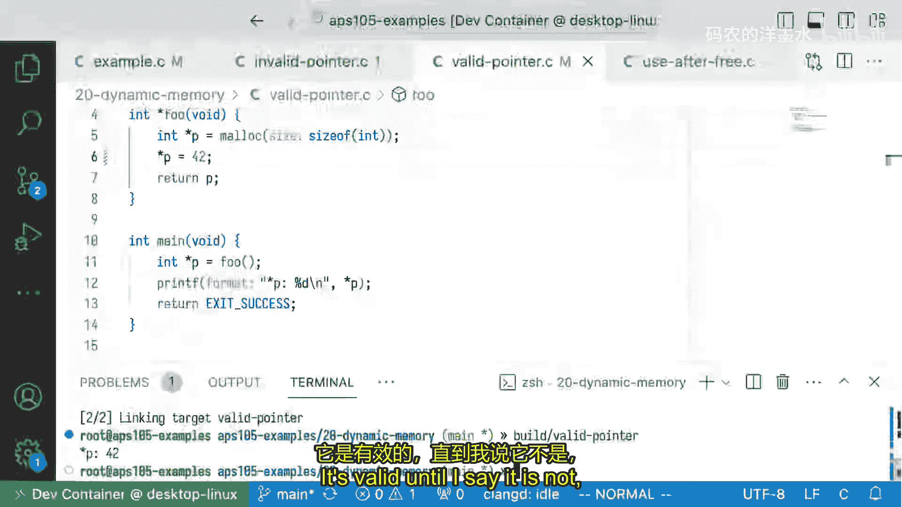
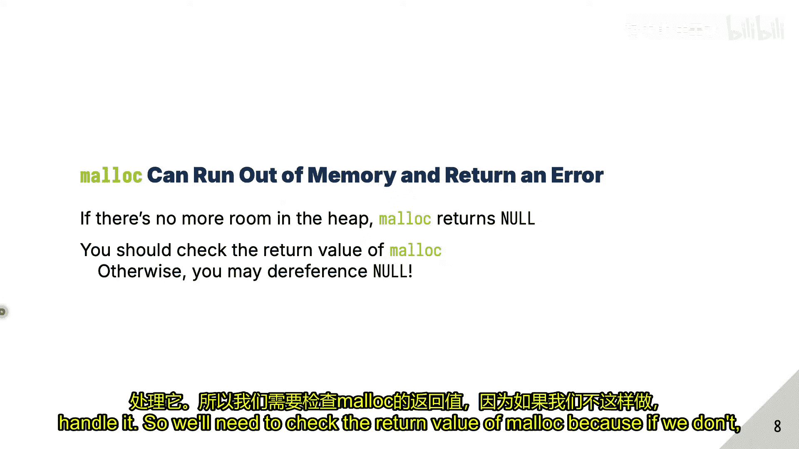
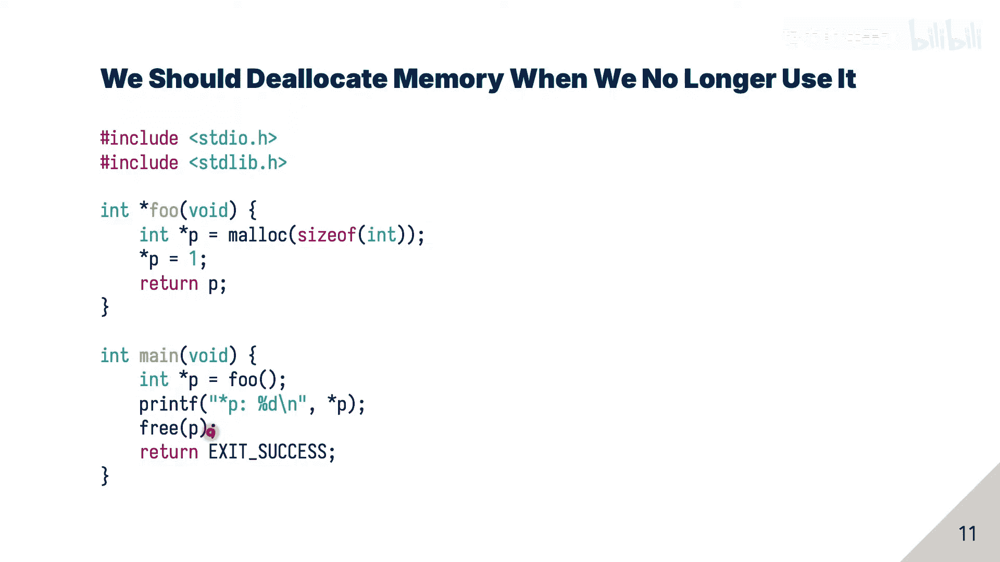
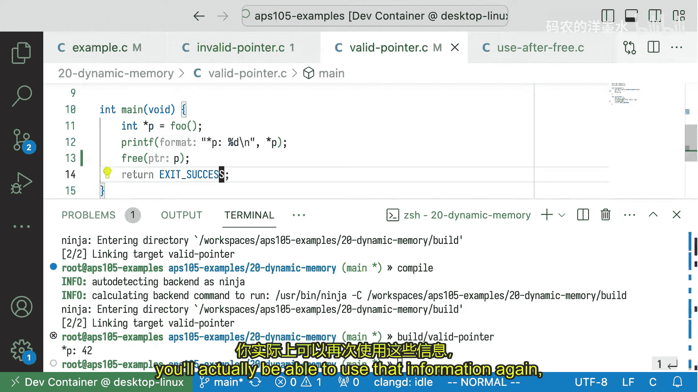
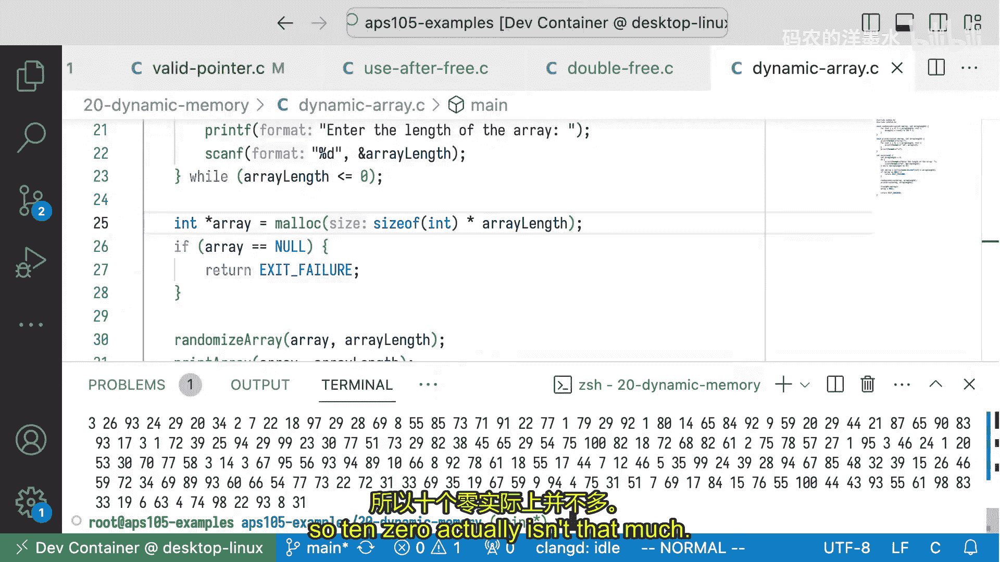
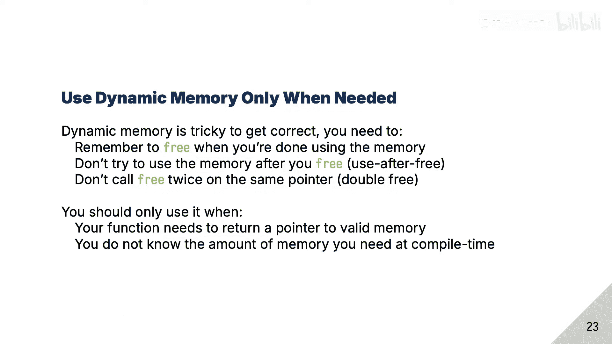

# 020：动态内存 🧠


在本节课中，我们将学习C语言中一个强大但需要谨慎使用的特性：动态内存管理。我们将了解如何手动请求和释放内存，以及如何避免由此带来的常见陷阱。

---

## 概述

到目前为止，我们使用的变量（局部变量）都存在于一个称为“栈”的内存区域中。这些变量在函数运行时被创建，在函数结束时自动销毁。然而，有时我们需要创建在函数结束后依然存在的内存，或者需要根据运行时信息（如用户输入）来决定分配多少内存。这时，我们就需要使用“堆”内存，并通过 `malloc` 和 `free` 函数来手动管理它。

上一节我们介绍了指针和函数返回地址时可能遇到的问题，本节中我们来看看如何通过动态内存分配来解决这些问题。

## 栈内存的局限性

首先，回顾一下我们之前遇到的问题。考虑以下代码：

```c
int* foo() {
    int x = 1;
    return &x; // 返回局部变量x的地址
}

int main() {
    int* p = foo();
    printf("%d\n", *p); // 危险！x已不存在
    return 0;
}
```

在这段代码中，函数 `foo` 返回了局部变量 `x` 的地址。当 `foo` 执行完毕后，`x` 所占用的栈内存就被释放了。此时，`main` 函数中的指针 `p` 指向的是一块无效的内存区域。尝试访问这块内存（如 `*p`）会导致未定义行为，通常是程序崩溃（段错误）。

**核心问题**：我们无法安全地从函数返回一个指向其局部变量的指针。

## 引入堆内存：`malloc`

为了解决这个问题，C语言提供了另一种内存区域：**堆**。堆内存的分配和释放不由函数调用栈控制，而是由程序员手动管理。

我们使用 `malloc` 函数从堆中请求内存。它的函数原型如下（定义在 `<stdlib.h>` 中）：

```c
void* malloc(size_t size);
```

*   `size_t size`：需要分配的**连续字节数**。`size_t` 是一个表示大小的无符号整数类型。
*   返回值：一个指向所分配内存起始地址的 `void*` 类型指针。如果内存不足，则返回 `NULL`。

`malloc` 只是分配了原始内存，并不初始化其内容，里面的值是**未定义**的。

### 分配一个整数




如果我们想分配一个整数的空间，可以这样做：

```c
int* p = malloc(sizeof(int)); // 请求足够存放一个int的内存（通常是4字节）
if (p != NULL) { // 必须检查malloc是否成功
    *p = 42; // 初始化这块内存
    printf("%d\n", *p); // 使用它
}
```

现在，我们可以重写之前的 `foo` 函数，使其安全地返回一个指针：




```c
int* foo() {
    int* p = malloc(sizeof(int)); // 在堆上分配内存
    if (p != NULL) {
        *p = 1; // 初始化值
    }
    return p; // 返回堆内存的地址，该内存在函数返回后依然有效
}

int main() {
    int* p = foo();
    if (p != NULL) {
        printf("%d\n", *p); // 安全地访问
    }
    return 0;
}
```

这样，`p` 指向的是堆上的内存，即使 `foo` 函数结束，这块内存依然存在，因此访问是安全的。

## 释放内存：`free`

有借有还。既然我们手动请求了内存，就必须在不再需要时手动归还，否则会导致**内存泄漏**。归还内存使用 `free` 函数：

```c
void free(void* ptr);
```

*   `void* ptr`：必须是之前由 `malloc`（或相关函数）返回的指针。
*   调用 `free(ptr)` 后，`ptr` 指向的内存被释放，交还给系统。
*   释放后，**绝对不能再**通过 `ptr` 访问该内存。
*   如果 `ptr` 是 `NULL`，`free` 函数什么也不做，这是安全的。




一个良好的习惯是在 `free` 之后，立即将指针设为 `NULL`，以防止后续误用。

```c
int* p = malloc(sizeof(int));
// ... 使用 p ...
free(p);
p = NULL; // 好习惯，防止“悬空指针”
```

### 内存泄漏

如果只分配而不释放，程序占用的内存会越来越多，就像某些网页浏览器一样。这被称为**内存泄漏**。对于长时间运行的程序，这是严重的问题。

### 使用已释放的内存

在 `free` 之后再次使用指针，称为 **Use-After-Free**。这是未定义行为，可能导致程序崩溃或读取到垃圾数据。

```c
int* p = malloc(sizeof(int));
*p = 14;
free(p);
printf("%d\n", *p); // 错误！使用了已释放的内存
```

### 重复释放

对同一个指针调用两次 `free`，称为 **Double Free**，同样会导致运行时错误。

```c
int* p = malloc(sizeof(int));
free(p);
free(p); // 错误！重复释放
```

## 动态分配数组

`malloc` 更强大的用途是动态创建数组。我们可以在程序运行时决定数组的大小。

以下是动态创建和操作数组的步骤：

1.  **计算总字节数**：数组长度 × 每个元素的大小。
2.  **调用 `malloc`** 分配内存。
3.  **检查返回值**是否为 `NULL`。
4.  **将返回的指针当作数组名使用**。
5.  **使用完毕后，调用 `free` 释放内存**。

```c
#include <stdio.h>
#include <stdlib.h>

int main() {
    int arrayLength;
    printf("Enter the array length: ");
    scanf("%d", &arrayLength);

    // 1. 动态分配数组
    int* dynamicArray = malloc(arrayLength * sizeof(int));

    // 2. 检查分配是否成功
    if (dynamicArray == NULL) {
        printf("Memory allocation failed!\n");
        return 1; // 或 exit(EXIT_FAILURE);
    }

    // 3. 像使用普通数组一样使用它
    for (int i = 0; i < arrayLength; i++) {
        dynamicArray[i] = i * 10;
    }

    for (int i = 0; i < arrayLength; i++) {
        printf("%d ", dynamicArray[i]);
    }
    printf("\n");

    // 4. 释放内存
    free(dynamicArray);
    dynamicArray = NULL;

    return 0;
}
```




**核心概念**：`malloc` 分配的是一块连续的字节区域，这与数组在内存中的布局完全相同，因此我们可以将返回的指针当作数组来使用。

## 调试工具：Valgrind

动态内存错误很难仅通过观察代码发现。幸运的是，有工具可以帮助我们。**Valgrind** 是一个强大的内存调试工具。

在命令行中，像这样运行你的程序：

```bash
valgrind ./your_program_name
```

Valgrind 会监控程序的内存操作，并报告如下问题：
*   **内存泄漏**：哪些内存被分配了但没有释放。
*   **Use-After-Free**：在释放后使用了内存。
*   **Double Free**：重复释放。

为了获得更详细的泄漏信息，可以运行：

```bash
valgrind --leak-check=full ./your_program_name
```

Valgrind 的输出会指出问题发生的代码行号，是调试动态内存问题的利器。

## 错误处理：`exit` 函数

当 `malloc` 返回 `NULL`（内存不足）时，我们的程序可能无法继续。与其让程序后续崩溃，不如主动、体面地结束它。我们可以使用 `exit` 函数。

```c
#include <stdlib.h>
// ...
int* p = malloc(sizeof(int));
if (p == NULL) {
    // 内存分配失败，退出程序
    exit(EXIT_FAILURE); // EXIT_FAILURE 是一个表示失败的非零值
}
// EXIT_SUCCESS 表示成功
```

`exit` 函数会立即终止程序，其参数会返回给操作系统，类似于 `main` 函数的返回值。

## 总结




本节课中我们一起学习了C语言的动态内存管理：

1.  **为什么需要动态内存**：为了创建在函数作用域之外存活的内存，或创建大小在编译时未知的数据结构（如数组）。
2.  **如何分配内存**：使用 `malloc(size)` 函数从堆上请求指定字节数的连续内存。必须使用 `sizeof` 运算符来计算所需大小。
3.  **如何释放内存**：使用 `free(ptr)` 函数释放之前分配的内存。这是防止内存泄漏的关键。
4.  **必须遵守的规则**：
    *   检查 `malloc` 的返回值是否为 `NULL`。
    *   不要使用已释放的内存（Use-After-Free）。
    *   不要对同一块内存释放两次（Double Free）。
    *   释放后可将指针设为 `NULL` 以防误用。
5.  **动态数组**：通过 `malloc(n * sizeof(type))` 可以创建动态大小的数组。
6.  **辅助工具**：使用 **Valgrind** 来检测内存泄漏和其他内存错误。
7.  **核心建议**：动态内存功能强大但危险，**仅在必要时使用**。如果可以使用栈内存（局部变量）或全局变量解决问题，就优先使用它们。



动态内存管理是C编程中的难点，也是体现程序员功力的地方。理解并正确应用这些概念，是编写健壮、高效C程序的基础。