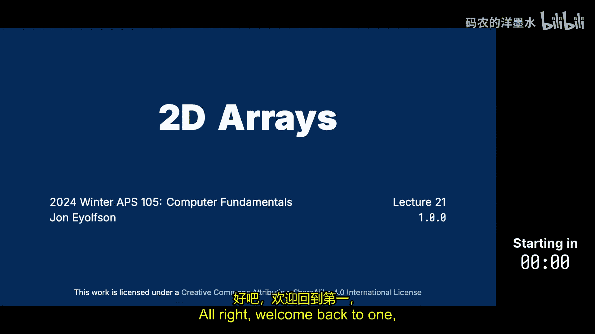
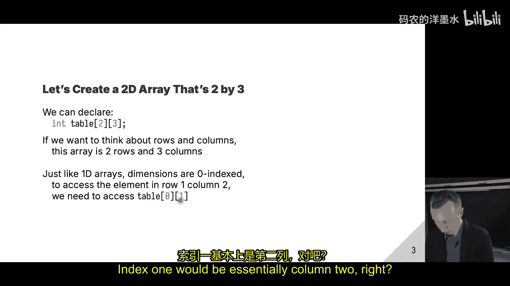
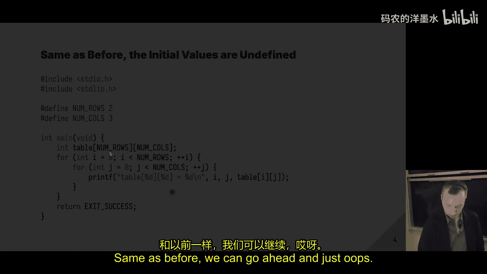
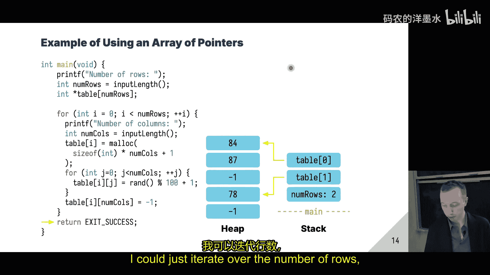
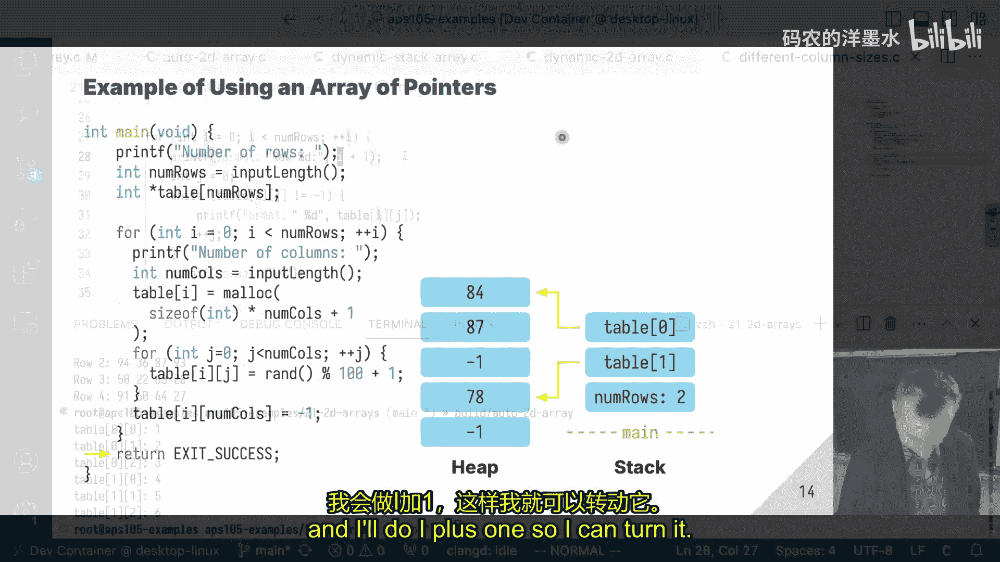
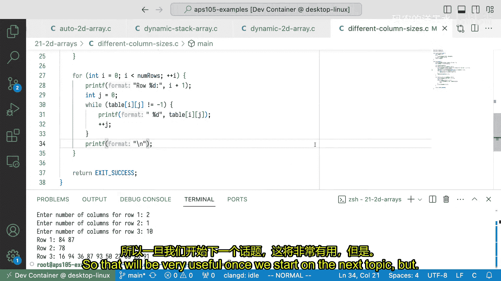
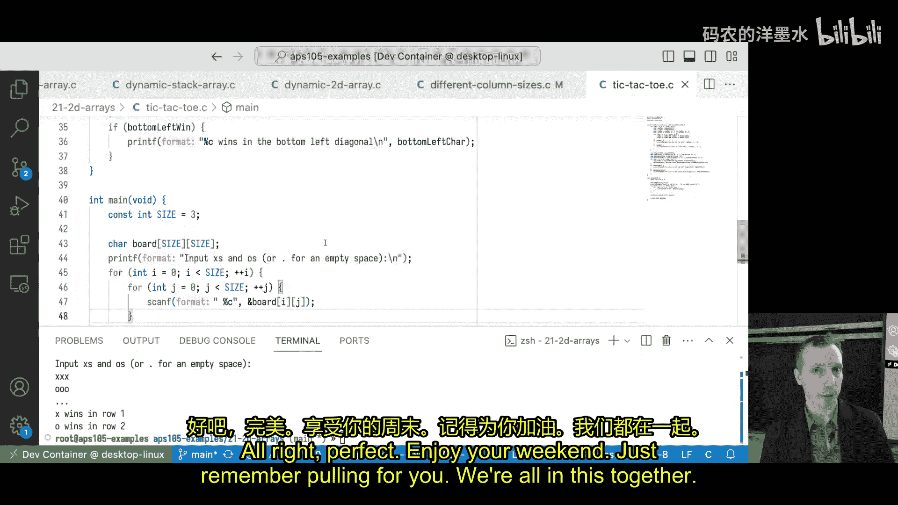

# 021：二维数组 🧮



在本节课中，我们将要学习C语言中的二维数组。我们将从一维数组的回顾开始，逐步介绍二维数组的声明、初始化、内存布局以及如何动态创建和使用它们。课程最后，我们会通过一个简单的井字棋游戏示例来巩固所学知识。

---





## 回顾：一维数组

上一节我们介绍了一维数组，本节中我们来看看二维数组。首先，让我们快速回顾一下一维数组。

声明一个一维数组的语法如下：
```c
int array_name[array_size];
```
或者，我们可以在声明时直接初始化它：
```c
int array_name[] = {value1, value2, value3};
```
我们还可以使用一个宏来计算数组的大小。

---

## 二维数组基础

二维数组，顾名思义，就是在两个维度上存储数据的数组。它的声明语法与一维数组非常相似，只是多了一对方括号。

声明一个二维数组的语法如下：
```c
type array_name[rows][columns];
```
其中：
*   `type` 是数组中每个元素的类型。
*   `array_name` 是数组的名称。
*   `rows` 是数组的行数。
*   `columns` 是数组的列数。

我们可以把二维数组想象成一个表格，有行和列。和所有C语言数组一样，索引是从0开始的。例如，要访问“第1行，第2列”（人类计数法）的元素，我们需要使用索引 `[0][1]`。

---

## 初始化二维数组

与一维数组类似，我们可以在声明时初始化二维数组。但需要注意的是，我们需要为每一行使用一组独立的花括号。

以下是初始化一个2行3列的二维数组的方法：
```c
int table[2][3] = {
    {1, 2, 3}, // 第一行
    {4, 5, 6}  // 第二行
};
```
我们也可以省略内层的花括号，C语言会按顺序填充所有值。但为了清晰起见，建议使用内层花括号。

---

## 内存布局：行主序

在内存中，二维数组是以**行主序**的方式连续存储的。这意味着同一行的所有元素在内存中是相邻的，存储完第一行后，紧接着存储第二行，依此类推。

正因为这种存储方式，我们可以用一个一维数组的索引公式来访问二维数组中的元素：
```c
1D_index = (row_index * number_of_columns) + column_index
```
例如，对于一个 `table[2][3]`，元素 `table[1][2]` 在一维表示中的索引是 `(1 * 3) + 2 = 5`。

---

## 动态二维数组与省略维度

在声明二维数组时，我们可以省略第一个维度（行数），但必须指定第二个维度（列数）。C语言编译器可以根据初始化的数据量自动计算出行数。

以下是合法的声明：
```c
int table[][3] = {{1,2,3}, {4,5,6}}; // C会计算出有2行
```
但是，不能同时省略两个维度，因为C语言无法推断出数据的组织方式。

---

## 部分初始化与零填充

如果我们为二维数组指定了大小，但在初始化时提供的值少于元素总数，C语言会自动将剩余的元素初始化为0。

例如：
```c
int table[2][3] = {{1}, {4,5}};
```
这个数组将被初始化为：
*   第一行: `{1, 0, 0}`
*   第二行: `{4, 5, 0}`

这个规则同样适用于一维数组。

---

## 运行时确定大小的数组（VLA）

在现代C语言标准中，我们可以使用变量来指定数组的大小，这被称为可变长度数组。但请注意，这样创建的数组位于栈上，有其作用域限制。

以下是创建可变长度一维数组的示例：
```c
int length;
printf("Enter array length: ");
scanf("%d", &length);
int dynamic_array[length]; // 大小在运行时确定
```
对于二维数组也同样适用：
```c
int rows, cols;
printf("Enter rows and columns: ");
scanf("%d %d", &rows, &cols);
int dynamic_2d_array[rows][cols];
```
但是，以这种方式声明的数组不能在声明时进行初始化。

---

## 将二维数组传递给函数

将二维数组传递给函数时，函数原型中必须至少指定列数。行数可以被省略，或者作为一个单独的参数传递。

以下是一个函数声明的例子：
```c
void process_array(int arr[][COLS], int rows);
// 或者，如果COLS也是一个变量，需要先声明它
void process_array(int cols, int rows, int arr[][cols]);
```
关键点是，列数参数必须在数组参数之前声明，这样编译器才知道如何进行内存地址计算。

---





## 创建不等长列的“二维”数组

标准的二维数组要求每一行的列数相同。如果我们想要一个每行列数都不同的结构（类似于“锯齿数组”），就需要使用指针数组和动态内存分配。



其核心思想是：
1.  创建一个指针数组，每个指针将指向一行。
2.  为每一行单独使用 `malloc` 分配所需数量的内存。

以下是实现步骤的分解：

首先，声明一个指针数组（即“行”数组）：
```c
int num_rows;
printf("Enter number of rows: ");
scanf("%d", &num_rows);
int *table[num_rows]; // 一个包含`num_rows`个整型指针的数组
```
然后，为每一行动态分配内存（即“列”数组）：
```c
for (int i = 0; i < num_rows; i++) {
    int num_cols;
    printf("Enter columns for row %d: ", i+1);
    scanf("%d", &num_cols);

    // 为`num_cols`个整数+1个哨兵值（如-1）分配空间
    table[i] = malloc(sizeof(int) * (num_cols + 1));

    // 填充数据...
    for (int j = 0; j < num_cols; j++) {
        table[i][j] = rand() % 100; // 示例：填充随机数
    }
    // 在末尾放置哨兵值，标记行结束
    table[i][num_cols] = -1;
}
```
通过这种方式，`table[i]` 是一个指向整型的指针，我们可以像使用一维数组一样使用它 `table[i][j]`。但请注意，不同行分配的内存块在堆上不一定是连续的。

这种结构的类型实际上是 `int **table`（指向整型指针的指针），这是我们课程中首次遇到的双重指针。

---

## 应用示例：简易井字棋检查器

最后，让我们通过一个简单的井字棋游戏胜负检查器来应用二维数组。假设我们有一个 `SIZE x SIZE` 的字符数组代表棋盘，‘X’和‘O’代表玩家，‘.’代表空位。

以下是核心的检查逻辑概述（检查行、列和对角线）：
```c
#define SIZE 3

char checkWinner(char board[SIZE][SIZE]) {
    // 检查行和列
    for (int i = 0; i < SIZE; i++) {
        if (board[i][0] != '.' && board[i][0] == board[i][1] && board[i][1] == board[i][2]) {
            return board[i][0]; // 行获胜
        }
        if (board[0][i] != '.' && board[0][i] == board[1][i] && board[1][i] == board[2][i]) {
            return board[0][i]; // 列获胜
        }
    }
    // 检查对角线
    if (board[0][0] != '.' && board[0][0] == board[1][1] && board[1][1] == board[2][2]) {
        return board[0][0];
    }
    if (board[0][2] != '.' && board[0][2] == board[1][1] && board[1][1] == board[2][0]) {
        return board[0][2];
    }
    return '.'; // 暂无胜者
}
```
这个例子展示了如何遍历和操作二维数组，其思想与实验6（单词搜索）类似，只是检查的方向和规则不同。

---

## 总结 🎯

本节课中我们一起学习了C语言中二维数组的方方面面。
*   我们回顾了一维数组，并扩展到二维数组的声明和初始化。
*   理解了二维数组在内存中以**行主序**连续存储，并掌握了相应的索引计算。
*   学习了如何声明可变长度数组以及在函数中传递二维数组的规则。
*   深入探讨了如何通过**指针数组和动态内存分配**来创建列数不等的“二维”结构，这引入了 `int **` 类型的双重指针概念。
*   最后，通过一个井字棋检查器的例子，实践了二维数组的遍历和逻辑应用。



掌握二维数组是处理矩阵、网格、游戏棋盘等数据的基础，也为后续学习更复杂的数据结构做好了准备。