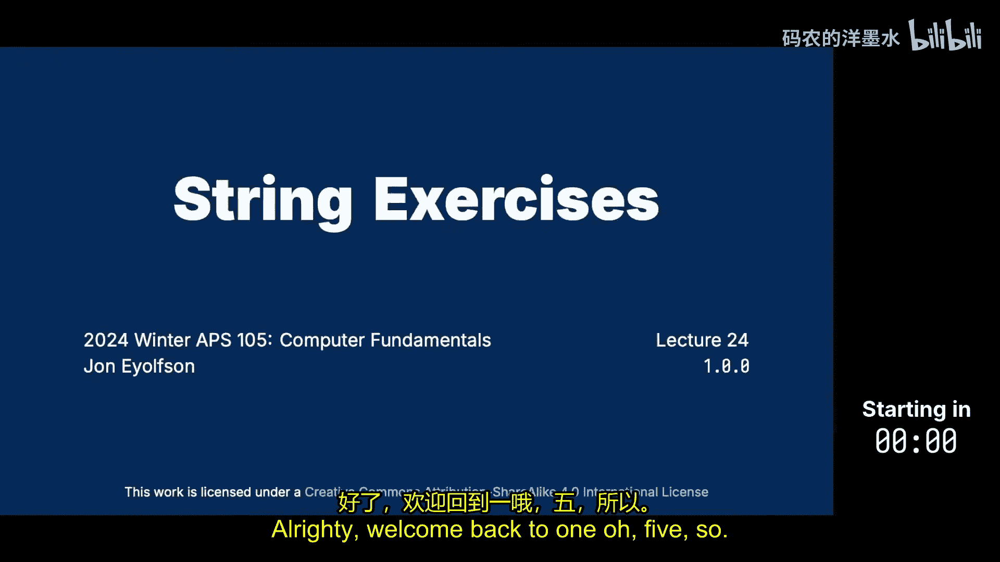
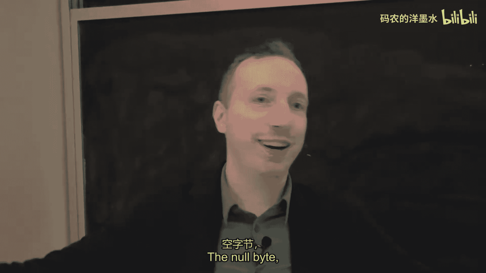
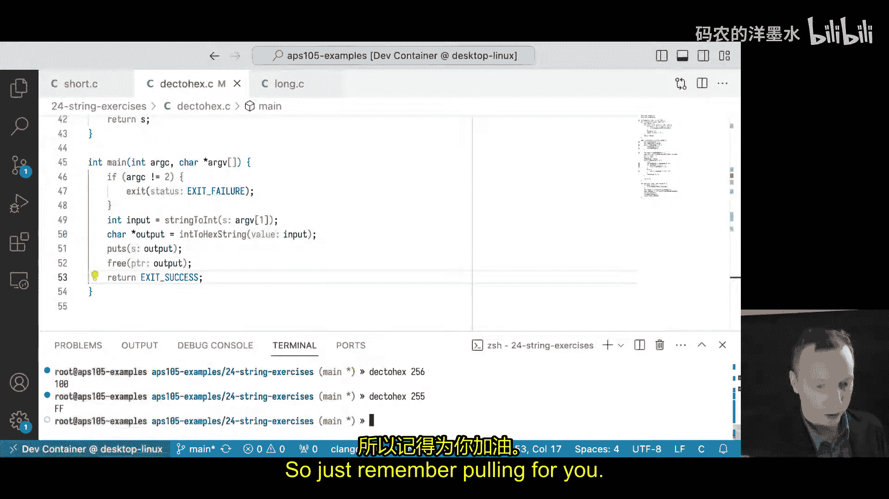

# 024：字符串练习 🧵






在本节课中，我们将通过两个典型的考试题目来练习字符串操作，并学习一个实用的编程技巧：如何编写一个可以接收命令行参数的程序。我们将从字符串的基础概念开始，逐步深入到具体的函数实现。

## 字符串基础回顾

上一节我们介绍了字符串的基本概念。本节中我们来看看如何应用这些知识解决实际问题。

C语言中的字符串本质上是一个字符数组，其特殊之处在于它以空字符（`\0`）结尾。这个空字符是字符串结束的标志，也是我们操作字符串的关键。

## 练习一：去除前导零

首先，我们来看一个去除字符串前导零的练习。题目要求我们完成一个函数，该函数会修改一个表示数字的字符串，去掉其开头的所有‘0’字符。

以下是题目给出的代码框架和我们的任务：
```c
void printnum(char *string) {
    int i = 0;
    while (string[i] == ‘0’) {
        i++;
    }
    // 我们需要在此处添加一行代码
    printf(“%s\n”, string);
}
```
我们的目标是在注释处添加代码，使得函数能正确打印出不带前导零的数字。例如，输入字符串 `“000089876”`，应输出 `“89876”`。

**解题思路**：
1.  变量 `i` 在 `while` 循环结束后，其值等于前导零的个数。
2.  为了从第一个非零字符开始打印，我们需要将字符串指针向前移动 `i` 个位置。
3.  这可以通过指针运算实现：`string += i;`。这行代码将指针 `string` 重新指向原字符串的第 `i` 个字符（即第一个非‘0’字符）。

因此，我们添加的代码就是 `string += i;`。这样，`printf` 函数就会从新的起始位置开始打印，直到遇到空字符为止。

## 练习二：查找子字符串的最后一次出现

接下来是一个更复杂的练习：编写一个函数 `last_string_in_string`，用于查找字符串 `s1` 在字符串 `s2` 中最后一次出现的位置。

函数原型如下：
```c
char *last_string_in_string(const char *s1, const char *s2);
```
如果找到，则返回指向 `s2` 中该次匹配起始位置的指针；如果未找到，则返回 `NULL`。题目要求我们不能使用 `strstr` 函数。

**解题思路**：
我们可以从 `s2` 的末尾开始，向前逐段比较与 `s1` 长度相同的子串。以下是实现步骤：

1.  获取 `s1` 和 `s2` 的长度。
2.  从 `s2` 的 `(长度_s2 - 长度_s1)` 位置开始向前遍历。这是为了确保每次比较的子串都有足够的长度。
3.  在循环中，使用 `strncmp` 函数比较 `s2` 中从当前位置开始的、长度为 `长度_s1` 的子串是否与 `s1` 完全相等。
4.  如果相等，则立即返回指向该位置的指针。
5.  如果遍历完所有可能位置都未找到，则返回 `NULL`。

核心代码逻辑如下：
```c
int len1 = strlen(s1);
int len2 = strlen(s2);
for (int i = len2 - len1; i >= 0; i--) {
    if (strncmp(s2 + i, s1, len1) == 0) {
        return (char *)(s2 + i); // 找到匹配
    }
}
return NULL; // 未找到匹配
```

## 实用技巧：使用命令行参数

前面的练习都是标准的函数实现。现在，我们来看看一个更贴近实际应用的编程方法：让 `main` 函数接收命令行参数。

`main` 函数其实有另一种形式：
```c
int main(int argc, char *argv[])
```
*   `argc` (argument count)：表示程序运行时传入的参数个数。
*   `argv` (argument vector)：是一个指向字符串数组的指针，每个字符串都是一个参数。

**参数规则**：
*   `argv[0]` 通常是程序自身的名称。
*   `argv[1]`、`argv[2]`... 是用户输入的其他参数。
*   操作系统会自动处理空格，将输入分割成独立的字符串参数。

### 示例：十进制转十六进制程序

让我们编写一个实用的程序 `dectohex`，它从命令行接收一个十进制数字，并将其转换为十六进制输出。

程序用法示例：在终端中输入 `./dectohex 255`，程序输出 `FF`。

**实现步骤**：

1.  **参数检查**：首先检查 `argc` 是否为2（程序名 + 一个数字参数）。如果不是，则打印错误信息并退出。
2.  **字符串转整数**：我们需要将 `argv[1]` 这个字符串转换为整数。为了更好地处理错误输入（如包含字母），我们编写自己的转换函数，而不是直接用 `atoi`。
    *   遍历字符串的每个字符。
    *   检查字符是否在 `‘0’` 到 `‘9’` 之间，否则报错。
    *   使用公式 `value = value * 10 + (current_char - ‘0’)` 来累加计算整数值。
3.  **整数转十六进制字符串**：
    *   通过不断除以16并取余数，计算出十六进制数的每一位（逆序）。
    *   根据余数大小（0-9 或 10-15），将其转换为对应的字符（`‘0’`-`‘9’` 或 `‘A’`-`‘F’`）。
    *   由于计算是逆序的，我们需要将字符从后往前填入新申请的字符串内存中。
    *   最后，不要忘记在字符串末尾添加空字符 `‘\0’`。
4.  **输出与清理**：打印得到的十六进制字符串，并释放之前动态申请的内存。

这个程序展示了如何编写一个完整、健壮的命令行工具，它比使用 `scanf` 等待用户交互更为常见和实用。

## 总结

本节课中我们一起学习了：
1.  **字符串操作练习**：通过“去除前导零”和“查找子串最后出现位置”两个题目，巩固了指针运算和字符串比较函数（`strncmp`）的用法。
2.  **命令行参数**：学习了 `main(int argc, char *argv[])` 的用法，了解了如何让程序从命令行接收输入参数。
3.  **综合应用**：实现了一个完整的“十进制转十六进制”命令行程序，涵盖了参数校验、字符串与整数的相互转换、内存动态管理等多个知识点。



掌握这些技能，你将能够编写出更接近真实世界应用场景的C语言程序。