# 026：进阶递归

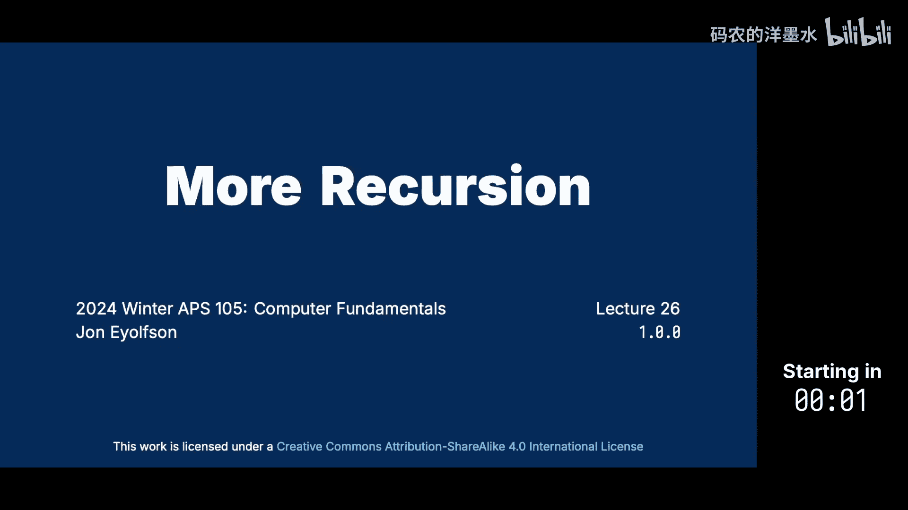

在本节课中，我们将深入学习递归的进阶应用。我们将通过几个具体的编程问题，包括计算最大公约数、递归计数、数组求和以及著名的汉诺塔问题，来巩固对递归概念的理解。我们将遵循递归的两个核心规则：**基础情况**和**递归步骤**，并学习如何将它们应用到更复杂的场景中。

---

## 计算最大公约数 (GCD)

上一节我们回顾了递归的基本概念。本节中，我们来看看如何利用递归解决一个经典的数学问题：计算两个整数的最大公约数。

最大公约数 (GCD) 是能同时整除两个给定正整数的最大整数。我们可以使用**欧几里得算法**来递归地解决这个问题。

该算法的核心思想是：对于两个整数 `a` 和 `b`（假设 `a >= b`），`gcd(a, b)` 等于 `gcd(b, a % b)`。当 `b` 变为 0 时，`a` 就是最大公约数。

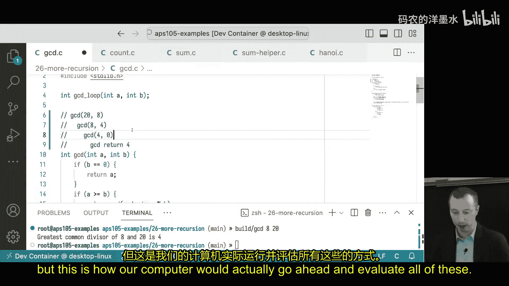

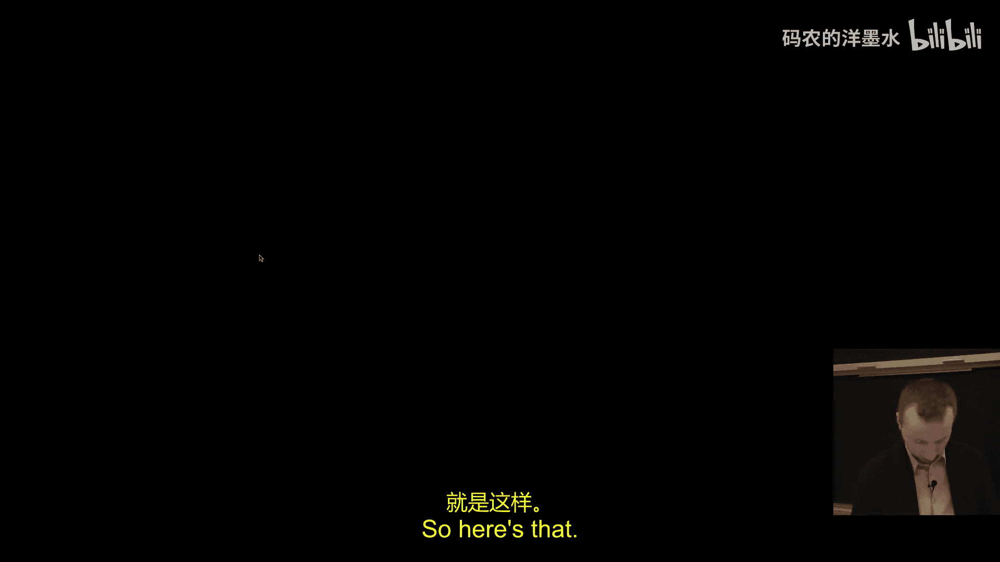

以下是递归实现的代码：

```c
int gcd(int a, int b) {
    // 基础情况：当 b 为 0 时，a 就是最大公约数
    if (b == 0) {
        return a;
    }
    // 如果 a 小于 b，交换参数以确保 a >= b
    else if (a < b) {
        return gcd(b, a);
    }
    // 递归步骤：gcd(a, b) = gcd(b, a % b)
    else {
        return gcd(b, a % b);
    }
}
```

例如，计算 `gcd(20, 8)` 的过程如下：
1. `gcd(20, 8)` 因为 20 >= 8，进入递归步骤：`gcd(8, 20 % 8)` 即 `gcd(8, 4)`。
2. `gcd(8, 4)` 进入递归步骤：`gcd(4, 8 % 4)` 即 `gcd(4, 0)`。
3. `gcd(4, 0)` 触发基础情况，返回 4。

因此，`gcd(20, 8)` 的结果是 4。

---

## 递归计数

理解了如何解决数学问题后，我们来看看一个更简单的任务：递归地计数。这有助于我们理解递归调用顺序对结果的影响。

我们的目标是编写一个函数，给定一个数字 `n`，它能打印出从 1 到 `n` 或从 `n` 到 1 的数字。关键在于**打印语句**的位置。

以下是两种实现方式：

```c
// 版本一：先递归，后打印。结果是从 1 打印到 n。
void countUp(int n) {
    if (n == 0) {
        return; // 基础情况：什么都不做
    }
    countUp(n - 1); // 递归步骤：先解决更小的问题 (n-1)
    printf("%d\n", n); // 然后再打印当前数字
}

// 版本二：先打印，后递归。结果是从 n 打印到 1。
void countDown(int n) {
    if (n == 0) {
        return; // 基础情况
    }
    printf("%d\n", n); // 先打印当前数字
    countDown(n - 1); // 再解决更小的问题
}
```

调用 `countUp(5)` 会输出 `1 2 3 4 5`，而 `countDown(5)` 会输出 `5 4 3 2 1`。这清晰地展示了递归调用和操作执行的先后顺序。

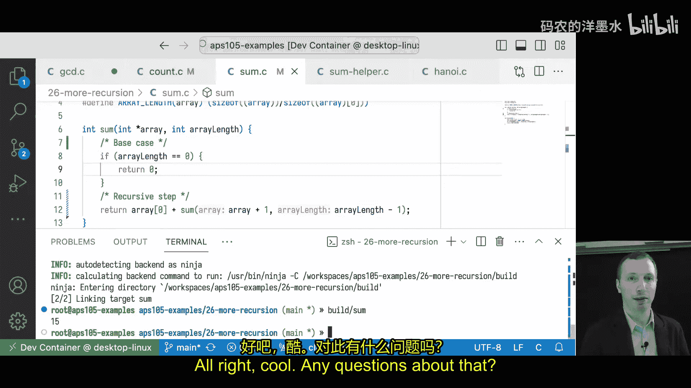

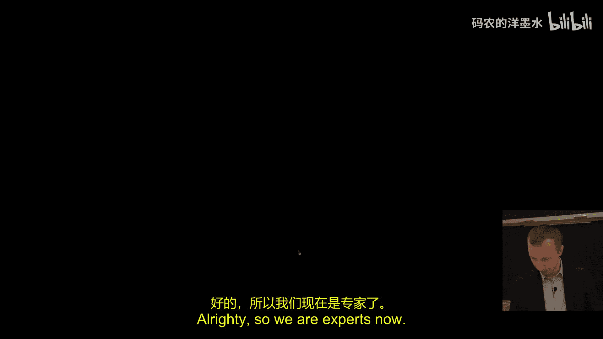

---

## 递归计算数组和

现在，让我们将递归思想应用到数据结构上：计算一个整数数组所有元素的总和。

思路是：数组的和等于**第一个元素**加上**剩余元素组成的子数组的和**。这自然形成了一个递归定义。

以下是递归求和的实现：

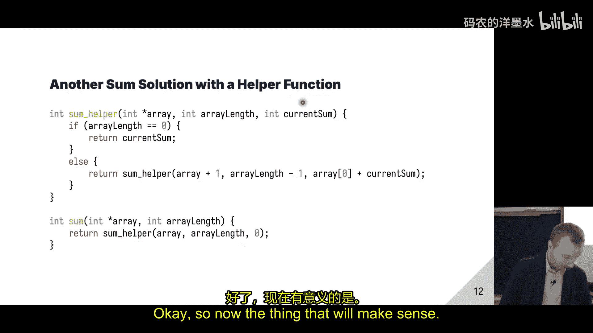

```c
int sumArray(int arr[], int length) {
    // 基础情况1：如果数组为空，和为0
    if (length == 0) {
        return 0;
    }
    // 基础情况2：如果数组只有一个元素，和就是这个元素
    if (length == 1) {
        return arr[0];
    }
    // 递归步骤：总和 = 第一个元素 + 剩余子数组的和
    // arr + 1 是指针运算，指向下一个元素，length - 1 是剩余长度
    return arr[0] + sumArray(arr + 1, length - 1);
}
```

例如，对于数组 `{1, 2, 3, 4, 5}`：
1. `sum({1,2,3,4,5}) = 1 + sum({2,3,4,5})`
2. `sum({2,3,4,5}) = 2 + sum({3,4,5})`
3. 以此类推，直到触发基础情况。

最终结果是 15。

有时你可能会想到一个需要额外参数的“尾递归”版本。为了让主函数更简洁，通常会定义一个辅助函数：

```c
// 辅助函数，携带当前和作为参数
int sumHelper(int arr[], int length, int currentSum) {
    if (length == 0) {
        return currentSum; // 基础情况：返回当前累加和
    }
    // 递归步骤：将当前元素加入和，并处理剩余数组
    return sumHelper(arr + 1, length - 1, currentSum + arr[0]);
}

// 主函数，对用户隐藏辅助参数
int sumArrayNice(int arr[], int length) {
    return sumHelper(arr, length, 0); // 初始当前和为0
}
```

---

## 汉诺塔问题

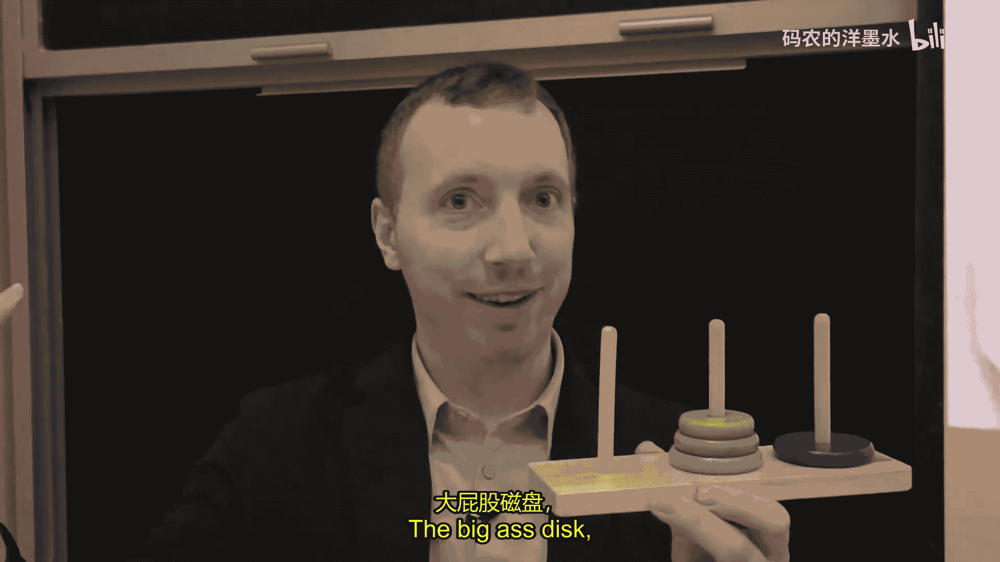

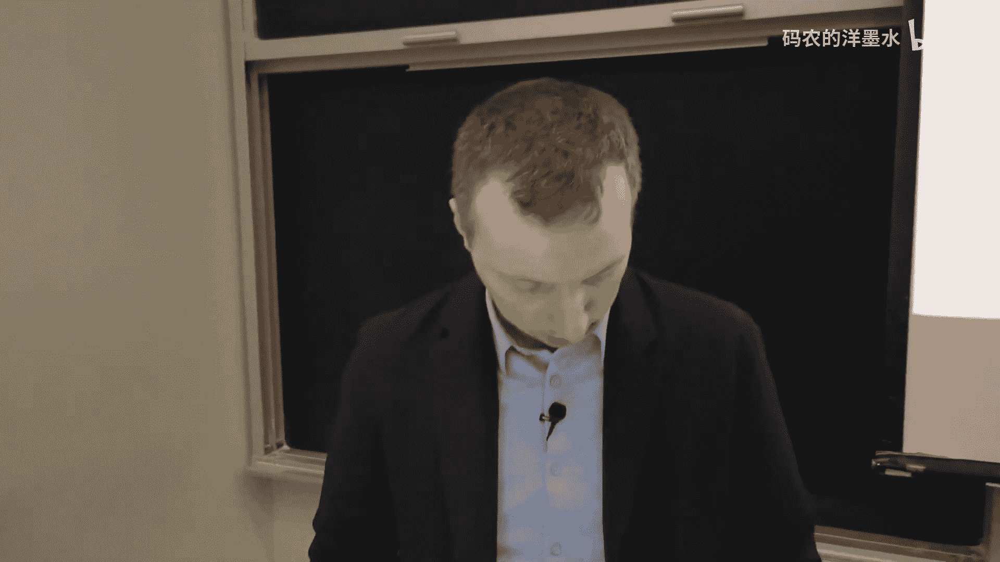

最后，我们探讨一个经典的递归问题：**汉诺塔**。它完美体现了“将大问题分解为小问题”的递归思想。

**问题描述**：有三根柱子（编号1，2，3）。开始时，所有大小不同的圆盘按从大到小的顺序套在柱子1上。目标是将所有圆盘移动到柱子3上。
**规则**：
1. 每次只能移动一个圆盘。
2. 任何时候，都不能将较大的圆盘放在较小的圆盘之上。

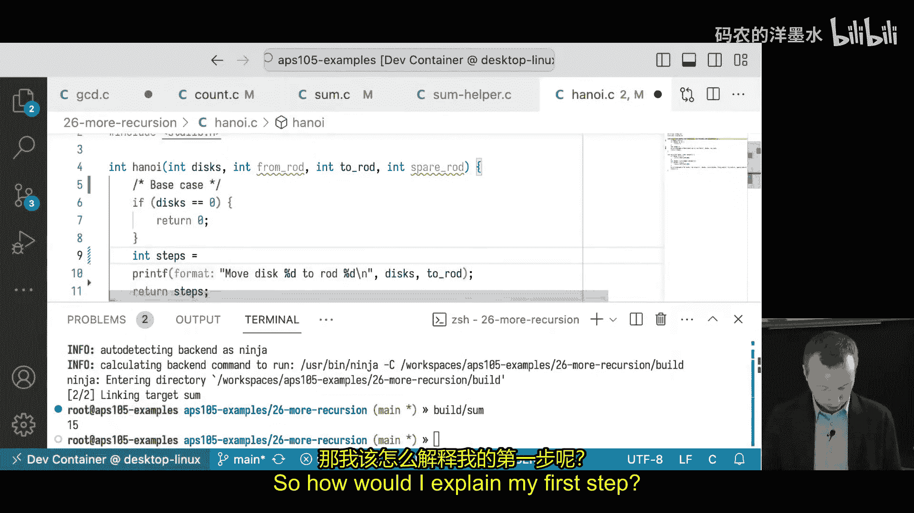

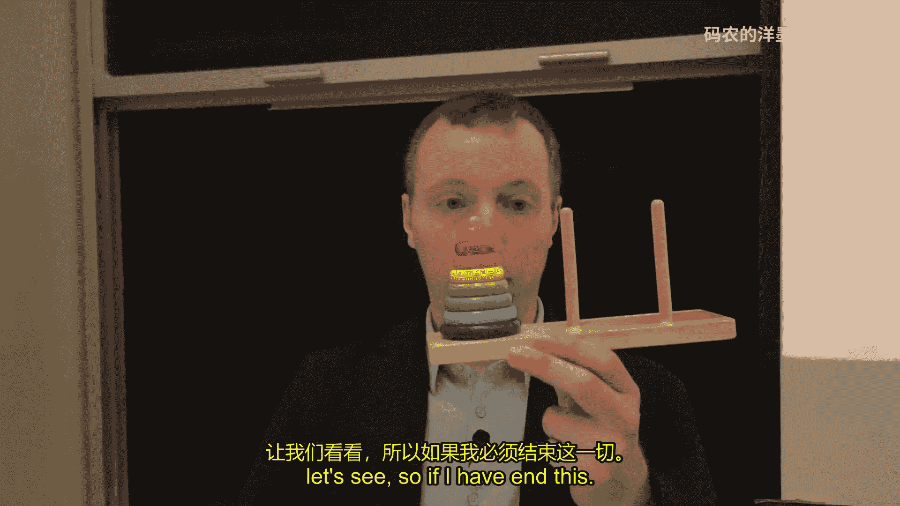

**递归思路**：
要将 `n` 个圆盘从“源”柱子（`from`）移动到“目标”柱子（`to`），并借助“备用”柱子（`spare`），可以分解为三个步骤：
1. 将上面的 `n-1` 个圆盘从 `from` 移动到 `spare`（借助 `to`）。
2. 将最大的第 `n` 个圆盘直接从 `from` 移动到 `to`。
3. 将 `spare` 上的 `n-1` 个圆盘移动到 `to`（借助 `from`）。

当 `n` 为 0 时，不需要移动，这是基础情况。

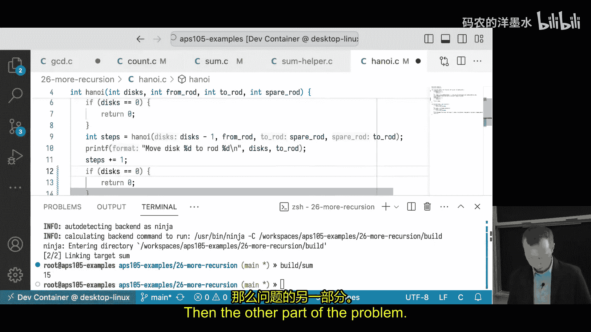

以下是计算移动步骤并打印移动方法的递归实现：

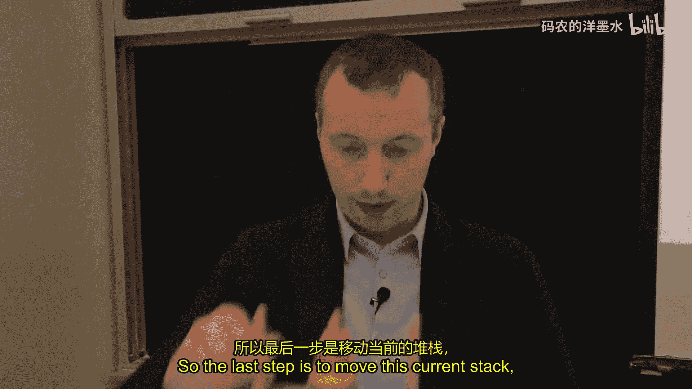

```c
int hanoi(int disks, int from, int to, int spare) {
    int steps = 0;
    // 基础情况：没有圆盘需要移动
    if (disks == 0) {
        return 0;
    }

    // 步骤1：移动上面 n-1 个圆盘到备用柱子
    steps += hanoi(disks - 1, from, spare, to);

    // 步骤2：移动最大的圆盘到目标柱子
    printf("Move disk %d from rod %d to rod %d\n", disks, from, to);
    steps += 1; // 计入一步

    // 步骤3：将 n-1 个圆盘从备用柱子移动到目标柱子
    steps += hanoi(disks - 1, spare, to, from);

    return steps;
}
```

调用 `hanoi(3, 1, 3, 2)` 会输出将 3 个圆盘从柱子1移到柱子3的详细步骤，并返回总步数 7。
移动 `n` 个圆盘所需的最少步数是 **2^n - 1**。例如，8个圆盘需要 255 步，这使得汉诺塔成为一个非常耗时的游戏。

---

## 总结

本节课中我们一起学习了递归的进阶应用。我们通过四个例子巩固了递归思维：
1.  **最大公约数**：使用欧几里得算法，将问题不断化简直到基础情况。
2.  **递归计数**：理解了递归调用与操作执行的顺序关系。
3.  **数组求和**：学会了将问题分解为“首元素”与“子数组”的和。
4.  **汉诺塔问题**：体验了如何将复杂问题（移动n个圆盘）递归地分解为更小的相同问题（移动n-1个圆盘）。

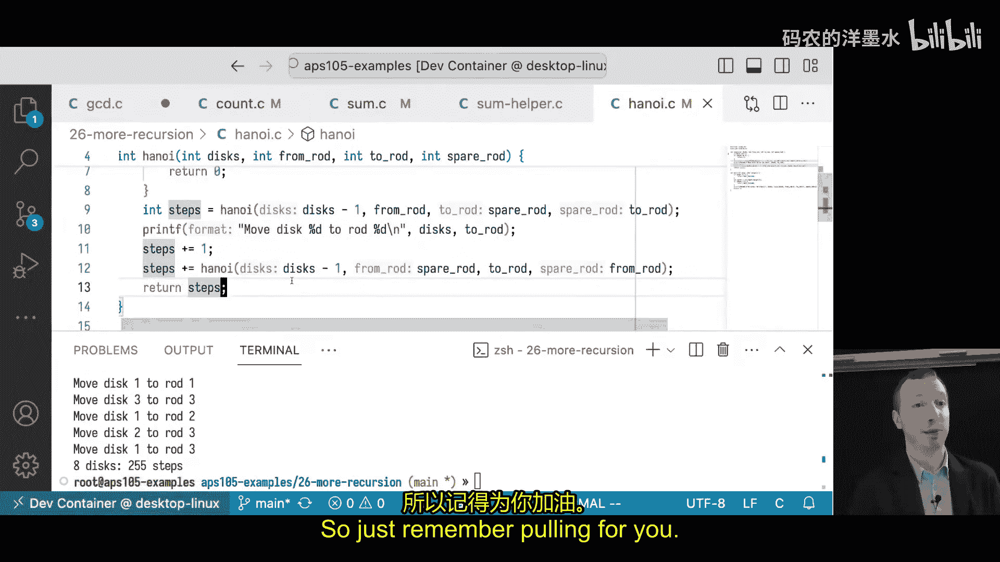

递归的核心始终是**定义清晰的基础情况**和**向基础情况推进的递归步骤**。掌握这种思维方式，是解决许多复杂编程问题的关键。