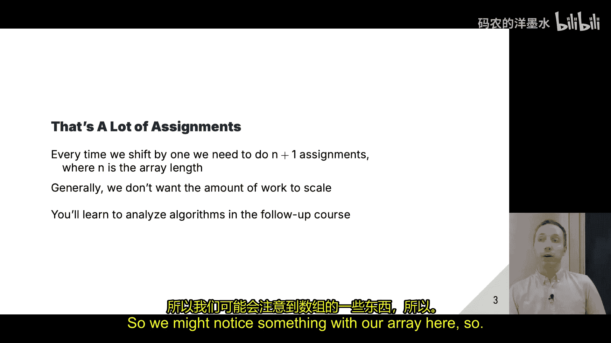
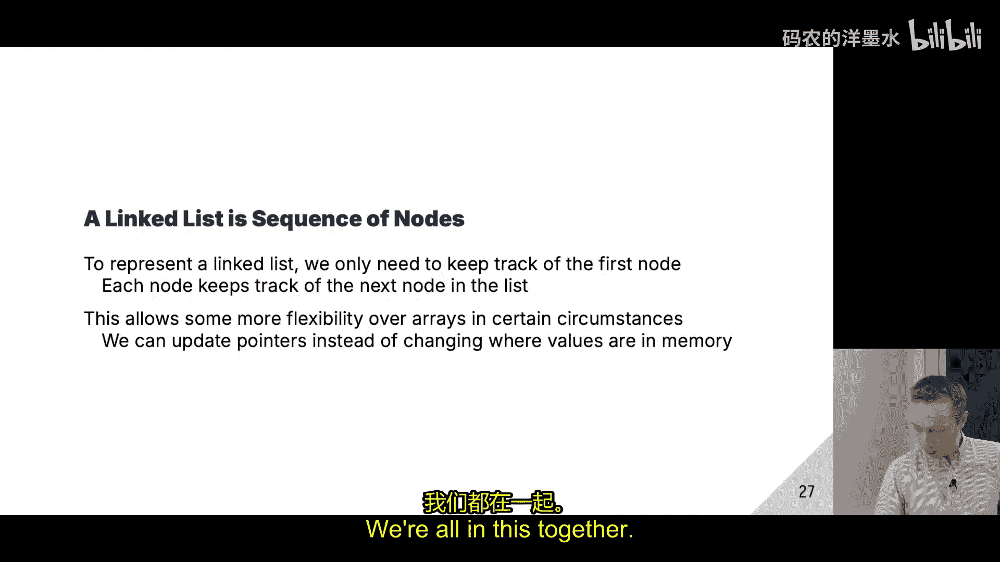

# 029：链表 🧩


在本节课中，我们将要学习一种新的数据结构——链表。我们将了解为什么需要链表，它与数组的区别，以及如何在C语言中实现和使用链表。

---

## 为什么需要链表？🤔

上一节我们介绍了数组，它虽然有用，但并非完美。数组存在一些缺点。例如，假设我们有一个数组来表示排队的人。如果我们想把队首的人移到队尾，就需要进行大量的赋值操作。

以下是一个移动数组元素的函数示例：

```c
void move_array(int arr[], int length) {
    if (length <= 1) {
        return;
    }
    int first = arr[0];
    for (int i = 0; i < length - 1; i++) {
        arr[i] = arr[i + 1];
    }
    arr[length - 1] = first;
}
```




这个函数需要进行 `n+1` 次赋值（`n` 是数组长度）。随着数组变大，操作会越来越慢。在计算中，我们通常希望操作效率尽可能高，不随数据规模线性增长。

我们可能会注意到，在这个操作中，除了被移动的元素，其他元素的相对顺序并没有改变。这正是链表的核心思想。

---

## 什么是链表？🔗

链表的基本思想是，每个元素（称为“节点”）不仅存储数据，还存储指向下一个元素的“指针”。这样，改变顺序就只需要修改几个指针，而不需要移动大量数据。

对于之前的排队例子，链表可以这样表示：节点1知道下一个是节点2，节点2知道下一个是节点3，依此类推。要把节点1移到队尾，只需要：
1.  让队首指针指向节点2。
2.  让节点4的“下一个”指针指向节点1。
3.  让节点1的“下一个”指针指向 `NULL`（表示队尾）。

无论链表多长，都只需要修改三个指针，这是一个固定数量的操作。

---

## 在C语言中实现链表 ⚙️

本节中我们来看看如何在C语言中具体实现链表。我们需要定义节点的结构。

### 定义节点结构

我们不能在结构体内部直接包含一个同类型的结构体变量，否则会导致无限递归。因此，我们必须使用指针。

```c
typedef struct node {
    int value;           // 节点存储的数据
    struct node* next;   // 指向下一个节点的指针
} node_t;
```
*   `value` 存储节点的数据（这里用整数示例）。
*   `next` 是一个指针，指向下一个 `node_t` 类型的节点。如果这是最后一个节点，则 `next` 应设置为 `NULL`。

为了管理整个链表，我们通常还会定义一个表示链表本身的结构体，它只包含一个指向第一个节点（头节点）的指针。

```c
typedef struct list {
    node_t* head; // 指向链表第一个节点的指针
} list_t;
```

---

## 创建链表和节点 🛠️

上一节我们定义了结构，本节中我们来看看如何动态创建它们。我们希望链表在函数调用后依然存在，因此要使用动态内存分配。

以下是创建链表和节点的辅助函数：

```c
// 创建一个新的链表（初始为空）
list_t* create_list() {
    list_t* list = (list_t*)malloc(sizeof(list_t));
    if (list == NULL) {
        exit(EXIT_FAILURE); // 内存分配失败
    }
    list->head = NULL; // 空链表
    return list;
}

// 创建一个新节点
node_t* create_node(int value) {
    node_t* node = (node_t*)malloc(sizeof(node_t));
    if (node == NULL) {
        exit(EXIT_FAILURE);
    }
    node->value = value;
    node->next = NULL;
    return node;
}
```

---

## 遍历和打印链表 📝

现在我们已经有了链表，我们需要一种方法来查看其中的内容。以下是遍历链表并打印所有值的两种方法。

### 迭代方法（使用循环）

```c
void print_list(list_t* list) {
    node_t* current = list->head; // 从头部开始
    while (current != NULL) {
        printf("%d ", current->value);
        current = current->next; // 移动到下一个节点
    }
    printf("\n");
}
```
循环持续执行，直到 `current` 指针变为 `NULL`，表示已到达链表末尾。

### 递归方法

链表的结构天然适合递归。

```c
void print_list_recursive(node_t* node) {
    if (node == NULL) { // 基础情况：空链表
        printf("\n");
        return;
    }
    printf("%d ", node->value); // 处理当前节点
    print_list_recursive(node->next); // 递归处理剩余部分
}
// 需要一个包装函数来传入链表头
void print_list_wrapper(list_t* list) {
    print_list_recursive(list->head);
}
```

---

## 向链表头部插入节点 📌

一个常见的操作是在链表头部添加新节点。以下是实现此功能的步骤和函数。

向链表头部插入节点的步骤：
1.  创建新节点。
2.  让新节点的 `next` 指针指向当前的头节点。
3.  更新链表的 `head` 指针，使其指向新节点。

```c
node_t* insert_front(list_t* list, int value) {
    node_t* new_node = create_node(value); // 步骤1
    new_node->next = list->head;           // 步骤2
    list->head = new_node;                 // 步骤3
    return new_node;
}
```

**重要提示**：步骤2和步骤3的顺序至关重要。如果先执行步骤3（更新`list->head`），再执行步骤2，新节点的`next`就会指向自己，造成循环引用和内存泄漏。

---

## 核心概念总结 📚

本节课中我们一起学习了链表这一重要的数据结构。

*   **链表是什么**：链表是由一系列节点组成的数据结构，每个节点包含数据和指向下一个节点的指针。
*   **为何使用链表**：与数组相比，链表在插入、删除元素（尤其是在头部）时更高效，通常只需要修改少量指针，而无需移动大量数据。
*   **如何实现**：在C语言中，我们使用结构体定义节点，并用指针连接它们。通常使用动态内存分配（`malloc`）来创建节点。
*   **关键操作**：我们学习了创建链表、遍历打印链表以及向链表头部插入节点。操作指针时必须格外小心顺序，否则会导致错误或内存泄漏。



链表是理解指针和动态内存管理的绝佳实践，也是后续学习更复杂数据结构的基础。请务必动手实践代码，加深理解。