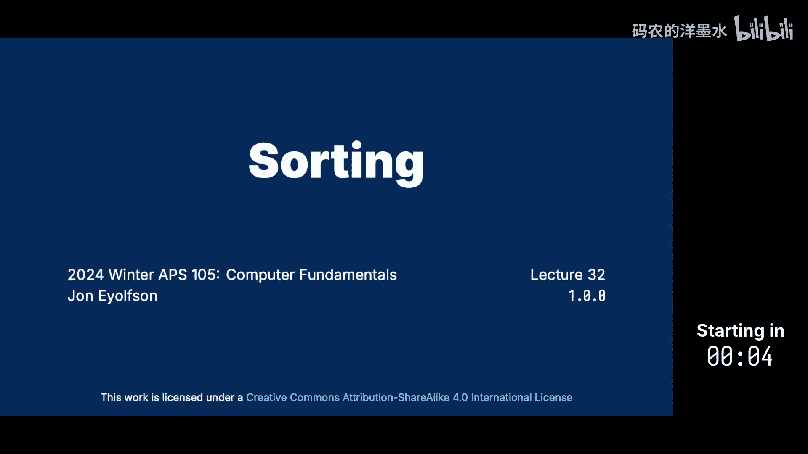
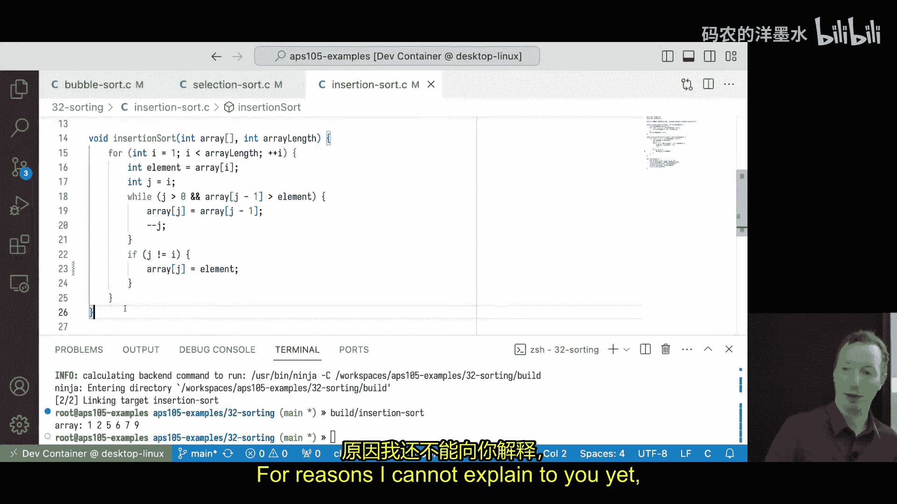
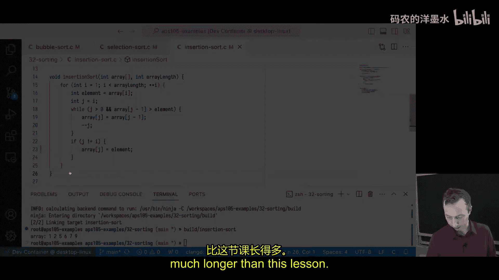
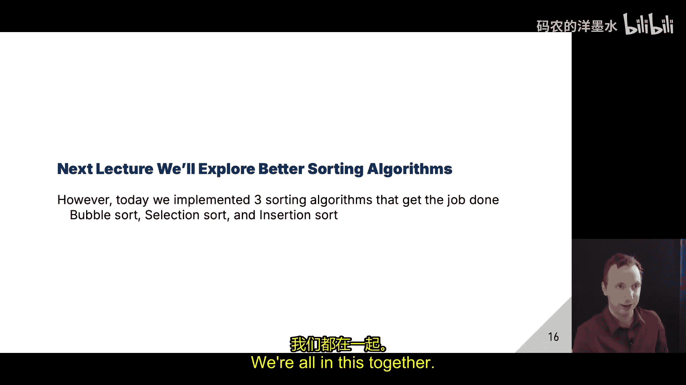

# 032：排序算法入门 🧮




在本节课中，我们将学习排序算法。排序是编程中最常见的问题之一。虽然你通常不需要自己实现排序算法，但了解其工作原理非常重要，因为你会经常用到它。计算机处理数据速度很快，但在向人类（比如你自己）展示数据时，通常需要将数据按某种顺序排列，以便于阅读。今天，我们将讨论几种排序算法。算法，就是解决问题的一系列步骤，通常可以用类似C语言这样的编程语言来描述。

## 问题定义

我们面临的问题是：需要对一个数组进行排序。例如，给定一个包含四个元素的数组 `[2, 5, 3, 1]`。我们希望编写一个函数，将数组按升序排列。升序意味着最小的数字排在最前面，然后是次小的，依此类推，最大的数字排在最后。排序后，数组元素应为 `[1, 2, 3, 5]`。

计算机的能力有限，它一次只能比较两个元素，判断哪个更大或更小。排序所需的另一个基本操作是交换数组中两个元素的位置，这个功能我们之前已经实现过。

## 冒泡排序 🫧

上一节我们定义了排序问题，本节中我们来看看第一种解决方案。想象一下如何向一个两岁的孩子（或者像C语言这样“笨拙”的计算机）解释排序。一个直观的想法是：从数组开头开始，比较相邻的两个元素，如果顺序不对就交换它们，然后继续比较下一对。这样扫描一遍数组后，最大的元素就会“冒泡”到数组末尾。然后重复这个过程，直到某次扫描中没有发生任何交换，此时数组就已排序完成。这种方法被称为**冒泡排序**。

以下是冒泡排序的步骤：
1.  比较数组中索引为0和1的元素。
2.  如果第一个元素（索引0）大于第二个元素（索引1），则交换它们。
3.  移动到下一对元素（索引1和2），重复比较和交换。
4.  继续此过程，直到到达数组末尾。
5.  完成一遍扫描后，最大的元素已位于正确位置。
6.  重复步骤1-5，直到某次完整扫描中没有发生任何交换。

让我们用数组 `[2, 5, 3, 1]` 来演示：
*   **第一遍扫描**：比较 (2,5) -> 顺序正确；比较 (5,3) -> 交换 -> `[2, 3, 5, 1]`；比较 (5,1) -> 交换 -> `[2, 3, 1, 5]`。
*   **第二遍扫描**：比较 (2,3) -> 顺序正确；比较 (3,1) -> 交换 -> `[2, 1, 3, 5]`；比较 (3,5) -> 顺序正确。
*   **第三遍扫描**：比较 (2,1) -> 交换 -> `[1, 2, 3, 5]`；后续比较均无交换。
*   **第四遍扫描**：无任何交换，排序完成。

### 代码实现

以下是冒泡排序的C语言实现：

```c
void bubbleSort(int array[], int length) {
    int swapped;
    do {
        swapped = 0; // 标记本轮是否发生交换
        for (int i = 0; i < length - 1; i++) {
            if (array[i] > array[i + 1]) { // 如果顺序错误
                // 交换元素
                int temp = array[i];
                array[i] = array[i + 1];
                array[i + 1] = temp;
                swapped = 1; // 标记发生了交换
            }
        }
    } while (swapped); // 如果本轮发生过交换，则继续循环
}
```

## 选择排序 🎯

我们介绍了冒泡排序，它通过不断交换相邻元素来排序。本节中我们来看看另一种思路：选择排序。其核心思想是：在未排序部分中找到最小的元素，并将其放到已排序部分的末尾（即数组开头）。你可以将其视为一种递归思维：将最小元素放到第一位后，剩下的任务就是对数组的其余部分进行排序。

以下是选择排序的步骤：
1.  从数组的第一个位置（索引0）开始，假设该位置的元素是最小的。
2.  遍历数组中剩余的元素（从索引1到末尾），寻找比当前最小元素更小的值。
3.  如果找到更小的元素，则更新最小元素的索引。
4.  遍历完成后，将找到的最小元素与数组第一个位置的元素交换。
5.  现在，第一个元素已排序。对剩余的未排序部分（从索引1开始）重复步骤1-4。

让我们用数组 `[9, 5, 18, 8, 5, 2]` 来演示：
*   **第一轮**：找到最小元素2（索引5），与索引0的元素9交换 -> `[2, 5, 18, 8, 5, 9]`。
*   **第二轮**：在剩余部分 `[5, 18, 8, 5, 9]` 中找到最小元素5（索引1），已在正确位置，无需交换。
*   **第三轮**：在剩余部分 `[18, 8, 5, 9]` 中找到最小元素5（索引4），与索引2的元素18交换 -> `[2, 5, 5, 8, 18, 9]`。
*   **第四轮**：在剩余部分 `[8, 18, 9]` 中找到最小元素8（索引3），已在正确位置。
*   **第五轮**：在剩余部分 `[18, 9]` 中找到最小元素9（索引5），与索引4的元素18交换 -> `[2, 5, 5, 8, 9, 18]`。排序完成。

### 代码实现

以下是选择排序的C语言实现：

```c
void selectionSort(int array[], int length) {
    for (int i = 0; i < length - 1; i++) {
        int minIndex = i; // 假设当前位置元素最小
        // 在剩余部分中寻找更小的元素
        for (int j = i + 1; j < length; j++) {
            if (array[j] < array[minIndex]) {
                minIndex = j; // 更新最小元素索引
            }
        }
        // 如果找到的最小元素不在当前位置，则交换
        if (minIndex != i) {
            int temp = array[i];
            array[i] = array[minIndex];
            array[minIndex] = temp;
        }
    }
}
```

## 插入排序 📥

我们了解了选择排序，它通过选择最小元素来构建有序序列。本节中我们来看看最后一种算法：插入排序。想象你手中有一副已排序的扑克牌，现在拿到一张新牌。你会怎么做？你会从右向左扫描手中的牌，为新牌找到正确的插入位置，然后将其插入。插入排序正是基于这种思想：将数组分为已排序和未排序两部分，逐个将未排序部分的元素插入到已排序部分的正确位置。

以下是插入排序的步骤：
1.  假设数组的第一个元素（索引0）是已排序部分。
2.  从第二个元素（索引1）开始，将其视为待插入的“新牌”。
3.  将这张“新牌”与已排序部分的元素从右向左依次比较。
4.  如果“新牌”比当前比较的已排序元素小，则将那个已排序元素向右移动一位，为新元素腾出空间。
5.  继续向左比较，直到找到一个不大于“新牌”的元素，或者到达数组开头。
6.  将“新牌”插入到腾出的空位。
7.  对未排序部分中的每个元素重复步骤2-6。

让我们用数组 `[9, 2, 6, 5, 1, 7]` 来演示：
*   **初始**：`[9]` 已排序。
*   **插入2**：比较9，9>2，移动9 -> `[9, 9, 6, 5, 1, 7]`，到达开头，插入2 -> `[2, 9, 6, 5, 1, 7]`。
*   **插入6**：比较9，9>6，移动9 -> `[2, 9, 9, 5, 1, 7]`；比较2，2<6，停止，插入6 -> `[2, 6, 9, 5, 1, 7]`。
*   **插入5**：比较9，9>5，移动9 -> `[2, 6, 9, 9, 1, 7]`；比较6，6>5，移动6 -> `[2, 6, 6, 9, 1, 7]`；比较2，2<5，停止，插入5 -> `[2, 5, 6, 9, 1, 7]`。
*   **插入1**：类似地，将9,6,5,2依次右移，最后在开头插入1 -> `[1, 2, 5, 6, 9, 7]`。
*   **插入7**：比较9，9>7，移动9 -> `[1, 2, 5, 6, 9, 9]`；比较6，6<7，停止，插入7 -> `[1, 2, 5, 6, 7, 9]`。排序完成。

### 代码实现

以下是插入排序的C语言实现：

```c
void insertionSort(int array[], int length) {
    for (int i = 1; i < length; i++) { // 从第二个元素开始
        int element = array[i]; // 待插入的“新牌”
        int j = i; // j用于在已排序部分中从右向左扫描
        // 寻找插入位置，并向右移动元素
        while (j > 0 && array[j - 1] > element) {
            array[j] = array[j - 1]; // 将大于element的元素右移
            j--;
        }
        array[j] = element; // 插入元素到正确位置
    }
}
```

## 算法效率简析 ⚡

我们实现了三种排序算法。从计算机科学的角度，我们常用**大O表示法**来粗略衡量算法的效率，它描述了算法所需操作次数与输入数据规模（通常用 `n` 表示）之间的关系。对于大规模问题，常数因子通常被忽略，我们关注的是增长趋势。





今天我们学习的三种算法——冒泡排序、选择排序和插入排序——在最坏和平均情况下的时间复杂度都是 **O(n²)**。这是因为它们都包含嵌套循环：外层循环运行大约 `n` 次，内层循环在每次外层循环中也运行大约 `n` 次，所以总操作次数与 `n²` 成正比。

当 `n` 较小时（例如本课程中的问题规模），O(n²) 的性能差异并不明显。然而，随着 `n` 增大（例如处理数百万数据时），O(n²) 算法的耗时将急剧增加，远不如 O(n log n) 或 O(n) 的算法高效。因此，在处理大规模数据时，我们需要更高效的算法。

## 总结 📝

本节课中我们一起学习了三种基础的排序算法：
1.  **冒泡排序**：通过重复比较和交换相邻元素来排序，实现简单但效率较低。
2.  **选择排序**：通过在未排序部分中反复选择最小元素来构建有序序列。
3.  **插入排序**：通过构建有序序列，对于未排序数据，在已排序序列中从后向前扫描，找到相应位置并插入。



这三种算法的时间复杂度均为 O(n²)，适用于小规模数据或作为学习排序思想的入门。在下一讲中，我们将探索效率更高的排序算法。