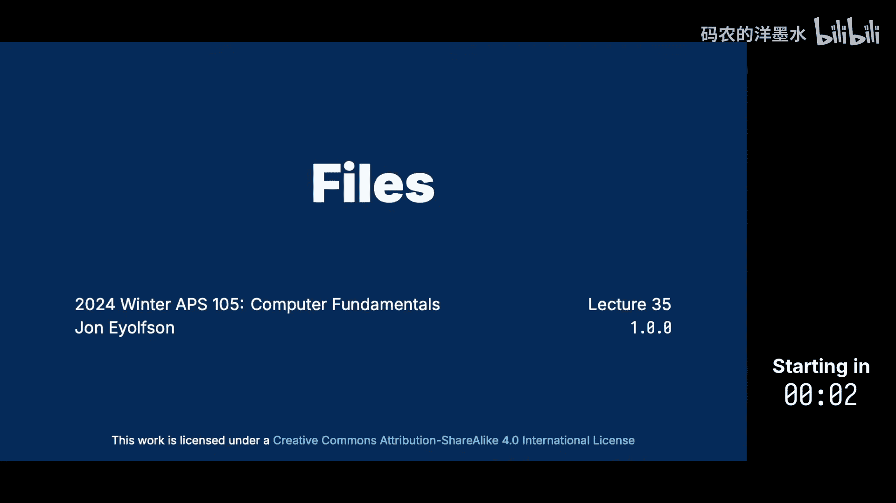
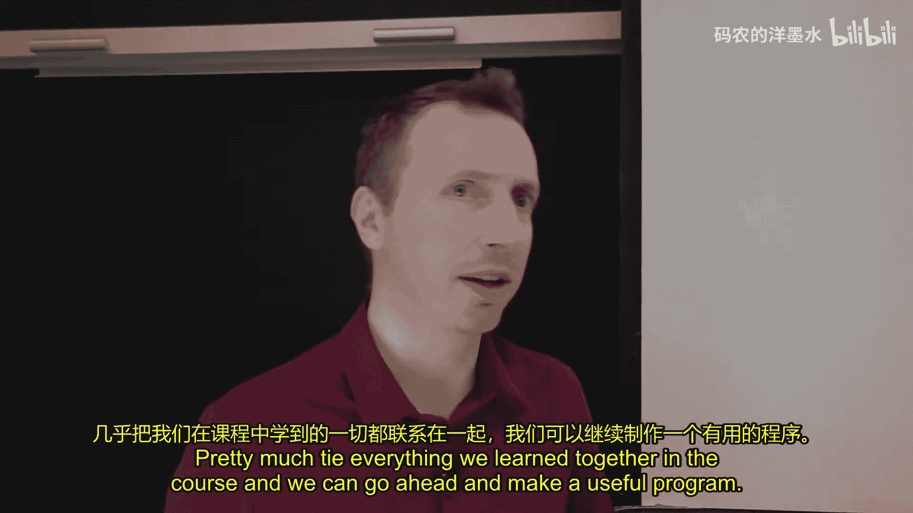
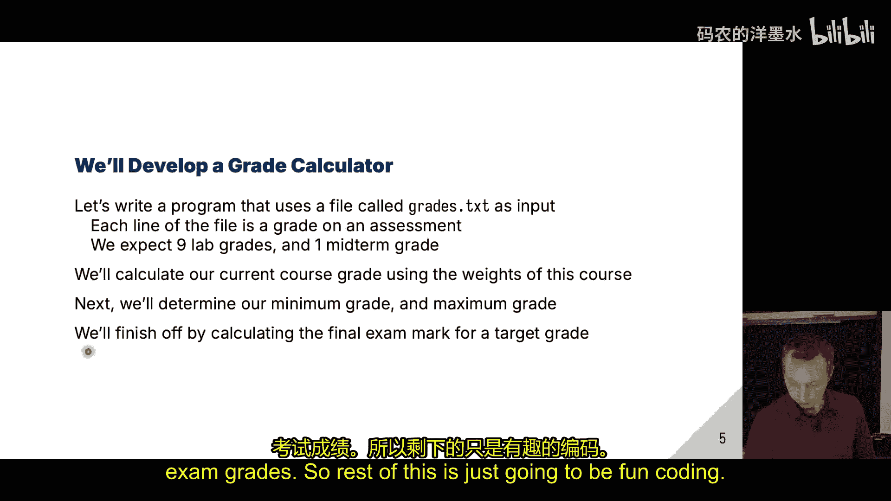
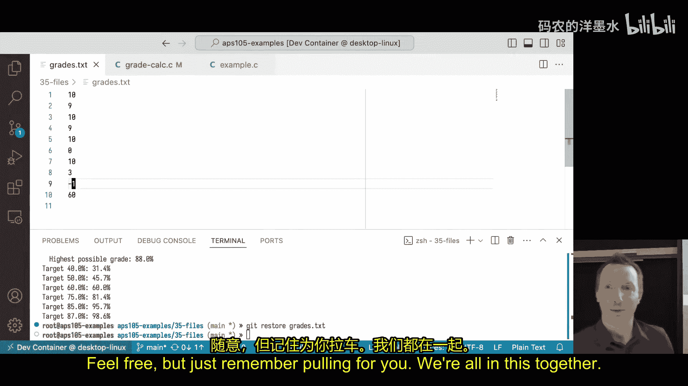

# 035：文件操作与成绩计算器





在本节课中，我们将学习如何使用C语言进行文件操作，并综合运用课程中学到的知识，开发一个实用的成绩计算器程序。我们将通过读取文件来获取输入数据，从而避免每次运行程序时都需要手动输入大量信息。

---

## 概述：文件操作基础

上一节我们介绍了从终端获取用户输入的方法。本节中，我们来看看如何从文件中读取数据，这对于处理大量输入非常有用。

在C语言中，操作文件主要涉及三个步骤：打开文件、读取/写入数据、关闭文件。文件操作不会在考试中涉及，但除了打开和关闭文件的特定函数外，其核心概念与我们之前学习的字符串处理等内容紧密相关。

### 打开与关闭文件

要使用一个文件，首先需要打开它。我们使用 `fopen` 函数，它需要两个参数：
*   **第一个参数**：一个表示文件路径的字符串（例如 `"grades.txt"`）。
*   **第二个参数**：一个表示打开模式的字符串。例如，`"r"` 表示以只读模式打开文件。

`fopen` 函数会返回一个指向 `FILE` 结构体的指针。如果打开失败（例如文件不存在），它会返回 `NULL`。




使用完文件后，必须使用 `fclose` 函数将其关闭，并传入从 `fopen` 获得的文件指针。这类似于使用 `malloc` 分配内存后需要 `free` 释放。

以下是打开和关闭文件的基本代码框架：
```c
FILE *file_pointer = fopen("filename.txt", "r");
if (file_pointer == NULL) {
    // 处理错误，例如打印错误信息并退出
    exit(1);
}
// ... 在这里对文件进行读写操作 ...
fclose(file_pointer);
```

### 从文件中读取行数据

要从文件中逐行读取数据，我们可以使用之前学过的 `getline` 函数。之前我们将其与 `stdin`（标准输入，即终端）配合使用，现在我们可以将文件指针传递给它。

`getline` 函数会动态分配内存来存储读取的行，并返回该行的字符数（不包括结尾的空字符 `\0`）。当读取到文件末尾时，它会返回 `-1`。

以下是从文件中读取所有行的典型循环结构：
```c
char *line = NULL;
size_t size = 0;
ssize_t length;

while ((length = getline(&line, &size, file_pointer)) != -1) {
    // 处理读取到的一行数据，它存储在 `line` 变量中
    printf("Read line: %s", line);
}
free(line); // 释放 getline 分配的内存
fclose(file_pointer); // 关闭文件
```

---

## 项目实践：构建成绩计算器

掌握了文件读取的基础后，我们将综合运用结构体、数组、循环和函数等知识，开发一个成绩计算器。这个程序将从一个名为 `grades.txt` 的文本文件中读取成绩数据，然后计算当前课程成绩、可能的最低和最高成绩，并分析为了达到目标成绩需要在期末考试中取得多少分。

### 第一步：定义数据结构

首先，我们定义一个结构体来统一管理每项考核（如实验、期中考试）的信息。这比使用多个独立的数组更清晰、更易于维护。

```c
typedef struct {
    double weight;   // 该项考核的权重（百分比）
    double grade;    // 该项考核获得的分数
    double total;    // 该项考核的总分
} assessment_t;
```

### 第二步：从文件读取成绩数据

我们将编写一个函数 `read_grades` 来读取文件。假设 `grades.txt` 的前9行是9次实验的成绩（满分10分），最后一行是期中考试成绩（满分75分）。

以下是该函数的核心逻辑：
1.  使用 `fopen` 打开文件。
2.  使用 `getline` 循环读取每一行。
3.  使用 `atof` 函数将读取的字符串转换为浮点数 `double`。
4.  根据行号，将成绩赋值给对应的 `assessment_t` 结构体。
5.  读取完成后，关闭文件并释放 `getline` 使用的缓冲区。

### 第三步：初始化考核权重与总分

在 `main` 函数中，我们需要创建并初始化所有考核项目的数组。对于实验，根据课程大纲，前三次实验权重为2%，中间三次为3%，最后三次为5%，满分均为10分。期中考试权重为30%，满分为75分。

```c
assessment_t labs[LABS_LENGTH];
assessment_t midterm;

// 初始化实验的权重和总分
for (int i = 0; i < LABS_LENGTH; i++) {
    if (i < 3) labs[i].weight = 2.0;
    else if (i < 6) labs[i].weight = 3.0;
    else labs[i].weight = 5.0;
    labs[i].total = 10.0;
}
// 初始化期中考试
midterm.weight = 30.0;
midterm.total = 75.0;
```

### 第四步：计算当前课程成绩

当前课程成绩是已完成的各项考核的加权和。计算公式为：
**课程成绩贡献 = (获得的分数 / 总分) * 权重**

我们需要遍历所有考核项进行累加。注意，如果某项成绩为负数（例如用-1表示申请了延期），则其权重应转移到期末考试上，本次不计入当前成绩。

```c
double course_grade = 0.0;
double final_weight = 40.0; // 期末考试基础权重

for (int i = 0; i < LABS_LENGTH; i++) {
    if (labs[i].grade < 0) {
        // 成绩为负，权重转移至期末
        final_weight += labs[i].weight;
    } else {
        // 正常计算该项贡献
        course_grade += (labs[i].grade / labs[i].total) * labs[i].weight;
    }
}
// 加上期中考试贡献
course_grade += (midterm.grade / midterm.total) * midterm.weight;
```

### 第五步：计算可能的最低与最高成绩

*   **最低可能成绩**：假设期末考试得0分，那么最终成绩就是当前的 `course_grade`。
*   **最高可能成绩**：假设期末考试得满分（100%），那么最终成绩是 `course_grade + final_weight`。

### 第六步：计算达成目标成绩所需的期末分数

用户可能想了解为了达到某个总评目标（例如75分或85分），需要在期末考试中获得多少分。

计算步骤如下：
1.  计算需要从期末考试中获得的加权贡献：`needed_from_final = target_grade - course_grade`。
2.  将所需的加权贡献转换为期末考试卷面百分比分数：`required_final_percent = (needed_from_final / final_weight) * 100`。

然后，我们需要处理一些边界情况：
*   如果 `needed_from_final <= 0`，说明已经达到或超过目标，可以输出“无需参加考试”或类似信息。
*   如果 `needed_from_final > final_weight`，说明即使期末考试得满分也无法达到目标，应输出“无法达成”。
*   否则，输出计算得到的 `required_final_percent`。

---

## 总结

本节课中我们一起学习了C语言的文件操作，并完成了一个综合性的实践项目——成绩计算器。

我们回顾并应用了以下核心知识：
*   **文件操作**：使用 `fopen` 和 `fclose` 打开和关闭文件。
*   **数据读取**：使用 `getline` 从文件中逐行读取数据，并使用 `atof` 进行类型转换。
*   **结构体应用**：使用 `typedef struct` 创建 `assessment_t` 类型来有效组织和管理相关数据。
*   **流程控制与计算**：通过循环遍历数组，使用条件判断处理特殊情况（如成绩延期），并实现加权平均等数学计算。



通过这个项目，你将看到如何将分散的知识点组合起来，解决一个实际的、有用的编程问题。文件操作使得程序能够方便地处理外部数据，这是大多数真实软件的基础。虽然本课程不考核文件操作的具体API，但理解其背后的思想（输入/输出、资源管理）和熟练运用其他已学概念（字符串、内存、结构体）至关重要。