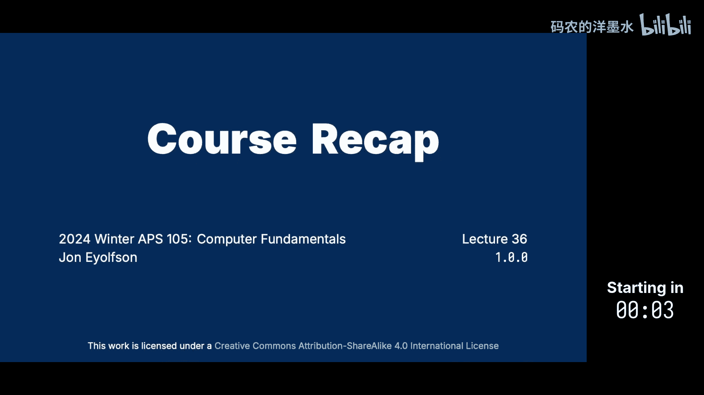
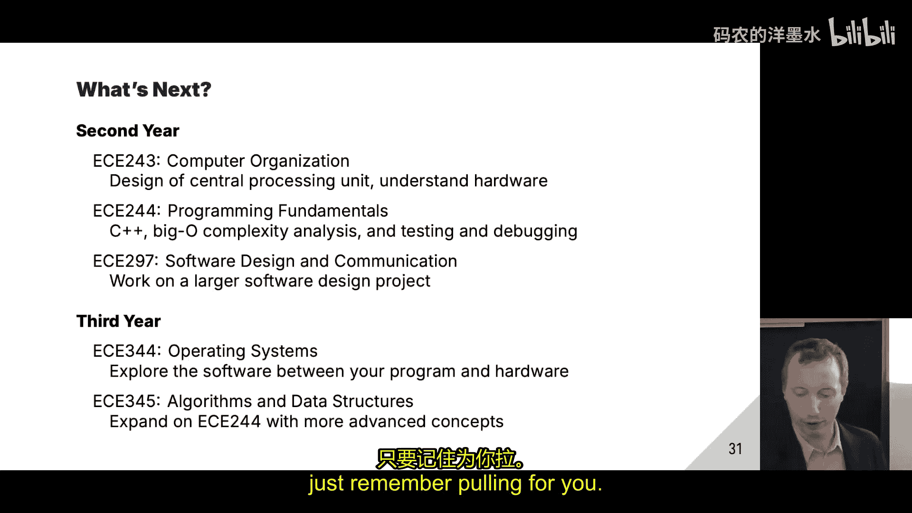

# 036：课程回顾 🎓



在本节课中，我们将对C语言编程课程的全部内容进行一次全面的回顾。我们将梳理从基础语法到高级概念的所有核心知识点，帮助你为期末考试做好准备。

---

## 概述 📋

本课程从零开始，带领我们学习了如何使用C语言编写程序。我们首先了解了如何编写源代码，然后使用C编译器将其转换为可执行的机器码。接下来，我们将按学习顺序，回顾所有关键概念。

## 1. 变量与基本类型

我们首先学习了如何声明和初始化变量。声明一个变量的语法是：指定类型，给出变量名，并可选地赋予一个初始值。

**代码示例：**
```c
int score = 100; // 声明并初始化一个整型变量
```

以下是本课程中需要掌握的基本数据类型：
*   **`int`**： 用于表示整数（无小数位）。
*   **`double`**： 用于表示带小数点的数字。
*   **`char`**： 用于表示单个字符（如键盘上的字母）。
*   **`bool`**： 用于表示布尔值（`true` 或 `false`），使用前需包含 `<stdbool.h>` 头文件。
*   **`void`**： 表示“无类型”，用于函数不返回值或无参数的情况。

关于字符，我们还需要了解转义字符，例如换行符 `\n` 和制表符 `\t`。

## 2. 输入与输出

为了让程序能与用户交互，我们学习了输入输出函数。其中，`printf` 和 `scanf` 是最重要的两个。

*   **`printf`**： 用于向终端输出信息。我们可以使用格式说明符来输出变量的值。
*   **`scanf`**： 用于从终端读取输入。同样使用格式说明符，但需要注意，我们必须传递变量的**地址**给 `scanf`，它才能修改变量的值。

**重要格式说明符：**
*   `%d`： 用于 `int`。
*   `%lf`： 用于 `double`。
*   `%c`： 用于 `char`。
*   `%s`： 用于字符串。
*   `%p`： 用于指针（考试中较少使用）。

## 3. 运算符

C语言提供了丰富的运算符来操作数据。

**需要掌握的运算符包括：**
*   **自增/自减**： `++` 和 `--`（前缀与后缀形式）。
*   **取地址**： `&`，用于获取变量的内存地址。
*   **`sizeof`**： 用于获取数据类型或变量所占的字节大小。
*   **算术运算符**： `+`, `-`, `*`, `/`, `%`（取模，注意对负数的特殊规则）。
*   **赋值运算符**： `=` 用于赋值，以及 `+=`, `-=`, `*=`, `/=`, `%=` 等复合赋值运算符。

数学函数（如 `rand()`）可能出现在考试中，但其他复杂数学函数通常不需要记忆。

## 4. 控制流：条件与循环

为了让程序能够做出决策和重复执行任务，我们引入了控制流语句。

上一节我们介绍了基本的运算，本节中我们来看看如何控制程序的执行路径。

### 条件语句 (`if`, `else if`, `else`)
`if` 语句允许我们根据条件表达式的真假来决定是否执行某段代码。我们可以使用 `else if` 和 `else` 来构建多分支判断。

**用于比较的运算符（结果为布尔值）：**
*   `==` （等于）
*   `!=` （不等于）
*   `>`, `<`, `>=`, `<=` （大于，小于，大于等于，小于等于）

**逻辑运算符（操作布尔值）：**
*   `!` （逻辑非）
*   `&&` （逻辑与）
*   `||` （逻辑或）

### 循环语句
循环使我们能够重复执行代码块。

*   **`while` 循环**： 先检查条件，条件为真则执行循环体。
*   **`do...while` 循环**： 先执行一次循环体，再检查条件。保证循环体至少执行一次。
*   **`for` 循环**： 常用于有明确次数的循环。结构为 `for (初始化; 条件; 增量) { 语句 }`。初始化语句在循环开始前执行一次；每次迭代前检查条件；每次迭代后执行增量表达式。

## 5. 函数

为了组织代码和实现复用，我们学习了如何创建函数。

**函数定义：**
```c
返回类型 函数名(参数列表) {
    // 函数体
    return 返回值； // 如果返回类型不是void
}
```

**函数原型：** 如果函数定义在 `main` 函数之后，需要在文件顶部或 `main` 之前声明函数原型，以便编译器识别。
```c
返回类型 函数名(参数列表)； // 函数原型
```

**重要概念：**
*   **作用域**： 变量只在定义它的花括号 `{}` 内有效。
*   **按值传递**： C语言中，函数参数传递的是值的副本。因此，在函数内部修改参数不会影响外部的原始变量。
*   **指针参数**： 若想通过函数修改外部变量，需要传递该变量的指针（地址）。

## 6. 指针

指针是C语言的核心概念，它存储的是内存地址。

*   **声明指针**： `类型 *指针变量名;`
*   **取地址运算符**： `&变量` 获取变量的地址。
*   **解引用运算符**： `*指针变量` 访问指针所指向地址的值。

**指针与类型：**
*   对变量使用 `&`，其类型变为“指向该类型的指针”。
*   对指针使用 `*`，其类型变回“指向的类型”。

理解不同数据类型的大小（如 `int` 通常为4字节，`double` 为8字节）有助于理解指针运算。

## 7. 数组

数组是一块连续的内存空间，用于存储多个相同类型的值。

**声明与初始化：**
```c
int grades[5]; // 声明一个大小为5的整型数组
int values[] = {1, 2, 3}; // 声明并初始化，编译器自动推断大小为3
```

数组名在大多数情况下会“退化”为指向其第一个元素的指针。因此，`grades[i]` 等价于 `*(grades + i)`。

**指针算术：**
*   指针 `+` 整数 = 指针（指向更后面的元素）。
*   指针 `-` 指针 = 整数（两个指针之间相隔的元素个数）。

## 8. 动态内存分配

当我们需要在运行时决定内存大小，或者希望内存的生命周期超越函数时，需要使用动态内存分配。

*   **`malloc`**： 申请指定字节数的内存，返回指向该内存块的指针。如果失败则返回 `NULL`。
    ```c
    int *arr = (int*)malloc(10 * sizeof(int)); // 分配可存放10个int的空间
    ```
*   **`free`**： 释放之前由 `malloc` 分配的内存。**必须**且**只能**释放一次，释放后不应再访问该内存。
    ```c
    free(arr);
    ```

## 9. 二维数组

二维数组可以看作是“数组的数组”。

**声明与初始化：**
```c
int matrix[2][3] = { {1, 2, 3}, {4, 5, 6} };
```

**在函数中使用二维数组：** 作为参数时，必须指定列数（第二维的大小）。
```c
void printMatrix(int table[][3], int numRows);
```

动态分配二维数组通常使用“指针的指针”（`int**`）来实现，即先分配一个指针数组，再为每个指针分配一个一维数组。

## 10. 字符串

在C语言中，字符串是以空字符 `\0` 结尾的字符数组。

**重要注意事项：**
*   使用 `%s` 格式说明符进行输入输出。
*   **绝对避免**使用 `scanf(“%s”, str)` 读取字符串，因为它无法防止缓冲区溢出。应使用 `fgets` 或 `gets_s`。
*   常用字符串函数（需包含 `<string.h>`）：
    *   `strlen`： 获取字符串长度（不包括 `\0`）。
    *   `strcpy`： 复制字符串。
    *   `strcmp`： 比较字符串。
    *   `strcat`： 连接字符串。

## 11. 结构体

结构体允许我们将多个不同类型的变量组合成一个新的复合数据类型。

**定义与使用：**
```c
typedef struct {
    double x;
    double y;
} Point;

Point p1 = {1.0, 2.0}; // 初始化
p1.x = 3.0; // 使用 . 运算符访问成员

Point *ptr = &p1;
ptr->y = 4.0; // 使用 -> 运算符通过指针访问成员
```

## 12. 链表

链表是一种动态数据结构，由一系列节点组成，每个节点包含数据和指向下一个节点的指针。

**核心操作：**
*   创建节点。
*   在链表头部或尾部插入节点。
*   遍历链表。
*   搜索并删除节点。

理解链表的关键在于绘制节点和指针的示意图，并注意更新头指针。

## 13. 排序与搜索算法

最后，我们探讨了如何组织数据。

**排序算法（需掌握）：**
*   **冒泡排序**： 重复遍历列表，比较相邻元素并交换。
*   **选择排序**： 每次从未排序部分选择最小（或最大）元素放到已排序部分的末尾。

**搜索算法：**
*   **线性搜索**： 适用于未排序数组，逐个元素检查。
*   **二分搜索**： 仅适用于**已排序**数组。每次与中间元素比较，将搜索范围缩小一半，效率远高于线性搜索。

---

## 总结 🏁

本节课中我们一起回顾了整个C语言编程课程的知识体系。我们从最基础的变量和输入输出开始，逐步深入到函数、指针、内存管理、数据结构（数组、字符串、结构体、链表）以及基本算法（排序和搜索）。掌握这些内容是顺利通过期末考试的基础。请务必通过练习过去的考题来巩固理解。



祝大家在期末考试中取得优异成绩！我们更高年级的课程中再见！✨