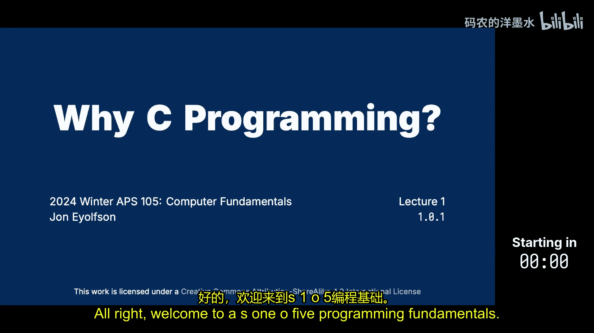
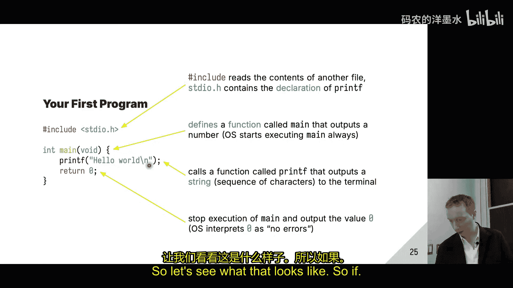
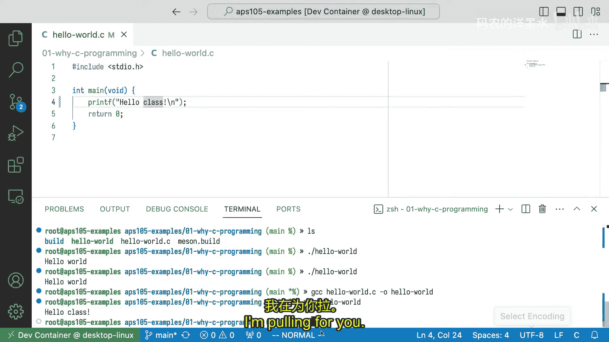

# 【全集】多伦多大学 C语言编程 中英字幕 1080P p01 Lecture 1 - 导论 -BV1gikKB3EZW_p1-

。

All right， welcome to APS 105 programming Fundamentals。

We're going to put the fun in the fundamentals。So everyone excited for this course or slightly terrified。

Hopefully this course。It will be one of your favorites。

 at least my hope if you're in the software at all。So I'm John Aelsson， your instructor。

Do not feel bad if you cannot pronounce my last name。

 I could not pronounce it either until I was about 25。

 And then some nice Icelandic man told me how to pronounce it， so。Just call me John。

 if that's easier， or I will teach you a trick how to spell and pronounce my last name。So。

How it spelled kind of mess， kind of how it pronounced。 I've heard it all sorts of different ways。

 Eiffelson was probably my favorite， not even close。 So here is the trick。

 if you need to pronounce my last name。😊，You know how pronounced elf， right？Is just Christmas。

 So else should be in your mind。 So that's the perfect way to start pronouncing it。

 So let's say elf sin， elf sin。😊，Easy， and if you want to spell it。

Just shove the L and the F over and shove a O。In the empty space， And I can spell my last name， too。

 In the unfortunate case， you have to spell it。 I hope you don't have to spell。

 But just in case there's a little hack， that's what I do。So。

Now we get to talk about how this course is structured and all that boring admin stuff。

So there are four entries in your course timetable。 The first。

 which is in the top left there are your lectures。 That's where you are right now。

 That's where we learn all the concepts。 And we can ask questions to the instructors and all that fun stuff。

What's directly related to the lectures are the tutorials so the Ts will be at the tutorials they will go through practice problems with you that are really close to exam problems。

 so I encourage you to go there and they'll start easy， they'll get progressively harder。

 so hopefully you can fall along or at least gives you a good idea of what to expect for the exams。

And then the other half of this course are writing software and the labs。

 so the boxes in the green have to relate to the lab。 so there's the plenary lectures。

 So those are additional practice for labs that run more like a lecture but the Ts run them and they're directly related to the lab material and then there are the lab sessions themselves and that is where you get in-person help from the Ts So again。

 I encourage you to go to that。So word of advice since this is what your second semester here at U of T and I will。

Give you my wisdom from， you know， starting off university as well and， you know， screwing it up。

 So don't do it。 I did start your labs early。 So this is the cadence of the labs。

 So two weeks before they are due。 there will be a handout posted。

So I encourage you to go look at the handout as soon as it is posted。

 And then within a week from the handout being posted。

 the material will actually be covered in the lectures。

 So a good thing to do is look at the handouts。 See what things the lab is asking about。

 And that is the stuff you should definitely pay attention to when it comes up in lectures。

 or if you're trying to relate it back to the lab and you are wondering about how it actually relates to the lab or how to solve something。

 Good time to ask the question in the lectures。😊，So within a week of the lab being due。

 all the material you will need will be covered， and then you should start working on the lab right away。

 and then， of course， there is the deadline if you do not heed my advice。

 which is Saturday at midnight， which means if you leave it to the last minute。

 I guess you have ruined your weekend， so that is your prerogative， I guess you're all adults。

 I can't tell you what to do I can just give you suggestions and you're free to ignore them。

 so I encourage you to have a weekend and have a life outside of this course， So start early。So next。

 I have to talk about academic integrity， which is a serious topic。 That is no fun for anyone。

 So the rules are you may discuss course content， but do not copy it from each other。

 So you're primarily harming your own learning， the best way to learn this course is through practice。

 So if you are robbing yourself of practice。 you're just going to fall behind next time you take a software course。

 You're already be behind and you will get further and further behind and it will just be a mess。

 So most of this course is just practice。 So make and the labs are intended to help you practice and encourage you to practice by assigning marks since well。

 that's a thing to do。So another word of advice。 So you may or may not。

 I guess I probably shouldn't judge if youve you know。

 copied English assignments or something like that。 Well， if you copy computer code。

 it's a lot easier to detect it。 We might go into why that is。 but trust me。

 you are not more clever than people who have been writing software for 30 years。 So。

Some people think they are I think last year。 so this is the first year I have taught this course。

 but last year I think in one of the first labs， about 20 people got caught immediately and that is no fun to everyone because then you have to meet with the course coordinator。

 and then you have to meet with the department and then you have to meet with the thing and they tell you that it's just not good for anyone。

 waste your time， waste our time， wastete your learning， no good， don't do it， not fun for anyone。

So now we can talk about the grade waitinging， so the majority of your grade is exams。

 which isn't that fun， but it is what it is， so your exams are worth 70% of your total grade。

 the midterm 30%， the final exam， 40%。The other 30% is labs， which are divided into 9 labs。

 So how that 30% works is they're progressively weighted more as you learn more and the labs get more complicated。

 So there is a lab 0。 That's a setup lab。 It is not worth anything。 So its weight is0。

 And then the first actual work is labs 1 to 3。 So they'll be worth 2% each for a total of 6。

 Then labs 4 to 6 are worth 3% each instead of 2 total of 9。

 And then the final 3 labs are worth 5% each。 which is a total of 15。

 and that is how the 30% of your labs is going to work。

So the official resources for this course are corucus and then the online textbook。

 so the direct corucus link is there。 So how my slides work is while they're PDFfs。

 so anything is clickable so you can just click the link if you want to。And。In addition to Corus。

 which is kind of the hub for this course， there's an online textbook， learnings do org。

 No other materials required， don't have to go to the library， don't have to buy a book。

 Nothing like that， and the nice thing about this book is it was written by the course coordinator and it has exercises along with the chapters and it actually follows the course quite closely。

 The last one is the piazza discussion form， which is on there。

 So the Ts some of their job is to monitor that help you if you have any questions that may arise outside of the lab sessions。

 but the lab sessions is probably a faster way to get help from the Ts。

So some additional resources for war this section。I do。

 I live stream the lectures just in case you are sick or anything like that or you want to stay home or you're cozy or something like that。

And I have the recordings all on YouTube so you don't have to go through Corus。

 you don't have to log into anything。 It's nice and easy。The lecture slides are just on my website。

 so again， you don't have to log into anything and everything's linked on there， which is all fun。

 And then there is an unofficial discord community。 So if you find that link。

 it will join you to the Discord server。 And one thing I like to do。

 so I'll take questions just from you guys。 and I will also try to get to know your names。

 I'm bad about pronouncing names and using names and everything like that。 but I will try again。

 I pronounce my own name wrong for 25 years so don't be offended。So。

If you don't want to ask questions like to me directly in class。

 I also kind of monitor the discord chat while I am lecturing。

 so if you're more comfortable with asking questions in the Discord chat。

 I have channel section3 on my phone here and I can see that while I am lecturing and I will try my best to answer the questions if that is an easier way for you to ask questions during the lecture and that also has the benefit of if you have to stay at home。

 you can also still ask questions because while its lectures are live stream and I look at the chat。

So。Any questions with any of the admin stuff so far， or are we all good， yep。Oh。Okay， yep， and name。

 sorry。Morris， okay， yep。The final exam， I have to double check with the course Coordinator because I know she wants to do it in computer lab。

But I think it's still TBD on that。 but I'll get back to you。All right。

 any other questions about the course at all before we kind of dive head first into it？

So we'll all cover this again。 So I'll point out anything we actually need to know。So。

People probably have a range of experience from absolutely nothing to you don't need to be here。

 So this course has to be set to people that may not have any programming experience whatsoever。

But again， if you have some programming experience， please still show up to lectures and everyone。

 please still show up to lectures if you are able because I get lonely and it's no fun lecturing to an empty room。

 So please still show up。 So how all my lectures are going to work is。😊。

If you talk to someone who has been programmingd for a long time， it。

 it seems like they're speaking a completely different language because they use words。

 They use words weirdly and everything like that。 So what I'm going to do is any new term that comes up。

 will be highlighted here in blue。 And I will explain it on that slide。

 And if you do not know what that term still means， please ask me。 So。The first thing is， well。

 what the hell is a program。 So a program is something that a computer can execute。

 which is just another word for run。 And the art of writing a program is called programming。

 and it is kind of an art。 It is not an exact science。But some people consider it an art。

 but it's actually kind of more like engineering。Which is good because， hey， we're an ECE。

So why are we doing C programming in this course specifically。

 So humans write programs in something called a programming language。

 C and is is an example of a programming language and at first appeared in the 70s。

 So programming language is just a set of rules that allow you to write some text that we will see how that gets transformed into something a computer will run in a few slides。

So you may have heard the term programming language before and may know some different programming languages。

 So specifically why we chose C for this course is it is a small language with not that many features and is closer to how a computer works。

 So it is a lot more difficult to do some tasks in C。

 but what if you have to learn eventually how a computer works。

 which you will do over the course of your degree。 then C is good because basically it doesn't hide anything from you。

 it is really close to how a computer actually works。

 So it immediately springboards you into the hardware courses and everything like that。 And again。

 hardware is a word we may not have seen before。So。We're programming a computer。

 We have to answer what is a computer。 So a computer has two parts。

 The first part of a computer is called hardware。 and that is the physical components of the computer that you can actually touch。

So what that would look like。 So here is what is sitting at my desk at home。

 And this is what part of a computer actually looks like。

 So there are three main components to a computer。 And the first is under that fan in the middle。

 So that is called the CPU or central processing unit。

So some might consider that the brain of the computer。

 That's where all the calculations actually happen。 And that is what actually does the work。

 The rest of your components are just storing information。

So the next most important part of your computer is the RAM or random access memory and that's kind of like short termm memory。

 so any information that is stored in RAM， the CPU can directly access and that is how that is where all your programs will primarily execute and the CPU interfaces directly with RAM and will read values from the RAM。

The next piece of storage。Likely is probably an SSD or itss solid state drive。

 And that's long term memory。 So that's where all your files are stored， all of your assignments。

That's where Windows is or Mac OS， depending on what type of computer you have。

And that is also called， O， sorry， long term memory。So we model a computer as a black box。

 We model most things in engineering as a black box。 So the black box just takes some input。

 Something happens。 We don't really know the details of it。

 We don't actually need to know the details of it。 And then we get some result out of it。

 or in other words， some output。 So for a computer， your input is provided by like a keyboard。ype。

 typing letters on a keyboard， moving a mouse， clicking a mouse， maybe。You know。

 swiping your fingers on a trackpa or a touchpad， trackpa， whatever you want to call it。

 or a touchscreen。 And then that input gets fed into the computer， which has， again。

 three major components。 So compute， which is the CPU memory， which is synonymous with Ram。

 even though， you know， you might consider it short term and long-term memory。

 But whenever we say memory in reference to computer， we're talking about Ram。

 And then there is storage。So that's SDs or H DDs。 If， you know， you have a very old machine。

 and then you have some output that will go to a monitor or screen or something that you。

 the human can actually see。So what's the other major part of a computer， The other major part is。

 well， software and software is just the information that your computer needs to run。

 So the most important information are instructions that the CPU can actually run and the instructions tell the CPU what to do。

 so。As you go on， computers seem really， really complicated and really， really smart。

 but in actuality， they are very， very stupid。 So CPUs aren't really that much complicated than doing addition。

 If you can do addition of two numbers。 Well， you're pretty much as good as a CPU。

 But the only difference between you and a CPU is really， really smart people made that go really。

 really， really fast。 So you can do a few additions。 maybe second，10 seconds。

 something like that CPU can do billions and trillions。 So that's the main reason why we use CPUs。So。

 the next。Question is， well， if software is just information， how do they store that information？

So computers just store it using a series of numbers At the end of the day。

 everything that goes into a computer。Turns into a number at some point。 And then we。

 as humans assign meaning to them。 That is the kind of dirty secret about all computers that we just assign random meanings to numbers。

 And then if you play with the numbers in the right way， you get some result that surprises you。

But at the most basic level， all computers can store is a one or a 0 or a  one。That's it。

 And since we're electrical people， well， what does that look like？Well。

 it's kind of like a light bulb。 So a0， you can think of it as off。 That means light is off and a1。

 Well， it means I turned on the light。 So a1 is the same as on。 that means。That means it's on。

 That's a one。 So that's as complicated as computer get。Of course done。All right。

 it gets a little more complicated than that because we need more than just a single0 or one to do something。

So usually as humans， we represent numbers in decimal。 So there if we really。

 really break it down and be really， really precise about how we represent numbers， well。

 we represent numbers as sequences of digits。 So all the digits are in an order。

 And depending on what order they're in， they have some special meaning。

 computeruters aren't that much different。 So a digit is just a number between 0 and 9。

 So there are 10 options， because we are humans。 we like 1s because we have 10 fingers and 10 toes。

 at least most of us do。 I still do despite some close calls。So。Computers， same idea。

 except they represent numbers as sequence as of bits。 And what a bit is is a bit is just short。

For a binary digit。 And that means it's a digit that's either0 or one。

 So there's only two options in this case，0，1 lights on， lights off。 That's it。

So we can actually write numbers using just bits。 This is called binary。

 So binary is just a numeral system that only uses bits。So if we go back to elementary school。

 hopefully， if they probably made you do this at one point。 So here's a decimal，176。

 and then they had you write out like the hundreds column， the tens column， the ones column。

 and then you put a digit in each one of them， Everyone's done that before。Allright。

 so everyone's done that， maybe in grade 3。Something like that。

So then as soon as they taught you what exponents were， you realized that， oh。

The columns are actually like that。 So the first one is 10 to the power of 0。

 Second one is 10 to the power of 1。 The third one is 10 to the power of 2。

 And if we had more digits， it would keep going up by another exponent。So if we represent 176。

 it's just 1，7，6， hundreds column 10 column， ones column or using exponents。

 So if we were to write a binary number， the only difference is that base。 So instead of 10。

 the base 10 is because we're using digits。 So if we're using bits instead of digits。 Well。

 our base becomes 2。 So we would write out the columns， you know。

 to the power of 0 to the power of one to the power of two。

 And since we only have two options for each bit。 Well。

 we probably need a lot more of them to express the number of1 hundred76。So in this case。

 we actually need 9 or eight of them。So if we take the exponents and just make it easier on ourselves and just convert them just to an actual number。

 they'll look like this。 So we'll get 1，2，4，8，16，32，64，1，28。

 and that those numbers probably look familiar if you have had to buy a laptop because the size of the memory is probably one of these options and why it's one of these options is because well computers inherently are binary。

 they like powers of two。So if we were to represent the number 176 in binary， we could do that。

But just。And this is how we would do it。 It would be 1，0，1，1，0，0，0，0。

 We don't really knowing how to do this is not important to this course。

 It might be in a second year course， but for now we just need to know how a computer would actually represent a number in binary。

 so to verify this Well， we can do what we did before when they were all you know powers of 10 being powers of two doesn't actually change anything。

 So if we want to write the number back out， you know， it would be like one times 100 plus。

7 times 10 plus 6。 Well， in this case， it's the same thing， but it's either 0 or one。

 So to get this number back to a decimal that we humans going understand， it would be one times。

1 times 1，28 plus1 times 32 plus1 times 16， and we wouldn't have to add any of the other ones because anything time 0 is 0。

 so we can verify that this is the correct representation because 1，28 plus 32 plus 16 equals 176。

 so they actually mean the same thing。So。Computers。

 they can only store information in finite amounts。 So a byte。 that's our next term。

 So that is the only actual important thing from that long spiel。 know what a bit is。

 and then know what a byte is。 So a byte is a binary number that is up to 8 B long or or exactly 8 bits long。

 and then there'll be leading zeros。So because there are 8 bits and each bit can either be a0 or a one。

 Well we took some statistics in high school  too。 So if we have two choices for all eight of our bits。

 we have two to the8 different options So we can actually represent 256 different things using a single bite。

 And why is it called a bite， it's because we do not have a sense of humor， because well。

 a bit sounds like， you know， you're taking a small bit of some food， And then they're like， well。

 what would be bigger than a bit。 And then someone said， haha， a bite， Because that's bigger。

 So if you had to go bigger than that， maybe that's like a gulp or chomp or something like that。

 But I guess we'll get to that when we need to， but。For computers right now。

 pretty much a bitete is like the smallest useful。Unit of information that a computer actually uses。

So few other notation things。 So in math， you know。

 if you were being very explicit about what base and number was in。

 you would write it as like a subscript。 So this would be like 5 in base 10。

 So like a normal human number。 And that is the exact same as。1，0，1 in base 2， which would be binary。

 So in this case， in most programming languages。What the equivalent would be is 5。

 So whenever you write a number in programming languages。

 it assumes you are a human and you are writing it in decimal。

 But if you want to write a number in a different base in a programming language。

 instead of having a subscript or anything like that。

 what they do is just prefix it with 0 B to indicate that it is a binary number。 and then。

There would just be ones and zeros that follow after that。

 and that would represent your binary numbers。 So this would be 0， B1，0，1。 again， in this course。

 you won't actually have to write binary numbers， but it's good to know that at some point they will get converted to binary because they will have to run on your computer。

So another note that trips up students even in third years for some reason。

 whenever we just talk about binary， they think all the rules just fly out the window。

 So if I wrote the number， you know，1 hundred76 again。

 But I had to use four digits for whatever reason。 Well， implicitly， there's leading0s there。

 I can write as many0s in from that number as I want。 and it won't change the meaning of it。

 same true same is true for binary numbers。 So if I write0 B 0，0，0，0，0，0，1，0，1。

 that's the same as writing just 1，0，1。 there's implicitly leading0。

 So you don't need to write them if you want。All right。

So that is how you represent numbers on a computer。 So we can actually represent letters and。

 you know， other numbers in binary。 So the way computers do this is they don't need a full byte。

 So basically， this is how it represents things you type on your keyboard。

 as long as you have a standard keyboard。So it doesn't need all 256 options。

 Your keyboard doesn't have that many keys on it if it did。 Well， that would be quite the keyboard。

 So for keyboards， you only need 7 B， so。There's some text on the side that says the most significant bit is always zero。

 Just ignore that for now。 So for representing any character on your keyboard。

 you only need seven bits so that would be  two to the7 or 200 or sorry， 128 different possibilities。

 and what you can type on your keyboard is called a character。

So a character is how a computer represents English。And the parts of English are like letters。

 digits， punctuation and spaces and some other things that we'll see in the next lecture。

 So for instance， if you type an A on your keyboard。

 how it's likely going to be represented is it's going to be represented like this in binary or if we don't know how to read binary yet。

 it's just the decimal 65。 So if I type an uppercase A。It means 65， and。That's the magic。

So we'll get into more of this as we go throughout the course。

 but just remember at the end of the day computers are not some magical thing。

 it's just a bunch of numbers floating around and we just assign meaning to them so if you ever think they're magical just remember they don't even know what an A is。

 you have to translate an A as 65 and if you went up to I don't know one of your parents and say hey。

 I got a 65 in the course they probably think oh no， that's not good， but then you're like no。

 it's actually an A I was speaking computer and then。I don't know。 horriblerrible joke。

 Don't mind me。We're weird people， so get used to it。

So your programs or another word for program is application or app or whatever you want to call them。

 they all mean the same thing， they run in some type of operating system that we have all used at this point so the operating system and from this point on I will just shorthanded as OS is just software that interacts directly with the hardware and you'll learn much more about this in ECE344。

 which I happen to also teach， so hopefully I will see you there。So other terms。So code。

 code is just text written in a programming language。

 So just a bunch of characters written in a programming language that have to conform to some rules。

 which we'll see as we go through the course。And another term you might hear is source code。

 So source code is just code for particular software。 It's just。

Kind of a shorthand way of saying that。 So instead of saying something long winded and saying you want。

 you know， I want the code that represents Firefox or something like that。 You just say。

 where's Firefox's source code。So then they would give you some code that's written in a programming language that if you create a program out of it。

 it's Firefox。Another term that we will encounter in this course is called a library。

 and that is just code written by someone else that you can use， and C provides a library。

They have a very， very creative imagination， and their imaginative name for this library is the standard C library。

 I could not think of a more boring name myself if I tried。

 So you have to give them some credit for that， at least。😊，So。

The weird thing about programming is we need to use a program in order to create programs。

 So a compiler is the program that transforms your so source code into a program that your operating system can actually run。

 So what it looks like is it takes your source code。 And then that。

You can represent a compiler as a black box again if you want to learn more about a compiler。

 that's a third or fourthy course here， which is also a lot of fun。

 but for now we'll treat the compiler like like we're treating the computer and we treat it as a black box So the input to the compiler is your source code and then the compiler does some magic and then at the end of the day it outputs machine code and machine code is the actual binary representation of the instructions that the CPU knows how to run So again。

 the CPU just understands numbers there are certain numbers assigned to tell the CPU to do certain things like there is a certain number that if the CPU sees that means it will add the next two numbers for example and all the CPU will do is just run those over and over again and once you in one of the second year courses you will actually does。

a CPU that does this， but for now， we can just treat it as a black box。

So we often use the term compile as a verb like saying let's compile our program。

 that just means let's take our source code and then turn it into machine code so I can actually run it on my computer and see what it actually does。

All right， again， no questions so far。Cool， al right。Oops。Alright。

 so we need another program to handle input and output for us。

 So you're not going to have to write anything that like directly。

Interacts with the keyboard or a monitor or anything like that。

 You're going to use primarily something called a terminal， and that uses keyboard for input。

 So it will translate the key the key presses for you。

 And then it will show the result on your monitor or your screen for the output。

 So it is a text interface。 it just uses characters you see on your keyboard， nothing else。

 nothing else special。 So if you want to see more graphical things like Windows come up。

 fun spinning 3D windows and all of that fun stuff， that will be a later course。

 This is the introductory course。 So we are just going to use the text interface。

 So every program we create in this course， our input's going to be text and our outputs going to be text just to keep things simple and have you focus on actual actually using programming to problem solved So how you present your results doesn't end up really mattering that much。

 It just。😊，Might be a bit easier to use， but we're going to be programming this course。

So here is an example of your first program， so don't worry if this does not make any sense yet。

 this is just to introduce you to what it looks like and I will break it down line by line。

 but I know each line may not be comprehensible yet。

 so I'll give a brief idea of what each line does and hopefully that will set us up for questions and we can actually see how to run something like this。

So this is your typical first program。 Your first programming in any programming language is going to be to get the output hello world to see that。

 you know， you can actually show something that you have actually written in text。

So the first line here， this includes STDIo。h， it does not have a medical problem。

 STD is short for standard， not something else， get your head out of the gutter。

So that include at the beginning， that means just tells the compiler to read the contents of another file in this case there is a file called STDIo。

 H somewhere else on your computer and。It will read the contents of that file and that is short for STD。

 short for standard， and IO is short for input output， so that means standard input output。

 how to actually you get input in and show output。There is a function in here。

 We don't know what function means yet， but it contains a declaration of something called print F。

 And that basically is how we can show some output。So。

 and how the compiler and you typically read a program is from top to bottom。

 But when it actually runs the program， it does not go top to bottom。 But first。

 we'll see what it does。 So this it main void has a bunch of gibberish shit right now that we don't really know what it means。

 What this does is define something called a function called main that outputs a number。

 So this basically describes that black box I was talking about again。 So it's。

Something the computer understands that takes some input and then produces some output。 In this case。

 it is short for integer or a number。 So that means the result of this function。

 kind of like a mathematical function is a number。So。The rule is whenever you write a C program your。

If you try and run this program， it will start running it at main。 It will not start writing。

 running it at the top。 so you can read it from the top down。 but when you start running it。

 it starts running at main so。If the first thing this will do if we try to run it is it will run this print F function。

 which we can see kind of。Take something that looks a bit like hellello world in quotes with like a weird backslash and an N。

We'll see what that does in the next lecture。At the end of the day basically just calls a function called print F and that function handles output for us。

 so it outputs a string to the terminal that we can actually see and a string is just a sequence of characters so like H ELLO so H is a character。

 E is a character， it'll be assigned some number but we don't have to worry about that because C will translate it for us。

it just takes a bunch of characters and then everything looks okay， hellello world。

 that's all things we can type on our keyboard， and then there's this backslash n which looks kind of weird。

 you've probably never sent an email to someone with a backslash N so that actually does something else that's special that we will get into and we won't actually see it when we run this program。

Then the final line means stop executing this program。 So this is how you stop executing main。

 and then output the value 0。 So that is the result of running this function。

 And the operating system takes that value and does something with it。If it reads a 0。

 that means no errors have happened。 Everything is hunky Dory。

 The printer didn't catch on fire or anything like that。 We are all good。So。

Let's see what that looks like。You have started La zero that is already posted。

The result of your lab zero， you'll set up something called VS code and VS code is where you'll do all of your programming。

 it is an IDE short for integrated development environment。And。That is where you write your code。

 you can compile your code and run your code and all of that fun stuff。

 So I have exactly what was on the slide here。 I created a file called hellello worldl do C again。

 if this doesn't look familiar to you it will after you set up lab0 so also during the lectures。

 I will have a bunch of code examples， So please feel free to tell me。

 we don't know anything yet because the course hasn't started。

 but in general after the course starts we can。Part of the lecture is dedicated to just。

Seeing what happens， telling me what would happen if I did this， we can do live coding examples。

 We can see the result。 And the best thing about me being here is I can explain what is actually going on because some of the stuff will be mystifying to you and some of the stuff if you ask me the right thing to do might be even mystifying to me because well。

I've been programming for a long time， so I'm used to seeing same stuff。

 So if you just tell me to do something random， I might not even know what it can do。

So heres our program。 As you go through La 0， youll figure out how to actually。

Invoke or run your compiler so you actually get the machine code for something to run。

 I believe the default in La zero is to use a compiler， something called GCC。

Which is short for the good new C compiler。 That is just the name of the people that wrote the software。

 And then they did not have a creative name for it。 So C， C is short for C compiler。So if we use GCC。

 we can say the name of the file to actually compile and then the resulting name of the。

The resulting name of the executable that we can actually run。 So now after this point。

 I've executed a program or I've created a program called Hello Dash World and。😊。

If I type dot slash and then hellello world as a name。Press enter when I press enter。

 my computer will start executing that program that I have written。 So if I hit enter。

 I can see the output。 So the output here is hello world， which is what I have written。

 and that dash end does not show up。 So that dash end doesn't show up because well。

 is why it's something called a new line that we' get into in the next lecture。 It just。

Typically you end each line with a new line whenever you're done， a line of text。

So if I wanted to change it to output something different。

 I could just go ahead and change what comes after hello， so I could just say hello class。

And then the part of this course is I have after I make a change and save it。

 you should be sure to save it。In order to see your change when you actually run the program。

 you have to compile it again because that hello world file。

 that's still the result of when I compiled it the first time。 So if I run it again。

 it will still say hellello world。So if I run the compiler again， so I'm just telling it， hey。

 compiler again， compile the C file and create this program for me again。

 and then it goes oh okay sure I've done that now if I execute it again， it will say hello class。

So that's our first lesson。 So any questions of anything we have done so far。Sorry。不时间。

It ask we can def that。Yeah， so anything for。The for tests or anything like that。

 don't worry about it right now。 We'll get to it later。

 We'll have problems that come up and we'll answer that。Don't worry about tests for now。

 This is the first lecture。 this is stress free for now。All right， any other questions。

 anything else fun you want me to do。 so typically。

I will built in some extra minutes for the lecture just in case there are questions I like taking questions。

 and in this case I built in that time and there are no questions。We get to go early。

 so just remember， I'm pulling for you， we're all this together。

