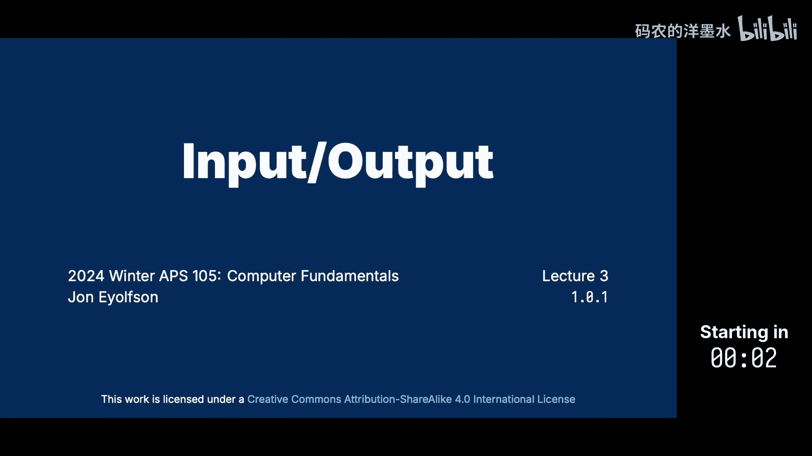
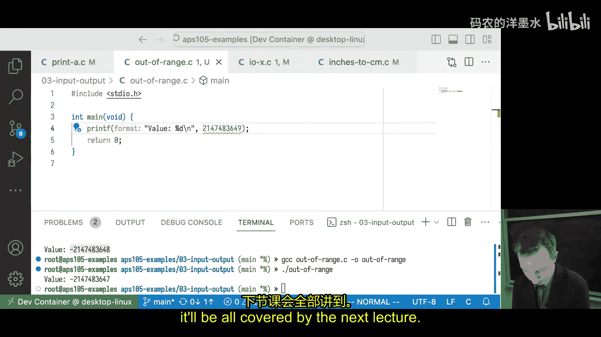

# C语言编程：第3讲：输入与输出 📝



在本节课中，我们将学习C语言中两个核心功能：如何从用户那里获取输入，以及如何将程序的输出显示给用户。我们将通过`printf`和`scanf`这两个函数来实现输入与输出，并理解格式字符串、变量地址等关键概念。

---

## 回顾“Hello World”程序

上一节我们介绍了数据类型。现在，让我们重新审视第一个“Hello World”程序，以便更好地理解输出是如何工作的。

程序的第一行 `#include <stdio.h>` 是“标准输入输出”的缩写，它包含了我们今天要学习的函数的声明。`printf`函数的声明就在其中，它告诉编译器`printf`需要什么输入以及会产生什么输出。

在`main`函数中，我们使用了`printf`函数。它的作用是输出一个**字符串**。字符串就是一系列字符的序列。就像发短信需要在结尾按“发送”或“回车”一样，字符串通常以换行符`\n`结束，这是一个我们之前学过的控制字符。

**如何创建一个字符串？**
字符串以双引号`"`开始，后面可以跟任意数量的字符，直到遇到另一个双引号`"`结束。打印时，这些引号本身不会显示出来。

`main`函数本身也是一个函数。`int main(void)`中的`void`表示它不接受任何输入，而开头的`int`表示它的输出是一个整数值。目前，我们总是返回`0`，表示程序运行正常结束。

---

## 理解函数调用与参数

当我们使用一个函数时，例如`printf("Hello World\n");`，我们称之为**函数调用**。函数的输入被称为**参数**。如果函数有多个参数，它们之间用逗号`,`分隔。

`printf`函数至少需要一个字符串参数。它也会返回一个整数值（表示打印了多少个字符），但这个返回值通常被忽略。

以下是`printf`可以接受多个参数的例子：
```c
printf("Hello World\n", 1);
```
在这个例子中，第二个参数是整数`1`，但目前`printf`还无法使用它，所以程序仍然只会输出“Hello World”。

---

## 使用格式字符串打印变量值

如果我们想用`printf`打印变量的值，就需要使用**格式字符串**。

在格式字符串中，我们使用**格式说明符**来告诉`printf`如何显示数据。格式说明符以百分号`%`开头。
*   `%d`：用于输出整数。
*   `%lf`：用于输出双精度浮点数（`double`）。
*   `%c`：用于输出字符。

`%lf`中的`lf`代表“long float”，这是历史原因造成的命名。

**如何使用？**
格式字符串中的第一个格式说明符对应`printf`的第一个额外参数，第二个对应第二个，依此类推。
```c
int x = 1;
int y = 2;
printf("Point %d, %d\n", x, y);
```
运行这段代码，将输出：`Point 1, 2`。

**如何打印一个真正的百分号？**
就像用`\\`表示一个反斜杠一样，在格式字符串中，用`%%`来表示一个百分号`%`。

---

## 字符与整数的关系

计算机底层一切皆数字。字符在内存中也是以数字形式存储的（例如ASCII码）。我们可以通过格式说明符来查看这种关系。
```c
printf("The integer value of 'A' is %d\n", 'A'); // 输出：65
printf("The character value of 65 is %c\n", 65); // 输出：A
```
字符`'A'`对应的整数值是65。通过改变格式说明符，我们可以让同一个值以整数或字符的形式显示。

---

## 使用`scanf`获取用户输入

`printf`用于输出，`scanf`则用于从终端获取输入。它同样使用格式字符串。

**关键区别：`scanf`需要变量的地址**
为了让`scanf`能够修改我们变量的值（即把用户输入存进去），它需要知道这个变量在内存中的**起始地址**，而不仅仅是变量的值。

如何获取一个变量的地址？使用**取地址运算符**`&`。
```c
int x;
scanf("%d", &x); // &x 获取了变量x在内存中的地址
```
`&x`的结果类型是`int*`（指向整数的指针），我们将在课程后半部分详细讨论。现在只需记住，`scanf`的参数需要是变量的地址。

---

## 一个完整的输入输出示例

以下是一个简单的程序，它提示用户输入一个数字，然后将其打印出来。
```c
#include <stdio.h>
int main(void) {
    int x;
    printf("Input x: ");
    scanf("%d", &x);
    printf("You entered: %d\n", x);
    return 0;
}
```
程序运行流程：
1.  打印提示信息 `"Input x: "`。
2.  等待用户输入一个整数（例如`14`）并按下回车。
3.  `scanf`将输入的数字转换为整数值，并存储到变量`x`的地址中。
4.  `printf`将变量`x`的值打印出来。

**注意事项：**
*   格式说明符（如`%d`）必须与要读取的变量类型（如`int`）匹配，否则会导致不可预测的结果。
*   目前我们假设用户总是输入有效数据。在实际程序中，需要检查`scanf`的返回值（成功读取的项目数）来处理错误输入。

---

## 常量与命名规范

有时我们需要创建值永不改变的变量，这称为**常量**。在C语言中，使用`const`关键字来声明常量。
```c
const int InchesPerCm = 2.54; // 这是一个常量，值不能被修改
```
尝试给`InchesPerCm`重新赋值会导致编译错误。使用常量可以防止意外修改，使代码更安全。

**命名规范（约定俗成）：**
*   **普通变量**：以小写字母开头，如果包含多个单词，后续单词首字母大写（驼峰命名法），例如`userAge`。
*   **常量**：以大写字母开头，单词间用下划线`_`连接，例如`Inches_Per_Cm`。全大写的常量（如`EXIT_SUCCESS`）通常表示特殊的预定义值。

保持一致的代码风格非常重要，它能提高代码的可读性。

---

## 实践：英寸转厘米程序

现在，让我们综合运用所学知识，编写一个将英寸转换为厘米的程序。

**程序思路：**
1.  定义一个常量存储转换率（英寸/厘米）。
2.  提示用户输入英寸值。
3.  使用`scanf`读取用户输入。
4.  进行计算（厘米 = 英寸 * 转换率）。
5.  使用`printf`输出结果。

以下是程序代码：
```c
#include <stdio.h>
#include <stdlib.h> // 为了使用 EXIT_SUCCESS

int main(void) {
    const double InchesPerCm = 2.54;

    printf("Enter number of inches: ");
    double inches = 0.0;
    scanf("%lf", &inches);

    double centimeters = inches * InchesPerCm;

    printf("Measurement in CM is: %.2lf\n", centimeters);

    return EXIT_SUCCESS; // 比直接返回0更具表达性
}
```

**代码说明：**
*   第10行：`%.2lf`是格式说明符的**子说明符**。`.2`表示只打印小数点后两位，并进行四舍五入。这**不会**改变变量`centimeters`的实际值，只影响显示方式。
*   第12行：使用`EXIT_SUCCESS`（定义在`stdlib.h`中）代替`0`，能更清晰地表达“程序成功退出”的意图。

---

## 总结与注意事项

本节课我们一起学习了C语言的输入与输出。
*   我们使用`printf`和格式字符串（如`%d`, `%lf`, `%c`）来输出数据和变量。
*   我们使用`scanf`和取地址运算符`&`来获取用户输入并存储到变量中。
*   我们了解了常量（`const`）的用法和基本的命名规范。
*   我们完成了一个完整的单位转换程序。

**重要提醒：**
计算机的存储空间是有限的。例如，`int`类型有最大值（约21亿）。如果尝试存储超过这个范围的数字，会发生“溢出”，导致结果回绕到最小值，从而产生错误。在本课程中，我们会确保输入数据在合理范围内，但了解这一限制对未来的编程工作至关重要。




现在，你应该能够完成实验一的第一部分，并尝试第二部分了。如果遇到困难，下一讲的内容会提供更多帮助。