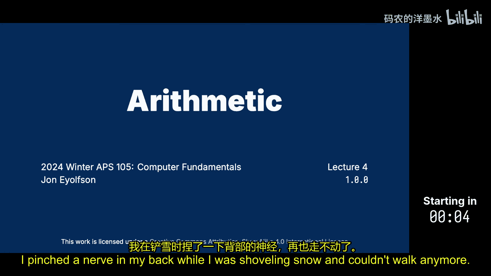
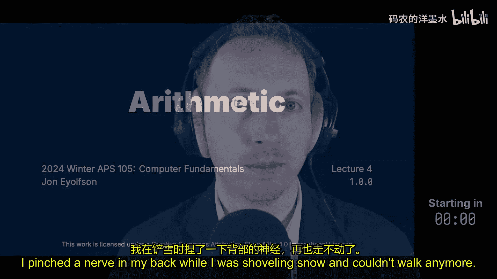
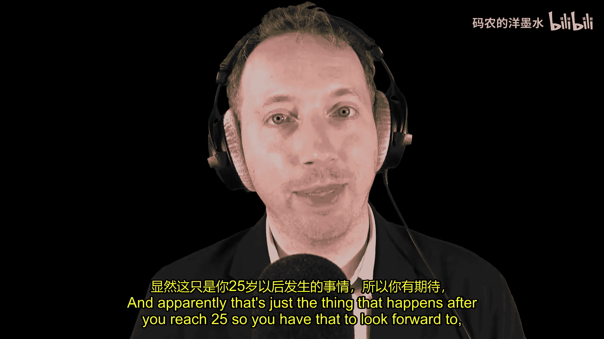
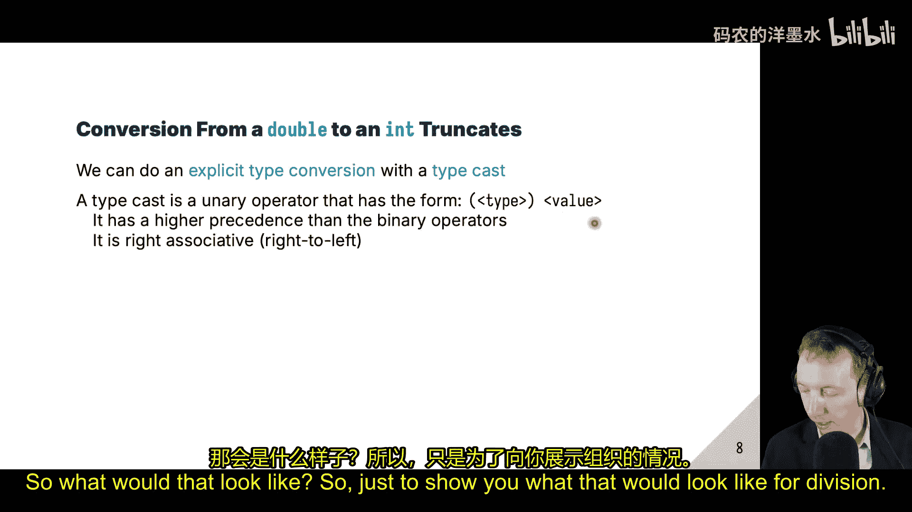
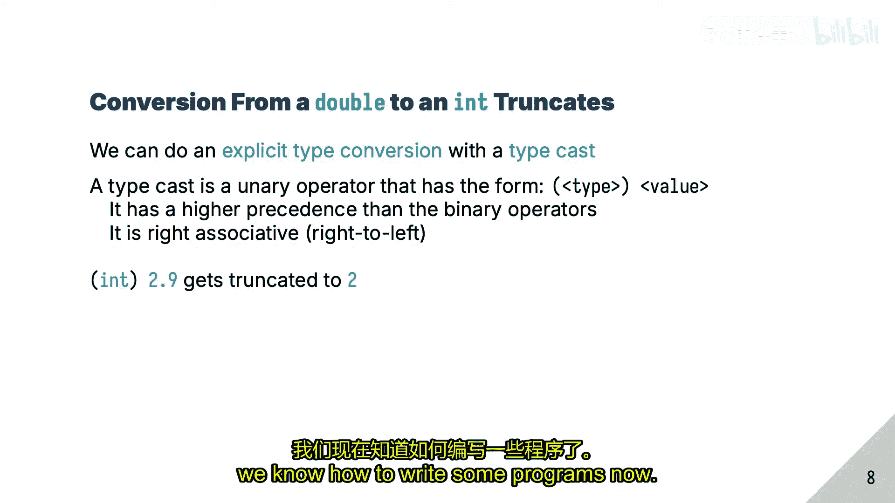
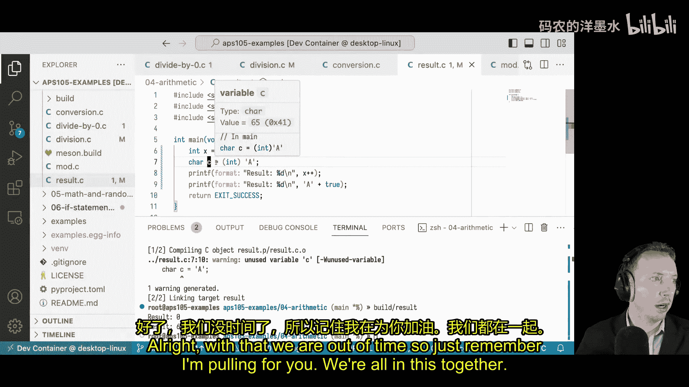

# 【全集】多伦多大学 C语言编程 中英字幕 1080P p04 Lecture 4 - 算术运算 -BV1gikKB3EZW_p4-

Welcome back to 105。I apologize for not being there today。

I pinched a nerve in my back while I was shoveling snow and couldn't walk anymore。

And apparently that's just the thing that happens after you reach 25 salt。

You have that to look forward to。

All right。So today， we get to talk about arithmetic and specifically performing arithmetic in C。

So first thing we have to talk about to be very precise is what an expression is。

 so that's a term that will come up whether we're talking about the syntax of C。

So expression is just a combination of operas and operators。

 which result in a single value fancy way of saying something like， I don't know， one plus 2。

So we know that that will result in three。But at the end of the day， that results in a single value。

 So three， or if we wanted to say3 by itself is an expression because it's already a single value。

All right。Sorry。😔，So。😔，So。There's all of the operators you would expect。

 So there's plus minus multiplication division。You' probably。

Already committed this to memory or just habit， but there is an order of operations you might have been taught at bedmas。

 you might have been taught at Pmass。Same thing。 Just different names， so。

There's a distinct order of operations we have to follow， so we do everything in brackets first。

 followed by exponents， then division multiplication are at the same level。

 and then we have addition subtraction。 And we also work left to right。

 And if we want to be precise about that term that is called being left Associative。So。

It's important to agree on the order of things。 So if we have one plus 2 plus 3 left associative means we compute it as So plus is just a binary operator。

 so we can only do。嗯。We can only add two numbers together at once。 So in order to compute this。

 we would compute。One plus two， get the result three and then add3 plus3 to get six。

If instead it was right associative， we do it in a bit of a different order。

 so wed do the 2 plus3 all the way to the right first and we would get5 and then finally we'd do one plus5 to get6 in this case we get the same answer。

 but it's important to always do them in the same order。Quest。

 if I can turn captions on the screen or increase the volume， unfortunately。

 I can't while I am doing this， but。The volume levels look okay on my end。

 so hopefully the recording's okay or you can turn it up there。So。

If we want to do something more like1 plus2 times3， well。

 if we want to compute this because we want to do the multiplication first。

 so we say that is higher precedence， then we would compute two times 3 first to get6。

 and then we add that result to one to get7。If instead we didn't have presence。

 we'd get a different order， so we would add one plus 2 first to get 3。

 then multiplied by 3 to get 9。 and we would get a different answer。

 So that's why it's important that we agree。For reference， I put on the slide that where。

All these precedence rules are in C， but we will go over them today and discuss。

What level each are at。So。We also need to talk about division again， because in C。

 it behaves a bit differently than what you expect。 So if we write out the types of the operarans as。

Like int divided by int。The result of doing this division is going to be another int value。

 so this might not make。Since do you integers， you know。

 they don't have any decimal points or whatever。 So what's going to happen if the answer should actually have a decimal point。

 So and see if we compute。5 divided by 2。 The result is actually2， because we can't say 2。

5 because remember an integer is just forit numbers， right， Numb without a decimal point。

So the rule in C is that theres no rounding whenever you do division between integers。

 the result is the quotient that you would get if you did long division by hand。Or in other words。

 it would be the proper result minus the decimal place you just kind of chop it off。So。

In order to get the remainder in C， there's an operator to do that。

 it's called the modular operator and you use it by using the percent sign and that is how you get the remainder from an integer multiplication。

It has the same precedence as division and multiplication， so it's treated the same。

 but the same but you just get the remainder out of it。So for example。

 if you did5 mod2 is how we say it， so here at the bottom5 mod2， then the result is going to be one。

 because while if we did the division by hand it would be we'd get two with one as a remainder。

 so since this is a remainder operator， we would get one from doing this from doing the remainder。

 while if we just did the integer division， we would get two。

And it's important to note here that both the opera ends of this module must be int。

 we can't use them with doubles。So C has a few rules for the modo operator。

 so the quotient is always truncated。That's the term we use。

 which basically just means take the result and just chop off the decimal point without doing rounding。

 without doing anything special to it。So。In order to get the result of the operator， the rule for C。

Is that if we can represent the division A divided by B， then。The result of the integer division。

 So this one will be just another integer， you know。

 just that quotient part or just the result it should be。

 but truncated multiplied by our original B plus the result we get from the remainder should probably equal a in order for math to kind of make sense。

 So to see what the result would be。 So I have the columns here。 So here's A B。

 and then the integer result of A divide B， and then the remainder of a divide B。

So if a is 5 and b is 2， then the true answer is 2。5。

 but the integer division would just simply be 2， and then the remainder would be 1。

 Now we can check that， hey， this actually makes sense so if we do B times the integer division that's 4 and then plus the remainder 5 gets us back to our original a。

 so that is the rule that's going to hold for all of these。So if a is 5 and B is negative 2。

 then a divide B is going to be negative 2 because the answer should be negative 2。5。

 and then the modo is going to be 1 because if we multiply B，Which is negative2。

By the result of the interteger division， which is negative 2， we get4。

 so in order for this equation to make sense， well。

 the remainder has to be1 that gives us back up to a， which is5 because it always needs to equal a。

Gets a bit weird whenever we have。This case where the dividend or a in this case is negative。

 so if a is negative 5 and b is 2， well the integer division is still going to be negative2 because we do the truncation。

Of negative 2。5。 but now in this case， we get a negative mod， which is a bit weird。

 but makes sense in our equation because2 times negative2 is negative4。 so in order to get to a。

 which is negative 5， we need it to be negative 1。So it's a bit weird。嗯。

People don't really expect sometimes that the remainder can be negative。 So this is just a。

Just a warning to look out for that， that it may be negative。 I believe in this course。

 whenever we take the modo operate， we。Think we assume all of our arguments are positive。

 So if A and B are positive and you take the mod of that， the mod is also going to be positive， but。

Just in case you could get a negative number there。

 just watch out for that because the module might not be negative。Or might be negative。All right。

The other part of that rule was， oh， okay， this equation holds if we can represent a divide by B。

 Well， why can't we represent a divide B， And the main thing we can't represent is division by 0。

 So in math， that's impossible。If you write it in C， you can write。1 divide by0。 you can compile it。

 Itll give you a value。 And let's go ahead and do that to show that。 well， it's a bad idea。

So here is my program here。And this is going to be a bit different I noted from what you might see in Viual Studio code because I use a different extension。

 so this format is actually just telling me， whoops。

 telling me the name of the argument for the print F function， but it's not actually used。

So if I look at this， my compiler gives me a little bit of a warninging here。

 it says the division by zero is undefined， which。We will see that if your compiler ever says something you're doing is undefined。

 then you should probably not do that thing。In this case， I am dividing by zero。

So if I go ahead and try and run this program， I get native。Some weird number， and。

I'm going to get a random number every time because it's undefined。

 which just means your computer can just spit out any old random number and it doesn't actually make sense。

 and it's not guaranteed to make sense。 So if I run it again， I get a completely different number。

 if I run it again， different number so on and so forth， every time I run it。

 I get a different number。So。The value we got back there was undefined。

 could be different every time， could be different on different computers。

 yours could do something different than mine。Yours could have a consistent result。

 Minine could be inconsistent。 Unfined means you can't actually rely on the behavior。

 which is a big source for errors， if some。If you rely on something that's undefined and it just happens to work for you。

And then you try it on some other computer。It suddenly won't work anymore。

 and it will be very hard to figure out why and might be because you have undefined behavior。So。

And see， this is undefined behavior， US spelling。 Sometimes you'll see it pop up as just U B。

 and it is one of the harder types of problems to debug that you should avoid at all cost。

 So once we get through the course a little later， whenever you do division。

 you should make sure that。The number you are dividing by is not zero， if it is zero。

 then big problems are going to happen， so you should make sure you do not divide by zero。

Another question might be out seeing any questions yet， hopefully things are working。

So another question might be what happens if we mix types so we know we have ints and we have doubles what happens if you kind of mix them together so the operators plus minus multiplly divide and modular they're all binary operators so they only take two operatorss and then they themselves are the operators。

So what the rule is is if both of the operas are ints。

 then the results is an int and recall for modo， both operas have to be int。

 otherwise it's not going to work。But the other rule is if at least one of the operas is a double。

 the other is going to be converted to double if it's not already one。So。

When we convert an int to a double， all we do is add  point0。

 So we just add a decimal point and then a 0。 So if we， for some reason， write in our C program，2。

5 plus 2， well， we're not allowed to just。Add a double and an int。

 So C has to convert this two to a double。 So this two， which is an int， gets converted to 2。0。

 which is a double。 And then it would do the addition。 So the result would be 4。5。

So that automatic type conversion， you'll see it come up， it's called implicit type conversion。

 implicit just means we didn't request it， like we didn't actually tell C to do it。

 it just kind of did it because it was following its rules。

So it basically means we didn't actually request it。And it might not be obvious that we requested it。

So if we go the other way， so if we convert a double to an int， it does that truncation。

 like when we had when we were doing the integer division。So。

That just means it will just chop off anything after the decimal point。 It doesn't round。

 It doesn't do anything like that。 So we can do explicit type conversion if we want with something called a typecast and a typecast is a unary operator。

 So it only。Acs on one opera end， likely a variable or a value， and it has the form。

 so it has parentheses and then you say the type， which will probably be either an int or a double and then the value or the variable that you want to convert to that type。

So。This has higher precedence than the binary operator。 So it will always happen first。

 and it is right associative with itself。 So if we have multiple。

 it will start from the right and then go to the left because， well。

 it only has one argument here and。The thing the operator is on the left。

So what would that look like？

So just to show you what that would look like for division。Is if I have in x equals。3 divide by2。

 Let's see if people are around in discord。 So what should the result of this be。

So if I do the integer division of3 divided by2， let see， I'll give it a bit。

 see if anyone is typing it on discord。 Oh， I see one person typing。So。

Let's see we can figure out what the integer division is。So one， we got ones， a bunch of ones。

 All right， good， we got a whole bunch of ones。So。In this case， yeah， it would be one。

 So what is the result of。This is one。 So what would the result of 3。0 divided by 2。0 be。

So we got ones。 Oh， we got 1。5。 Okay， so yeah， this would be 1。5。 And that is also why。Here。

On the first line with the int， that's the integer division。 So the result should be 1。5。

 but because it's integer division， it gets truncated。 So it's just a1 and not a2。

So we have this double， and then this is 1。5。 So if we go ahead and we run this program。

 hopefully we get the results we expect。 oops， it is called division。And we get， yeah， x is1。

 and then y is 1。5， and this would be true even if we change this 2。0 to a 2。 So even if we do that。

 our result is going to be 1。5 because this two gets converted to a double， so itll be 2。

0 and then we'll have what we had before。So if we just compile that and run it again。

 we'll see why is still 1。5。If I change this back to 2。0 and then remove the 0。0 from the3。

Shouldn't matter which operaand is which This three should then get converted to a double。

 And then we should get our final result， which would be 1。5 again。 So if I compile that， I get 1。5。

 I only get the integer division in the case that they are both integers。 And in this case， it will。

 I get a nice little compiler warning that says the result of an integer division is used in a floating point context。

 What that means is the result of this。The result of this expression is going to be one。

 which is an int。 And then I'm assigning it to a double。 So if I'm assigning it to a double。

 I'm converting it to an int to a double afterwards。 So the result。

 the value of y in this case would just be 1。0。 So I will compile that and run it。 in this case。

 I get 1。0 for y， because it's still a double。But I took the result of the integer division。

 and then it implicitly converted it back to a double。

 My compiler was trying to tell me I did something silly。So。That's what that means。

 but if I change either one of them to a double， then I am good。

 or I could do that type cast we just learned。So if I did that。Then， I would。

Convert this three to a double first。 so it would be the same as doing if I added more brackets。

Itd be the same as doing。This first。So I convert the three to a double， so it's 3。0。

 and then if I do the division， then it's 3。0 divided by 2。

 and then that two will be converted to a double and I'll get 1。5 at the end of it。All right。

 we have a question。 What is the correct way to tell the compiler that the integer truncation was intended？

 So in this case， if I really wanted。To mean like that integer division。

 I should assign it to an int like I did above for X。Otherwise， if you sign it to a double。

 it thinks you're doing。It thinks it's a problem。And yeah， another question。

 why am I using return success instead of return 0， So we went over that at the end of last lecture。

 So in the standard library generally， it's not a good idea to use magic values。

 generally you want them to mean something。 so it's a bit easier to read。

 So in the standard library header。There is something called exit success。

 which you should use to return from Maine， if your。Program has completed successfully。

 so turns out that exit success is simply just zero， but it conveys our meaning a bit better。

 so it might be a bit easier to read。Alright， I think that's so yeah。

 So we don't have to use the typecast on the two in this example because after the typecast for the double to three。

 the three is now what it would do is just replace。This 3 by 3。0。

 And now we don't have to cast2 because it's going to be doing a double divided by an int。

 So it would implicitly go ahead and convert this 2 to a2。0。 And then they'd both be doubles。

 and we'd get 1。5。All right， let us switch back quickly and we'll have some other examples and I think we'll have time at the end so we can mess with some programs since we know how to write some programs now。

So oops，1。 So here are some of the rules again。 So if we did int 2。5。

 we're converting it from a double to an int， so it just gets truncated。 So the result of int 2。

5 would just be 2。 and now that is an int。Like I had in the example。

 if we had double 5 divide by 2 gets computed。 right， Remember that。

The type conversion has a higher precedence than division， so we would do that first。

 so it gets computed as double5 first so we convert that int 5 to a double which would be 5。

0 so after that first step it would be 5。0 divide by 2 so this two would get converted implicitly to a double so it would be 2。

0 and then we get5。0 divided by 2。0 which is 2。5。And finally， if you did something silly like this。

 so you did double int and then a number。 Well， because the sociivity is right to left。

 we would do everything to the right first， so we would convert。This 2。9 to an int first。 So this。

 the result of this operator right here， would be the integer 2， because it gets truncated。

 And then we take that two， and then we convert it to a double。 So if we take。

Convert a 2 to a double， we just get 2。0。That's another way to do some operator on a double if you want。

 that's just a way to truncate a double， but it looks a bit ugly。🤢。

Turns out we'll see in the next lecture a nicer way to do this。

 but it is one way to truncate a double。So another thing is the assignment is also technically an operator。

 we saw that before whenever we declared a value， we could assign to it and then on other lines we could just assign new values to that variable well turns out assignment is also an operator that you can use an expressions but it's a kind of a bad idea to use it。

 but if you wanted to know the binary operator is right associative and it's the lowest precedence of anything we've seen so far。

 So the result of an assignment operator is the value assigned， so if we wrote x equals3。

 then the result of that is going to be three。This means you can write something like x or y equals x equals 3。

 So because it is right associative， it's going to get computed as this。

 So the x equals 3 is going to happen first， so we'll update x。The value of x to 3。

 And then the result of this is a3。 So after that first step， we'll get y equals to3。

 and then we would just assign the value 3 to y。 So it lets us do that。For now。

 I would warn you against doing things like that。 So I would instead just do this on two separate lines because generally。

Especially when you're starting。Doing assignments as part of expressions is a bad idea。

So trust me on this one。So there's some other shorthand operators are。That you can use。

 and there's a question about Python， I can answer Python things afterwards because not everyone might know Python。

So there's some other shorthand assignment operators you want， you may use。

 so you might find yourself doing something like x equals x。Times 2。

 if you just want to double the value of x， so you updated it so that after you do this statement。

 then x is twice the value it was before。So C has a shorthand and other languages has a shorthand for things like this。

 so instead of this I can just write x multiply equal to and they actually just mean the exact same thing。

You just save yourself repeating X twice。 So you just say it once。

 So this applies the operation to the value of the left of the assignment and then reassigns it with the result。

 So this will be。Two times。Or sorry x times 2， and then that result would be assigned to x。

 so it's just a shorthand way of doing things。Then we have a question。

 what if I add a double to X that's declared as an int。 So in that case。In that case。

 the addition or multiplication or whatever would be done as doubles。

 and then to fit it back into that variable， which would be an int。

 that would be an implicit type conversion and it would get truncated again。

And then another question， are shorthand assignments considered expressions that can be used in part of other expressions and in C。

 yes， they are。 But again， I would。I would tell you to not use them， if you do any assignments。

 you should just have one assignment per line and that's it。

And we'll see once we get into the course。There's。Some annoying operators that look really close that do something completely different。

So there's shorthand for all the binary operators so I can do plus equals， I can do minus equals。

 I can do multiply equals， divide equals， mod equals if I want。

 so there's shorthand for all of these。There's also some more shorthand for adding and subtracting by one。

 So this is a really common operation in programming and for computers in general。

So much so that while we give it special names。 So adding one to a variable is called incrementing。

 So it just we increment it by one。 subtracting one from a value is called decrementing。

 you're going to hear these terms come up a lot。 So there are special operators for incrmenting and decrementing。

 So the unary operator。 it's a unary operator。 So it just increments or decrements of value for incrementing it's plus plus And then for decrementing it is minus minus So。

😊，Annoingly， there's two versions of this operator， so it can either come before the variable。

 which is called prefix， or it could also come after the variable， which we call postfi。

 So pre is before， post is after， so it can either come before or after the variable。

So why do we have two versions of the z increment and decrement。Well。

 they do slightly different things。 The difference between the two is actually the result of the operation。

 So if we assume initially， we have we declared in x and it equals 0。 if we did plus plus x。

 Well that will increment the value of x。 So it will add1 to x and the result is going to be the updated value。

 So the result of x plus。Plus plus x is going to be one。The other version of it， the post fix。

 if we have x plus plus， that still adds1 to x， but annoyingly， well， not annoyingly。

 sometimes it's useful， but probably not for us。 the result of this expression is the original value。

 So in this case， the result of plus plus x is actually0。

 So it was the value before we actually added one to it。So。

In both cases x gets reassigned the value of1， it's just the only difference between postfix and prefix is the result of this and there's a slight typo here because this should be x plus plus。

 so I apologize for that tyypo， I will fix it right after that。

So the rule is you should always prefer the prefix。

 so this version that always returns the updated value unless it's strictly necessary and you're doing it。

 but generally if you actually need it。You're being too clever and the compiler is more clever than you。

 So you should just write something that's more clear and easy to read。 So when you go back to it。

 you actually have an idea of what you meant without remembering these rules。

 So remembering these rules。Generally。Isn't really worth it。

 You should just know that plus plus just increments a value。

 and you should always just use plus plus x instead of x plus plus。So。And then question。

 can you give an example of using both so we can see。Ay quick， do we have an example ready to。

So in this case， we don't know。 We don't have any good way of knowing when we would use one or the other。

 But we could do something like just just to show that。I'm not really lying to you。

So here's a program， we just have a int X， and then we have a print F with a format string。

 we're just going to print a integer。 so in this case， if I print plus plus X， then I compile it。

 and then I run it。Then the result is going to be one， because this is the prefix version of it。

 which always returns the updated value。 If instead I did plus P x plus plus， then。Ohoops。

Then I would get just 0。 And then we have another question。

 what about the order of operations if we did something like。If we just sandwich it。

 if we just sandwich X， we actually just get a error that this expression is not assignable。So。

 we actually。Cannot do something like plus plus x plus plus， because， well。

If you go over the full precedence rules， it will actually do the post fix first。 Again。

 you don't really have to know this。But is just for illustration， so if it did this part first。

 whoops。If we did x plus plus first， then the result would be a0， and then we can't do plus plus 0。

 That doesn't make sense。 You can only change a variable。

 so I can't do plus plus x or anything like that。And then yeah， another question。

 why if I print X twice。 So just to show that we actually updated the value of x。

 let's have two lines here。So。I'm going to print the result of x plus plus。

 which will result in the result of this will be 0， but。

The actual value of x is going to be updated to1。 And to show that， I will just print it again。

 So in this case， if it was actually updated。Then when I run this， I should see the result of 0。

For the first line and then the result of one。 So that's just to show you that， hey。

 it's actually updated here， which。Again， is a bit weird gen。

Generally always prefer plus plus x to x plus plus。

There's also other reasons to prefer the prefix version of it。

 turns out in order to get the original value， the compiler might have to do something that is slow in order to do that。

 even if you don't really mean it and it doesnt have and it doesn't need to do that。

 So you're kind of getting in the way of the compiler generating code as well。

 but that's an argument you can make in like a fourthy course， but just no prefix version。

 and you will be okay。So there is another unary operator called size of and that tells you the number of bytes used by a type or a variable。

 So the result of size of is the number of bytes used and it's just an integer， in fact。

 it's always a positive integer。So we can use this to verify the number of bytes used for some types。

 so if we do size of int， well the result of that is going to be4 because it takes up four bytes。

 so if you don't remember the size of a type，Then you can always just ask see and print it out yourself。

 So the result of size of double， that's 8 Bs。 size of char is one。

 So one by and a bull is also one B because， while it's a whole number。

 We can't actually do anything smaller than a by。 It's typically the smallest unit we use in computing。

Whatever we have to deal with memory。Smallest unit would， of course， be a single bit， a1 or a0。

 but we can't really do much with it so。Again。You can also use size of on variables。

 so if I declare a double x， I can also do size of x。

 and I can get the result of 8 because well x is a double and it consumes8 bytes。

So here's all of the summary for the precede rules for today's operators。Just spelled out。

You don't have to remember all of them， so these are all the unary operators at the top that just take a single value。

 so those have the higher precedent so you don't have to memorize all of them just know that unary operators have the highest precedent。

 so you do those first。So。In this case， here's our typecast。 and then our operators。

 The only difference is the sociivity so。In post fix。

 we have to go left to right because the operators on the right for all the other unary operators。

 the operator is actually on the left， so the sosociivity is right to left。

 So typecast is one we saw before that the Ampersand to get the address of is actually a is actually a unary operator as well。

Size of is a urary operator。 And then here is where we have our normal math。

 So here is multiplication division and mod。 And then here is addition and subtraction。

 and they are left to right associative and well。The things。

Near the top are higher precedes and at the bottom is lower precedent， so we would do those last。

So addition subtraction， and then what has the lowest precede is the assignment statements which are right to left associative。

 but again I do not recommend you try to mix them in expressions。

 you should just have them on a line so just if you want to assign something。

 just have variable equal or variable plus equals and then don't do any assignments after that just do one assignment。

So other things we can do in C just to make things a bit more readable is you can add comments to your code and it is basically a note for others to read the compiler completely ignores them。

 So what the rules are for them is any text you write between a slash star and then a star slash is considered a comment that the compiler ignores so it won't consider it as code its just messages to write to yourself。

 You can also use just slash slash and then anything after that's ignored until a new line。

 so until you hit enter。So for example。If you wanted to leave yourself a note as to why I included STD Lib。

 well， you could write to the right of it。 Oh， start a comment， say I need this for exit success。

 So that's why I have it here。Otherwise， if I just return0。

 I don't actually need this line and I could delete it。

 so maybe that's a note to yourself that if you change this to return0 again。

 you can go ahead and delete this line。You can also just add a note to yourself at the。

Beginning of Maine， it says， oh， the program will start here and it will finish when it hits return。

 So if you want to leave notes to yourself， you can do that question about how much are you being graded for comments on the labs。

嗯。For the most part， your labs are all auto graded。

If you just submit them and you get a grade back and there's no。T A sitting down with you。

 marking it。 comments don't count for anything。 You're not graded for comments。

 but it's a good idea to have them。 So if you refer back。

 you actually know what you're doing or if it takes you more than。

Like if you take more than a day to finish your assignment。Generally。

 it's good to leave yourself comments so you know where you were and where to pick up from and then resume your work。

So。Another thing to be careful of。Is。Just be careful of truncated into true to vision。

 So if I asked any normal person what is one divided by two plus one divided by2。

What would the answer be， so assume you haven't taken this course yet。

 tell me what one divided by 2 plus one divided by  two is。Well， well， it's on the slide already。

 So the answer should be one makes sense， right， so。What would it be in C。

 So I will leave this to you now， So if I did one divide by 2 plus 1 divide by 2。

 what would it be in C。 Yeah， I've seen in the answer array big old goosea， Big0。

 So someone that is not familiar with C and doesn't know about truncated integer division。

 They would see this and maybe read a 0 in their program later and be like， what the hell。

Does C not know how to do math， what a stupid programming language this is？Well。

It's actually because of that truncated intu division， and if we apply all of our rules today。

Since division has higher presence than add or than addition when we compute this。

We would do the division first and since one divide by two， they're both integers。

 well we trunccate it， so the answer should be 0。5， but because we're doing it on integers。

 we trunccate it。 so we just chop off everything after the decimal point。

 so the result of this is actually going to be 0， and the result of this division is going to be 0 as well。

 so。So we would get0 plus0， which is simply just zero。

So we have a few more minutes for your questions。 So any questions from today or anything you want me to do and explain。

 this is generally。嗯。The thing that trips up people the most。

 especially when you read the program and it's like， well， obviously that's one， but hey， no。

 it's not， it's zero。So I will give it， let's give it a few minutes。

 you can type your question in the Discord chat， I see some people typing right now。Oh， so question。

 can we do arithmetic on Booles， So false plus false equals false。

 We can try it out generally doing arithmetic on booles。 doesn't really have any meaning。

 We will see。In the next lecture。No， in two lectures we'll see what we can do with Booles right now。

 Booles aren't actually that useful。 So if we can do false plus false， so sure。

 we can do false plus false。If we do false plus false， the result is zero。

Because false is just another word for0， if we did。True plus false again。

 probably doesn't have much meaning， but true is equal to one。

 So true plus false should probably just equal to one。 So you can do。嗯。

You can do it on Booles generally， it doesn't mean anything。But sure， you can see。See。

 let's you do some weird things even if。You， as a functioning human， would read it and be like。

Why are you doing that？ That doesn't make sense。All right。Any other questions？

We have a question about strings。We will not。We're going to talk about strings much later in the course。

So don't worry about strings。 And then another question， hey， if we add to characters， oh。

 will that add their ASI value。 So yeah so。If we do cha C equals。嗯。Capital A， which is what 65。

 I believe well。If you。For some reason， add， let's say we add x plus C。

What it's going to do is it's going to。A cha C， It's just a byte。

 So it's just going to consider it as an integer and then just do the addition。

 So this would be integer division。 So in this case， I believe。Capital a is 65。

 So if we compile this and look， the result should be 66 because x is 1 and then C is 65。

 and then yeah， someone's asking if we can just do a plus true and in this case we can。

We're going to get the same thing。We're going to get 66。Again。

 probably doesn't really have any meaning to us。Whatever you write programs。

 you should write them in a way that they are readable and make sense。

 there is a branch of programming where you try and write the most confusing program possible to just。

I dont know try and overwhelm whoever is trying to read it and figure out what your program is actually doing。

 but in this course we are going for clear programs that don't have any additional things。Like。

Everything actually has a purpose and a meaning。So any other quick questions before we wrap up？

And I apologize if you can hear my dog。There is someone at the door and she is very alarmed。

And then a question is can I cast an integer to a char so you can cast an integer to a char。

 but remember that a char is only one by and the integer is 4。

 so if it's a number it can't actually represent it will behave。

It will actually try and convert it into the smaller value。

 and it'll do something similar to what we did in the last lecture when we had an int and then we tried to assign it a value that was too big for it。

 so the same thing is going to happen for characters。But it will try。Generally。

If you know that for sure， your character will fit in an int， then it is perfectly fine to do that。

 So， in fact， if I made， instead int see， and then I took that char and converted it to an int。 Well。

 that would be fine because。It would just convert a。

 so the actual ASII value and here if I look over it in this。

 it actually tells me with this extension， I don't think your yours may not do that， but says hey。

 it's 65， so that's 65 which just fits in a byte would get converted to an int。

 so now it would just take up 4 bytes and now we can just use it。And then a number one。

 another question is， if I just do。Cher。What is it Char A int a。

 So something like this would also work。 but my compiler Oh， yeah。

 something like this would also work。 so it would take a， convert it to an int。 So now it's to 65。

 but takes up 4 bytes。 And then at the end here would be an implicit conversion。

To fit it back into a char。 So it fits in C。 And in this case， while it's 65。

 so the integer 65 can actually fit。All right。 With that， we are out of time。 So just remember。

I'm pulling for you。

We're all this together。