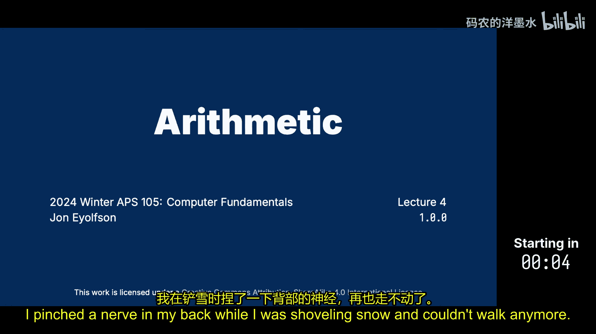
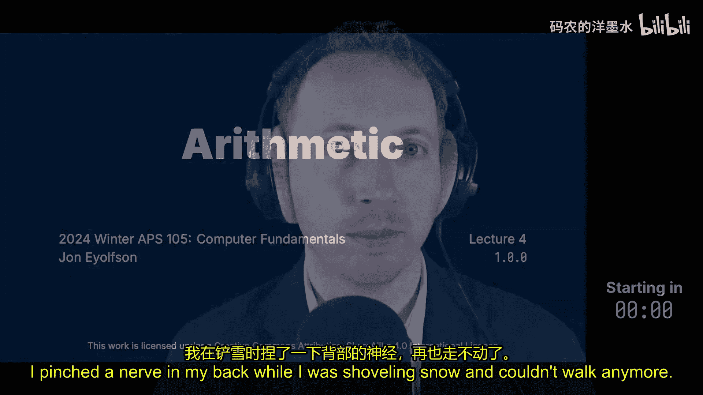
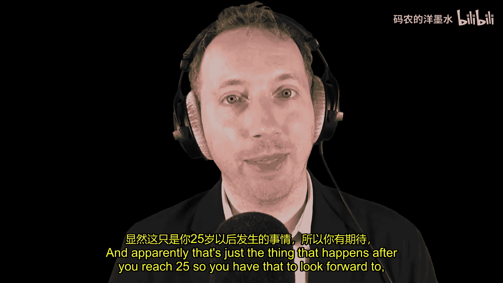
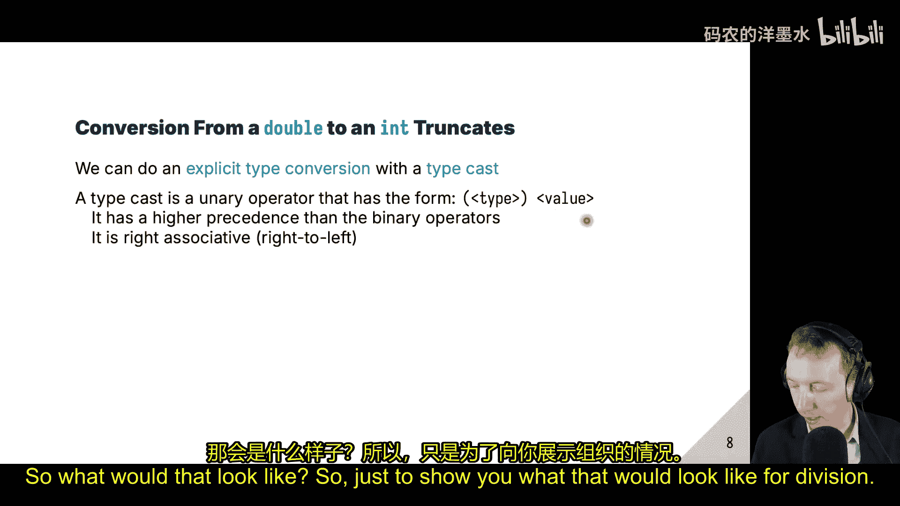
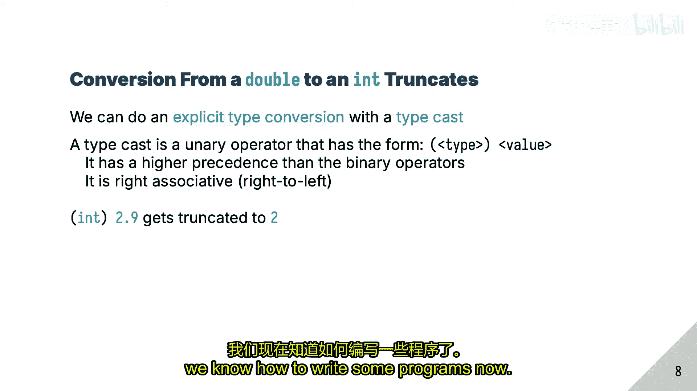
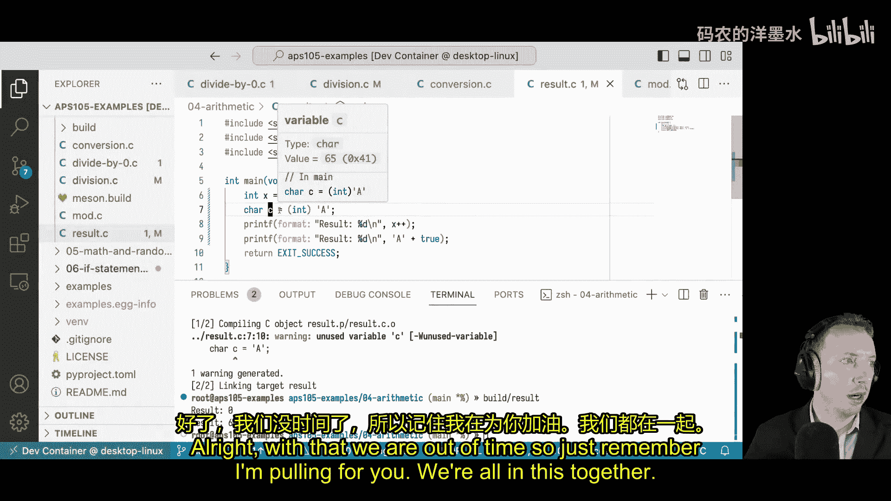

# C语言编程：第4讲：算术运算 🧮







在本节课中，我们将要学习C语言中的算术运算。我们将了解什么是表达式，学习C语言中运算符的优先级和结合性，并探讨整数除法的特殊规则、类型转换以及一些实用的快捷运算符。理解这些概念是编写正确数学运算代码的基础。

## 什么是表达式？

上一节我们介绍了课程背景，本节中我们来看看算术运算的基础——表达式。

表达式是操作数和运算符的组合，其计算结果是一个单一的值。例如，`1 + 2` 就是一个表达式，其结果是 `3`。即使是单个值，如 `3`，本身也是一个表达式。

## 运算符与运算顺序

C语言包含所有你期望的运算符：加（`+`）、减（`-`）、乘（`*`）、除（`/`）。和我们熟悉的数学规则一样，C语言中的运算遵循特定的顺序，即运算优先级。你可能学过 BEDMAS 或 PEMDAS 规则，它们是相同的概念，只是名称不同。

以下是C语言中的基本运算顺序：
1.  括号 `()` 内的运算最先进行。
2.  接着是指数运算（本课暂不涉及）。
3.  然后是同优先级的乘（`*`）、除（`/`）运算。
4.  最后是同优先级的加（`+`）、减（`-`）运算。
5.  对于相同优先级的运算符，计算顺序是从左到右，这被称为**左结合性**。

理解运算顺序至关重要。例如，计算 `1 + 2 * 3`。因为乘法优先级高于加法，所以先计算 `2 * 3` 得到 `6`，再计算 `1 + 6`，最终结果是 `7`。如果没有优先级规则，从左到右计算会得到 `(1 + 2) * 3 = 9`，这将导致错误的结果。

## 整数除法与取模运算

在C语言中，除法运算的行为可能与你预期的不同。当两个操作数都是整数（`int`）时，进行的是**整数除法**，结果也是一个整数。

整数除法的规则是**截断**（直接舍弃小数部分），而不是四舍五入。例如，`5 / 2` 的结果是 `2`，而不是 `2.5`。

如果你想得到除法运算的余数，需要使用**取模运算符**（`%`）。它的优先级与乘除法相同。例如，`5 % 2` 的结果是 `1`。

取模运算必须用于两个整数之间，不能用于浮点数（`double`）。C语言确保以下等式始终成立：
`(a / b) * b + (a % b) == a`
其中 `a` 和 `b` 是整数，`a / b` 进行整数除法。

需要注意的是，当被除数（`a`）为负数时，余数也可能是负数。例如，`-5 % 2` 的结果是 `-1`。在本课程中，我们通常假设操作数为正数以简化问题。



## 除以零与未定义行为

在数学和C语言中，除以零都是没有意义的。如果你在代码中写入 `1 / 0`，编译器可能会发出警告，但程序仍可编译。

然而，运行这样的程序会导致**未定义行为**。这意味着程序可能输出任意随机值，每次运行的结果都可能不同，在不同的计算机上表现也可能不同。依赖未定义行为是严重的错误来源，必须避免。因此，在编写除法代码时，务必确保除数不为零。

## 混合类型运算与类型转换

当表达式中混合了整数（`int`）和浮点数（`double`）时，C语言会自动进行**隐式类型转换**。

转换规则如下：
*   如果两个操作数都是 `int`，则结果也是 `int`（取模运算要求如此）。
*   如果至少有一个操作数是 `double`，那么另一个操作数会被转换为 `double`，然后进行计算，结果为 `double`。



将 `int` 转换为 `double` 很简单，直接添加 `.0`，例如 `2` 变成 `2.0`。将 `double` 转换为 `int` 则会进行截断，例如 `2.9` 变成 `2`。

除了隐式转换，你也可以使用**显式类型转换**（或称强制类型转换）。它使用**类型转换运算符**，格式为 `(类型)值`。这是一个一元运算符，具有很高的优先级。

例如：
*   `(int)2.5` 的结果是整数 `2`。
*   `(double)5 / 2` 的计算过程是：先将整数 `5` 转换为 `5.0`，然后 `2` 被隐式转换为 `2.0`，最终 `5.0 / 2.0` 的结果是 `2.5`。

## 赋值运算符及其快捷方式

赋值（`=`）本身也是一个运算符，它是右结合的，并且优先级非常低。赋值表达式的结果是被赋予的值。例如，`x = 3` 这个表达式的结果是 `3`。这意味着你可以写 `y = x = 3`，但这会使代码难以阅读。**建议初学者始终将赋值语句单独成行**。

对于常见的运算后赋值操作，C语言提供了**复合赋值运算符**作为快捷方式：
*   `x = x + 2;` 可以简写为 `x += 2;`
*   同样，还有 `-=`、`*=`、`/=`、`%=`。

这些快捷方式让代码更简洁。

## 自增与自减运算符

将变量加1（递增）或减1（递减）是非常常见的操作。C语言为此提供了专门的运算符：
*   递增：`++`
*   递减：`--`

它们有两种形式：
*   **前缀形式**（如 `++x`）：先增加变量的值，然后返回增加后的值。
*   **后缀形式**（如 `x++`）：先返回变量当前的值，然后再增加变量的值。

**建议始终使用前缀形式**（`++x`），除非你有非常明确的理由需要使用后缀形式。前缀形式更直观，且通常效率更高。

## sizeof 运算符

`sizeof` 是一个一元运算符，用于获取一个类型或变量所占用的内存字节数，结果是一个整数。

例如：
*   `sizeof(int)` 通常返回 `4`。
*   `sizeof(double)` 通常返回 `8`。
*   `sizeof(char)` 返回 `1`。

你也可以对变量使用它，如 `double x; sizeof(x);` 同样返回 `8`。

## 代码注释

为了让自己和他人更容易理解代码，可以添加**注释**。编译器会完全忽略注释内容。

C语言有两种注释方式：
1.  多行注释：介于 `/*` 和 `*/` 之间的所有内容。
    ```c
    /* 这是一个多行注释，
       可以跨越多行。 */
    ```
2.  单行注释：从 `//` 开始到行尾的内容。
    ```c
    // 这是一个单行注释
    #include <stdlib.h> // 需要这个头文件来使用 exit(EXIT_SUCCESS)
    ```

虽然本课程的实验作业不根据注释评分，但良好的注释习惯对编写和维护代码非常有帮助。

## 一个常见的陷阱

最后，我们来看一个初学者常犯的错误，它综合体现了整数除法的特性。

请问表达式 `1 / 2 + 1 / 2` 在C语言中的结果是多少？

根据整数除法规则，每个 `1 / 2` 的结果都是 `0`（因为 `0.5` 被截断）。所以整个表达式是 `0 + 0`，最终结果为 **`0`**，而不是数学上正确的 `1`。

要得到正确结果，需要确保至少有一个操作数是浮点数，例如写成 `1.0 / 2 + 1.0 / 2`。

---




本节课中我们一起学习了C语言算术运算的核心知识：表达式与运算符优先级、整数除法与取模运算、混合类型转换、以及自增、赋值等快捷运算符。记住整数除法的截断规则和避免除以零是写出正确数学运算代码的关键。下一讲，我们将开始学习如何让程序根据条件做出判断。