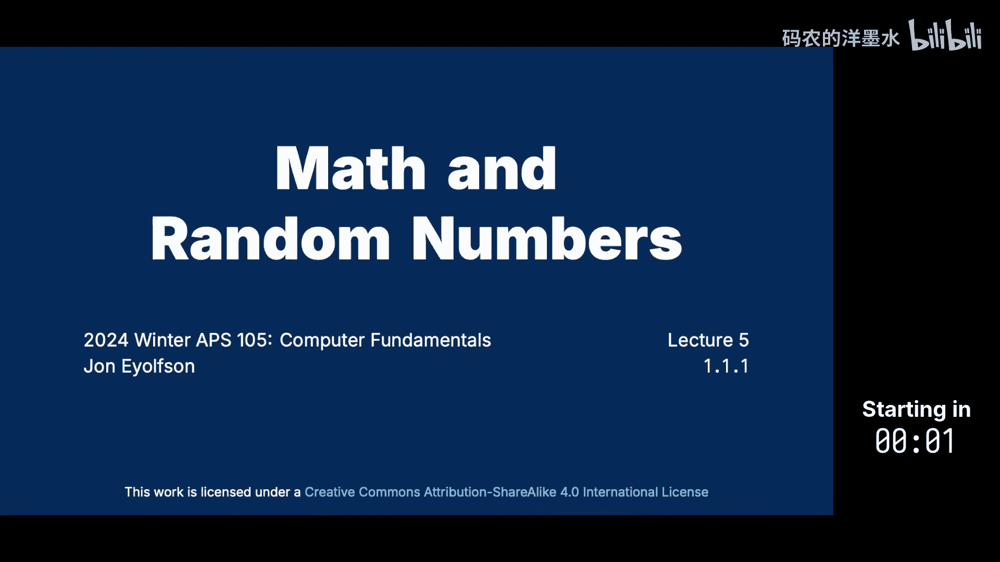
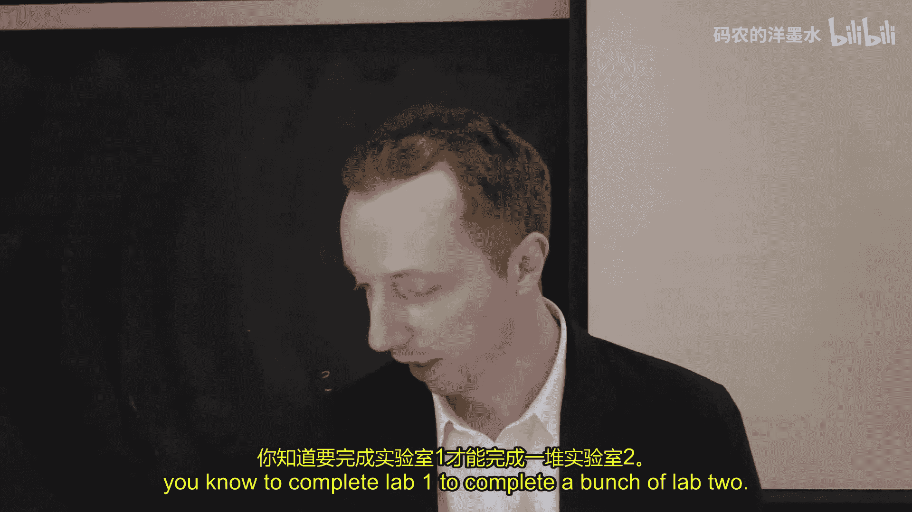
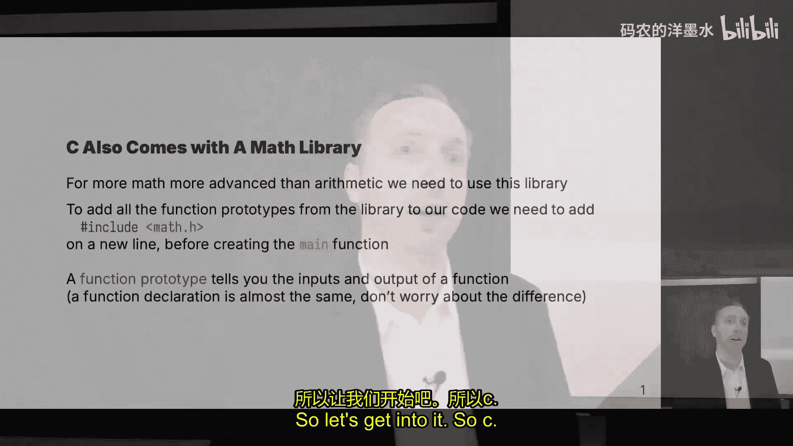
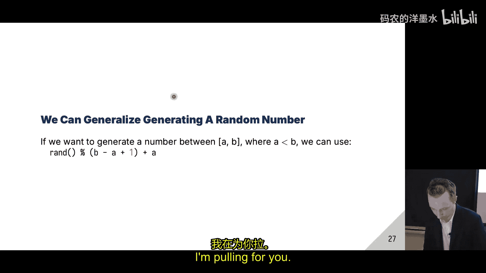

# C语言编程：第5讲：数学运算与随机数 🧮🎲







在本节课中，我们将学习C语言中的数学运算和随机数生成。我们将探讨如何使用数学库进行高级计算，以及如何生成和控制随机数。这些知识对于完成实验一和实验二至关重要。

## 数学库与函数原型

上一节我们介绍了基本的算术运算。本节中，我们来看看如何使用C语言的标准数学库进行更复杂的计算。

要使用数学库，我们需要在代码开头包含其头文件。这会将库中所有函数的原型添加到我们的程序中。

函数原型描述了函数的输入和输出。其基本形式如下：
```c
输出类型 函数名(输入类型1, 输入类型2, ...);
```
例如，`int main(void)` 表示 `main` 函数没有输入，输出一个整数。

以下是几个函数原型的例子：
*   `double foo(double);`：函数名为 `foo`，接受一个 `double` 类型输入，返回一个 `double` 类型输出。
*   `double foo(double, double);`：函数 `foo` 接受两个 `double` 类型输入，返回一个 `double` 类型输出。
*   `void f(double);`：函数 `f` 接受一个 `double` 类型输入，没有输出。
*   `double foo(void);`：函数 `foo` 没有输入，返回一个 `double` 类型输出。

头文件（如 `math.h`）本质上就是包含了许多这样的函数原型。预处理器会在编译前将 `#include` 指令替换为对应文件的内容。

## 常用数学函数

了解了如何引入数学库后，现在我们来具体看看其中一些有用的函数。

**平方根**：计算平方根的函数是 `sqrt`。它接受一个 `double` 参数，并返回其平方根。
```c
double result = sqrt(4.0); // result 的值为 2.0
```

**幂运算**：计算幂的函数是 `pow`。它接受两个 `double` 参数（底数和指数），并返回结果。
```c
double result = pow(2.0, 8.0); // result 的值为 256.0
```

**三角函数**：例如 `sin` 和 `cos`，它们使用弧度制。数学库中定义了常量 `M_PI` 来表示 π 的值。
```c
double sine_value = sin(M_PI / 2.0); // 计算 sin(90°)，结果为 1.0
```

**对数函数**：
*   `log(x)` 计算自然对数（以 e 为底）。
*   `log10(x)` 计算常用对数（以 10 为底）。
常量 `M_E` 表示自然对数的底数 e。

**浮点数取余**：对于浮点数，不能使用 `%` 运算符。需要使用 `fmod` 函数。
```c
double remainder = fmod(3.5, 2.0); // remainder 的值为 1.5
```

**最值函数**：
*   `fmin(a, b)` 返回 `a` 和 `b` 中较小的值。
*   `fmax(a, b)` 返回 `a` 和 `b` 中较大的值。

## 浮点数舍入

处理浮点数时，经常需要舍入。C语言提供了多种舍入函数，它们的行为略有不同。

以下是主要的舍入方式：
*   `round(x)`：四舍五入到最接近的整数。在恰好为0.5的情况下，总是**远离零**方向舍入（例如，1.5 -> 2， -1.5 -> -2）。
*   `rint(x)`：四舍五入到最接近的整数。在恰好为0.5的情况下，默认采用“银行家舍入法”，即**舍入到最近的偶数**（例如，1.5 -> 2， 2.5 -> 2）。
*   `ceil(x)`：向上取整，返回**不小于 x 的最小整数**（例如，ceil(1.1) -> 2， ceil(-1.9) -> -1）。
*   `floor(x)`：向下取整，返回**不大于 x 的最大整数**（例如，floor(1.9) -> 1， floor(-1.1) -> -2）。
*   **截断**：强制转换为 `int` 类型会直接丢弃小数部分。对于正数，效果同 `floor`；对于负数，效果同 `ceil`。

**重要提示**：`printf` 中的格式说明符（如 `%.1lf`）只影响**显示**的舍入，不会改变变量实际存储的值。若需真正修改变量的值，必须使用上述舍入函数并重新赋值。

若要舍入到指定小数位，需要先缩放数值，舍入后再缩放回来。例如，将 `2.55` 舍入到一位小数：
```c
double value = 2.55;
double rounded_value = rint(value * 10.0) / 10.0; // 结果为 2.6
```

## 实际问题：凑整到5分币

现在，我们应用所学知识解决一个实际问题：由于1分币已淘汰，需要将金额舍入到最接近的5分币（0.05元）。

思路是：将金额除以镍币的面值（0.05），得到镍币的数量（一个浮点数）。将这个数量四舍五入到最接近的整数，再乘以面值，就得到了舍入后的金额。
```c
double amount = 42.42;
double rounded_amount = rint(amount / 0.05) * 0.05;
// rounded_amount 为 42.40
```

## 随机数生成

最后，我们来看看如何在C语言中生成随机数。随机数由 `rand` 函数生成，其原型定义在 `stdlib.h` 中。

`rand()` 函数返回一个介于 `0` 和 `RAND_MAX`（一个很大的整数）之间的伪随机整数。伪随机意味着数字序列由数学公式生成，是确定性的。

为了获得不同的随机序列，可以使用 `srand` 函数设置随机数种子。种子值通常取自当前时间。
```c
srand((unsigned int)time(NULL)); // 使用当前时间作为种子
int random_num = rand();
```

要生成特定范围内的随机数（如1到10），可以结合使用取模运算符 `%` 和加法：
```c
int random_in_range = (rand() % 10) + 1; // 生成 1 到 10 之间的随机数
```

更通用的公式是，生成 `[A, B]` 区间内的随机数：
```c
int random_num = (rand() % (B - A + 1)) + A;
```

---



本节课中我们一起学习了C语言数学库的使用，包括各种数学函数和舍入方法，并通过实例解决了凑整问题。最后，我们还掌握了生成和控制伪随机数的技巧。这些内容是进行科学计算和模拟程序开发的基础。