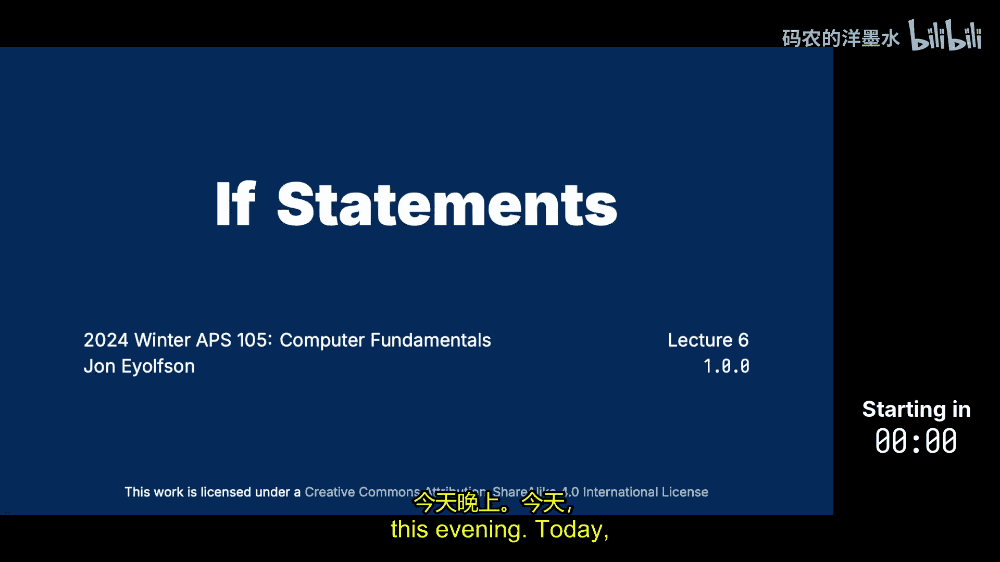
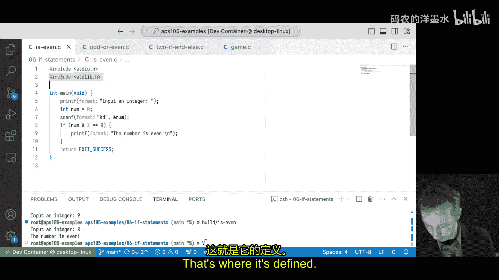
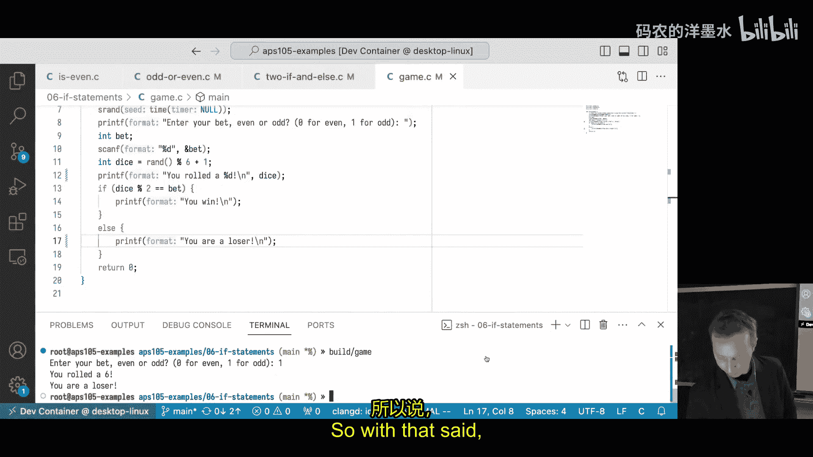
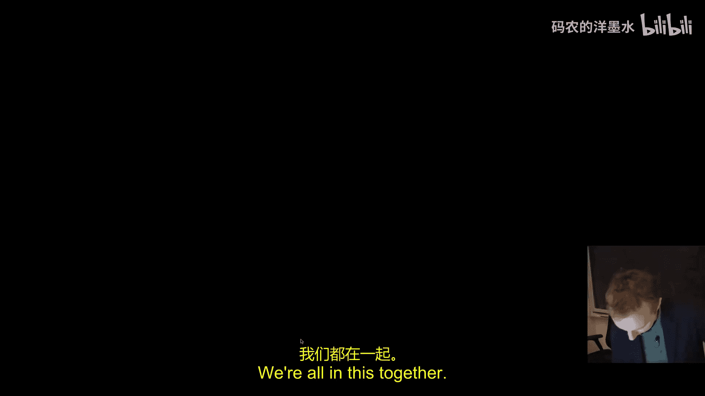

# 【全集】多伦多大学 C语言编程 中英字幕 1080P p06 Lecture 6 - If 语句 -BV1gikKB3EZW_p6-

う。

All right， welcome back to 105， though thank you for joining me today this evening。Today。

 we get to talk about if statements， or in other words。

 essentially the only reason why your computer looks like it is smart。Even a little bit。

So up till now， if we've been following the course right now， our programs。

 they always do the same thing。when you run main， it just runs line by line。

 it just stupidly goes from the next line to the next line to the next line until eventually it does a return and then it's done。

The input may be different， so like if we take an integer， maybe we can type in a different integer。

 but that's about it。It's not really anywhere close to a real program that will do anything slightly complicated。

 but after today with if statements， that will form the foundation of being able to do different things。

So there is a way to conditionally run code。 so we only run code sometimes instead of all the time。

 and it is called an if statement。And it basically uses a Boolean to decide whether or not to execute some code。

 So the syntax， which， again， is just the rules of the C language。 So how I have to write it in。

In using my keyboard， I guess it's not kind of English so what I have to do for an if statement is I write if。

 so that is a reserved keyword so I'm not allowed to name a variable if or anything like that。

 then bracket then an expression so something that actually results in a value in this case that expression should be a result in a Boolean and then a statement that will run if it is true and if it is false it will run。

 it will just skip that statement。So。Writing it like this， you can write an if statement like that。

 but generally it's a bad idea。 It's been a source of some very。

 very hard to debug issues that have come up in in fact， using this type of if statement。

Ashley resulted in。Like one of the largest security breaches there's been in quite a long time。

 So don't write it like that for this course。 Always write it like this。

 So you're sure what runs when that statement is true。 So write， if expression。

 and then do the curly bracket。 And then you can write a whole bunch of statements between the curly brackets。

 and they will run only if that expression is true。 And again， expression。

 just a combination of operas and operators。 so far， we've seen like addition， subtraction。

 multiplication， that fun mod one division。 And they've all resulted in another number。

 be it a double or an int。 we don't really have anything that results in a boolean。

 So that's what we get to learn today。Oh， and yeah， before that。 So just again。

 to say that statements only run if that expression is true， so。

C will compute the results of that expression， convert it to a boolean if it's not already。

 and a boolean is either zero false or one true， so if that expression is true or it's a one。

 it will run the statements between the curly brackets and after it's done it will run the next statement after the curly bracket if the expression is false。

 it just immediately skips right here to the very end so it will not run that code。So the expression。

 in an if statement， it will convert to a Boolean。 We probably need to know some operators that actually result in a boolean instead of a number。

They are relational operators， and they work with number arguments and then result in a Boolean value。

 So there， these are all of them that you will use。 So there is equal equals in math。

 that just means a single equal sign。 So that's comparing if two numbers are the same as one another。

 So in C， it is equals equals， not equals。 because remember， just a single equal sign。

 That means assignment。 That means I'm updating a variable。 So。

That may be the source of some issues you have。 So whenever you want to compare two values。

 remember to always use equal equals。 and that just means a single equal sign in math。

You will have problems if you just use a single equal sign and you do assignment。So a。

Exlamation mark equals。 That's the same as saying not equals in computing。

 We generally just say this exclamation mark is short for not。 So this just。

Kind of translates directly to not equals。 So in math， you know。

 that's a sign equal sign with a slash through it。 Can't write that just using a keyboard。

 So we have to use not equals。 Then there's less than， So means less than。

Hopefully that one's self-e。 And then it's less than or equal to。

 So it's just the less than and then an equal or an equal sign。

 So that's the same as less than or equal to in math。 And again， there's greater than。

 which is greater than and then greater than or equal to。

 or at least how I remember the greater than or equal to。 Did you learn like the crocodile。

 goes and eats the thing at the bigger side。No， okay， some of us might have。

Like even if you've done your PhD and stuff， you still remember it like that。

 So I still remember the little alligator eating stuff to figure out which side is which。

 So don't worry about。All right。So some examples is I can see if two numbers are equal to each other。

 Remember these could be variables as well。 It's generally why I do it。 just writing is two equal to。

 probably isn't the smartest thing I but serves as an example。

 So I could write two equal equal to and then the result of that is true。 So two does equal to。

 at least in this universe。 I could also ask， hey is three less than two， in this case， you know。

 the alligator is not eating the bigger number， So it is false。 So we would result in0。

 And then I might ask， hey is three greater or equal to3 in which case that would be true。

 So I would get a one。 So any questions about those operators。 So those will take numbers。

 and then we will be able to get a boolean out of them。All right，Those relational operators。

 they follow similar type rules to mixing ints and doubles。 so if both operas are an int。

 then it does the operator just using integers。 if at least one of the operas is a double。

 the other gets implicitly converted to a double if it's not on already and then that operator just uses the real numbers or the doubles So the result So that's just done for the comparison sometimes comparing doubles gets really weird。

 So in general， if you have to compare doubles never use equal equals for reasons we will not get into。

 but doesn't really matter the result in either case is going to be a boolean at the end of it。

 So is this true or is this false。So some other examples， in this case， if I write2 equals equals 2。

 so in this case 2 is an int and 2。0 is a double， well what will happen is this two gets converted to a double。

 so itll get converted to 2。0 and then 2。0 is the same as 2。0 so the final result would just be a 1。

So any questions about those operators right now？So get just using those fairly straightforward operators。

 we can actually create programs that actually do something more complicated。

Other operators we might used are some operators that only work with Booleans。

 so these operators are called logical operators so they let us kind of connect Booles together in order to come up with a more complicated condition so。

All the operas are boolean in this case。 And then the result is a boolean。 And thankfully。

 there's much fewer of these。 So there is。😊，This these two lines。 So the two lines。

 that just means a logical。 oh crap。 I screwed them up。 So these two lines， sorry。

 these two lines are mixed up。 I'll fix that in the slides later。

 So these two lines are a logical or。So that means this or this is true。 So in that case。

 if one of them is true， then the whole statement is true。

 And the only way that this statement is false is that both of them is are false。 So that's like。

I don't know， I'm going to get up in the morning。If it's sunny and warm out。 and then， well。

 if it's neither of those， then you're not going to get up。 but if one is true， then you get up。

So these two and operators， they mean logical and。 so the result is only true if both sides are true。

 So if I say， you know， I'm going to get up again if it's sunny and it's warm。

 then I will only get up out of bed if both of those are true。 So as long as one of those is false。

 I'm staying in bed in the morning。And then there's also this uninary operator that's just called not。

 And all it does is it flips the value。 So if you say not true， the result is false。 if you say not。

 not false， the result is true。 So sometimes it's easier to say that， like， hey。

 I'll wake up if it's not snowing or something like that。

 So any questions on those operators other than I screwed up the lines here。Yep。It can be logical or。

Yeah， so this operator here is logical or。And then this is logical and。

 and I will fix the slide after， but it makes sense because the operaan or the ampersand is an and。

 so that means logical and。There is an operator that's just one of these in C。

 so one line and one ampers send， we will not cover what those do in this course。

 they do something else， so you will probably have some weird results if you actually type in just a single ampersand instead of two。

So some examples here is if I have， if I do one and and。One， well then。Both sides are true。

 So the final result here is going to be true。 If I do 0 and one， Well。

 that final result is false because they both need to be true in order for that entire expression to be true。

If I do one or0， well， that is true because one of them is true， so the entire thing is true。

 and then if I do zero or0， well that's just zero because they're both false。

 so the whole thing is false and again not one is equal to zero and then not zero is equal to1 so a questions about these。

So they make a bit more sense when we actually have a program and tie them together。

 which we'll get into shortly。So some other rules， because C allows you to write a bunch of silly things。

C does have rules for converting numbers to Boolean if it's not already a boolean。 generally。

 you should use one of the relational arguments all the time because if you don't these rules are kind of weird because if C wants a boolean。

 so if it's an if statement， it will convert or cast that value to a boolean， and as a general rule。

 it gets a bit weird， So if the number represents0， it gets converted to0。

 otherwise it gets converted to a 1， which sometimes will be really weird for double。

 So for instance， if you say if point4， which is a double， then C is going to say hey。

 that's not zero， so that's true， which gets really weird。

 So try and always used the relational operators here。So where we're at in precedes。

 a lot of rules so we'll get into some examples later is the higher precedents。

 so to connect them to things we already know， these are multiplly divide mod and then we have addition of subtraction so all of the relational operators are lower precedents So I would do all the math operations first or all the arithmetic first and then I would do the relational operators So here's the less and then here's。

If one value is equal to another or not equal， and then our logical operators。

 So are ands and our o's that are a lower precedence。

 So it will always favor doing the ands before the or's。So just rules， generally。

 you should just probably get used to writing brackets around stuff or instead of just remembering these precedence rules。

So。What can I do？在事上的。So how hard is this going to be tested on？

We're going to ask you to write programs and they should work， so we're not going to say， hey。

 what's the precedence of this？But。While you're doing that， if you can't remember。

 just put brackets around what you mean。 So even like more brackets doesn't really hurt anything so。

When in doubt， just use brackets to get what you mean。Because honestly， I forget some of them。

So let us write our first program that does something using an if statement after all that blabbering。

So。We can now write a program where we can input an integer and it will do something。 Well。

 more than nothing， we can write an if statement so we can。Do a scan F。

 get that number into that int called nu。 And then afterwards。

 we can do an if statement so we can say if nu。Mod 2 is equal to 0。

 So that's saying if I divide 2 by one， my remainder is 0。

 which is another way of saying the number is even。 So if the number is even， I will print off。

 it will is even。 So if I go ahead and run that。Then oh， someone showed a number to write。Anyway？

Nine， all right， so nine， nothing happens for a nine because it is not an even number。

If I if I want to see the if statement actually run this print F， well。

 I have to give it an even number in which case I can say eight。

 and then it will print off this is even， so now it is only doing this print line。

Only if this condition is true。 So only in this case。

 if we divide the number by 2 and the remainder is 0， we'll print off that the number is even。

So any questions about that？Kind of cool。 We're leveling up our skills。

 So this is a program that does something more exciting than just doing some calculation and printing up the value。

 So now we're optionally now we're optionally just printing a line only if a certain condition is true。

 which is one of our first steps to writing real programs。😊，So。

Programs in the slides so don't worry about it and just in case any was confused about what statements run。

 so the same thing is true， it will start executing at main and then follow statement by statement so it would run print F input and integer then in nu equals0 and then that scan F and then the way you can think of the if statement is what it will do is compute the value of this expression so previously in the expression I had nu mod2。

Equal equal to0。 So what it's going to do is compute the result of this。

 So in this case if I enter I know 8 then8 mod2 is0 and then0 equal equal0。

 So the result of that is true。 So what we say is we go down we call these branches so we say we go down the true branch in that case because well we had an even number so in that case it would run print F the number is even and then after printing that it would just go to return exit success if in fact like what I had before when I inputted a9 well this expression would be false and then I would skip directly to return true and I wouldn't see that print statement。

嗯。And yeah， question in Discor， do they give part marks on the midterms if our program isn't perfect and the answer to that is yes。

 a human gets tograde it， so it's mostly in this course， at least on exams。

 thinking about your logic and making sure that what you're actually writing makes sense。Yep。Yeah。

 so the exams， they're closed book exams just on paper。

 and the programming stuff is just through the labs。Yep。Alright。

 any other questions about the structure here of this if statement。Yep。Yeah， so if it becomes false。

We follow this line here， so this is the line we follow here if it's false and it goes immediately right to that return。

So it skips over the print。Right， yeah。All right， any other questions what we have here？Yep。

 and I only have one line to print， is there still bad practice to not use brackets。Yeah。

 so the question is， essentially if I go back。ちュちゅ。

Is it bad practice if I just do like get rid of the curly brackets like this？

And just write it all in one line。So。Yeah， that would probably be considered bad practice because it's really easy to like just write a line here and assume it runs if it's true and it won't。

 in this case， it'll only run that single printed line and usually it makes it harder to read。

So for this course， like people that' have been programming for 30 years have tried to like save the curly brackets and it costs。

I don't know what the total amount was， like several billion dollars。

 So just always use the curly brackets。 It makes it easier to read。All right。

 any other questions with what's going on here？Alright， so。Oh and then there's a question。

 can we use exit success instead of return zero in the lab and for that， sure。

 you can use that in the lab if you want， generally good practice not to have magic numbers。

 if you want to remember the magic number zero， go for it。You might find that exit success is easier。

 and you always have to do all your include statements or something bad will or it just won't be able to find the values。

 So if I want to use this success， I need this include here for standard lib because that's where that value actually lives。

 That's where it's defined。

Oh righty。So let us level up our skills a bit more，op。

So。We might ask ourselves， oh， okay， well， we can optionally run some code if a condition is true。

 What about to just run some different code if that is false， Because right now， if it's false。

 we just skip over whatever。Whatever the statements were and just go right to the end。

 So another valid syntax of an if statement is if expression。

 then a statement and then else a statement。 But again。

 we should always write the curly brackets just so the structure of the code is very， very clear。

 so we should write if expression statements and then else statements。

 and what this will do is it will only run these statements if the expression is true。

 and then otherwise it will only run these statements， if that expression is false。

 So each time through， I will either execute one or the other but never both So if it's true。

 I will run this， if it's false， I will run this and then no matter what the code will resume running at the end of this。

So questions about that。Probably easier just to see it。So again， just so it's on the slides。

 only the statements between the curly brackets will run after the else and it。Yeah。

 these statements here between the Ls only run if that condition is false。

So we can actually change our code a bit more。And do something like this。

 So now we can use that L statement。 So now instead of printing nothing， if the number is even， well。

 I could have the same program， but I will write an else here。

 So if the number is not even this will run and I will just print off the number is odd。

 So now if I run this program odd or even then if I input8， it should do what it did originally。

 So if it is8， that means this expression is true。 So it will run this print F。

 And then it is done writing or running all of the code that will run if the condition is true。

 So when it's done it will run return0， and in this case I had return0 instead of success。 but again。

 same difference。And then。And oh， we got a question why do we not put semies after the curly brackets？

 So the answer to that is， you don't have to。So if we did。

 we actually could and it won't change anything。Ohoops。So it won't change anything。

 the compiler won't yell at us or anything like that， it's just a bit weird， so no one does that。

 it's just kind of a style choice we use because we don't need to put it there I'll have a caveat of like dangers you could get into with just a semicolon because it's technically a statement that does nothing and generally it causes issues so if we don't need it we just avoid it。

So， and then question， can we put semicolon after include statements and the answer to that is a no。

 I believe， but we can try it。And compile， whoops， compile。Yeah。

 so it gives us a warning that there's some extra crap at the end。

 so in this case it doesn't seem to mind it， but the compiler really， really， really。

 really doesn't like that we did that。Ohoops。So we should probably not do that。All right， anyways。

 for this example， let's see to do。So now if I write， I don't know， an odd number。

 now it will print off that， hey， this is now odd。Yay， it does something different。

 That's kind of cool。😊，Any questions about this？Al right， I have a brainbuster for you。 if。

 if we've been paying attention a lot。So I just thought of this while I was preparing。

 So what happens if I essentially。Flip those two。And do this。So。

Is this program the same as what I had before？No， anyoneone say why not。Yeah。Well， let's see。

 Let's try it out。 So let's compile that and run it。 So in this case， it should still work， right。

 So if I do 8。Well， that number is even because if I do 8 mod2， the remainder is 0。

 and then I would do0 equal equal1， which is not true。 So that's false。 So this would run。

 So it would be this number is even。 And if I do an odd number。

It says this number is odd because my would be or my remainder would be one。So。

 it looks almost equivalent。But。This。Hopefully you don't get if you got an exam question like this。

 it would be kind of mean， maybe because there is a problem with this if we remember the weird modD rules from before。

Oh， yeah。 I heard negatives。 So turns out that this doesn't work that well。 if I do， is negative 7。

 an odd or an even number。An odd number， right？Oh。Yeah。

 this is why programming is hard because remember all those weird modules I went over for。

 and it seemed like I was just。Yammering on for no reason。 Well。

 I was yammering on because it might actually be an issue。 So in this case， because of the mod rules。

If I do negative7 mod2。The remainder is technically by C's way of thinking about it is it's negative one。

 So if I wanted to write an equivalent program， what I could do is I could do nu mod2 is one or nu mod 2。

Is equal to negative one。 And in this case， if I do that， well， that should cover the negative case。

 So if I do negative 9 finally says this number is odd。So。

One way to remember that this rule is stupid is if you are seeing if a number is like an exact multiple of something。

 always compare it to 0。 do not try and compare it to any number other than 0。 Otherwise。

 you have to remember the negative thing。 and it's just a whole hassle。

So hopefully this won't actually be tested。In the real scary world out there where you have to deal with all of C's stupid little rules。

 then things like this may be an issue。Of course， this would not be an issue if I just didn't allow negative values。

 so if that is another option。Okay， so here is my program that will print whether or not the number is even or odd。

 and here I do the smart thing of just doing the modo and then comparing it to zero because as we saw。

 comparing it to other values， we have to remember the negative rules and generally not a good idea。

So。If I took the structure of this program how it runs is well， it would start running from main。

 so if I break it down， what will happen is this program whenever I run it will always print input an integer and then do the scan F so I can actually enter an integer and then it will evaluate that expression in the if statement。

 so in this case。Numb mod 2 equal equal0， or sometimes we just say equals kind of depends on your preference there。

 And then if it is true， then I take this branch and I will print the number is even。

 And then after I'm done。Doing all of the statements in the curly brackets in the if。

 then I will go to the very end and return exit success。Otherwise。

The only other possibility for this program right now is if this result is false。

 I will print off the number is odd， and then I will skip to the very end whenever I'm done。

 executing everything that runs when it is false。 and we have an exit success。

And then yeah we have another question what if we have three conditions can there be more if or else statements in the same group and the answer to that is absolutely so you can see how this quickly could make our program look like it can do a lot of different things so here I had two possibilities I could go through well。

I could write it so that if Id go in the false statement or go in the true。

 I could have two other possibilities， so I could write if statements within if statements。

 and then if I wanted to， I would have like an exponential number of possibilities that my program could follow and then you have to reason that all of them are correct and that is where you know software problems coming to play。

 So generally you want to make them as simple as possible and try and reduce the number of if statements you have if at all possible。

And to follow up on that question。What happens if we have multiple if statements？

So Irie preshot this so we could write a program that does this so input an integer so it starts off the same。

 so we scan F， get an integer and then we could have if nu mod2 equal equals0 then the number is even we can print off and then afterwards we can write if the number is equal to or greater than 10。

 we'll just print off that the number we entered is 10 or greater and then we can write an else after this。

 but this gets into a special problem where。If we actually just follow the rules of C。

It is not evident what else this belongs to so does this code only execute if the number is odd or does this else right here only execute if the number is less than 10 so turns out this actually has a special name and it's called the dangling else problem so I just have an else here。

 I'm not actually sure what if it is connected to so。

The way C resolves this is it says this else is always connected to the first if。

If you read up from this else。 So this else is actually connected to this if。

 so it will only run in the case that the number is 10 or less so。If we actually run this program。

 let's see。So here is that same program where I have an if and then an if and then an else。

 so kind of told you that because of that dangling else problem。

 this else actually refers to this if。If I start reading my code from the top and start arguing about it。

 so it'll print off input an integer。Declare an integer and just initialize it to0 just in case something bad happens。

 and then we do a scan F。 So we wait for the user to type the integer。

 and then it will check if the user typed a even number in this case。 So if nu mod 2 equals 0。

 So it means I divide by 2， I have 0 as a remainder means it's a multiple of two。

 then I will optionally print off this is a。Even number。And if it's an odd number。

 I would just skip right to here。I would skip to this line if it is false。

Then next thing I would execute is I would check this condition。 So the number。

I would check what I entered and if it is 10 or greater， well I will print off it is 10 or greater。

 and then I will just do this return。Otherwise， if the number is not 10 or greater。

 then I will go into this else and then print off the number is less than 10 so if I run that。

If I run this and I type the exact number 10， it should say this number is even。

 and then the number is 10 or greater。So print both those statements。

 if otherwise I type in the integer， I don't know， 11。Then that is a odd number。

 so it would not print this line and it would skip。

 and it would go here and then check if the number is 10 or greater and it would print that， yes。

 indeed， 11 is 10 or greater。So I could do that with a bunch of other numbers， let's say。A。

So if I input8， it should say this number is even， and it's less than 10。

So I get both of those print statements。If I instead。Input is 7。

 then I only get the number is less than 10。Then another question。

 what if we use a tab key to indent the group so the L statement only works on the indented group。

 so turns out the indentation we write for C， so if I did something I don't know。

So I think the question is like if I did something like this or。I think this， but turns out C。

 the compiler doesn't actually care about the indentation。

 it's just to make it easier for you to read as a person and yes， C does not care。Yep。So if you want。

So if you like just want it to。So I'm not sure the question， like if I write another L statement。

Yeah。But you want another here。15。Here。Oh， like if you want to do。This。Yeah。Yeah， you can do that。

 you can pose many statements as you want there。Yeah， any other questions。

 since this is the first you know actual programming we've get into， that's not just arithmetic。

 and it gets more exciting from here。All right， slight murmuring。 So here let's。So。

Tierers are dangling else problems， so。How do we make the L statement act on both statements if that's feasible。

 So if I go here， if I wanted to have two L statements， oops。

Then I could just do something like this so。In this case。I'd say this number is odd in this case。

 so I could write something like this。So I have two F L statements。 So it'll check this condition。

 If it's true。 It runs this， and then。End here， if it's full， if this condition is false。

 then we'll run this and then we'll end here and then。We'll do another if statement。All right。

Any other questions？Yep， can you add code between the X and the L。Yep。

 so I can add code right here between the if and the L statement， no problem。啊。After the if。What。

 we'。Oh， here。So if you write something here， that will be a compiler error。 So it will say here。

 expected expression because well， it's assuming that。I can't just begin a line with else。

 It has to be connected to an if。So yeah， L by itself doesn't mean anything。

 so I can't have a line between the alphalf and the S。So yeah， So else can't live by itself。

 It has to live with an if。All right， any other questions we have？All right， well let us here。

 let me hide this quick and see if we can come up with a game by the end of the class。So。

We can make a pretty decent game ish。So here。🎼橘皮。Alright， so let's make a little dice game。

 It will be slightly silly。 So let's assume that。We are rolling a dice， you know one to six。

 and then we as a user can place a bet on it so we can bet even or odd and it's or if we guess right。

 we win and then if we guess wrong， we don't so we went over random numbers last time the seed。

Can be set by the system time，To actually do that in C。

 this will not be testable because it goes way beyond this course。

 but if I wanted to make the numbers appear random。

 what some things I can do is I can set the seed based off something that changes all the time so you might not know what to actually expect to come off so I can set the seed based off the current time so I get a different sequence of numbers every time if I want to make this more secure well probably I set the seed off something that's a bit more random because someone actually might be able to figure this out so if you've played a game that generates random numbers。

 sometimes some people can break it because they'll figure out what the seed is and then they actually know what to expect and then especially in a game like this if you can predict the outcome。

 not much of a game when you win all the time。So here I set the seed based off the current system time。

 and then I'll have enter your belt， bet， zero for even， one for odd。

 and then create a variable called bet and then scan F。If I oh， and then yeah。

 another question in chat， is there an L if statement and C answered to that is a new and we'll go over more complex if statements tomorrow。

Or Monday。 so in this case， if I want to simulate rolling a dice with my random number generator。

 and I want to make this die value between。One and six。What should I write here after Rand？

So if we remember RAand before Rand will give us just a random positive integer that's between zero and huge。

 So if I wanted to change that random integer，Instead to represent a dice roll or something between one and6。

 what should I write here？Yeah， percent of。Sorry， was does that percent what？

Percent max minus min plus1。 Yeah， so for a dice， at the end of the day。

 what's the answer for just a die。OkayYeah， so if we do the math in our head， sometimes we get good。

 So we do percent。 So mod。 So mod 6。 So if we do ran mod 6。

 that will always give us a number because R is positive。

 We often to deal with the stupid negative rules。 Always give us a number between that is either 0 all the way up to5 inclusive。

 So if we want to go change a 0 to a 5。 So we got the right range。

 if we want to change it to a1 to a 6。 all we do is we add one。 So now we have our dice roll。

 And let's just sometimes when you're developing programs。

 typically it's nice to just print F print F， your current value to make sure it's what you believe it should be。

 So let's just write here you。😊，You rolled a。Pscent sign D， so we want to print off an integer。

 so that our format specifier is a percent sign D。And we end it with a new line because， well。

 that's the end of the line we want to print to the user。Yeah， so and then just to clarify。

 if I don't change the seed for Rand， I'll get the same sequence of numbers every single time I run the program。

So。Let's compile this and I can actually show that quick too if you want。

 so any of your bet so in this case I'll just bet even and then it just says you rolled a three okay so I ran it again。

 you rolled a four， ran oops。Run it again， you rolled it too， so it seems to be different every time。

 so just to be sure I can comment out that line， so when you comment out a line。

 the compiler just ignores it so it's like it is not even there anymore。So if I compile and run that。

I'll get you rolled a two and because it's the same seed every time， every time I run this program。

 I'm going to get you rolled a two every single time， going to be a pretty lame game。

When I uncommented this line， so that's how we say that。

 then I get a random value or at least a seemingly random value every time。Oh， and yeah。

 this actually is an extension I use。 So remember the argument names can actually have like names so you can figure out which argument is which I have an extension VS code that tells me what the argument names are and just shows them here。

 So it's a bit more readable。 So my。Code probably looks a bit different than yours。All right。

So now we see our dice roll， so now if I wanted my game to say you win or you lose。

Any ideas what I should write here？So I have the die， it will be one to six。

 so it'll be a random th roll， So how do I know if I win？Yeah。

 so well there there's two possibilities here right。

 I can either win or I could lose so that probably should make you think there's some type of logic here。

 sometimes I win， sometimes I lose so that should immediately make you think of an if statement so generally it's easier to think about like the true condition first so let's be optimistic and we can think about the winning condition first。

 so if I'm betting on even or odd， well what's my winning condition so if。I can check。

 So if the die mod2， So that will give me essentially。The remainder of the dice roll。

 so it will be zero if it is。Even and then one， if it is odd。

 and what I can do is actually just check if it matches my bet。So in this case。

 I formulated my choices just so it nicely matched with that modular remainder operator。

 so if I enter a bet here of0， if I take that number and then get the remainder after div by 2。

 if it's equal to zero， it means it's even and well my bet is the same as what I chose。

So in this case， I would win you win。And the other case。

If we're being nice is I could have entered a one。 So if I entered a one and the dice roll was， say。

 a three， then three mod 2 would just be one because it doesn't have any negative values or anything like that。

 So if that matches my bet。 So it's odd and then I bet odd。 then I also win because I guessed right。

 So now it can say you win。So。What else should I have here if I want to tell the user they're a big fat loser？

Here are the magical elf。Yeah， so else I don't if I。If I just have print F here， you are a loser。

Ha ha。So if I just have this and I compile this。Whenever I run my game。

 I'll place my bet so let's say I bet even again rolled three， well I was a loser in this case。

 so it wasn't wrong， but sometimes when I run it， I rolled a two and then it also says you win。

 you are a loser， which is very confusing， it gives me an existential crisis here so we don't want the loser text to run if we are in fact a winner so we should put that in the El。

 so we should just write an else here。Always do the curly brackets and we should move this print F up into the else and because now it is within these curly brackets。

 each time we're in a new set of curly brackets， we should indent our code like that to just show the structure of it。

So if I do that now and I compile this we have a functioning game so I can now bet。

 let's say I bet odd now， so I rolled two and in fact I am a loser so if I go ahead， play again。

 let's see odd， I rolled two， I'm a loser again。Roed 6， I'm just a big fat loser。

 So I guess I end today as a loser。 So with that said， just remember， I'm pulling for you。

 We're on this together。

