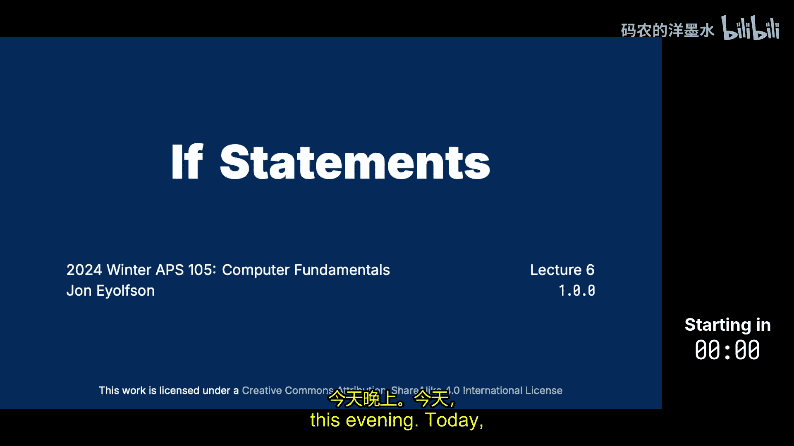
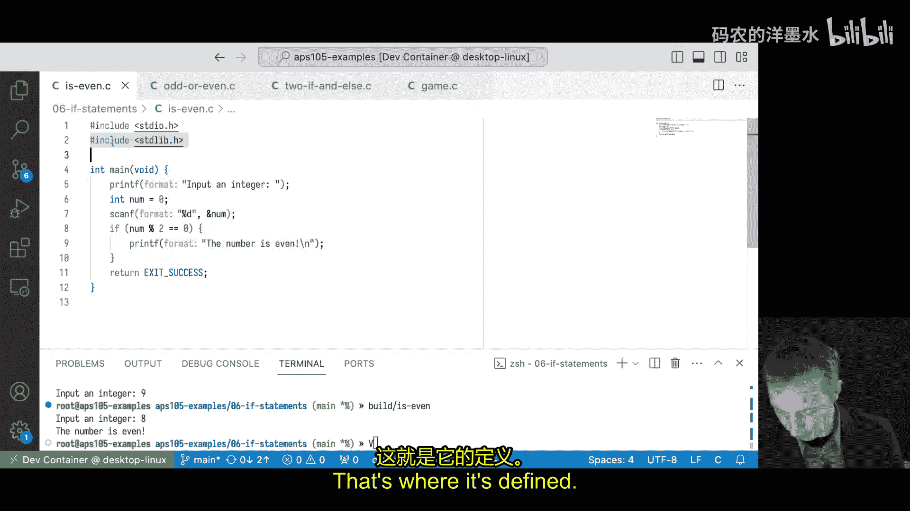
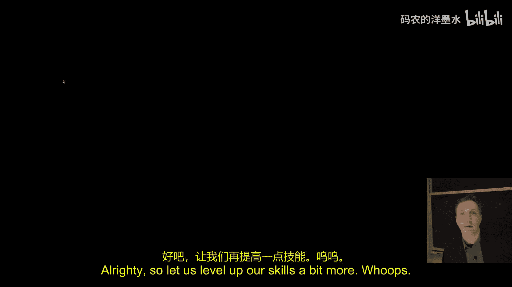
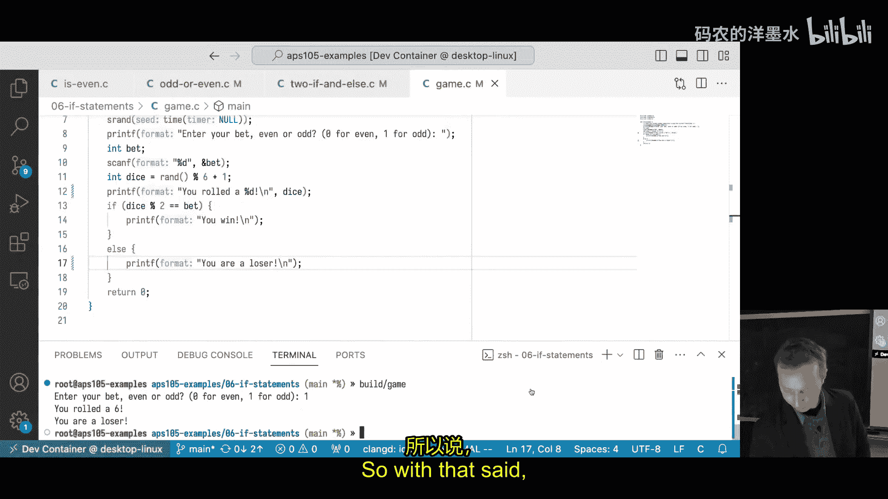
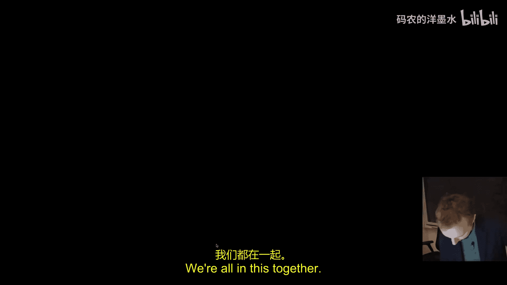

# C语言编程：第6讲：If语句 🎯



在本节课中，我们将要学习C语言中一个非常核心的概念——`if`语句。通过`if`语句，我们的程序将不再只是简单地按顺序执行每一行代码，而是能够根据条件做出判断，从而执行不同的代码块。这是让程序看起来“智能”的第一步。

## 什么是If语句？ 🤔

到目前为止，我们的程序总是做同样的事情。运行`main`函数时，它只是按顺序一行一行地执行，直到遇到`return`语句结束。虽然输入可能不同（例如，我们可以输入不同的整数），但这远不足以完成稍微复杂的任务。

`if`语句为我们提供了一种**有条件地运行代码**的方式，即只在某些情况下运行代码，而不是每次都运行。它本质上使用一个**布尔值**（真或假）来决定是否执行某段代码。

## If语句的语法 📝

C语言的语法规则规定了`if`语句的写法。其基本结构如下：

```c
if (表达式) {
    // 如果表达式为真，则执行这里的语句
}
```

*   `if`是一个**保留关键字**，不能用作变量名。
*   `表达式`是任何能计算出值的组合，在这个上下文中，它应该能得出一个布尔值。
*   如果表达式结果为**真**，则执行大括号 `{}` 内的语句。
*   如果表达式结果为**假**，则直接跳过这些语句，继续执行大括号之后的代码。

**重要提示**：虽然从语法上讲，如果`if`后面只有一条语句，可以省略大括号，但**强烈建议始终使用大括号**。省略大括号是许多难以调试的错误（甚至是一些重大安全漏洞）的根源。使用大括号能让代码结构更清晰，避免歧义。

## 关系运算符 🔗

在`if`语句中，我们需要一个能产生布尔值的表达式。到目前为止，我们见过的运算符（如加、减、乘、除、取模）都产生数字结果。为了进行比较，我们需要**关系运算符**。

以下是C语言中常用的关系运算符，它们接受数字参数并返回布尔值：

*   `==`：等于（注意：在C语言中，单个`=`是赋值，`==`才是比较）
*   `!=`：不等于
*   `<`：小于
*   `<=`：小于或等于
*   `>`：大于
*   `>=`：大于或等于

**示例**：
*   `2 == 2` 结果为 **真 (1)**
*   `3 < 2` 结果为 **假 (0)**
*   `3 >= 3` 结果为 **真 (1)**

关系运算符遵循与算术运算类似的类型转换规则：如果两个操作数都是`int`，则用整数比较；如果至少有一个是`double`，则另一个会被隐式转换为`double`，然后进行浮点数比较。**注意**：比较浮点数时，通常不建议直接使用`==`来判断相等，因为可能存在精度问题。

## 逻辑运算符 🧠

有时我们需要组合多个条件。这时就需要**逻辑运算符**，它们只对布尔值进行操作，并返回一个新的布尔值。

以下是主要的逻辑运算符：

*   `&&`：逻辑与。**只有**当两边条件都为真时，整个表达式才为真。
    *   示例：`(1 && 1)` 为真，`(0 && 1)` 为假。
*   `||`：逻辑或。**只要**有一边条件为真，整个表达式就为真。
    *   示例：`(1 || 0)` 为真，`(0 || 0)` 为假。
*   `!`：逻辑非。这是一个一元运算符，用于取反。
    *   示例：`!1` 为假，`!0` 为真。

**运算符优先级**：在复杂的表达式中，运算顺序很重要。算术运算符（`*`, `/`, `%`, `+`, `-`）优先级最高，其次是关系运算符（`<`, `<=`, `>`, `>=`, `==`, `!=`），最后是逻辑运算符（其中`&&`优先级高于`||`）。**最佳实践**：如果不确定优先级，就使用括号`()`来明确指定运算顺序，这能让代码更清晰、更安全。

## 第一个If语句程序 🚀





现在，让我们编写第一个使用`if`语句的程序。这个程序将判断用户输入的数字是奇数还是偶数。

```c
#include <stdio.h>
#include <stdlib.h>

int main(void) {
    int num = 0;
    printf("请输入一个整数：");
    scanf("%d", &num);

    if (num % 2 == 0) {
        printf("这个数是偶数。\n");
    }

    return EXIT_SUCCESS;
}
```

**程序流程解析**：
1.  程序从`main`开始，打印提示信息。
2.  使用`scanf`读取用户输入的整数并存入变量`num`。
3.  计算`if`语句中的表达式：`num % 2 == 0`。
    *   如果`num`除以2的余数为0（即为偶数），表达式结果为**真**，程序进入`if`代码块，执行`printf`打印“这个数是偶数”。
    *   如果表达式结果为**假**（即为奇数），程序直接跳过`if`代码块，执行后面的`return`语句。
4.  程序结束。

## Else语句：处理另一种情况 🔄

上一节我们介绍了如何条件性地执行代码。本节中，我们来看看当条件不满足时，如何执行另一段不同的代码。这就要用到`else`语句。

`if-else`语句的语法如下：

```c
if (表达式) {
    // 表达式为真时执行的语句
} else {
    // 表达式为假时执行的语句
}
```

每次执行时，程序**只会**执行`if`块或`else`块中的一个，绝不会同时执行两者。执行完毕后，程序会继续执行整个`if-else`结构之后的代码。

让我们改进之前的奇偶数判断程序：

```c
#include <stdio.h>
#include <stdlib.h>

int main(void) {
    int num = 0;
    printf("请输入一个整数：");
    scanf("%d", &num);

    if (num % 2 == 0) {
        printf("这个数是偶数。\n");
    } else {
        printf("这个数是奇数。\n");
    }

    return EXIT_SUCCESS;
}
```

现在，无论输入什么整数，程序都会给出明确的“奇数”或“偶数”反馈。

**关于取模运算的注意事项**：判断奇偶数时，将取模结果与`0`比较是安全的做法。如果与`1`比较（例如`num % 2 == 1`），当`num`为负数时（如`-7 % 2`在C语言中结果为`-1`），判断会出错。因此，对于判断倍数关系，**总是与`0`比较**是更稳妥的选择。

## 多个条件与嵌套If语句 🧩

程序通常需要处理更复杂的逻辑，这就需要组合多个`if`语句，甚至进行嵌套。

以下是一个包含多个条件的例子：

```c
#include <stdio.h>
#include <stdlib.h>

int main(void) {
    int num = 0;
    printf("请输入一个整数：");
    scanf("%d", &num);

    if (num % 2 == 0) {
        printf("这个数是偶数。\n");
    }

    if (num >= 10) {
        printf("这个数大于等于10。\n");
    } else {
        printf("这个数小于10。\n");
    }

    return EXIT_SUCCESS;
}
```

**悬空Else问题**：当`if`语句嵌套时，`else`与哪个`if`配对可能产生歧义。C语言规定：`else`与**最近**的、尚未配对的`if`配对。清晰的缩进和使用大括号可以避免混淆。

**重要提示**：C编译器**不关心**代码的缩进，缩进只是为了方便人类阅读。代码的结构完全由大括号`{}`决定。

## 综合实践：一个简单的骰子游戏 🎲

最后，让我们运用所学知识，创建一个简单的猜奇偶骰子游戏，将`if`语句、随机数和用户输入结合起来。

```c
#include <stdio.h>
#include <stdlib.h>
#include <time.h>

int main(void) {
    // 设置随机数种子，确保每次运行结果不同
    srand(time(NULL));

    int bet = 0;
    printf("请下注（0代表偶数，1代表奇数）：");
    scanf("%d", &bet);

    // 生成1到6的随机数，模拟掷骰子
    int die_roll = (rand() % 6) + 1;
    printf("你掷出了：%d\n", die_roll);

    // 判断输赢
    if (die_roll % 2 == bet) {
        printf("你赢了！\n");
    } else {
        printf("你输了。\n");
    }

    return EXIT_SUCCESS;
}
```

**游戏逻辑解析**：
1.  使用`srand(time(NULL))`初始化随机数生成器，使每次游戏结果不同。
2.  提示用户下注（0=偶数，1=奇数）。
3.  生成一个1到6的随机整数作为骰子点数。
4.  判断输赢：如果骰子点数除以2的余数等于用户的下注数字，则用户猜中了奇偶性，宣布获胜；否则宣布失败。

---





本节课中我们一起学习了C语言中至关重要的`if`语句。我们掌握了如何使用关系运算符（如`==`, `<`, `>`）创建条件表达式，以及如何使用逻辑运算符（`&&`, `||`, `!`）组合多个条件。我们学习了`if`和`if-else`的基本语法与执行流程，并了解了通过嵌套和组合可以构建更复杂的程序逻辑。最后，我们通过一个有趣的骰子游戏将理论付诸实践。`if`语句是控制程序流程的基石，理解它对于编写任何有意义的程序都至关重要。