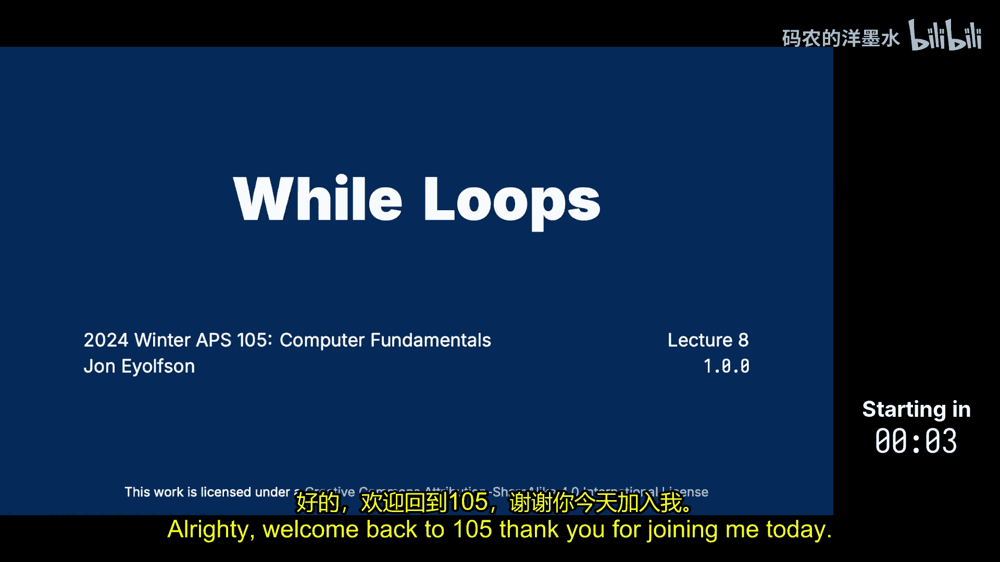
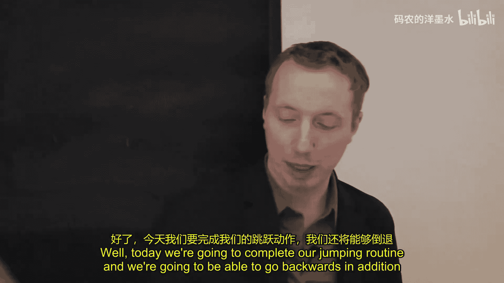
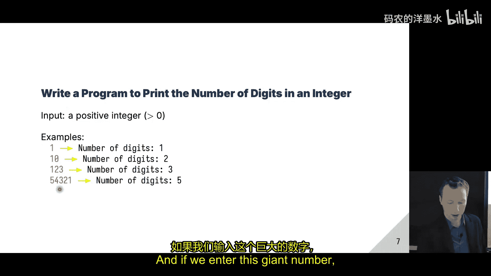
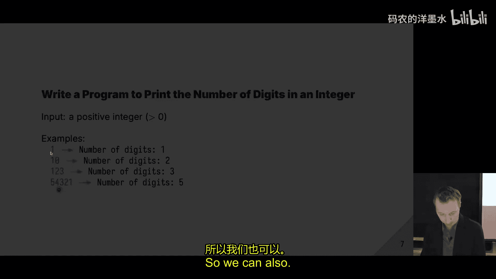
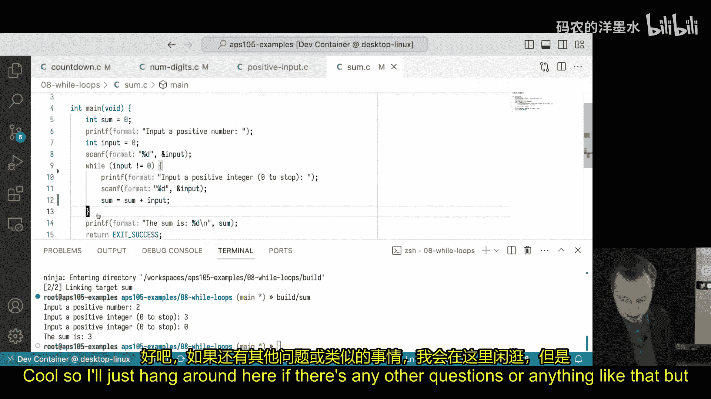
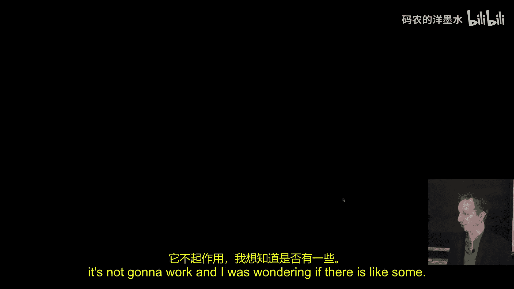

# C语言编程：08：While循环 🌀





在本节课中，我们将学习C语言中的`while`循环。上一节我们介绍了`if`语句，它允许我们根据条件向前跳转执行代码。本节中，我们将学习如何让代码向后跳转，从而实现重复执行特定代码块的功能。这正是`while`循环的核心作用。

## 什么是While循环？

`while`循环允许我们在某个条件为真时，重复执行一段代码。这使得计算机能够高效地执行重复性任务。

其基本语法如下：
```c
while (表达式) {
    // 要重复执行的代码
}
```
其中，**表达式** 是一个布尔表达式，其结果为真（非零）或假（零）。只要表达式为真，花括号 `{}` 内的代码就会不断重复执行。

## While循环的执行流程

为了更好地理解，我们可以将其与`if`语句对比：
*   `if`语句：检查条件，如果为真则执行一次代码块，然后继续执行后面的语句。
*   `while`循环：检查条件，如果为真则执行代码块，执行完毕后**返回**再次检查条件。只要条件仍为真，就继续重复执行代码块，直到条件变为假，程序才会跳出循环，继续执行循环之后的代码。

因此，要避免程序陷入**无限循环**，必须在循环体内有能够改变条件状态的代码，使其最终变为假。

## 实践：倒计时程序

让我们通过一个简单的倒计时程序来理解`while`循环。

**目标**：编写一个程序，从10倒数到1，然后打印“发射！”。





不使用循环的笨办法是写11条`printf`语句。而使用`while`循环，我们可以更简洁地实现：

```c
#include <stdio.h>

int main() {
    int count = 10; // 初始化计数器

    while (count > 0) { // 当count大于0时执行循环
        printf("倒计时 %02d\n", count); // 打印当前计数，%02d确保两位数显示，不足补零
        count--; // 计数器减1，这是改变循环条件的关键步骤
    }

    printf("发射！\n");
    return 0;
}
```
**代码解析**：
1.  我们创建了一个变量 `count` 并初始化为10。
2.  `while (count > 0)` 是循环条件。只要 `count` 的值大于0，循环就会继续。
3.  在循环体内，我们打印当前的 `count` 值，然后使用 `count--` 将其减1。
4.  当 `count` 减到0时，条件 `count > 0` 变为假，循环结束，接着执行最后的 `printf(“发射！\n”)`。

**格式说明符小技巧**：`%02d` 中的 `02` 表示输出的整数至少占2位宽度，不足2位时在前面用0填充。这确保了输出格式整齐（如 10, 09, 08…）。

## 实践：计算整数位数

接下来，我们看一个更实用的例子：计算用户输入的一个正整数的位数。

**思路**：我们可以利用整数除法的特性（结果向下取整）。例如，`123 / 10 = 12`，相当于去掉了最后一位。重复这个过程，直到数字变为0，重复的次数就是数字的位数。

以下是实现代码：
```c
#include <stdio.h>

int main() {
    int input;
    int num_digits = 0;

    printf("请输入一个正整数：");
    scanf("%d", &input);

    while (input != 0) {
        input /= 10; // 等价于 input = input / 10; 去掉最后一位
        ++num_digits; // 位数加1
    }

    printf("这个数有 %d 位。\n", num_digits);
    return 0;
}
```
**执行示例**：
*   输入 `123`：`123 -> 12 (1次)` -> `1 (2次)` -> `0 (3次)`，输出“这个数有 3 位。”
*   输入 `5`：`5 -> 0 (1次)`，输出“这个数有 1 位。”

**关于自增运算符**：代码中使用了前缀自增 `++num_digits`。虽然在此处与后缀自增 `num_digits++` 效果相同，但在C语言中，涉及表达式求值时两者有区别。作为良好实践，在单独进行自增操作时，推荐使用前缀形式以避免潜在的混淆。

## Do-While循环

除了标准的`while`循环，C语言还提供了`do-while`循环。两者的关键区别在于**条件检查的时机**：
*   `while`循环：先检查条件，再执行循环体（可能一次都不执行）。
*   `do-while`循环：先执行一次循环体，再检查条件（**至少执行一次**）。

其语法如下：
```c
do {
    // 要重复执行的代码
} while (表达式);
```

## 实践：输入验证

`do-while`循环非常适合用于**输入验证**，确保用户输入符合要求。例如，强制用户输入一个正数：

```c
#include <stdio.h>

int main() {
    int input;

    do {
        printf("请输入一个正整数：");
        scanf("%d", &input);
        // 如果输入小于等于0，条件为真，循环继续，要求重新输入
    } while (input <= 0);

    printf("你输入了：%d\n", input);
    return 0;
}
```
在这个程序中，即使用户一开始输入负数或零，`printf`和`scanf`也会至少执行一次，提示用户输入。直到用户输入一个大于0的数，循环条件 `input <= 0` 才为假，循环终止。

## 综合实践：正整数求和程序

现在，我们结合所学，编写一个程序，持续读取用户输入的正整数并将其累加，直到用户输入0为止，然后输出总和。

```c
#include <stdio.h>

int main() {
    int sum = 0; // 总和初始化为0
    int input;

    printf("请输入正整数（输入0结束）：\n");

    // 先读取第一个数
    scanf("%d", &input);

    while (input != 0) { // 当输入不是0时继续循环
        sum = sum + input; // 累加到总和
        // 提示并读取下一个数
        printf("请输入下一个正整数（输入0结束）：\n");
        scanf("%d", &input);
    }

    printf("所有数的总和是：%d\n", sum);
    return 0;
}
```
**重要提示：代码顺序**：在循环中，语句的顺序至关重要。如果将循环内的 `scanf` 移到循环条件检查之后，就会导致第一个输入的数字被“跳过”而无法加入总和。计算机严格按顺序执行指令，理解这一点对调试程序非常重要。



## 总结 🎯

本节课中我们一起学习了C语言中实现重复执行的关键结构——循环。
*   我们首先介绍了 **`while`循环** 的基本概念和语法，理解了其“先判断，后执行”的流程，并通过倒计时程序加深了理解。
*   接着，我们应用`while`循环解决了**计算整数位数**的问题。
*   然后，我们学习了 **`do-while`循环**，它适用于至少需要执行一次的场景，并演示了如何用它进行**输入验证**。
*   最后，我们完成了一个**正整数累加**的综合练习，巩固了对循环控制、条件判断和变量状态变化的理解。



记住，编写循环时，务必确保循环体内的操作能影响循环条件，使其最终变为假，从而避免程序陷入无限循环。