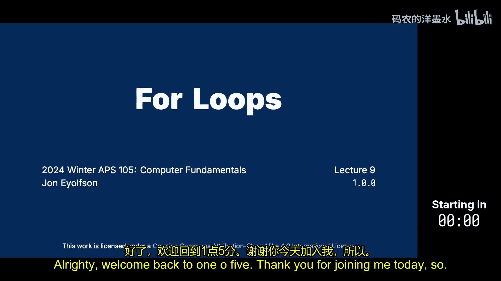
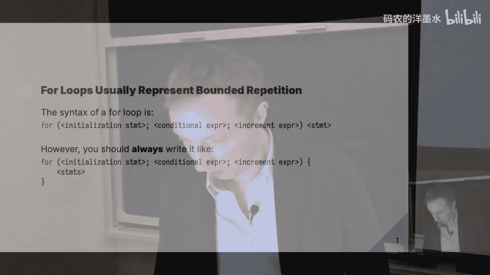
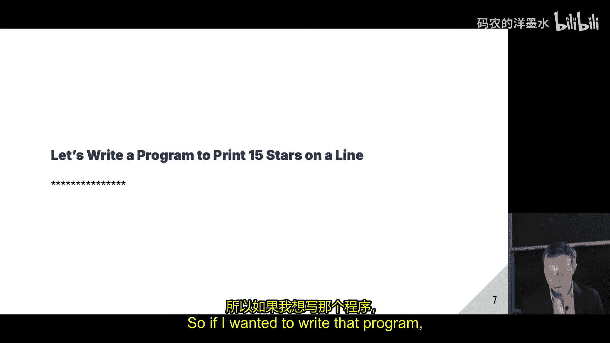
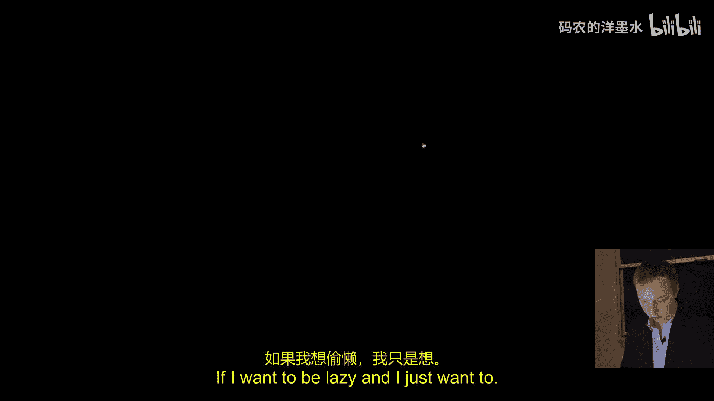
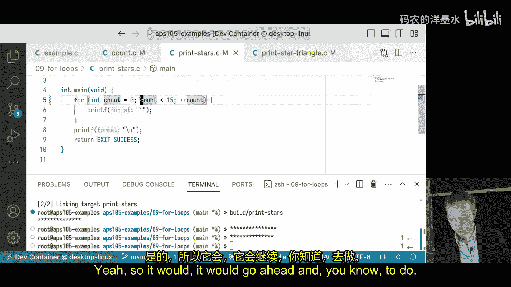
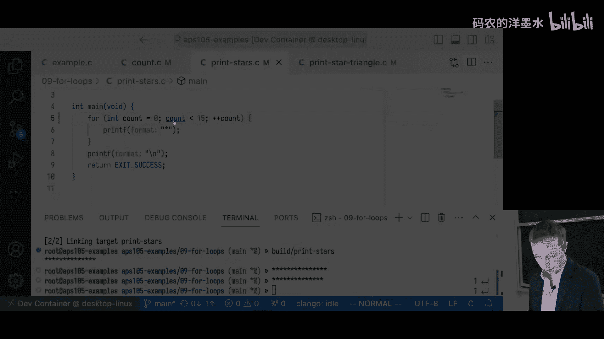
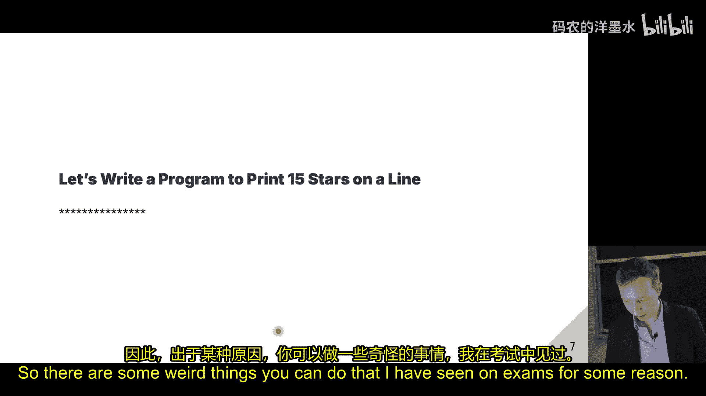
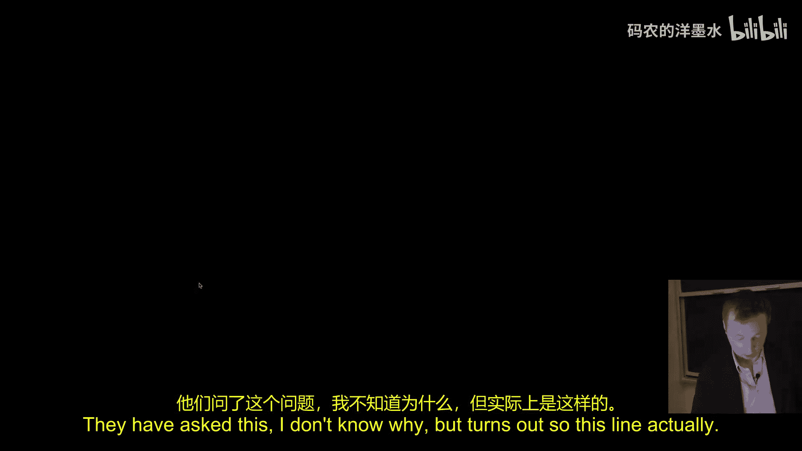
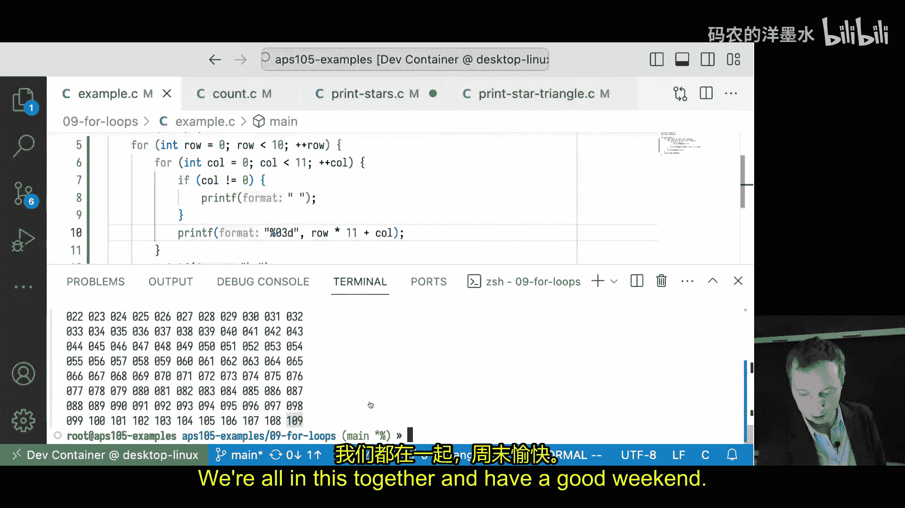

# 【全集】多伦多大学 C语言编程 中英字幕 1080P p09 Lecture 9 - For 循环 -BV1gikKB3EZW_p9-

All alrighty。 Welcome back to 105。 Thank you for joining me today， so。

We're at like a quarter of the way through the course， Everything good so far。

 any lingering questions， comments， concerns or anything like that or。Fairly smooth sailing， La 1。

 okay， La 2 going okay。

Alright， seems okay。 That's good。 So if you can， too。

I encourage you to also do the textbook exercises and all of that fun stuff。

 because especially if you're new to this， best way to learn is just practicing。

So today we get to talk about four loops。 So luckily for us。

 they're not really anything new after learning about wild loops。

They just used for a slightly different purpose， and they are slightly easier to read other than that。

They're pretty much exactly the same as while loops。So they usually represent bounded repetition。

 So something we know that will only repeat a certain number of times。

 So syntax for this looks a bit wordy。 So it starts off with a4。 So keyword for。 So again。

 not allowed to name a variable for。 And then instead of just a condition in the parentheses。

 we have a whole whackish stuff now。 And it looks complicated。 but really， it's actually not。

 it's not a more complicated than a wall than a while loop just makes it easier for you to read some code。

 believe it or not。So the first thing you're allowed to put here is an initialization statement。

 so you define you can define a variable and initialize it to a value here。

 This will only run once and we'll see the flow of how this works on the next slide and then。

In the wild loop， all we had was a conditional expression。 Well， in this case。

 our conditional expression for how many times to repeat this loop is going to be here in the middle。

And then finally， there's another semicolon。 And then there's an increment expression。

 So that is when we're going to change our variable。

 and it will run at the end of every iteration of the loop。 Then here， of course。

 we have a statement。 However， in this course， And in C in general， you should always write it like4。

 We have the initialization。The conditional， the increment。

 And then we use curly brackets and have all of our statements in there。

 So every time through the loop， we execute all of the statements within the curly brake brackets。

So our control flow， we have a lot more stuff。But it's not really that much more complicated。

 So we have some code here that would be at the start。 And then I'll just call them the first one。

 I'll call ait short for initialization condition， short for conditional expression。

 because we're lazy。 And then instead of increment。

 I'll just say ink because it's shorter and it gets the point across。

 Then here within the curly brackets and have some capital A。

 that's some code that I want to run every iteration of the loop。 and then I have an end。

So the control flow for this or the flow for this loop is well it will always execute the code at the start。

 and then it will always execute this initialization statement and it will only do that once right before it checks the condition and then similar to a while loop。

 it will check the condition if it was true。 Then it will go ahead and execute the statement。

 And then unlike the while loop， we are allowed to tell it to do something at the end of every iteration。

 So we don't forget something is the main point of this。

 So this increment will always run at the end of every iteration of the loop。

 And then after that's done， it will go ahead and check the condition again here we have to make sure that our condition will eventually be false or elsewhere in that fun infant loop that we cannot get out of except if we hit control C and then just get rid of everything。

So eventually， whenever we hit false， then we just go to the end exactly like the while loop。

So just some terminology in case， hopefully I've defined everything that I've used。

 at least within a few slides。 So here you might hear programmers talk about iterations。

 So that's just a shorthanded way of saying a single repetition of a loop。 we call that an iteration。

 So also， if you want to think of it in another word， it's just a single step。

 So single time through the loop。So some fun rules about this because， well。

 you actually don't have to put in the initialization or the increment expression if you don't really want。

 So you can write4 semicolon and then your conditional here。

 which I'll just do a lowercase A and then another semicolon and an A。 However， if you write this。

 So you get rid of the extra functionality of the for loop。And it just becomes a while loop。

 So this is exactly the same as writing while A。 and then just a curly bracket with some code in it。

 So for these， yeah， you can express the same thing， but four bounded repetition。

 you should write a4。 So just don't write a4 with no conditions in it。 It's weird。

 Just use a while loop。 If you don't know how many times you're going to iterate through。

Everyone agree。Great。So。Let's write a program now to count from 0 to 9。

 so we can do this with a while loop。So here， let's just do it for fun。So anyone。

 tell me how I would print out the numbers zero through9， all on different lines。

Using our good old friend， while loopop。要。Yeah， so create a variable called count。

 initialize it to zero。What the neling right。Oops， and did I forget anything？

And an account like that。Yeah， so count。Equals count plus1。Now I'm good， right？All right。

 any disagreements with what we have currently written？Up there， hit。Yeah。

 so there's a few different things we could change about this。Just depending on style。

 but it all means the same thing， so。So if we run count now。What we get is 0，1，2。

 exactly what we expect here， so。Style things like mentioned， if I wanted to。

 I could write here instead of count equals count plus1。 I had a few options。

 I could write minus minus count。 I could write count plus equals to1。This。

Probably when you're beginning， it's probably easier to read and understand what's going on。

 So you might prefer just to do this。嗯。I could also change the condition if I wanted for the loop。

 In this case， it doesn't really matter， but I could also do just less than 10 if I wanted to get rid of the equal sign。

Right now， this is just a matter of preference。 But later on。

 you'll find that just having less than the number is going to be slightly easier for reasons we'll get into later。

 but they mean the same thing。 So if I compile this and run it still， it goes all the way up to 9。

 so。This。Can get a bit tricky because， well。If I want to argue that my loop will actually terminate。

 So I know it's going to run like 10 times， but I have to keep track of a lot of things。

 if I read this。 I have to see， okay， what did I set the first value to， Okay， my condition is here。

 O， great。 And then， oh， did I make sure that eventually this condition will be false。

 So am I doing something to change the value of count such that it will go ahead and eventually be false。

 Oh， okay， yeah， I'm doing that， It's right at the bottom here。So I needed to read a lot of places。

 And then eventually， you know， your code might be long。And then it looks somewhat thing like this。

 And you're like， oh， okay， not sure if that's right， because I can't see the end。 And then no。

 by the time you get here， you might forget this line and then forget what you were doing above。

 And then， oh， no， suddenly you're in that infinite loop situation。So for loops。

 the primary reason to have them is to put all of those count variable checks。

 increments and initializations right beside each other。 So instead of writing this。To do do。I could。

 instead， write。It has a four loop， so I could say four int count equals0 semicolon。

 and now I would do the same check。 I would check that count is less than 10。

 and then usually for four loops， we just want them as small as possible。

 so we might actually prefer to do plus plus count here。And。Then just looking at a single line here。

 we can argue about how many times this loop goes through。 So just by looking at the single line。

 we know it starts at0。 and then it will always be less than 10。

 and we increase it by one every time。 So it should go from 0 all the way up to 9。

 and then it looks a bit nicer because we can just have our print just nicely sitting on a separate line。

 So instead of having all those lines of code。 I can just do it in a single while or a single four loop。

So if I run it that， I get exactly the same results。So questions about that， yep。We't be able to use。

あるという。Yep， yeah。 So the question is， well， now can I not use count outside of the for loops。

 So we'll go into the rules that you can use variables。In。21 or two lectures from now。 But yeah。

 the difference is， if I try to use count now。Yeah。My compiler will yell at me。

 so my compiler will say use of undeclared identifier count because it doesn't exist anymore。

It actually had another。YeahAnd it wasn't yelling it。Yeah。Yeah。

 we'll go over those rules a bit later。 But if I wanted count to exist outside of the loop。

 this is also a good reason to use a for loop because generally。

 I'll only use count inside the while loop and or inside the for loop。

And I don't want to accidentally use it outside the for loop because， well。

 I might not remember what the last value of it is。 but if I wanted to。

 I could do something like this。So I could do int count。

 And then this initialization statement that just runs。One time before we even get into the loop。

 So I could just write something like this。 It would do the same thing， yep。Yeah， so while loops。

 they don't have this initialization part and the increment part。Wil loops just have this condition。

 and then you can write whatever you want。So this just kind of shoves it all into one thing。

 So you can just， the idea is we put all of our count things right beside each other instead of having them on separate lines。

 Usually， it's a bit easier to read。 This will probably be your， your favorite loop if。

If people have favorite loops， might be kind of weird。Alright， questions about that。All right。

So we can just do a bunch of problems today， because that's all about practice， so。Here's。

A solution to that， so you have it on the slides。So let's write a program that just prints 15 stars on a line。

 So I could just write。15 stars on line with a print F， but。

I don't really want to count how many times I hit the star key。 So if I wanted to write that program。

 let's see any suggestions with what I should write if I want to be lazy。

 and I just want to see 15 stars on a single line。

Anyone help me。 I have Cnesia。It's a rare condition。Yep。Yeah。

 just do a four loop that goes like 15 times and print a star each time。 So if I'm doing a four loop。

Well， I need a variable in order to increment。 Let's call it。 let's just call it count for fun。

What should the first value of count be。Zero， we like zero。Okay。

 and then what should my condition to keep on going through this loop be。Yeah， count lesson 15。

And then each time through， well， typically for all the loops， we'll either do。

 it'll just do plus plus count or whatever our variable is， we'll generally just increase it by one。

So now this loop。We'll go through this 15 times， so we'll go zero Next iteration of the loop。

 if we want to use our fun new terminology， count will be one， then count will be2。

 and then it will go through a few more times until eventually count is 14。

And then as soon as we increment or as soon as count is 14。At the end of that iteration of the loop。

 we'd do plus plus count。 So count would now be equal to 15 and 15 is not less than 15。

 so we would exit the loop and then just exit our program。 So we would stop at 14。

 So we could do this some other ways。 if you're starting。 Well it might be easier to read。

 you might prefer。This。Start count as one， and go。Until it is equal to 15。 So then it's like。1。1，2，3。

4，5，6，7， all the way up to 15。Turns out that's okay to begin with。 But turns out later in the course。

 Well， computers actually really like counting from 0， not one。

 So if you want to get into the habit while there's not that much else to think about。

 just always start your loops。With the count equal to 0。 in this case。

 if I want to just know that I go 15 times， just go less than 15。 So I'll go 0 all the way up to 14。

So。In this case， if I want to print out or 15 stars， I know I iterate 15 times through this slo。

 so each time through it I can print a star， and then we should always be nice and print a new line whenever we're at the end of the line。

So if I compile and run that， oops， little print stars， stars。Then I get 15 stars in a row。

 I didn't have to count or anything like that， cause， well。As you get used to programming。

 you're gonna be lazy and it's gonna be great because you'll no longer need to count higher than about。

10， idealally， you don't have to count higher than like 7 ever。 So， yeah。

 it's great being a programmer because you can even forget how to count。 It's pretty nice。All right。

 any other questions？plus plus。Just for。Prefix。They get to do plus plus calendar。Oh， if I do this。状。

Okay， so I can write something like this。 So if I compile， my compiler doesn't really care。

And then if I do this， I'll see。I assume that's 15 stars。Let's measure。Nope， we're slightly off。

So in this case， we're slightly off because in this rare condition。

 we probably actually mean post increment， or we should just change the bounds。

 But doing something like this。 having a change happen while you're doing a comparison。 generally。

 that's a bad idea。 And you'll probably be wrong。 you'll be off by one。

 and it'll look weird because it'll be nothing here。 So generally。

 you should actually just do something like that and just have your。Heavi your condition。

 Just do a plain old。Conditional check。Yeah， so sorry， it's like we go into the initial condition。

ていう場リを。That is。たさ。Yeah， so it would， it would go ahead and you do。

So we， we always do the start。 Then wed just do the initialization once and then condition exactly like if it was a while。

 Yeah， because it goes into the condition the first time right when we start。

 this is what the first increment。Yeah。Yeah。Yeah， so the reason we saw that bug is because。

 well the condition happened once and we incremented it from zero to one。

 and then we checked the condition and then we went through， so we messed it up。

Moreral the story is just generally mixing plus， plus on a line where you're checking condition。

 bad idea， especially if you are beginning， so。Do yourself a favor， and don't do that。Alright。

 any other questions。Or weird things we can do。 So there are some weird things you can do that I have seen on exams for some reason。

They have asked this。 I don't know why， but turns out， so this line actually。

Whatever we write here always executes at the end of the iteration of the loop and in C。

For some ungodly reason， you can use a semico to kind of chain two things together to make it a single expression。

 So I could write print F。Star。And then a comma and do this。

So now it will still follow all of the rules of the for loop。 So this will happen first。

 then it will check this condition。 And then well， it would do whatevers in the loop right now。

 there's absolutely nothing there。 And then right at the end。

 it would do a printf and then the count because we chain them all together。If I compile and run it。

 I get 15 stars。I've seen this on your exams。Please don't write things like this。 This is really。

 really confusing。I will might argue if it comes up on your exam， because。

I have never seen this before。In any real program， I have written or read another human wrote。

 so yeah。If you do that， alarm bells will go off and。I will be disappointed。So don't。

 don't disappoint me。Alright， so here are that rules you， you could。

 but shouldn't underline the shouldn't use a comma to like chain together。

 multiple expressions together to make it a single one and shove it all in that increment expression to make it do two things。

 General， it should do one thing and one thing only。

 that increment expression should increment a variable。

So maybe you don't want to increase it by one every time that's cool。

 You can increase it by two if you want， go for it。 So like。Yeah， we'll。

 we'll see some examples at the end。 But yeah， don't do like a printf as part of that。

 That's just weird。All right， other things that are highly discouraged in this course。

 but are actually I find useful。But we won't go into them。

 is there are two other keywords to give you more control over how your loops operate。

 So they are called continue and break。 So they themselves are keyword。

 So you cannot name your variables， break or continue bad luck for you and they help you control。

 give you more control over what happens with the loop。

 So if you write a break statement in the body of your loop。 Well， that causes essentially。

 like the goto jail card and monopoly。 So it will immediately kick you out to the end of the loop。

 and it will stop iterating your loop。 So event essentially。If you do a break。

Within one of these statements that we execute in the loop。

 we will go straight to jail and go straight to the end without checking the condition again。

 without incrementing， without doing anything like that。 Sometimes that is very useful。

 probably not in this course。There's also a statement called continue。

 And what continue will do is it will just stop the current iteration of the loop and then immediately restart it。

 So if I go back to the diagram。If within a， I hit if it encountered the keyword statement， continue。

 what it would do is immediately not execute the rest of the statements in the curly brackets。

 do the increment and then do the condition， so it' will essentially just skip the rest of the statements that you have in your loop。

Sometimes that will be useful in this course since your beginning， doing these advanced loop things。

 highly discouraged， I guess， depends on your problem， like。Like。Any tool。

 it depends on what you use it for。So good to know these things。

 Do you have to use them in this course， Probably not。And， in fact。

 coordinator encourages against it， but。Who am I to tell you what to do。

 So I don't want you to have to read C code and see one of these and be like， well。

 I I don't even know what the hell that means。 So I told you。Alright。

 so now we can do something more advanced so we can write a program to print a triangle of stars。

 So now we can break this down。 This seems to have two types of iterations going on。

 which might be a bit confusing at first。 So two things are going on。

 So I have some bounded repetition here where well。😊，I'm printing off。 in this case。

 there are five rows，5 rows。 Remember， I don't have to count higher than like a 7。 So I'm good。

 And then for each row， I am printing just the number of stars that matches that row number， so。

A lot of programming is just being able to detect patterns and kind of break it down and explain it to a very stupid machine。

 So your computer， very， very stupid machine， if you wanted to print off these stars。

 you have to tell it exactly what to do。So if I were to break this down to， to do。

So we want to print something that looks kind of like a star， two stars， three stars， four stars。

5 stars。So if we go with our pattern， you might want to write out that， hey， you know。This is。

Since I told you computers like starting at 0， while humans like starting at one。 So I might say。

 hey。Row 1， that has one star。 So that kind of makes sense。Row 2。Well， that's got two stars。Oops。

Rule 3。Has three stars。Ohoops。Row 4 has four stars， and you probably get the idea by now。

 row 5 has five stars。So if I wanted to write a program to do all this， Oh no， amnesia， help。

 I need help。Yeah。port that used to。没。Oh， so I just。Copy pasts for loop。All right。

 so best programmers just copy paste stuff。it's more true than you think。 It's not really a joke， so。

just for the sake of the question， could you fit a for loop inside of that lake comma or oh。

 that's a statement I guess。Inside of which one。I that link here。No， yeah， it's a statement。Yeah。

 so I mean， down early。Like you can also print played in。So print a new line。Here well。

 just right after yeah。Right after within the body of the loop，So you get like a starper。これ要策。

At every degree。The number。So we start this at one。So yeah， here。

 maybe I want to rename the variable count because this seems to be representing like the row。

Kind of right。Yeah， maybe I just rename it。Do a good old find and replace。 So I rename it to row。

 So now。嗯。This four loop will iterate five times。 first time row will be equal to1。

 then two then three， up to5。 So if I look at this， okay， now I have my five rows。

 So what do I want to do each time I'm through a row， so。Stars， yeah。Yep， y。Yeah。

 I want to print off that many stars。 So what do I need。Okay。Okay。

 so what should I call this variable in this loop。Co column stars。Preferences， column or stars。这种。

Stars， sure， all right， so stars。Starts off at one。 What's my condition here。

 How many stars do I want to go until。Yeah。Yeah， so I want to print the number of stars that are equal to the row number。

 So here I have this number。 So row is equal to one then2。

 So I should print off how many stars in the row。 So I just do the same thing again。

 So int stars less than or equal to1， my condition。

 I would go up until row instead of just a predetermined number。

 So instead of going up to five every single time。 well。Each time through this loop。

 I will have another loop that iterates up to row number of times。So。Then I do plus plus stars。

So now。The first time through。R will be equal。Equal equal to one。 And then。

We would execute this for loop。 And then in this case， this four loop would happen one time。

And inside of the loop， I should just print off a star。Should I move this new line inside there too？

No， because I want just。I essentially want a new line every time I'm done printing all of the stars。

 not just one。So in this case， if row is one。This will go ahead and only happen one time。

 So I'll only see one star。 And then that will be the end of row 1。

 So I should have a new line at the end of it。Then I would go through the loop again。

I would increment row from 1 to 2。 And now2 is still less than or equal to 5。 So row。

 this time through this iteration of the loop， big words。Now， row is equal to 2。And remember。

 we have to do equal equal C just to make it a Boolean。 Otherwise， it's assignment。So， now。

This time through the loop， this four loop will execute two times。 So I will get two stars and then。

Have a new line to say I'm done with that row。 And then similarly， we'll go through。

Row will be equal to3。We'll go ahead， print  three stars，4。 So now I execute this。

 Hopefully I get that fun triangle pyramid， right。So let's compile that and run that build print star triangle。

Hey， cool triangle。你。I like computers。So。Nice thing about this is if I wanted to print another row。

Well if I want to do that manually， it kind of sucks。

 I have to type 6 stars and then another row I have to type 7， and then。Then 8。 And then I came。

 while I came and count up to 8。 So now， instead of doing all that， I just change it this to 10。

 And now I get 10 rows。 So if I compile and run that。Cool， I get a bigger triangle pyramid thingy。

Cool， so questions about that。So like we had nested if statements。

 we can have nested four statements and inside here。You know。

 I can put Is in there if I really wanted to and all sorts of fun stuff。

Questions about this or how this works。Alright， to end off the day。

 So let's do something a bit more tricky and a bit more slightly practical。

 So let's say I want to print off rows and columns of something。

 And I want to do it in a way that a computer will like it slightly more and we'll see why it's kind of a better thing to start at 0。

😊，So say。I want to print like a 10 by 10 grid of something that goes from 0 all the way to 99。

 So that would be 100。 And I have。10 things per， like 10 columns per row。

So I might do something like。Int row equals 0 and say I want 10。 So row is less than 10。And then。

 plus plus row。Now， if I want to do columns， well， that's just a nested for loop。So instead of row。

Let's be a wizard。So， now， I just。Have an inner for loop that does the same thing for a new variable。

 So now what will happen here is first time through this loop， row will be equal to 0。

 and then while row is equal to 0。 This loop will go through column equals 0 all the way up to 9。

 and then finally be done with that four loop because 9，10 is not less than 10。

Then we'll go through it again。 row will B1。 and then this thing will happen5 or 10 times。

 same thing。 Eventually， we're going to have 100 times。

So let's say I wanted just a nice grid of numbers。We can start off and just kind of guess at something and see how it looks。

 So if I want to print off like the actual numbers， I want them all in a row， so zero all the way up。

 Well I might start guessing by just doing column。And then let's see， print F。

And then just do a new line at the end of each row。So。If I compile and run that。But。

Does this 10 times， which looks。Kind of right。 So if I wanted to go all the way up to 99。

 that's what it would look like for like the last digit of every column。

 And this kind of looks like that mod thing， right， so。

How would I change this so that every time through the loop， I'm printing in order。

0 all the way up to 99。Any guesses？Yeahep。好Let mean say。嗯哼。去找这。没你。Yeah。Yeah。Mmhmm。'm sorry。Yep。四高。

Yeah。Yeah， so if I want to convert it all the way up to a whole number， well。

 this column kind of looks like if we did like。That number mod 10。 So if we did that number mod 10。

 it was positive。 we'd always get 0 through 9。 So also represents like the last digit。

 So if I wanted to， that essentially represents my ones column。

 So if we went back to good old elementary school。The row actually kind of represents the tens column。

 So if I did row times 10， well， first time through the loop。

 which is why it's useful to start off by 0。Then I'll have 0 times 10。

 and I'll just get the plain old numbers。 So I'll get 0，1，2， all the way up to 9。

Then second iteration through the loop row is going to be equal to one。 So I would get。1 times 10。

 And then first， it would start off at plus 0。 So that would just be 10， then plus 1，11。

 and go through all of the。Digits with a that start with a one。So if I do this。

 it probably will look a bit ugly， but it's kind of close to where we got it if we want it to look like a nice grid。

🤢，We might want to normalize this thing and just always print two characters。

 So if we remember our format specifier， we can do something like a two ahead of it。

 So we always have two characters printed。So if we do that。Doesn't。

Help us that much until the first row。 And hey， at least every row looks the same。

 So now we have the problem of， we might want to pretty this up and have a space between all of them。

 So this is some common issue you'll have because what will happen if oh， and first。

 let's make it look can。 So what would happen if I just put a space between or before every single character。

Would it look like the prettiest thing I've ever seen？Probably look a bit weird。So if I do that。

 it kind of looks like a nice grid， except I'm very， very pedantic。

 and there's technically a space there。 And I don't want one。 So if you were to follow my rules。

 how do I get rid of that space。Yep。娘つべさん。Alright， so there's the cheating solution。

That you just do this， right。So if we just do this。Then it looks pretty good。

 It starts at the beginning， but I have laser eyes。 I know that's a space。😊。

So how would I get rid of that？Because I can write a program that checks if there's a space or not at the end of there。

And I can make it angry at you。Yeah， so we probably want an if condition because we like。So， here。

We have。10 things， right？ So I have 10 things。 How many spaces do I want。Yeah， I want nine。So。

I want one less， so that。It kind of depends if something kind of depends when we're programming means we should probably have an if statement。

So。Here， just to demonstrate， there's more than one solution。

 so I can either choose to conditionally put a space at the beginning or put a space at the end。

 Which one shall we prefer today。And beginning， end， we got end。 Okay。

 so if I wanted to conditionally put a space at the end。We can think about all the conditions， so。If。

Something， then we want to put a space at the end because。This is after our print statement。

 It will happen after our number。 So what numbers do we want to。Print a space after。

 so we could go through and even ask ourselves， do I want to print a space after 0。Probably。

We're column 0。 Do I want to print a space after column 1， Yes， okay， let's skip a few steps。

 Do I want to print space after column 8。Yep， do I want to print space after column 9。Absolutely not。

So in that case， well now we know our condition。 So if it。9ine， then we don't want to do it。

So if we're on our last column， So we could just say if column。Is equal or is not equal to 9。

 Then we go ahead and we just print a space because we can think about when do we want to print a space。

 Well， whenever the columns not equal to 9。So if I do that， hey， that looks a lot better。

Even though I can't really see it， but trust me， it works。嗯。But there's more than one solution。

 I could also just think about what happens when if I want to put a space before something。

 So it turns out this is a bit easier to think about because， well。If I look at。Essentially。

 column 0。 Do I want to put a space before column 0。No， so。And that's the only time， right。

 So I only don't want to put a space。 If we think about the inverse of that。

 I only don't want to put a space。Whenever the columns not equal to 0。

 So as long as the column is not 0， I want to put a space before it。So。If I build this。And run that。

 hey， that's the other solution that does the exact same thing。

 Maybe I want to pretty this up with a leading0 just to make it look a bit nicer。

 So now we have a giant， fun grid。 looks pretty sweet to me。😊，You might also prefer。Doing this0。

 because even if I were to make the column larger for some reason。 Well， before， when I had this。

 I just didn't want to print column 9。 Well， say I wanted to make the column bigger for whatever reason。

 I want to go up to like spinal tap。 I want to go up to 11。So if I want to go up to 11。

 then I have to remember to change this to 11， and then change this to 11。

 And then I would also have to remember to change。That if statement from a 9 to a 10。

 because I made it bigger。 But if I have it at a 0， don't really have to change it。

 So you might actually， I would。Consider doing it before to be slightly better。 But again。

 it's programming。 There's not just one solution。 It's kind of up to you。 So now， if I print this。

 looks a bit ugly because I get up to three digits。 So let's fix that。

So now goes all the way up from 0， prints 11 numbers a line and goes all the way up to 1，0，9。

 Looks pretty。 didnn't really have to change anything。So any questions about that。

 I was just kind of screwing around just to show you that， hey， programming more than one solution。

Alright， all good。 Allright， with that， Just remember， I'm pulling for you。

 We're all in this together and have a good weekend。😊。

