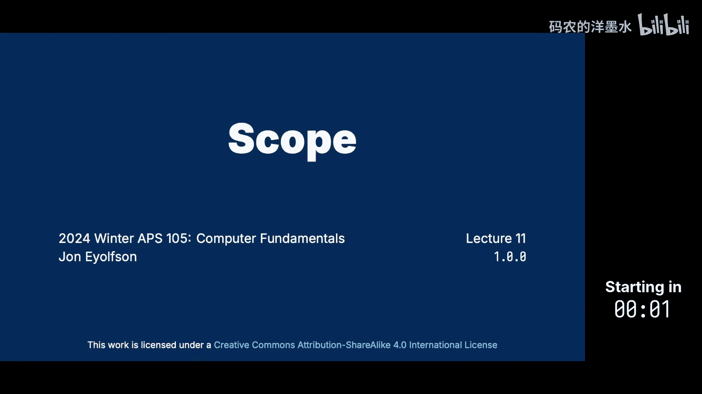
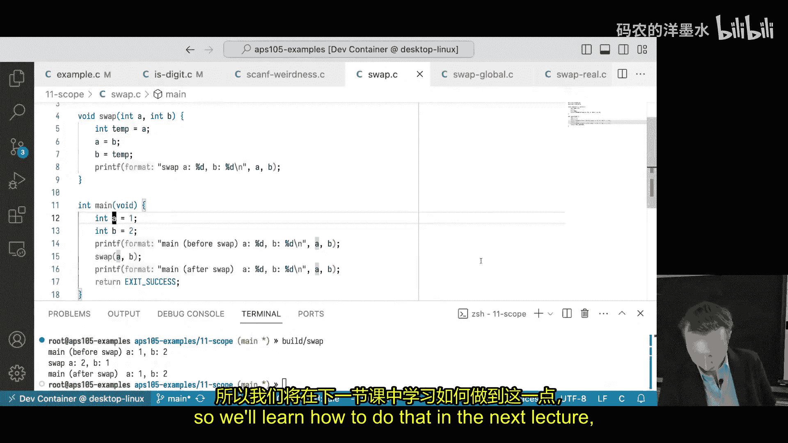
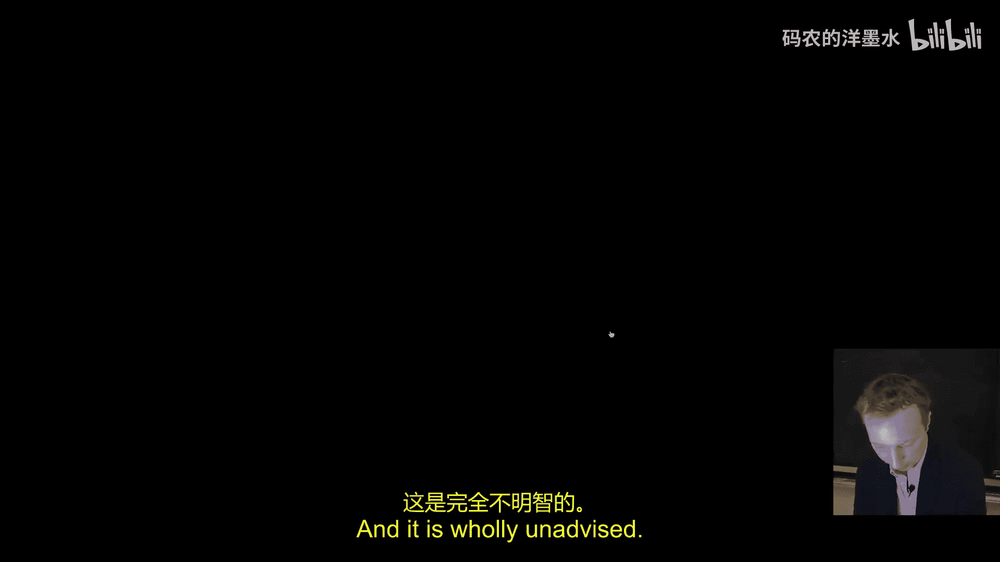
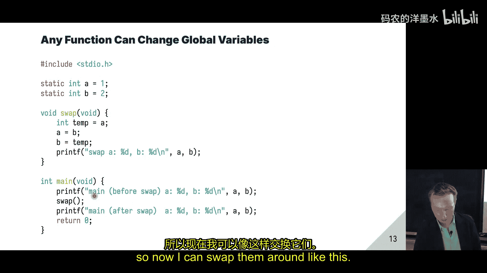
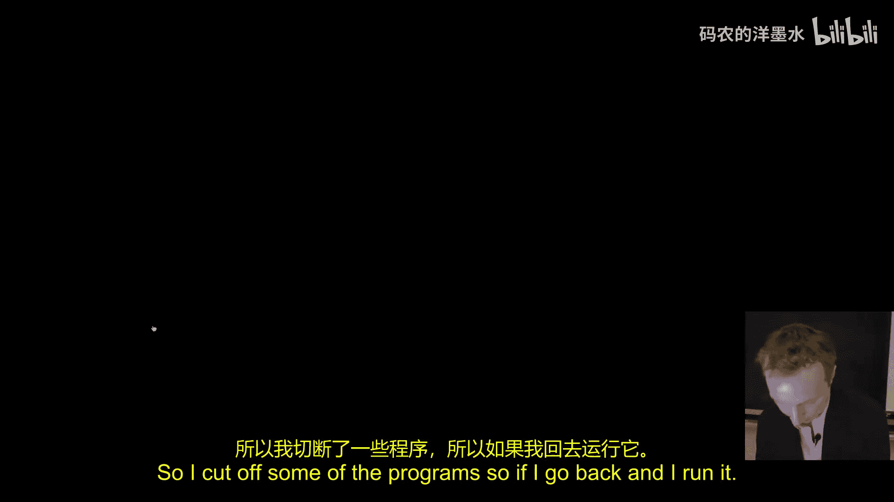
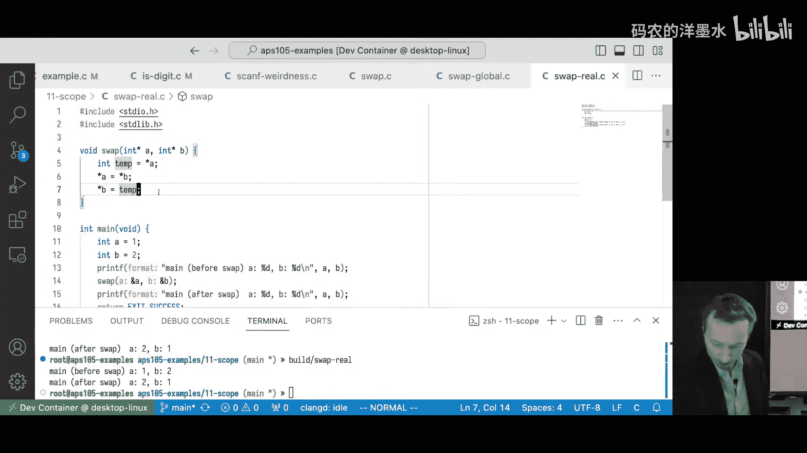

# 【全集】多伦多大学 C语言编程 中英字幕 1080P p11 Lecture 11 - 作用域 -BV1gikKB3EZW_p11-

Alrighty， welcome back to 105， thank you for joining me again today。

So today we get to talk about scope。 What the hell does that even mean that sounds like。

 I don't know， I have like a pair of binoculars or a telescope or something like that。

 Let's see what the hell we're actually talking about today。So， some terminology。Before we start。

 we were talking about functions， so if you want to sound like a pro。

 I will tell you all of the terms to use to describe what happens when we use functions。

So given what we had before at the end of the last lecture。

 where we'd used functions to implement that print triangle example。In our main。

 we had something like we got some input through scanF。

 and then we called this print triangle function that didn't return anything and took an integer argument as input。

So if you want to sound like an expert。 what you would say is the main function calls print triangle。

 So we call them function calls whenever we kind of jump to it。 So see what it's going do。

 it's going copy the arguments。To that for that function。

 and then execution will suddenly jump there。 So it's another way to just kind of jump around in the code and control what statements get executed when。

So in this specific case， what we would call that is main is the call and then print triangle is the call E terms you won't get tested on。

 but if you want to impress。Other professors with your programming language knowledge。

 that is the proper terminology for that。So。Why do I say that， Well， also。

 I can hopefully explain things a bit better。 So explain or that the return statement。

That will stop the callee from executing and then the collarer resumes from wherever it left off。

 and if the function happened to return an int or have some type of output。

 then the caller would get a copy of that return value whenever that function is done。

So fun terminology to know。So。Titled of the lecture today， scopepe。

 So scope is the part of the program where you can actually use a variable。

 and it's actually valid to use。 So typically， while we can always use a variable。

 So the variable declaration within the curly brackets， So within the curly brackets。

 that means we can use it from the beginning curly bracket until the matching curly bracket。

 So if we have multiple levels of them， it's whatever one close the one we opened。

So C will declare function arguments as part of the next set of curly brackets。 Wow。

 and also four loops。 So they will be。Declared in the next set of curly brackets coming up。

 not the current one we are in。What does that look like？

 So variables will always exist within a function。 So whenever we have something like this。

 So we have main。We would start our execution in Maine if we have a variable declaration in I equals 42。

 well， then it's within a set of curly brackets and after we declare it。

 we can use it until the ending curly bracket here so I would be valid to use on any of the lines I could return I if I wanted to。

 I can use it part of a print F。 I can use I at any point within the main function。So。

At the bottom here， Ill draw out like all the variables that are currently valid and their value， if。

 and their values， so。To help you out， execution would always start at main。

 so I draw a little dotted green line with main titled here， and then anything above this line。

 those are variables that exist within main that I am currently allowed to access at this point of the program wherever that yellow arrow is pointing to。

So at that printf， I'm allowed to use I， I can go ahead and print it off in this case it will print off the value of I is 42。

And then on the return line， I could use I if I chose to right now I didn't I just return zero。

 which means A OK， our program is good。So questions about that。Should it？All right。So four loops。

 how they work。 So if I start my execution at mainine again。

 start it with the same program or start with this start at the first line， sorry。

 I I equals 42 so right now there are currently no variables active because I haven't finished executing the line that would actually declare it。

 so as soon as I execute this declaration statement。

 then I'm allowed to use I so I can use I at any point in my program here。Everyone， good。All right。

So then I would have a four and then remember。The four loop has like three components。

 an initialization statement， and then like the conditional expression and then the increment expression。

 so this initialization statement， the scope of this variable J J will be valid for within the next set of curly brackets。

 so it will only be valid between this and this。So we can only use J here。

 so we have we can do print FJ。 Also I is still valid here。 so if we wanted to print off INJ。

 we could do that if we want and then。After we reach the end here。

 so we're at the closing curly bracket for the for loop。

 so if we go to the next statement here at the return， well， if we look over here。

 J does not exist anymore， so to go through that really quick again。At the beginning。We。Declared I。

 So we create an I here， lives in main。 Then we have a four loop。 It declares J。

 So if we move on to the next line， we now have a J equal to 0。

 and we can use it in the print F statement。Do something here。

And then on the return line on the next of Curly bracketrackett J no longer exists。

So just to make sure。We can see what happens。 So here， same program， my for loop。 Well。

 it goes from J equals 0 to J less than 1。 so it should only execute once。So if I run this， I'll see。

J equals 0， and then I equals 42。 and I can go ahead and show that， hey。

 if I move this print statement。Out of here。 So if I try to use J。

 J is currently out of scope and if I try to compile that。

 I'll get some error message that the same thing is like if I to if I try to use it before I declare it。

 so C is not that smart， but it just tells us the generic error message of this variable does not exist。

 so。If you just came across that randomly， it might not make any sense。

 so why it doesn't exist is because how we say it is it's not in scope。So。Os。So we can go ahead。

 delete that。 But if I wanted to， you know， I could move I into the loop。

 No problem because I exists for the entire lifetime of Maine。

So questions about any questions about that？Yep。永ジスクー。For the reasons。Yeah， so the question is。

 can I just create some old random old curly braces anywhere， And the answer to that is yes。

 and it declares a new scope。 So if I wanted to perfectly valid to just say new set of curly braces。

 and then I could have int。J again， equals to 4。And。I can print off J here。If I go ahead and do that。

To do。Then I see J is4， so that's this J， and then J no longer exists at this point。

Then we have a for loop that declares another J， and then that J is valid here。

 and then J no longer exists here。 So I'm allowed to have the same name。

 And this is actually its own scope。 So if I tried to do a print F。At the end of this curly bracket。

Well， I should get the message that undeclared use of identifier J J does not exist because it is not within scope。

 so it disappears as soon as we hit here。So if you wanted to， you。

 it's a bit weird to just write curly brackets。Kind of Willy Nely。 But if you want to， you can。

 It might have some applications， depending on。Some other programs。Yeah。

 and I have a discord question， which I will go over next。So。

Any other questions for this or shall I answer the discord question？

So the discord question is essentially， could I do something like this。

So I'll just rename the variable in the loop I。So let's see。I can compile that。C compiler。Doesn't。

 doesn't give me any problems。 What would I expect to happen if I actually run this program。

Any guesses， y？Yeah， two outputs for I。 And what will the value be for I for both of them。

 first and second。0 and 42。0 and 42。 So there's two plausible answers here。 So it could be。

At this point， it's like， what I are you talking about， It could be this I， which should be 0。

 or this I would be 42。 So it's either going to be。I is 42。 and then here the loop I doesn't exist。

 So this will always be 42。 So I'll either see 42， 42 or the or 0 and 42。So spoiler alert。

 I will see 0 and 42。So if I run that 0 and 42 and this。

Illusts the problem because it might be a bit confusing and also having two variables that are probably doing two different things。

 name the exact same thing。Probably something you should never do。 So in this case。

 good thing I had prepared for it。So what that is called is it has a term and it's very ill advised。

 that term is called shadowing。 So you can shadow a variable with the same name。

 So here is that same example on the slide where all I did is change the loop variable from J to I and we'll start off executing at main。

 So if I'm keeping track of my variables here。I declare in I equals 42， and there is。

 that's my variable that currently exists。Then I'm on this line。 So my4 loop int I equals 0。

 And that would be my initialization stage。 So I would check the condition。0 is less than one， Great。

 So it would go into the body of the loop and I would be valid。 So in this case， I is 0 and。😊。

The inner eye is valid here， so C will always use the most recent declaration of variables that have the same name。

 so in this case inside the loop， the most recent declaration of I is this I here that was declared in the loop so it would print I is zero which is what we saw。

 and then at the end of the loop， well this I， that loop I no longer exists anymore。

 and then I just have a return here and I could return I I would be 42。Questions about that。Yep。Yeah。

 the question， is there a way to access the outer eye in there and the answer to that is come up with a different name？

So no easy way to access it。Yep。'The variable。Yeah， so that's why in here。

It should be a different name than the outer one， as long as I want to access it。Yeah， so in general。

It's just really confusing to have variables that like shadow each other。

 So same name that has different values， so。Hot tip for the day is do not name variables the same name otherwise you might confuse yourself and confuse other people reading your code so think about having to remember that rule and then coming back to a piece of code in like four months time and then you're like wait how the hell does this work crap I have to watch that lecture again that's no good。

So any other questions？Okay， so。And then here's that other example so yeah a set of curly brackets that declares a new inner scope by itself。

 so same thing again， start executing at mainine， we have this declaration for I。

 so we'd create a variable I set it to 42， and then we have a set of curly brackets here so I would be valid the entire time。

Now we're within a new set of curly brackets， we declare int J。

 so after we execute this declaration we create a variable called J。

 it's equal to zero and we can use it on this line here until the ending curly bracket and then we can't use it after that so after this line。

 J goes away and then at the return statement the only variable we can use is I。

So any questions about that？All right， so other rules。

So the reason why I drew like main and the line is that each function has its own scope so you can't use variables in other functions。

 So how does that look， let's have a little program here and see what it does。

 So the purpose of this program is it asks the user to input two characters I'll go into why I have spaces there in a bit。

 So we just get two characters from the user and then the whole purpose of the program is it's going spit back out to the user whatever characters are digits if it's not a digit。

 it's not going to show you anything。So I wrote this function calledI digit that takes a character as input and then returns a Boolean and because I named it correctly。

 it's called is digit， so it should return true if the character is a digit and false。

 if the character is not a digit。 So there's a lot of ways to write this。I could just， you know。

Generally， if I could write it like if this whole thing returned true， else return false。

You could do that， but that's a lot of code。 and generally people or at least experienced programmers will kind of make fun of you if you do that。

 So if you already know the expression and it's a boolean。

 you can just return it directly and it will return true or false。Because essentially。

 you'd be writing， if true， return true， if else return false。

 so makes more sense to just return true or false。So in this case， to check if it's a digit。

 we remember our ASI， so if C is greater or equal to the character is 0 and they'll all be sequential up to9。

 and the character is less than or equal to the character nine， so that's the last digit。

 then it is a digit。So。Here's how。So everyone understand the program before I actually fake execute it。

Good。So let's fake execute it。 So I start here at mainine， where I declare。Characters， C 1 and C 2。

My creative juices were flowing。 So here after that line， Maine now has a variable called C1。

 and I didn't initialize it to any value。 So I'll put a question mark there that says I don't know what the hell the value currently is。

 Same for C2。Then I would execute the line， print F。Input two characters。

 So that would show in my terminal。 And then here I'm at scan F and ignore that thing at the top。

 I messed up。 So we would have a scan F。And it would wait for us to input two characters after we do it prints digits。

Then here it would。Do oh， if is digit C1。 So it would evaluate this。

 So we make a function call to is digit。 And the argument is C1。 So remember， last lecture。

 we talked about call or call by value or pass by value。 So this function will get a copy of C1。

 And it will be usable in this function as C。 So what does that look like。

 So here that's why I draw a line here。 So I have my is digit function And above this green line is our variables we can access in the is digit function。

So it would this argument would be a copy of， in this case， C1。

 So it would be the value of C1 because it's passed by value。

We would initialize its argument C as just the value of C 1 in this case。

 So it is equal to the character Y。 I'm assuming I inputted the character Y and then 2。

So questions about that。Okay， so in this function now， C is equal to y。 So if C is equal to y。

Is this going to be true or false？Hopefully false， right？

So why is not a digit if you run this and it says why is a digit。

 you need to rewrite it in this case， it will go ahead and well this will be true because if we remember the ASCI ordering。

 the letters are above digits， so this will be true， but in order for everything to be true。

 both sides need to be true because of the ampers sands， so。Y is not less than or equal to a 9。

 So this would be false， which would make the whole thing false， so it would return false， so。

This would evaluate to false。 So if it's if false， we just skip to the end。

 So execution would just skip to the end there。 We wouldn't go inside the if statement。

 We wouldn't execute anything。So everyone， good。And if I didn't invent curly brackets。

 I did not meant mean to。Alright， so now we are reusing the same function again。

 So now we have the next if statement。 So we have now is digit with C 2。

So we're doing another function call。 So this time， we're going to call is digit。

 and it's going to get a copy of the value of C 2， so。For。The function called to is digit。

 C will be a copy of the value for C 2。 So in this case， we're going to run the same function again。

 But now with a different input。 So now the input is the character  too。 So is that a digit。

Are we awake。 Allright， I see one thumbs up。 Allright， hopefully it's a digit。

 We got lots of thumbs up。 Allright， good。 So in this case， it's a digit。 So this will be true。

 So if we have， if true， then we will execute the next line。 And when we come back from a function。

 that function is done。 So all of its variables go away。 So they all go away。😊。

And now we have print F。 so we're in the if statement and we would just print off the character in this case。

 too。Finish。And then print off a new line， and then we're done our program。

So any questions about that program？All right， we're more or less good。Alright， in that case。

 I am going to show you some warnings of why。呃。So here's that program again。

Except I just initialized things。So。Yeah， before I start actually breaking things。

 Any questions about。The program， as we've written it， minus that line I just commented out。

So just to see that it does work。We got is digit。 If I input Y and then2。

 I see that the digits I entered， I just entered it too。And yeah， I have a question about spaces。

 I'm gonna go into spaces。 So are we all good with the program before we get the scan F weirdness。

I have to warn you about because I'm contractually obligated to。Yeah。Yeah。

 so that's what I'm gonna get into。 is okay。 beside the space。

 is there any questionsca I'm gonna go into the space stuff and it's gonna get real stupid。Okay， so。

So the program works， right， Id print， let's say I did 2，1。 Hey， I inputted the digits 2，1。So。

Here I have my print F， so you'll notice here in the format specifier。

 I have no space and then a character and then a space and then a character。

 so if I run this again and it says input two characters and I type space。Why space 2？

I would hopefully expect that C1 is still y and C2 is 2。 But if I run it， I see C1。

Looks like nothing。 but remember。All of these characters are asking encode coded。

 so they just correspond to some magical number that someone came up with。 So in the brackets。

 I just print off the number as well。 So it's just C1 both times， but I print as a character。

 and then I print it as a digit。😊，So。It says 32， turns out32 is a magical number for a space。

 So it actually just captured a space。 So if you don't have a space before it。😊。

The rule is that if you actually type a literal space， it will match a literal space。

 if you put a space before this capital or the format specifier for C。

 it will ignore any spaces however many spaces you type up until a non white space character。

 and then it will actually match with that character so。In this case， here。

 I put a space between both of them and it。Behaves， as I expect， So hero， space， space， space， why。

 space race， space， space， space 2。And。Whoops， I didn't recompile it， I bet。Alright， space space， Y。

 space switch with space 2。 And see this time。Now I get y and2， which is what I expected。So， if I。

Also， mistakenly， did no spaces between everything for characters。Oh God。 So with。

 if you do something like this。 So there's no spaces between characters。 and you do I did。

 and you run this program， and I do space， space， space， Y 2。It matches two spaces， because， well。

It just literally just takes the next character you input， whether it's a space or not。

So this rule is fairly stupid。 So if you just want to get a character。

Just remember to always put a space before it unless you want to literally have a space as input。

 which you probably don't want。 So just remember， scanf is weird。

 put a space before a percent sign character。 if you want。

 you can do it before percent sign D won't really matter but。Definitely before character， otherwise。

 it will match a space and bad things will happen。That's my warning to you。So questions about that。

You should have questions， because it's stupid。Allright， so just so you have it also on the slides。

 So I even put a slide butware it's strange。 So here I don't have a space before the first format specifier。

 So if my input was literally space， capital A， space， capital B， then C 1 is a space character。

 and then it would have ignored。Anything else， if I type more spaces because I had this space。

 and then it would match the A。If I write no spaces between them。

 like I just showed you and my input was like two spaces and then A， space B。

 then both C1 and C2 are going to be literal space characters。

So unless you really want to capture space characters， I even put in bold for you。

 always put the space before the percent sign C and never put the space after the format specifier because it gets even weirder if you do that。

So。If I put a space after。What happens when I compile and run this is。

 let's say I input two digits or two characters， y and then two， and then hit enter。

 and it will sit here and wait forever。What the hell I put in two digits。

 You stupid scan F piece of crap。 What are you doing？

 So it turns out if you put a space at the end for some。I'm。

Because this isn't really supposed to be for user input。

 It waits until you type just some gibberish and then press enter， and then it'll go。

 So do not put a space at the end。 Ba things will happen。

So I even put so this is from the real documentation， if you look up how to use scanf。

 it literally says it is very difficult to use these functions correctly and because you have to remember weird asoteric rules like that。

 So don't worry whenever you start programming for real， you will probably not use scanf。

 I have never use scanf before。 Yeah。I couldn't like like why be？M automatically。

Let's skip my middle chart。So the question is you want to do。You want to do space like。

 this is my format specifier。 Okay， you put in three characters。Three characters without a space。

 So I run it and do like ABC。So it should， itll just match the first two characters。

 So C 1 will be A。 C 2 will be B。 And then the other one gets ignored。 And let's see if I'm right。

 yeah。So C1 is A， C2 is B， other one just gets ignored。So it will ignore stuff， it needs other rules。

All right，Don't be discouraged by Scf being weird。 It's like some weird thing that。I don' know。

So just remember these rules， if you have percent sign C， put a space before that。

 never put a space after it， otherwise really bad things will happen。So。And yeah。

 this is just for scanf for print F doesn't have that issues because it's not taking any user input or matching。

 It's just replacing stuff。 So no problems with print F。 print F's cool。 Just scanf， scanf。But。

So just in case， so I've seen this come on up on exams and part of it is。

They don't really use it like this， but you should know maybe just in case a comma is actually like if it's in an expression。

 it's technically an operator that evaluates the left hand side。

 so it will execute anything it needs to do to compute the result and then it throws the result away and then it evaluates the right hand side and then the final result of the expression is whatever the final result of the right hand side is generally you never use the result anyway so you don't really have to ever know that rule if someone starts using commas in expressions。

 you should probably shoot them。 okay， maybe a bit too extreme。All right。

 But you may see things like this on exam。 So like a for loop。

Where it declares two variables as part of the initialization。

 so it puts a comma between them and declares an int。X equals 0 and a y equals 10。

 and then my conditional expression is just y is less than or x is less than y And then here for my increment step。

 I'm both incrementing and decrementing two different variables so it decrements X and it increments y。

 in this case， this would loop forever should be the other way around。

But you can do two things as part of the increment if you have two variables， generally。

 it's kind of weird if you do this， but I've seen it on exams。 So just be aware of that。All right。

 any questions about that before I pose another one？Yeah， a question so。

Is so I felt declaration like as we do。嗯。があるて。Yeah， so this is a statement。Is an expression。So。

 you like。You can write this whole thing as a statement。

 I could move that up and write it as a statement。Like why equals？By by itself。Oh。

 so this is a statement。 So this means like I could。 So this comma is not part of an expression。

 So it doesn't follow the the operator rules。Why will stand。Because it's like two expressions。

Technically， in compiler， it's not an expression。It's part， yeah。Because why it has to be a name。 So。

 yeah。But that's like compiler rules and stuff。嗯。So， yeah。

 So what do I mean by it throws away the results。 So in this case， in this increment step， we。

 we like， don't even care about the final result of this because it just executed。

 doesn't check the value or anything。 But if we really wanted to。Remember。

 this is the post fixed one。 So let's assume I is equal to 0。

Minus minus or sorry x is equal to0 minus minus x。 Well that will decrease the value of x by 1 so in this case it would be negative1 and then that's the value that's the final result of minus minus x so that gets thrown away and then we would do plus plus y So y would go from 10 to 11 and the result of that is an 11 so the result of this expression would be 11。

 but in a four loop like that it doesn't use the result of the expression anyways Yeah clarify x。

Yeah， X still gets updated。 Yeah， yeah， so we don't in the four loops and everything。

 this increment thing， we don't care about the result。 We care about whatever。

 however we change the variable， right， So we're just trying to change X。yeah。

 so these both get initialized。 So this。In for loop， remember this is my initialization statement。

 so this will always run， so these two variables will exist and then it will check this expression and then do the body of the loop。

 I don't have one here， and then at the end of the body， it would go ahead。

 do this operation and then go ahead， check again。Go and do loop stuff。Alright。

 then I have a good question for you。 So I will give you this program and give you a mint。

 So I'm trying to write a function that swaps two variables。 So here I will take an input A and B。

 and I'll give no output because I want this function to just swap two values。😊。

So here I'll create an integer called tempemp because I want to swap them around。

 If I just did a equals B and B equals a， well what that would。

 what that would happen is they would both be the value of whatever B was， because I just assign。

 say like A is1 and B is 2， then I would have。A equals B。 So A equals 2。

 And then I would have B equals A。 Well， I just change a to 2。

 So I would have B and A both B equal to2。 So in order to actually swap them around。

 I need to create a new variable to hold the the old A while I switch it to a different value。😊。

So I declare int temp equals a。 and then I set a equals to B。 So in this case， if a is1 and B is2。

 A is equal to 2。 and then I set B equals to temp， which would be one。

 So I swapped the two values around。So that is my function。 And in main。I have int A equals 1。

 B equals 2， and then print F。 I'll just print off the values of A and B。

 Then I will do the function called swap， and then I will print the values of A and B after the swap。

So。第二。Did you see one， two？21。O yeah。 So his thought is， so this line happens first。

 So I would see main before swap。 A is1， B is2。 Everyone should agree on that。 right。

 Then I call swap。So I call swap。A is1。 B is 2。 Then I go ahead， swap the values around Now。 A is1。

 B is。Or sorry， A is2， B is1， so it would print off swap A2， B1。

Then I come back here and you're saying a is one， and then B is 2。Why is that。the scope is different？

😔，In the， in the main scope。He is one of these two。保 school。It switches。This's only transfer。Yeah。

 we're calling a different function， and it's copied by value， remember， so。If I。

 let's go ahead and run it just to make sure we are not crazy。So here is our swapAP program。

If I run that， here's what I see。 So I see main before swap， A is1。 B is2。 swap。 A is 2。 B is1。

 and then in main after the swap， A is1， and B is2。So why is that well。

 execution would start at Maine， So in Maine， Maine would have an A， Ma would have a B。

 and then we print off the two values。 we haven't changed them。

And then when we do this function call for swap， well。

 we copy the value of A and B and then go to the swap function。 So in the swap function。

 it also has a variable named A， it also has a variable name B。

 and their values are copies of mains A and B。 but aside from that。

 aside from having the same values initially。They're completely different。 So in swap。

 a would be equal to。1 B would be equal to 2 and they are now in a new function。

 so it is swaps a and swaps B。 No relation to mains A and mains B。

 so we would declare a new variable temp that only exists in swap， set it equal to a。

 which is currently one then set swaps a equal to two， then set swaps B equal to one。

 and then we'd print off the swap values。 and then well in this case we don't return a thing。

 So if this function just。Poofs were done and we would return back to whoever called it。

 and in this case it was Maine， so it would just print off main after swap。

 and then we have mains A and mains B， which remain unaffected because。Doesn't matter。

Questions about that。Yeah。What you go about， actually。Making the program。

How would I go about actually making this work， Well， this also。Remember。

 scan F sets its values for stuff。 What do I have to do in scan F。

So if I want like scan F to set the value of int A， what do I have to give as an argument to scan F。

Just A or yeah。Yeah， it's the memory address of A， right， Remember I did like the Ampers。

 we always do the ampersand scanf， yeah。So， he said some。Fancy words that actually aren't in C。

 So C references aren't a thing， technicalically， they don't exist。But yeah。

 you said the magic word pointer， which we don't really know what a pointer is yet。

 So we'll learn how to do that in the next lecture， but。

Before we do that， I'll show you one way to swap them around without having to use an ampersn。

 and it is。Wholly unadvised， but it's fun。

So one way I can do it。Is I can create something called a global variable。

 which is like a whole brand new scope。 So the great thing about global variables is you can access them in every function。

 It's the only thing that kind of breaks those rules。

 So a global variable is always in scope below its declaration。 So they're created。

 they're actually created before mainine even runs and your operating system is responsible for that。

😊，So。They're not advised for this course。 You should avoid using them。

Nothing you write is actually that complicated， but if you absolutely have to make a global。

Declare them with the static in front of that。 And you don't have to know what that means。

 It basically makes it so you can't accidentally use it in another C file。

 So if I'm telling you to do something stupid， I should at least tell you the responsible version of it。

 So don't worry about what that actually does。But。What I have now is I can fix that swap by actually making the variables global。

 So here。😊，At the top， so global variables are don't live in any function。

 So I put them at the very top， and I can use them all the way to the bottom。

 And I saw some people grab their laptops like they thought of some assignment solution。

 do not use this。So in this case， though， here， I have a same swap。 So I didn't change swap at all。

 But now this a， I changed the argument to be void because I don't need any inputs because I can already access a。

 I don't need to access。This functions A， I'll just access the global variable A。

 So now I can swap them around like this。

So。I cut off some of the programs。 So if I go back and I run it， here's the global version。

 So if I run the global version。

Swa global。Then the values actually get swapped because they exist the entire time。 So here。

Before mainine， well these variables already exist， they would have been set a is equal to1。

 B is equal to2。 so if I have my print line here， it would print off A is1， B is2。

 then I call swap and notice it didn't have to declare A and B because they're already global swap them around So now a is1。

 B is one and now back in mainine well A and B refer to the same thing。

 there's still the global A and B and I change the value of them in a different function。

 So that is why it is especially not advised in this course to use them because any old function can just change the values and you may end up really。

 really， really， really， really， really confusing yourself so for this course there are times where global variables are necessary and appropriate but you have to be writing more complicated programs than we're doing in this course so。

Use responsibly。Alright， so just as let me make sure that I'm good。 So， yeah。

 now we've covered functions。 So again， just。To prep you so we've completed chapterpt 5 of the online book so you should be able to try all the exercises well their past midterm questions so the course coordinator wrote it so try them also you can discuss them in Discord or if you have any questions about them we'll be doing midterm review unfortunately sooner rather than later so start asking now and pile up your questions and get them answered or if I need to go more in depth I can take lecture time to answer them so you know there's past midterm exams just listed directly on the caucus just in case you're lazy there's a link for it too and again ask questions in discord and all that stuff。

So to prepare you for next lecture。This is what the swap function actually looks like to actually swap things。

 So just by reading main， I see that I use ampersan A and am personan B in order。

 just like I did with scan F。 And let's just go to the code。

So I'll be spending next lecture explaining this thing。 So here it is。

I have an A in Ma and a B in Maine。 and then I have main before swap。 I do swap。

 and then I'll print it off after the swap。 So if I run that。

It actually swaps the values around because， well， remember。

The amperserson A is like the memory address of a。 So swap is doing some funky things by。

Accessing the memory address of a， it's allowed to change the value at that address。

 And it's doing some funky things with that。 So the actual implementation of it， remember。

 I showed you， I said there's a star character。 Don't worry about it。

 Well the star and the type is going to start coming up now。

 So this is the actual implementation of swap。 I will not explain it until the next lecture。

 So just remember pulling for you。 We're on in this together。😊。

