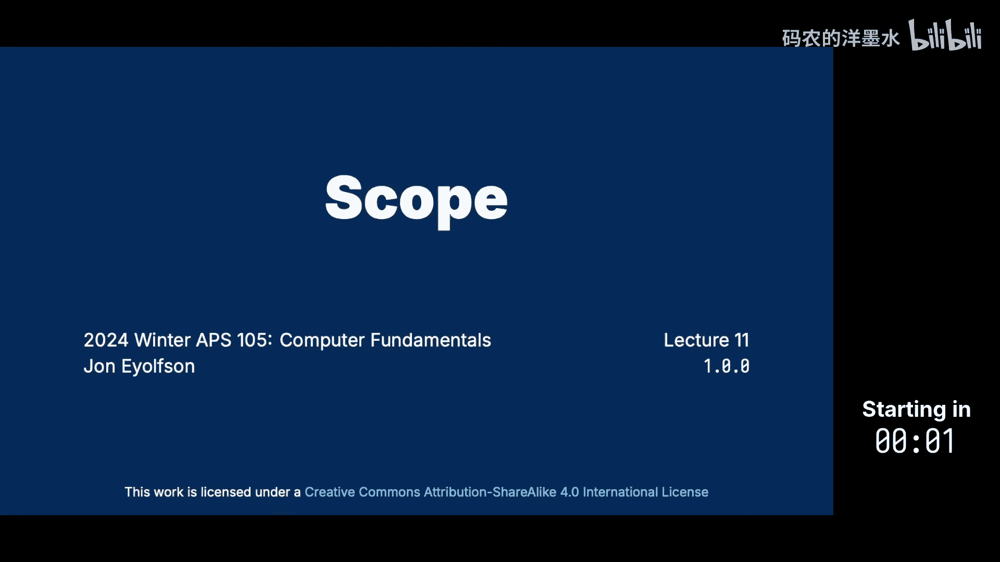
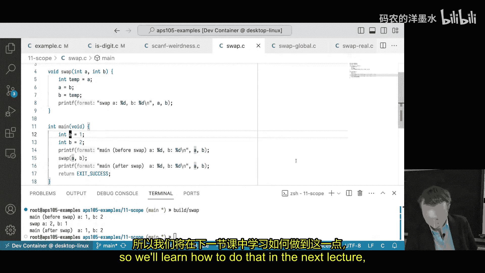
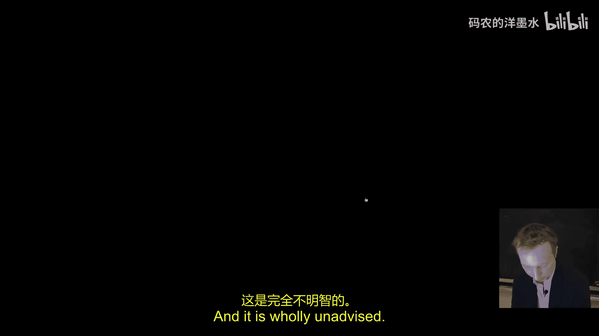
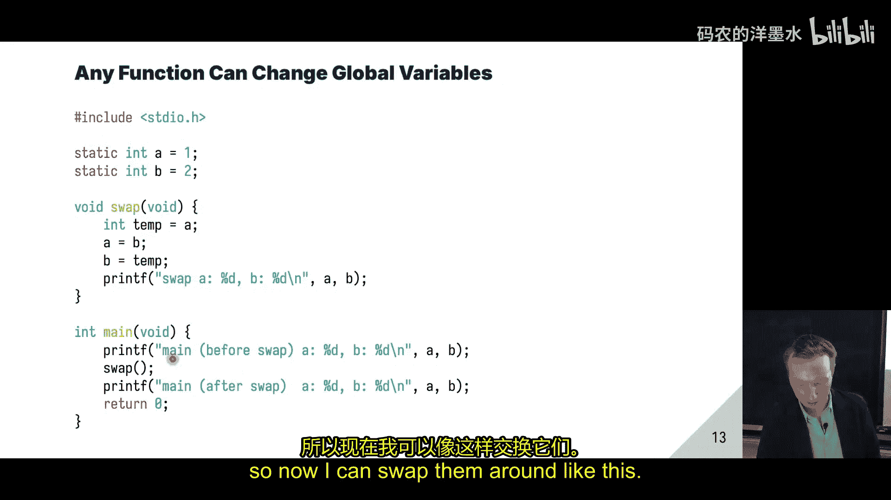
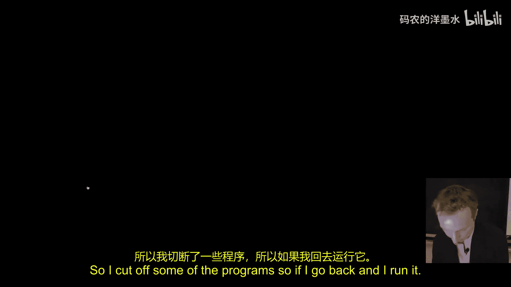
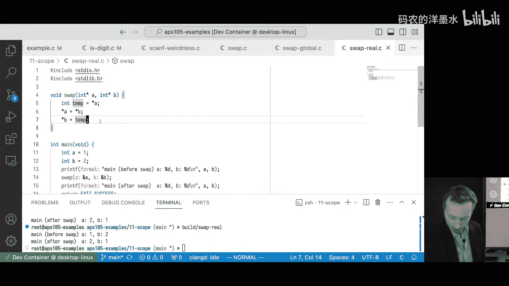

# C语言编程：11：作用域



在本节课中，我们将要学习C语言中一个非常重要的概念——**作用域**。作用域决定了程序中变量的有效使用范围。理解作用域对于编写正确、清晰的代码至关重要。

## 函数调用术语

上一节我们介绍了函数的基本用法，本节中我们来看看描述函数调用的一些专业术语。

*   **调用者**：发起函数调用的函数。例如，`main`函数调用`print_triangle`函数，那么`main`就是调用者。
*   **被调用者**：被调用的函数。在上面的例子中，`print_triangle`就是被调用者。
*   **函数调用**：程序执行流程跳转到被调用函数的过程。调用时，参数值会被复制给被调用函数。
*   **返回语句**：`return`语句会终止被调用者的执行，并将控制权交还给调用者。如果函数有返回值，调用者会获得该值的一个副本。

## 什么是作用域？

作用域指的是程序中可以合法使用某个变量的区域。通常，变量的作用域从其声明处开始，到其所在的**最近的一对花括号 `{}`** 结束。

变量总是存在于某个函数内部。例如，在`main`函数中声明的变量，其作用域覆盖整个`main`函数体。

```c
int main() {
    int i = 42; // i的作用域开始
    printf("%d\n", i); // 可以合法使用i
    return 0; // i的作用域结束
}
```

## 循环与作用域

对于`for`循环，其初始化语句中声明的变量，其作用域仅限于该循环体内部的花括号。

以下是`for`循环中变量作用域的示例：

```c
int main() {
    int i = 42; // i的作用域开始
    for (int j = 0; j < 1; j++) { // j的作用域开始
        printf("j = %d, i = %d\n", j, i); // 此处i和j都有效
    } // j的作用域结束
    // printf("%d\n", j); // 错误！j已不在作用域内
    return 0; // i的作用域结束
}
```

## 任意代码块与作用域

你可以在任何地方创建新的花括号代码块，这也会创建一个新的作用域。

以下是在任意位置创建新作用域的示例：

```c
int main() {
    int i = 42;
    { // 新的作用域开始
        int j = 4;
        printf("%d\n", j); // 合法
    } // j的作用域结束
    // printf("%d\n", j); // 错误！j已不在作用域内
    return 0;
}
```

## 变量遮蔽

如果在内层作用域声明了一个与外层作用域同名的变量，内层的变量会“遮蔽”外层的变量。C语言会使用**最近声明**的那个变量。

```c
int main() {
    int i = 42; // 外层i
    for (int i = 0; i < 1; i++) { // 内层i，遮蔽了外层i
        printf("inner i = %d\n", i); // 输出 0 (内层i)
    }
    printf("outer i = %d\n", i); // 输出 42 (外层i)
    return 0;
}
```

**注意**：变量遮蔽会使代码难以理解，应尽量避免。

## 函数与作用域

每个函数都有自己独立的作用域。一个函数不能直接访问另一个函数内部声明的变量。参数传递是通过**传值**进行的，即被调用函数获得的是参数值的一个副本。

```c
#include <stdbool.h>
#include <stdio.h>

bool is_digit(char c) {
    // c是main函数中c1或c2的值的副本
    return (c >= '0') && (c <= '9');
}

int main() {
    char c1, c2;
    printf("Input two characters: ");
    scanf(" %c %c", &c1, &c2); // 注意%c前的空格

    if (is_digit(c1)) {
        printf("%c", c1);
    }
    if (is_digit(c2)) {
        printf("%c", c2);
    }
    printf("\n");
    return 0;
}
```

## 关于`scanf`与`%c`的警告

使用`scanf`读取字符(`%c`)时需要特别注意空格。

*   **规则1**：在`%c`格式说明符**前**加一个空格（如`" %c"`），可以忽略输入流中任意数量的空白字符（空格、制表符、换行符），直到遇到第一个非空白字符。
*   **规则2**：**不要**在格式字符串的**末尾**添加空格，否则`scanf`会等待额外的非空白输入，导致程序看似卡住。

```c
// 正确做法：忽略前导空白，读取两个字符
scanf(" %c %c", &c1, &c2);

// 危险做法1：可能意外读入空格
scanf("%c%c", &c1, &c2); // 输入" A B"，c1会是空格

// 危险做法2：程序会等待额外输入
scanf("%c %c ", &c1, &c2); // 末尾的空格是陷阱！
```

`scanf`在处理用户输入时规则较为复杂，在实际开发中通常有更好的替代方案。

## 逗号运算符

逗号`,`在C语言中可以作为运算符使用。在表达式中，它依次执行其左右两边的子表达式，并**丢弃左边表达式的结果**，整个逗号表达式的结果是**右边表达式的结果**。

在`for`循环中，常用逗号来同时初始化和更新多个变量。

```c
for (int x = 0, y = 10; x < y; x++, y--) {
    // 循环体
}
// 初始化: int x = 0, y = 10
// 条件: x < y
// 更新: x++, y-- (先执行x++，结果丢弃；再执行y--，结果作为整个表达式的结果，但循环不关心这个结果)
```

## 为什么交换函数不起作用？

尝试编写一个交换两个变量值的函数时，初学者常会遇到问题。

```c
void swap(int a, int b) {
    int temp = a;
    a = b;
    b = temp;
}

int main() {
    int a = 1, b = 2;
    swap(a, b);
    printf("a=%d, b=%d\n", a, b); // 输出仍然是 a=1, b=2！
    return 0;
}
```

**原因**：C语言函数参数是**传值调用**。`swap`函数中的`a`和`b`是`main`函数中`a`和`b`的**副本**。交换操作只发生在副本上，原变量的值并未改变。

## （不推荐的）解决方案：全局变量

一种绕过作用域限制（但不推荐）的方法是使用**全局变量**。全局变量在所有函数之外声明，其作用域从声明处开始直到文件结束，可以被任何函数访问和修改。

```c
#include <stdio.h>

static int a, b; // 全局变量

void swap(void) {
    int temp = a;
    a = b;
    b = temp;
}





int main() {
    a = 1; b = 2;
    swap();
    printf("a=%d, b=%d\n", a, b); // 输出 a=2, b=1
    return 0;
}
```

**警告**：过度使用全局变量会使程序状态难以追踪，容易引发错误，在本课程中应尽量避免。

## 预览：真正的交换函数





要实现真正交换两个变量的值，需要用到**指针**的概念，这将是下一节课的重点。其核心思想是传递变量的**地址**，而非值的副本。

```c
void swap(int *a, int *b) {
    int temp = *a;
    *a = *b;
    *b = temp;
}

int main() {
    int x = 1, y = 2;
    swap(&x, &y); // 传递x和y的地址
    printf("x=%d, y=%d\n", x, y); // 输出 x=2, y=1
    return 0;
}
```

---



本节课中我们一起学习了**作用域**的概念。我们了解了变量在代码块、循环和函数中的有效范围，认识了变量遮蔽现象及其危害，并理解了函数参数传值调用的特性，这解释了为何简单的交换函数无法工作。我们还简要了解了逗号运算符的用法，并收到了关于`scanf`读取字符的重要警告。最后，我们预览了通过指针解决变量交换问题的方向。掌握作用域是写出结构良好、逻辑清晰程序的基础。