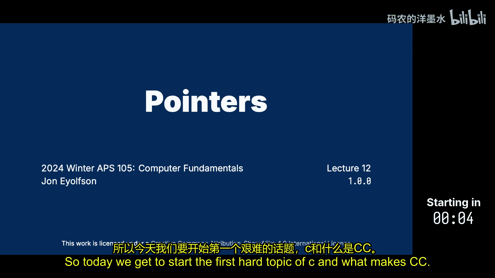
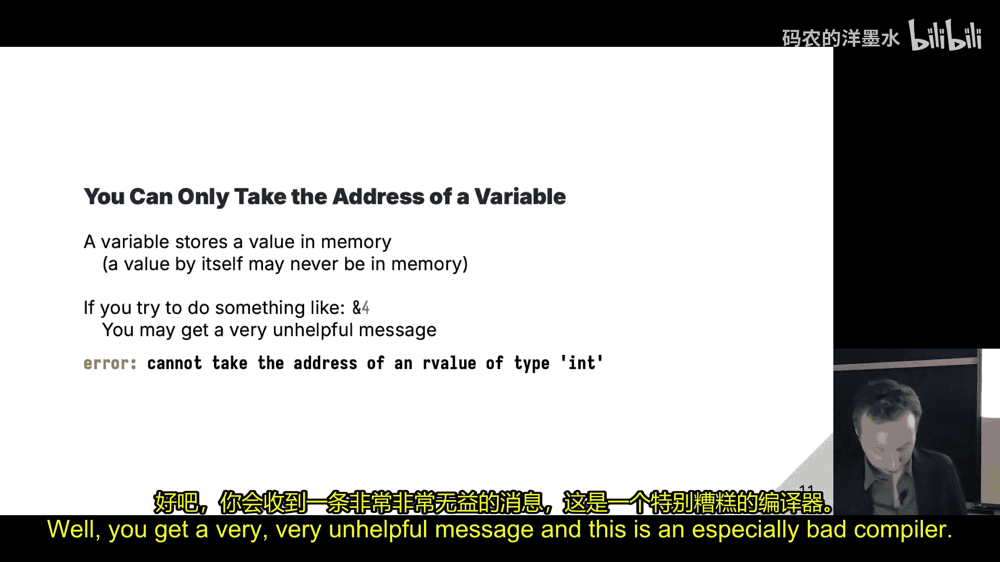
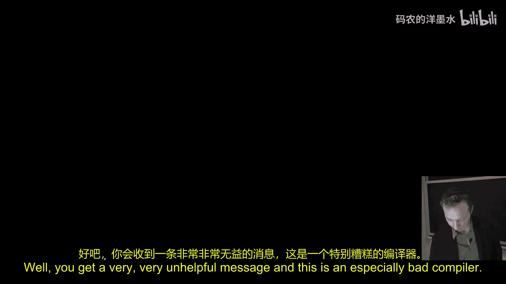
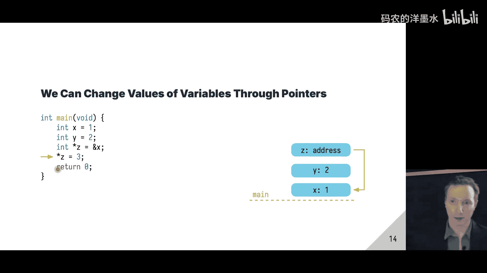
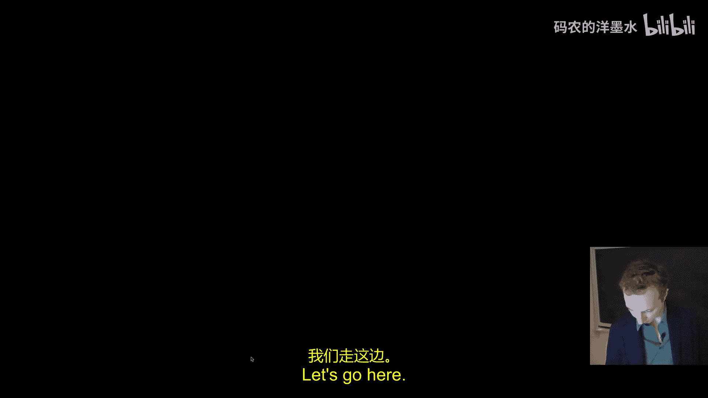
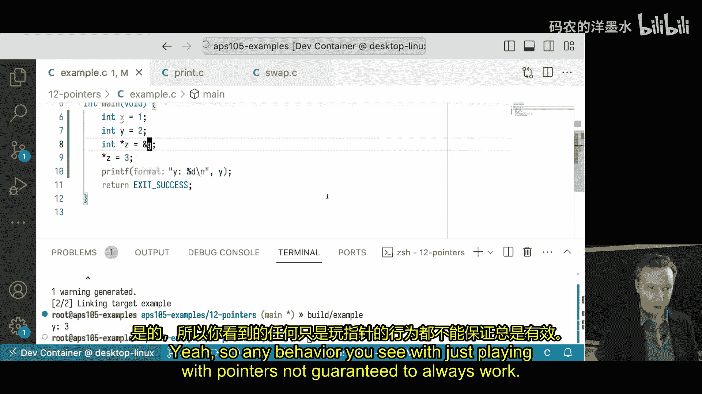
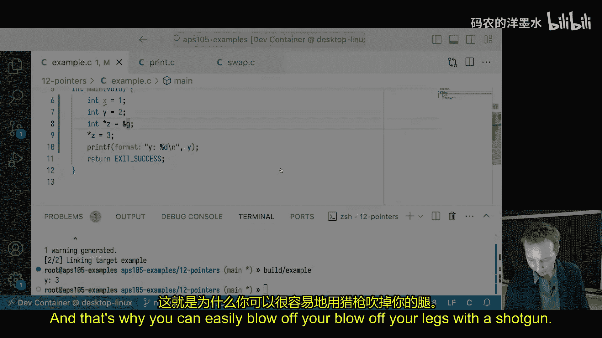
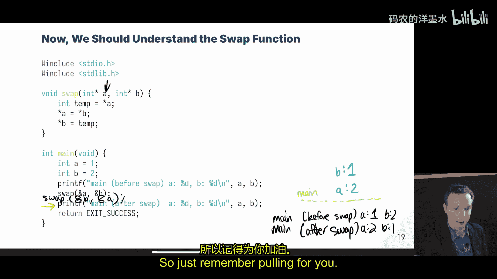

# 【全集】多伦多大学 C语言编程 中英字幕 1080P p12 Lecture 12 - 指针 -BV1gikKB3EZW_p12-

。

Alright， welcome back to 105。 Thank you for joining me today。

 So today we get to start the first hard topic of C and what makes C see。

 So we get to talk today about pointers。 So pointers。😊，Give you a lot of control。

 They're also the source of a lot of error。 So it's kind of like。

Walking a tightrop over a pit of snakes a little bit。

 So I'm here to help you not fall into the pit of snakes。 So nothing bad happens to you。So first。

 we'll do a bit of a rewind all the way back to lecture 2。So remember， computers。

 they just store numbers。 They store binary numbers more specifically， like a light switch， either 0。

 it's off or  one， it's on so。If we assume we have like a 64 B number， which is 8 B。

 So always remember that there are 8 Bs in a byte。So if we represent like as a whole number。

 and then we want to compute what it is。 So remember before we'd like in base 10。

 we had like the ones column， the1s column， the hundreds columns。

 the thousands column do do do do do。We changed the base 2。

 and they just became like the one's column， the two's column， the fours column all the way up to。

 if we have a 64 bit number， all the way up to the two to the 63， which is some gigantic number。

So if we just have the binary number 1，0，1， what decimal number is 1，0，1 in binary， if we remember。

I saw this。5， yeah，5。 So it still under my rule。 I can count up to 5。 That's fine。 So this is like 1。

1，0，2s，1，4， and then  zeros for the rest of them。 So this is the decimal number 5。

So especially if we have 64 bits。 turns out you don't really want to write 64 bits。

 It's a bit of a pain to write out and especially read。

 So if you were trying to see if like two numbers are different。 and you got 64 ones and zeros。

 And I said， which。Are they the same number or not， and they looked almost identical， except for one。

 you'd probably have some difficulties with it。So decimal numbers for humans。

 computers like powers of two， they are in binary， but is there something else we can actually use that might be a bit more useful for us trying to understand computers。

 So computers typically a very useful number system is actually base 16 instead of 2 or 10 seems to be more convenient。

So the rules for like base 16 would work exactly the same。 So for decimal。

 we have 10 options for a digit。 So 0 all the way up to 9 for binary， that's 2。

 we only have two options，0 or 1 for base 16， it means we need 16 options。

 So obvious ones would be 0 through 9。 But what about the six other characters。

 How would I represent。10，11，12，13，14，15。HWell， turns out we can just borrow some letters。So。

Recall the base 16。Number system， we call it hexadecimal。

 and we just borrow letters to represent the values 10 through 15， otherwise。

Aside from this being looking a bit weird behaves exactly the same as any other number system。

 So just goes in order。 So 10 is a 11 is B，12 is C。13 is D，14 is E，15 is F， alphabetical。

 So at least we should know our ABCs up to F。 So don't need to know anything more than that。So。

We called like a single digit and binary a bit。 So in hexadecimal， that digit。

 which would be 0 to 9 or a to F。Could call it a hex it like a hex digit。 No one actually does that。

 So they just call the whole number a hex number。 So and see if a hex number so short for hexciimal number。

 you'll see it start with 0 x。 And then anything after that will be in Hex。 So it will be。

0 to 9 or a to F。 And just like。Any normal numbers， we could just have like F， F， F 1。

 something like that。 So this is not going to testable。

 but it will help you understand some output that happens。 So like nothing in the exam will be like。

 hey， here's a hex number。 What is it in decimal。 This is only for you to just get a glimpse as to this because we will see it today when we talk about pointers。

But other than that， same rules apply， we just have a different base now。

 turns out why it's convenient is because each hex digit actually represents 4 B in a row。

 So if we have4 Bs well we can represent two to the four different things or 16 things turns out that's exactly what a single hex digit will represent。

 So one hex digit represents 4 Bs kind of convenient。

 Also why it works well is because computers deal with Bs。 So that is an 8 B number。 So 8 B to a Bte。

 So 2 hex characters actually represents a Bte， so。Since they're for each， if we have two of them。

 we got eight， that's one byte。So now if we had a giant 64 bit number， we could represent it in Hex。

 and since each hex character represents four bits， well I only need 16 hex characters instead of 64。

 which is a bit better。So let's say everything else is 0。 And I just have the hex number， F。4。

 so what decimal number would be F 4。So。All the same rules would apply。 So if this was base 10。

 this would be like the tens， times， whatever the value is of this digit。 Well for hex's same idea。

 it's 16 times whatever the value is of F。Anyone already remember what the value of F is？15。

 so it's 16 times 15。 so that's the value of this， which is 240， I believe， and then plus well。

 it's1 times 4。 So in decciimal， this would be the number 244。Which thankfully， I got correct。

 But same number system， same ideas， we just have base 16 instead of base 10 or base 2。

 So if you hear anyone say things in Hex， computers like Hex。

 you'll mostly see any like low level details about a computer in Hex。So also remember about memory。

 so in memory， each address contains a byte and here。I have the same figure I had in lecture 2。

 So the value is in blue。 If I just represent each byte as a whole number， well。

 it can be any value from 0 to 255。 So here I have 8 bys with different values and below them。

 I have the location they are in memory。 So this one's at 512000。Then they just go up incrementally。

 So1，2 to do why 512000， I just made up a number。So there's no particular reason why I pick that just every bit lives at an address。

 and they're just numbers， so。What I could do。Is and what actually you'll see as the result of C that C will give you。

 we will be accessing these addresses today and reading them and looking at them。

 So it turns out whenever C shows you an address。 it shows it to you in Hex。

 So this exact same thing。 I could write like this。 So instead of 512000， that's in decimal。

 I could write it out in Hex。 turns out it's 7 D，0，0，0。That's enough zeros。

 So if you don't believe me， you can go go try it out because this would be 16 to the power of 0。

16 to the power of 1，16 to the power of 2，16 to the power of 3。And then 16 to the power of4， so。

You can， you can do that math and figure out that it is actually the exact same number。

 So questions about that。 So when we see addresses。Same idea。 Each byte will live at some address。

 starting at zero， going up to some gigantic number。Turns out when we。Actually。

 get to read them today。 They'll be in hes like this， but。Same things just apply， just a number。

Everyone all good。More or less， All right， perfect。So。Remember。

 we also said that C will go ahead and pick a location in memory for you。

 So if you create a variable called like int X， that'll be somewhere in memory。

 so an int takes up four bytes， so it might take up these four bytes down here。

 so it might take up so each address is the address of a byte。 So one，2，3。

4 and they'll all be in order like that。So， a pointer。

Is just the starting address of a value in memory。 So when we did that ampersand operator。

 that is the address of， and that gives us the address of the first byte of that value。

 So for values that take up multiple bys。 like in x， it's always the lowest address。

 So it's always the first starting one。 So in the prefis example， if we did address of x。

 It would be this value。 It would be 70，0，0，0，4。😊，So pointers are actually a new type。

 We get a new type in this course。 So if we have something like in X equals1。

 we can't do something like in Z equals the address of X。

 So it turns out that the type of the address of x is actually X star。 And how you read this is。

 well， you call we call this a pointer。 So we say it's a pointer to an integer value and。

A pointer is just going to be where in memory that variable actually lives。

So each time we take the address of a variable， Well， we add a a or an asterisk to its type。

 So if we have。In x equals one， and we can do something like int star。 and for the star here。

We could put a space before it or after it。 It's kind of up to taste。 See。

 programmers like to put it right beside the variable name。 So they'll do int star。

Z equals ampersand of x， and you're allowed to do that。 So now Z is a pointer to X， we would say。

 but really， it's just storing the address that。Where the value of X is stored。

So we could do the address of Z in this case， so then we would get the address of the address。

 and it would be int star star， which would be a pointer to a pointer to an integer value。

 which is very confusing。 Don't worry this lecture is mostly set up so that we get some exposure to it。

 We can ask questions。 We can go through lots of examples later。

So you can only take the address of a variable because variables are。

By the C standard need to at least appear to be stored in memory and a value by itself。

 So if I just write the value like  one plus one。Or one plus 2， those， those ints。

1 and2 might never actually be stored in memory。 Only variables are stored in memory。

 So that means if I try something silly， like I take the address of 4。 Well you get a very。

 very unhelpful message。 And this is， an especially bad compiler。

W or a compiler message。So we could have int X， actually。

 let's just say intstar Z equals the address of4。Now， there's a red line there。 If I compile it。

 I get something very incomprehensible。 It says， cannot take the address。Of an R value of type in。

What in the hell does that mean。I have worked on compilers， and I can tell you。

 even to me that message sucks。 So that message should probably actually say you cannot take the address of a literal。

 You can't take the address of four， something like that。 that would probably be more helpful。 Yeah。

 it mean that our values like whatevers on the right side。Like so basically。For even if say was like。

 say you did't。XPlus click say have variable x。This address experts。Yeah。may like the end。

I kind of get what the。Yeah， the， the error message seems to think that。If it's an int。

 we can't take the address of it， but。I mean， it's kind of silly because if we have this。

The R values an int。 I can take the address of it。So， yeah， it turns out it's。

 it's just a bad error message。It's terrible。 But so if you ever see some message you can't comprehend。

 it's because you tried to take the address of like just a random value。 So don't do that。 Again。

 this error message is beyond terrible。就去。😔，Do do do。do do。 And then question， should we put。

6 digits for hex numbers， like 6 zeros If the number is a 0。 I'm not sure what that means。

 So hex numbers are just like any other numbers。If we have like a set size， they have to be。

 they get leading zeroes like anything else。All right。So in order to use a pointer and get the value。

 it's pointing to back， we can use a star operator。

 which is a unary operator to access the value at address。

 So if we have int X equals1 and int star Z equals the address of X。

 That means well Z currently has the address of X stored in it。

 And we can do star Z and star will go ahead and get the value at that memory location for us。

 So star Z will take the address that's currently at Z and then read the value that is currently pointing to。

So， in this case。We'll have a better worked example coming up。 But since。X is equal to1。

 The Z would be pointing to that value 1。 And then we can go ahead and read the value that Z is currently pointing to。

 which in this case is one。 So after。The statement y equals star Z， we would have y equal to 1。So。

You can also kind of reason about that each time you use the star operator。

 it removes a star from the type。 So if I have the variable like int star star Z。

 or we have a pointer to a pointer to an integer。 If I have just in an expression star Z。

 the resulting type of that is just a pointer to an integer， So each time you dereence it。

 which I probably shouldn't say because I haven't send de referenceence yet。

You just remove a star from the pointer type。So here is a more worked example just so it makes it a bit more clear。

 So we can actually also change the values of variables through pointers。

 So let's start off with this little example。 So we have。Int main void。 So when we start running it。

 we start running it at main。 So our first line is just int X equals1。

 So we're declaring a variable called X and assigning it to1。 So in this bottom here。

 I will just have all the variables that live within main that are currently in scope like we had yesterday。

 So in main after that line I have an X。 and then。Also in the blue blue square is going to be the value of that variable。

 So now I have x equal to1。Everyone， good。Alright， so then I declare a Y set it equal to 2。

So after that line， I have a y and its value is 2。Now I have int star Z。

 So this will just declare a variable called Z， which is a pointer to an integer。

 and it is going to be。The value， initial value is the address of X。

 So this is why we call it a pointer。 So how we don't really care about the actual value of that address。

 It'll be like that random 70，0，0，4， maybe who really cares。

 we just care what value it's actually currently pointing to and why we call it a pointer。

 So instead of。Doing the value， we draw this arrow。

 So this arrow means that the address that is currently stored at Z is currently pointing at wherever the value of x is。

And。You can also kind of think of this as like a remote control。 if you want。

 That's one of the ways I learned it。 So instead of going ahead and changing X directly。

 we can change X through Z because we can access the value of X through Z。

So now if I have the line here。I de reference X。 So that means I access the value that Z is pointing to。

 and I change it to 3。 So in this case， each time we do the star， which is called de referencing。

 So accessing the value at。I would take Z， see what address it is pointing to。

 And then I know this is the value I'm modifying because， well， I have to modify an integer。

 and this value is currently an integer。 So if I do that， I'm immediately changing X。

 So I change the value of x。 If I want to go ahead and print X now， I would see that I printed 3。

So any questions about that one。Or fun things we want to do with that Pointers are real fun。Yeah。

 so the pointer like starts at the pointer。Directly change。I said the point。Address。

 if I change any value for a star a， it will automatically change。Yes。The same。Yes。Yeah， so well。

 not the same number as Z， the same number of the value add Z。 Yeah， can you quickly G。

So this de referencing。 So that's just accessing the value that that variable is pointing to。

 So if I have a D reference of Z here， it means， well， I'm not using Z。

 I'm using Z to figure out what I need to change。 So in this case。

 I need to change X because it's pointing to X。Yeah， actually yeah following up with that。

 so I guess like like in this case on this slide that you're currently on。

 we kind of have like an expression。Yeah。You， you're allowed to do it for the left side because it you。

 you're essentially saying， well， this is the thing I want to change。 and it's basically a variable。

It means that like all the。Pointers。To whatever they are。おま take。Yeah。Yeah， all the pointers。

 So everyone has like， you've probably heard， I have a 64 B CPU。

 Everyone's probably heard that before means your pointers are 64 Bs。

So that's how big they are。So。嗯。Yeah， so what's the application of it， let's go here。

So let's just make sure that we can go ahead and change it， so。Let's have that example written out。

 What I do。 I said， Z equals 3。So now， if I want to show that I actually changed X through Z。Or Z。

 forgot what country I'm in。I can go ahead and print off the value of x。Os I can type compile to。

So in this case， I see that x is indeed3。 So I'm changing it through Z。And then， yeah。

 some other questions。 Can I initially as a pointer without using an amperserson like Z equals 5。

 So if you do that， that means you're just。Randomly pointing at address 5。

I think C will probably let you do that， without complaints。

AndW which is why I talked about the pit of snakes。 So this is an instance of the pit of snakes。

 So C， will gladly let me do something like that。 It gives me a little bit of a warning saying that I'm converting to a pointer。

 So I'm converting an int to an int star。 but happily lets me do that and I will blow off my leg by getting a segmentation fault。

 So this is probably the first time you've ever seen that。 This will be very common。

 So you basically see a segmentation fault every time you access memory you shouldn't be accessing。

 So in this case， I picked the random address 5 and said， please access the integer at location 5。

 and turned out that that was not valid。 and。😊，The error you get when you run it is called a segmentation fault。

 which if you want to know how that works， you will figure that out once you take 3，5。

5 in the operating system course。So for now， you should always just take the address of a variable。

 And then you're guaranteed that the memory address you get is actually valid。And yeah。

 it will be represented as some gigantic。Hex message。 And yeah， why is it useful？ Well。

 we had to use it for scan F， right， Because with scan F， we did something like we defined an X。

 And then we did like scan F。Like。This， right， oops， scan F。그。Yeah， we did something like this。

 right， because after scan F ran， it changed the value of R X。 So how did it do it？ Well。

 the only way it could do it is through pointer because remember。Function calls， they pass by value。

 So if I just did something like x， it gets a copy of one and won't change anything。

 So we had to give it the address of X to tell it what it can modify so it can go ahead and modify our value of X for us。

 And we can do that through a pointer， so。Now， hopefully。

 the mystery of why we had to do the ampersand for scan F is fixed。And here， again。

 if I just randomly said Z is 3， that'll blow up too。 Like basically。

 you're gonna have to guess a valid address， which。Is fairly hard。 So。

 and we'll actually print off some addresses in a bit to see the ballpark of what they're in。

Another question。 So without the asterisks。I'm not sure which one you want me to delete。Here。

 like Z equals 3。If we do Z equals 3， well， Z， nothing' is going to happen。

 So we create a variable called Z， which is a pointer to an int。We get the actual address of X。

Who knows what it is？ And then we just say， okay， the address you now， the address is now 3。Nothing。

 nothing bad happens in this case。 We're just changing what address Z is。

But if I did something like this， you know， that's， that's bad because。8 percent。

Zed would try to access the value at that memory location。

 So whatever the integer it that starts at memory address 3 is， and then it just dies。

 So I can go ahead and run this if I want， and it segmentation fault。Yeah。

 Z is straight up another type。 It's star。 So it's a pointer to an integer。And again。

 if I tried to make like Z an integer。And compile it。 C actually lets me do such a thing。

 But it gives me some warning that like， hey， you're trying to convert a pointer to an int。

 I did that for you， but you probably didn't mean it。 And in this case， well。X is gonna be just fine。

 even if I do like change Z。Because now I just madee Zed some random value and then reassigned it to another one。

 If I want， I can print Zed， if I want。The output would look weird。So here I can print Z。

It tries to do some conversion， so it tries to take some large hex number， basically。

 and then try to represent as an integer， and it gets。You get some random crap。

They gave yourself back。You sail。可以。Go to the next location member。

Could you get to why somehow without？Yeah， so if you know， if you really wanted to。

 you could get to why somehow by knowing。In what order variables get set out in memory。So you could。

 like， would that like。Does she just do it least sequentially or is that？So it depends on the CPU。

 some data structure that we don't know yet。 And you're not guaranteed it'll always be the same。

So we'll see once we start talking about another data structure， basically how to do that。呃。Yeah。

 so just changing Z oops here。Just changing Z to just some random value that's gonna to change the address。

That Zed currently is pointing to， and。If I just change it to a random address， trying and use it。

 probably not going to work。So if I do this， then。Currently。

 the address that's stored at Z is the start of variable X。 And if I de referenceence it。

 that is going to be the value that X is currently pointing at。

 If I want to point to something different， I could point at Y。And now Y will change from a2。

2 or three， I can print out three。Yeah， so there are some things you can do， ill advised。

 not guaranteed to always work across all CPUs。 Yeah。I don't forget。Yep， yeah。

 if you create a global variable， So in I'll call G。You can also get the address of G， if you want。

 That's fine。Yeah， so can you do something just October will the compiler always save you with the segmentation。

Like， can you access some memorys？What because they have access to your entire computer's memory。

 right？Oh， yeah。 so that's a good question。Is a question I ironically just got asked today in the operating system course。

 So， yeah， since I can access memory， does that mean that， hey， I can just guess a random memory。

 and then I can read my bank account information or something like that。 The answer to that is， no。

 your operating system is very smart and very secure。 So you can't do that through mechanisms。

 I will not even begin to explain now。 But if you w to know， hey。

 you can look at the operating system course， I'm teaching if you want。But。

It looks like you can access all of memory。 That's just an illusion。Yeah。

 so any behavior you see with just playing with pointers。

Not guaranteed to always work。 And that's why you can easily blow off your。

Blow off your legs with a shotgun。So。Let's step through another smaller example here。

 We'll add a function call in the mix。 This probably looks a lot more like scan F。

 So I'm writing a function called set 3， takes well， in this case， I'll say a variable called P。

 which is a pointer to an integer。 And what it does is it tries to access the value that P is currently pointing to。

 and then set it equal to 3。 So in my main I'm going to start off again by declaring a variable called X。

 setting it equal to 1。 So in main， x would be in scope or valid to use。 and we can go ahead and。

That's it。 Just set to one。Then we have y。 We create it， set it to the value to 2。Then we have Z。

 So that's the address of X。 So it will point to the location that X is in memory。 Again。

 all my blue boxes here are bytes that are currently in memory。Now。

 I'm going to do a function called to set 3。 So remember， C is。Call by value。

 So this set 3 function is going to get a copy of Z， and it's going to copy it to the argument P。

 So we'll start a new scope， it will be called， well， in the set 3 function。And we get P。

 which is a copy of Z in this case。And it's also an address， and it points to the same thing。

 So the address has the same value。 Remember， an address is just the starting location of。

 in this case， an integer， so。We would copy it and it would end up pointing to the exact same thing。

 So this is a way to get around that scope rule because remember in set3， well I can't I normally。

 well I can't access X， I can't access y right， normally can't access it in a different function but through a pointer。

 I can access it。 so here I can now access X in the function set3。Now， after this line runs， well。

 it's going since P is pointing at this location of memory。Which just has the value 1。

 It can go ahead and change the value from a 1 to a 3。 And then that function is done。

 So there's an implicit return at the end of it。 and we'd resume from where we left off in mainine。

 then hit return 0， and then our program would be done。And yes。

 this is the recommended way if we want to go ahead and use。

Variables and try and change them in different functions without actually using a global variable or anything like that。

But sometimes。If you don't have to， you don't really want to use a pointer because well。

Some find it a bit weird that the value of Xus kind of changed here。And yeah。

 this is same thing as doing my。D reference of Z in the previous example。

 I just moved it into the function so we can kind of combine last lecture。

Review it a bit with this one。 So things are still copied by value。

 But now I'm copying an address instead of just a value。 But an address turns out it's just a value。

So。This is why I told you about hexes， so we can actually print the address of a pointer if we want to format specifier。

 It's a new one。 It is percent P P for pointer， and it expects a weird look type。 So void star。

 which knowing what we know so far that's a pointer to nothing。So it turns out。

 void stars basically just see saying like， it's a generic pointer。

 I don't actually care what the value is。 and you're not allowed to access it。

 It's just saying it's a pointer。I don't really care what value type it's pointing to。

 So the rule is， well， you can't dereence it because if we got rid of the star。

 then we would just have void， which is nothing。 So we can't dereence a null pointer or sorry。

 non null pointer， A void pointer。 So the other rule is that you're allowed to cast a pointer of any type to void star。

 So if I have an int star， a pointer to an int， I can say， okay。

 it's a pointer to an I don't give it。Fill in blank。So。

How that looks is I can just do the same thing， except I can print values。

 So let's see the exact same thing。So here I'm just going to print。The value。 So I have an X。

 I have a Y， and then Z is currently pointing to the address of x。So here I say X。

 so the address is this， so I have to do an explicit cast to make my compiler happy to avoid star。

But the address of X。 So this is a pointer to an int。

 And I just make C happy by saying it's a pointer to I don't care because that's the type that percent P wants。

Then I just have equal to whatever the value is。Same for why。Then I do a set 3 with Z。

 which is the address of X。 and then a set3 of the just straight up the address of Y。 And then here。

 I'll print off the same things after I call set 3。And then in set 3。

 I'll print off the address of P。Which would be a。Pointer to a pointer to an int。

So that's just the address that the argument lives at。 and then the value of that pointer， which。

 well， since it's copied by value， it should match Z， and it should match the address of y。

And then here， I。Print off the value that the value。

At the memory location that P's pointing to by doing the D reference， which in this case。

 it would be an in。 And then I'll go ahead and just do set it equal to 3。So if I run that。

 I should see a bit of consistency here。Prit。Lets make that bigger。

 So this is where I showed you the hex things。 So these are memory addresses。

 They're just very large numbers in hex。 So don't need to worry about them other than they're consistent。

 so。Turns out that x is at this location。 Its value is 1。 Y is at this location。 itss value is 2。

P is at a different location because well， should be stored somewhere else in memory。

 and its value is this。So that makes sense because the first time we called it， it was。Z。

 which was the address of x。 So this matches the address of x。And then。We just changed。

 And currently， the value was one because we haven't changed it yet。 Then after this line。

 we went ahead and changed it。Then， P。Turns out its address is the same as before。

 doesn't have necessarily have to be， but in this case， it will be。

 And then its value is this long as thing， which turns out to be the address of Y。

 So these two are the same， which makes sense。 And while the value at y before we modify it it's 2 makes sense。

 And then we modify it， The address of x never changed， but its value changed to3。

 The address of y never changed， but its value is now 3。W， well whirlwind。 All right。

 we're good with that， ish。So don't worry， pointers are hard so just to color it to see that what is consistent。

 So red is the address of X， so it's the address of X it's the first argument we gave to the function so it was the value of P and then while the address doesn't change at the very end。

 And then in light blue， we have the address of y。 So it was the value that we gave P for the function call and it was still the address of y afterwards。

 And then here I just put the address of P in different colors because in this case they were the same address but in general they don't have to be。

So oops， questions about that。All right， we should be able to now。

I add like another variable after y。Would its address also like。と大す。Yeah， yeah， so it turns out。

That on a specific CPU， these go sequentially， well sequentially down。 So if I made another in。I。

Something like that。 Yeah， I would get the address samee thing， except it would be 30。

But turns out you can't rely on that。 That would just be for this particular CPU architecture。

All right， so。Should be able to understand that now and why that actually swaps two values， so。

Let us simulate so。Here is our swap function。 So we should now understand that， hey。

 it does indeed swap around。A and B， so。we start executing it。We'd execute at mean，This line。

 so declaring an integer called a and setting its value equal to1。

 So here I'll do the same thing in the slides in scope and main。We'll have。A。

 and its value is going to be 1。Then， we'll have B。It's a new variable。 its value is going to be2。

Then when we hit this print line。What's the value of A and what's the value of B。A should be 1。

 B should be 2， because， well， that's what we just said it equal to so。Hopefully。

 pointers did not break you so far。 So up until this point， we haven't used pointers。

 So before we'd see。The swap。We'd see a is1。B is 2。But now we're going to do swap。

The address of A and the address of B。 So since things are copied by value。

 we're doing a function call to something called swap。And up here。We'll use the argument name。

 So just to keep track of where I came from， I'll put a one beside this arrow to know I have to go back there after I'm done with the swap function。

So in the swap function， it will have a variable called A， which is just some address。

And it's pointing to， since it's done in order。 It's the same as this。 So it is pointing to mains A。

 So it's pointing right here。And then we would also have B。Which is an address。

And it's pointing electrical whoop， and it's pointing to be there。So we're good with that so far。

All right。Next thing we do in swap is create a variable called temp。

And then its value is the value at swaps A。 So because there's just one star or D reference。

 if we want to use that fun term that is not in the slides。I go ahead。 I follow a。

Let's take a highlight layer。 I follow a。It points me to an integer。

 And then that's the value I want to use。 So temp would be equal。To one。And then， next line。

I'm going to be modifying the value at a and then using the value at B。 So the value at B。

Which is here， the value at this B is currently2。So， I'm going to change。

Whatever a is pointing to to 2。 So it turns out。A in swap is pointing to the value 1。

 So I go ahead and I change that from loopops delete。From a one。To a too。And now， next line。

 I'm modifying what swaps B is pointing to。Which is this value of 2。

 And I am assigning it the value of temp， which is just simply one。So now。B。

He or this value would switch to one。Now we're done with this function。

 So they could could have written a return here， but the compiler will implicitly put one there if you didn't add one。

 So it just returns from where it came from。 So we resume back here。

So we can go ahead and just remove the one， we know where we came from。Now。

 when we print main after swap， well。Swap is now gone， so I can delete it。So now I just have that。

 and now when I print。I'm going to get mean。After。Swap。Almost wrote。A is two， B is1。

So questions about now how the swap function works。

 So it actually swapped the two values for us because we used pointers。

 didnn't have to resort to using globalbos or anything like that。Yeah。

 I dont really need to comment much more。 So any other questions about that。

And the question is from the line。So， from。This line， does it take the value。

 this value at the moment of declaration。The answer is no， doesn't have to。 but in this case。Well。

 we set a based off the argument， and then we take the value at whatever the value is it's currently pointing to。

 So if we go ahead and we called swap。Again。Well， in this case， we'd be pointing at the same things。

 but I could swap the other order。 I could do。Sp the address of B， and then swap the address of a。

 something like that and just swap it， but swap it in the other order if I want。

So same thing will happen。 But now a will be accessing。Mains B and B will be accessing mains A。

 which might be a bit weird。 But again， doesn't really matter about the names of the arguments。

 They just always get copied。 But if I call it swap again and just。

Change the order of the argument doesn't really matter。 And if I call swap two times， well， I swap。

 and then I swap back， I'll get the same result at the end of the day。All right。

 any other last minute questions？Sweet， if not， I will take up the rest on discord if there's anything else。

 So just remember， boom for you。 We're on in this together。

