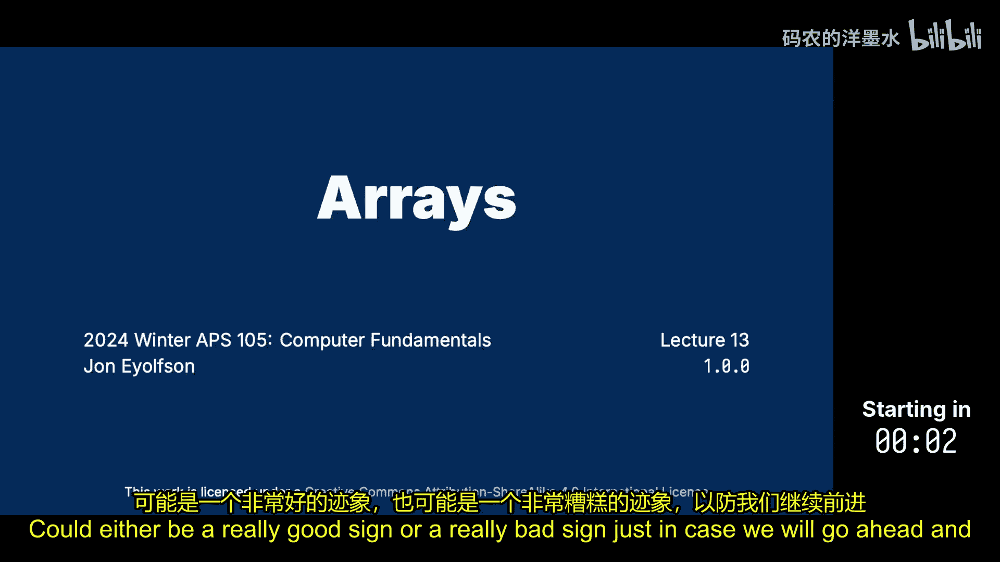
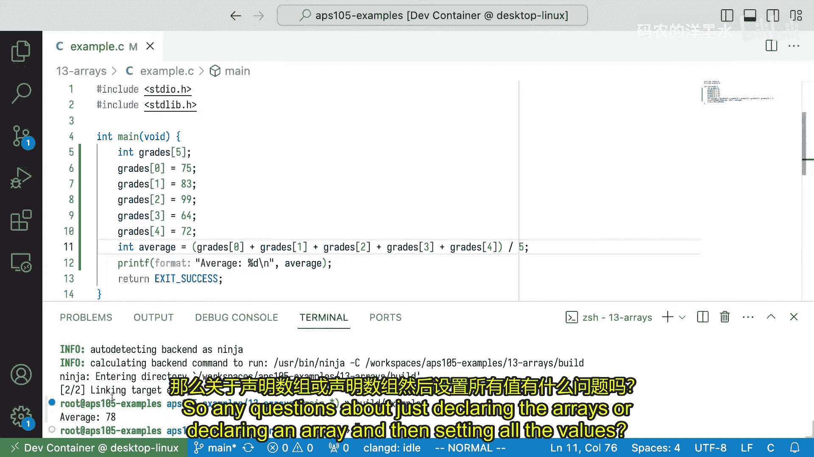
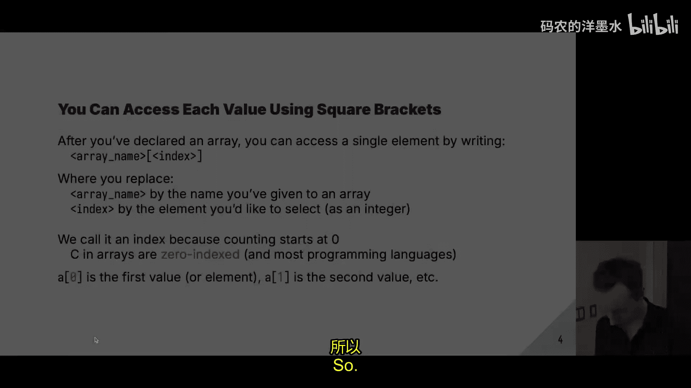
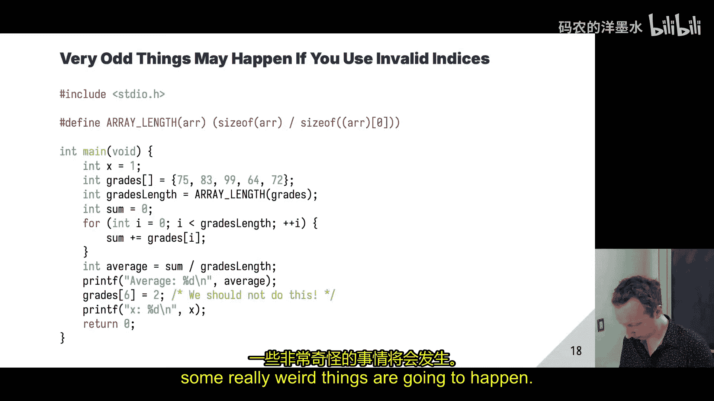
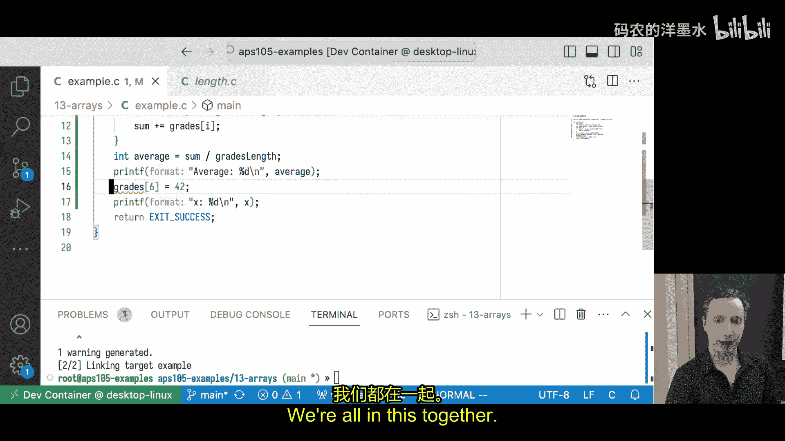

# 【全集】多伦多大学 C语言编程 中英字幕 1080P p13 Lecture 13 - 数组 -BV1gikKB3EZW_p13-

。

Alrighty， welcome back to 105， thank you for joining me today so didn't see any questions on the Discord or anything like that could either be a really good sign or a really bad sign。

Just in case we will go ahead and leapfg the other sections a little bit。

And move on to the next topic so you can start the next lab and also get some more questions going。

 So this will have some familiarities with the last lecture。

 but we won't tie them together until the next one。So。

We kinda need another piece of our programming puzzle。 So we have loops for repetition。

 so they help us you know， not repeat each other， like I said。

If I have to count all the way up to seven。That's too much for me， and I can't do it anymore so。

We have loops。For going ahead and doing the same operation over and over again。

 But what about if we have multiple variables， Loops can't really help us。 So like。

 what if we want to take， I don't know， the average of a bunch of grades。

So let's say we do something like。This。So if I want to take the average of five grades。

 what we know so far is， well I have to declare a variable for each grade and then I have to initialize it to whatever their grade is。

 and then to calculate the average， well， I have to do grade1 plus grade 2 plus grade3 plus grade 4 plus grade 5 all divided by5 to calculate the average。

So that will work。And our average would be。78。But that kind of sucks， right。

 If I want to add another grade， what do I have to do， I have to declare another variable grade。

So let's see， let's say I got 2%， so doing good。 and then I have to remember to go ahead and I have to change this。

 so I have to add it here， then I have to remember to divide by 6， and that's just a whole mess。

We want to be real programmers。 We want to be lazy。 We don't want to do any of that crap。

 We want to just be able to add a new value， and just。Have it calculated for us， right。

 We want to be lazy。Being a lazy programmer is a very good thing。So here's what we had before。

 So calculating the average of five grades。5 individual variables we have to declare。

 have to do our average calculation， print out the average。

 And every time we want to add a new grade。 That means we have to add a new variable。

 That means we have to add it to the average calculation。

 We have to change the divisor kindnd of a mess。 But this is all familiar to us， right。

 We all know how to do this。All right。At least one thumbs up， so。Arero prone。

We don't want have to remember to do lots of things if we were just adding a single value。

So that's wheres come in。 So thereforere groups of related values。

 So we can declare a number of integers all at once。 So at first， this won't seem that useful。

 but bear with me。 So the syntax for declaring as looks like a normal variable declaration。

 So type followed by a name， except there's these weird square brackets。

 So it's squared brackets and then an array size and that array size is going to be。

How many numbers of this type are we going to declare all at once。

So the type that is the type for each value or element of the array is what we call individual values specifically in an array。

 then we have to give the array a name and it will be representing a groups of numbers so you should probably call it whatever that group is。

 and then the array size which is just going to be an integer。

 which is the number of values you actually want to create all at once。

And then if we declare them all， we just have a big group of numbers。

 we want to be able to access each number individually。

 So how we access each number is in an expression， we can just use square brackets。

 So after you've declared an array in an expression， you just access it by using the array name。

 and then the square brackets with an index looks a bit weird right now。

 But what you replace is the array name by whatever name you declared the array as and the index by the element you would like to select and you give that an integer。

So you might think that okay well we're human， so I might want to say， you know， element 1。

 element 2，3，4，5。 Well， turns out for reasons we will get into in the next lecture。

 C starts counting at zero， not one because it turns out。We'll discover later counting。

 starting from  zero。 It's just way more convenient for computers。 Basically。

 every single programming language does this， except for like really weird ones。

 So what we call this is we say array are zero indexed。 That means they start at 0。

So that means if I made an array called a。 Well， array or a square bracket 0。

 that is the first element。 And if I have a square bracket 1， that's actually the second element。

 so on and so forth。 So it's。Bit off by one from how we like talking about them as humans。

 But as you start getting used to computers， this will become kind of second nature to you。

 and we should get used to it now。So， let us。Go back to this example and use an array instead， so。

Here I have a group of related values。 So I might say they're called。

Int grades and say I have five of them so I can declare an array like this so this will declare five integers and that group of integers collectively is called grades so now I can get rid of all of these declarations for the grades and now refer to them by you know their indexes so grade1 well since it is an array and it's zero indexed the first element of the array would be at index zero and then I have index1 index 2 index 3 index4 and I should call the and it's called not grade anymore whoops。

It is called grades。So， now。They are I don't have to declare five individual ints。

 I declare them all at once here， and then I go ahead and I set them accordingly after that step。

 so now I would have to fix this as well， so this would be grades0。Grades one。Grades 2。Crades three。

And I didn't say grades。And then grades。4our。So now if I compile and run that。

I'm in the same situation I'm in before but Im setting myself up for being able to get rid of this repetition。

So any questions about just declaring the arrays or declaring an array and then setting all the values？

Not too bad。So。

ち do do。So again， just so you have it。 Here's that same code using arrays。

 So now I can look at that calculation and I can look and。

Try and not have to repeat the word grades over and over again。 So if we look at that equation。

 is there a way to do that calculation without having to write grades 0，1，2，3，4， yep。

they the great five vehicles they one。平快放嗰。Not quite。Or not an easy way。 So those numbers。

 do we know how to count up， like， have an int that goes 1，2，3，4，5， yeah。Yeah， looks like a for loop。

 right？ So， well， instead of。Going ahead and accessing each grade individually。

 I will go ahead and do a for loop。So。How would I。What bounds would I need if I want to， let's say。

 declare an int called index。 I'll start it at 0， and。If I wanted to go all the way up to 4。

 what should my condition be。Yeah， index。I could do index less than 5 for my condition。 right。

 So this will be true for 0，1，2，3，4。 And then whenever we get 5， then that is false。

 And then we won't repeat ourselves。 So that's right。 because， well。

 we don't want to access 5 for reasons we'll get into later。 And then here I just go plus plus index。

So this should get rid of all the grades。 So instead of writing grades and then a number。

 I can just do grades。Zero。And I'm just kind of summing up all the values so I could just create a variable that keeps track of the current running total or the current sum。

So let's create a variable called sum。 And while I want to start it off at 0 just so I don't calculate this wrong。

 So I'll just initialize it for0。 And then each time through the loop， I will do sum equals sum plus。

Gras index。Right， so each time through the loop， I'm going to just add whatever the current grade is to the sum and then just calculate the sum by the end of the four loop。

 and I could also write this if I want just on style that I like a little better。

 I could do some plus equals grades means the same thing。So here， instead of this average。

 I can just get rid of this whole thing because I've calculated the sum。

 and it should look like that。So now if I compile。And run that。I get the same answer。

 but I don't repeat myself as much， right， so any questions about that？All， all right， still。

Still a bit unsatisfying， because， well。If I have to add another grade， right。

 what do I have to do So Ive。So if I want to add another grade， let's say I want to add grades 5。

 say let's say it's one of the students in this class。 So it's definitely 100。

 So can I just add another grade and it'll just work。No， what are the things I need to change here？

Someone knew， yeah。Change the size of the for loop yet。 So I have to change this to 6。

 Is that the only change， yeah。The which one？Yeah， I have to do this average calculation to six。

 is there one more， yeah？The grades index。This， this， right， So this isn't is not an index。

 It's the size of the array。 So if we're using it as like。Accessing the array， not declaring it。

 It's an index。 If we're declaring it， it's the size of the array。 But， yes。

 we do have to change that one。So， yeah。So now do I have to change everything or am I good。Allright。

 Go thumbs up。 but still a little bit unsatisfying， right， Id need to add a grade。

 I still have to add a line， And then I had to remember to change。

 I actually made it a bit worse because before I had to remember to change。2 things。 Now。

 after we to change three things。 So like I said before， it gets worse before it gets better。

 So let's。All we really did so far was just get rid of having to write it out。

 like adding each new term to the sum each time through the Lou。Also。As a little bit of a review， or。

A test of your knowledge。So。I can take like the sum of everything。

 and then here I'll make that a bit bigger。I can take the sum of everything and divide by 5。

Could I also。Do that。 instead of taking the sum of everything and divide by 5。

 I'll take the current grade and divide it by5 each time I add it to it。 and then。

That's all I have to do。I'll give you a minute to think about that one。Yeah。Sure we can。There we can。

Thank that。We。5。Yeah。Get two ideas。To the normal。This see the normal。いや。YeahYeah。go。2。

Anyone from the middle， is this a good idea？Oh we got some shaking head。

 A11 to be brave enough to explain why this is a good or bad idea，Like you're more likely to have。

Yeah， so remember if I'm， these are all integers， so I'm doing integer division。

 which is also called truncated division。 So each time I do a division， I might truncate it。

 So like say some extreme case where all the grades were say 4。 and it was， not this section。

 but another section。 Well，4 divide by 5 in integer division is just 0。

 And then it would be 0 plus 0 plus 0 plus 0 and the average would be 0。 when you would expect 4。

 So usually especially with integer division， you want to divide as little as possible。

 And we can see even for this little example。 So our average is 78， which would be okay。

And now if we just move the division。Well， because of integer division。

 we're doing five integer divisions instead of just one。 Well。

 we stray further and further away from the actual answer。 So we get 76 now。

So hopefully we are smarter than this when we calculate the course averages for this course。

 otherwise probably going to be lower than we expect。All right， good review。Ch to。Allright， so again。

 here's the code。 So you have it。 That's just us looping over each element of the array。So。We have。

What I like to refer to those like fives that just randomly come up。

 I like referring to them as magic numbers。 And in general， we want to get rid of magic numbers。

 Everything has a name and everything should have a name so we can actually tell by looking and reading the program what things are actually related。

 So you might。😊，Know now that all those fives are related to how many grades there are。

 But if you go ahead and。You， I don't know， have a life for the weekend and have fun and then come back to it on Monday。

 you might forget what you were doing。 You might not be able to read it。Like in that example。

 especially if there's three fliess to change， you might forget one。 Who knows so。In this case。Yeah。

 I increase the length of the array of 6， set that variable， change the loop bound to 6。

 change the average calculation to divide by 6， just a pain。So。

Might not be taught in the other sessions， but I think it's worth talking about。

 We can use a define to get use the C processor to do some copy and pasting for us。

 So don't have to know what that term is。 I'll show you how to use it。 Basically。

 it's just copy and pasting for us， which we like doing anyway。

 So we may as well make the compiler do it for us。So。Basically。

 that define will do a search and replace。 So if you write at the top of your code。Hashtag， I guess。

 hash town， whatever you want to say， define。 And then you write like just something here。

 It will search for that term and then replace it by whatever you write after the space， so。

The search thing you want to replace， usually it's a string， and it's all caps。

 and you separate all of the words with an underscore。

 And then the replacement is just whatever you want to replace that string by in the code。

So you can write defines also like a function so you can go ahead and make them more complicated。

 but you won't have to write any of yourself in this course， if you do use them。

 you should just use them for getting rid of magic numbers。So allright。 So if we go back hip here。

Well， we might do something like。Do a define。 We have to give it a name。

 Probably won't be descriptive。 So maybe I call it grades length。 So like the length of the array。

 and then。I will do the replacement equal to5。 So now every time we compile our code。

 it will look for grades length， and if it finds it， it will replace it with5 for us。

 So now we can get rid of our magic number。 So we want to have grades length number of integers。

 And then here， well， we want to iterate。Up to grades length。And then when we calculate the average。

 well， we want to divide by grade's length。So now I was smart， and I saved myself a lot of time。

 So now if I want to add another grade， so grades 5 equals。100， all I have to do is slightly better。

 Now I just have to remember to change this to six， goes ahead， changes everything for me。

Like I said， programmers are lazy， So this should be seen as like a triumph。

 So you should be proud of yourself。 The less things you have to remember。

 the laziier you have to be or the laziier you can be the better。 So I think there was a。😊。

Famous quote at Microsoft where they just look for the lazit people they can find and they hire them as programmers because。

 well， they'll come up with good ideas like this to save themselves time。 it's less error prone。

 and it's just a better idea。So let us reset it。All right， questions about that。要。Y， so。

The question is， would I recommend this over global constants？Depends。 So in old versions of C。

 So the general answer is this will always work。 Global constants will sometimes work depending on how old the C compiler is。

 So I'll just say the same thing。So this will always work。 This will do the find and replace。

 But we could do like a constant if we wanted to。Comes down to comes down to preference sometimes。

All right， so here's that same program。 got rid of our magic values。 So now if we look at it。

 we can see， okay， well， there's really no magic values here。 So like。😊。

The beginning of an array always going to be 0。 that's not really considered a magic value。

 some equal to 0， not really a magic value。 And then the only other numbers I input in this program are the grades。

 So that's specific。 So if I just look at this program， there's no magic values anymore。

 except in this example just to size。 I did return  zero instead of exit success。

 And that's just because I ran out of space on the slides。😊，So。

We can actually clean this up a little bit more。 So remember when we declare a variable。

 well if we had like in X， we can just immediately say in X equals something。 we don't have to wait。

And do it on a separate assignment line。 So we can also do the same thing with arrays。

 but it's a little bit different because they are groups of multiple values。

 so we can have the same array declaration， So type， some name， the size of the array。

 and then we can have equal。 and then we need some curly brackets because it's a group of numbers。

And then here we just have some comma separated values in order to initialize the array with all of those values。

 So the type name and array size same rules as before， the comma separated values。

 It's the values you'd like to assign again in order。

 So the first one you write down will be at index 0。 Second will be at index 1。

 Third will be at index 2， etc ce。 And the values must match the type of the array。

 So if I have an int array， they off to be integers。 If I had a double array。

 they would have to be doubles， or you going and convert them for us。

Or if I had a cha array or boray or whatever。So let us clean up the code a little better now that we know that。

 so instead of writing all that which was kind of， I didn't like doing that。

 I could just do equals and then curly brackets and then here I can just go ahead and write the values so I can write 75。

 85， 99， 64， 72， and then I can just boop， delete that。So now if I can type， compile， build。

So now average is still the same。 So good to Sandy check that we still have the same example。

 and now。This is starting to look a lot better， isn't it？But。Still， if I want to add another grade。

 right， I I still， it's like almost there here， its it's kind of nice。 I just like add one。

 and then I have to remember to change this。So I can do that， that's not too bad。But。Ideally。

 I would like just to add a new grade and have it figure it out for me。 like， like I said。

 even remembering one thing， we have a chance to screw it up， so。At least for me。

 I do not want to take that chance。So again， here is the example， just so you have it。

So it turns out that that array size， if you set values。

Just assign the values and then C will go ahead and be a nice programming language and figure out the length for us so you can just get rid of the array size and write type name and then just empty square brackets。

 and then all those comma separated values， then C creates an array with the length equal to the number of values for us。

 which is great。So I can just write grades。Empty square brackets。And then all of the values。So。

So first， talk about arrays。 So arrays， we have to talk a little bit about in memory。

 So they're going to be large enough in memory to hold all of the values。 So if I have in。Grades。

 an array。And I said。F int values， well the grades array。We say it contains five int values。

 and we know that an int is4 bytes， so therefore the total size of this array is just how many inCR times the size of the array。

 So in this case， the total size would be 20 bytes。

So turns out that if we remember that size of operator。

 so we can check the size of the array in bytes using the size of operator。

 so if we did size of grades， well C would return 20 because it's 20 bytes long。

And also just as a beware here。 So up to this point。

 I said length for like how many elements are in array。

 And then I only use size when I talked about the number of bytes。

Turns out most programmers use the term size and length fairly interchangeably。

 so usually we don't actually need to know the size in bytes of an array。

 so in the previous example when people are actually talking about it。

 they might just say the size of the array is5 and no one really talks about the size of the array and bytes so you might hear those terms used interchangeably。

 so don't worry about it， even though that size would be different than what you get back from the size of operator turns out no one really cares in general how many bytes an array takes updates care about how many values are in it。

So。Why I'm saying this is because， well， this is a define。 You do not know how to write yourself。

 So we can actually use a define to calculate the length of the array for us。

 And then I don't have to remember to go ahead and change the value for us。 So I need to just。

All I need to do is use this macro or sorry， use this define。

 so usually if we have a define that takes arguments that kind of look like a function。

 people generally call the macros but it's just a simple search to replace so whatever is in the brackets when you use this it will just be substituted in for in this case ARR here and here so it'll still do that copy and paste。

Again， don't worry about it if you don't understand it， but in the previous example。

 if I go ahead and use that macro， then if I do array length on grades， it says five。

 which is the number of elements that are in that array， which is great。So to let us go back here。

So what is my file？W your length？So let's go back here。All right。

So here is that same program with the array length macro again， don't have to read it。

 So all I have to do now is I can just say。An array of integers。

I'll call it grades and then I'll go ahead and set them。

 I don't have to explicitly say the size in between the brackets because C's got my back。

 it'll figure it out for me， and then if I want to know the length of the array。

 while I just use this array length macro and then give it the grades and basically what it's doing is taking like the size of the entire array so in this case 20 bytes divided by the size of one element so the size of an integer which is four。

 so 20 divided by4 gives us r5。Now。Everything else is the same。

 And I can replace the magic number that define I had before by just grade's length。 So again。

 I don't want a magic number。 So I'll replace it with grades length。😊，So now if I compile。

And run this。I get the same answer as I always got。 And now if I want to add another grade。

 it's super easy， right？ So I just do add another grade。

 Do I have to remember to change anything else。Is this way better？Yeah， this is awesome， right？

So if I compile it now and I run it boom 82 easy。 So if I want to just add another grade。

 I just add another grade。 I'm off to the races。 So questions about that， yeahep。

Does the compiler basically？我搞月。Yeah。Concise size off。Yeah。Yeah， in this case， it'll do。

 So the compiler will just do like a simple search and replace。

 So this array length macro byte the time it gets to the compiler is going to look something like size of grades divide by size of。

Grades 1， something like that。 So the compiler will probably figure that out compile time。

 figure out that， hey， the size of this array。In bytes is 20 B because I have five integers and then divided by the size of essentially an integer。

 So 2 divide by 4 is 5。Oops， I'll delete that。All right， any other questions with this， yep？

Like this。You can't really do that。Yeah。嗯。Sure good。Bbook like。75。Sorry， what you want me to do。

But was just like。You， same once you initialize an image。Mmhm say。And then you do a 70 length。75。这意思。

And then after that。So you say you want doesn't really make love this。You cannot do that。Yeah， yeah。

 you can't do that。Ca like， you know， you can do that later。Like its so song。

It's like basically you can do this fairly grace up only。Yeah。

 so these curly braces here are only for actually declaring an initializing array。That's it。Yeah。

Yeah， this clearly brace just sets the values in the array。 That's it， yeah。呃 think。Yeah。All right。

 any other questions for this？Pretty sweet so far，All right， so。

I will take your joy and crush it because things are going to get weird。So。

We need to ensure all indices in the array are valid。 So， again。

 assuming we have our grades array here， which have five elements。We're only allowed to access。

 grades 0 all the way up to 4。So。In general， if we have an array with some length。

 let's say array length， well， we can only access array zero。2 index array length -1。

 If we do something that is not within that， some really weird things are going to happen。

So here is that same program。 Let me just write it。 All right。

Let's review。If I go ahead and make。Int x equals1。Let's say I still do all this stuff。And they print。

The value of x。When I run this program now。What will I see printed X colon， what？

This isn't the tricky part。1。All right， hopefully it's one by now。

 otherwise you got a lot of work to do during reading week， and that's not good。

 So let's just run this just in case to make sure we haven't gotten insane。So x is equal to1。Okay。

 well， makes sense if I go ahead and say。I'll change grades4 equal to3。Let's say 42。So。

If I do this and run it again。What will I see when I print X？One again， right。

 I'm just changing the array。Wow， you people don't， people don't trust me at all， Jesus。All right。

 one， yay， all right。So if I just do this。And run that x is still one， right。Yeah， x is1。 No。

 it's 42。 What the hell。What。😮，What the hell was that？我。Help what's going on？So。

What did I do that was bad？Yeah。Yeah， so I did grade six。So I tried to access the sixth。

 or in this case， the seventh element。And my grades array is only 5。

 So that means I should only be accessing elements 0 all the way to 4。

RightSo turns out if you do not obey Cs strict rules。

 so remember the rule was you have to access valid elements in your array， if you do not do that。

 C is allowed to essentially do whatever it wants。 In this case。

 one of the things of whatever it wants happens to be that it changes X。Which is a bit weird。So。

That's a really odd thing that may happen。 So on some computers， at least mine。

 if I just go ahead and try to change grade like the seventh element of the grades array。

 I reassigned that variable X I declared at the top。 I see。In that example。

 maybe I just assigned to two， this one， I did 42， but that's kind of confusing。To end off。

 I guess we have a lot of time because that went quicker than I thought。

 But always make sure your rate indices are actually inbounds。 Otherwise， really， really， really。

 really， really， really。Really， really， really weird things are going to happen。

 and you will be very， very confused。 So we will figure out more or less why this happened in the next lecture。

 so。any quick questions。 That's just not that。Yeah。Yeah。Yeah， so the question is。In this case。

 if I just pick you know， some invalid one， will'll just randomly set a random value。

 So the answer to that is maybe， which is a very unsatisfying answer。

 and that's why this is really hard to predict because well。

 it turns out if I just change this whoops。If I just change this to grades five instead of six。

 and I run it。Nothing seemingly bad happens。If I change it to， I don't know 7。

 I haven't done this before。 So let's see what it does。Nothing really bad happens。

If I change it to eight。Nothing really bad happens。Let's just do weird things。

Let's make sure everything's invalid so we can start the loop from grade's length。

 So that is invalid。 starts at 5 all the way up to， I don't know。Let's say 1 thousand。

So we'll change it to 42， so this loop will start changing grades 5， then grade 6。

 then grade 7 all the way up to grades 999。 so if I run that，😀。😊，I get a really weird error。

I print X is 42。But then I get a bus error。That's cool。Don't know what the hell that is。So。Well。

 I kind of know what it is， and I kind of know what happened， but。The moral of the story is。

 always make sure your ray indexes are inbounds because Cd doesn't tell you an error。

 Sometimes it might like if you do it literally。 So in that。

 I didn't even get a compiler warning or anything like that。 C was just happy just to compile it。

And just let us do things when I wrote it like grade6。

 it actually gave us a little bit of a warning that I ignored。

 so it was a little bit smart where it said warning array index 6 is past the end of the array which is five elements。

 so it's trying to save us here， I ignored it and bad things happen， but when I had it in the loop。

 well your compiler when you hit compile。Can't figure out how what that bounds of the loop are。

 So turns out that you know， it just won't even warn you。

 It'll just happily let you do something that is broken。So with that。

 we can have Q And A come talk to me or whatever。 But just remember， pulling for you。

 We're all in this together。

