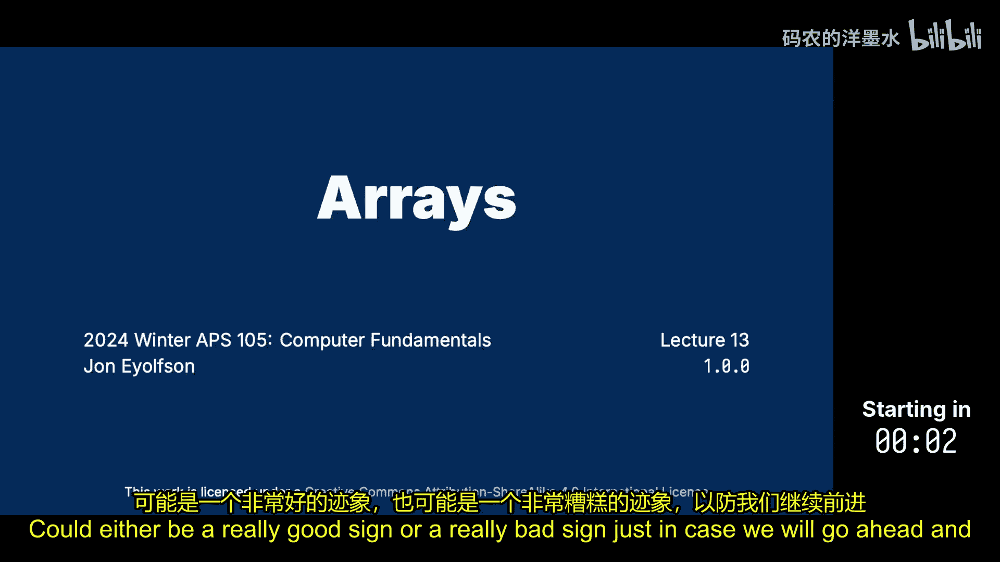
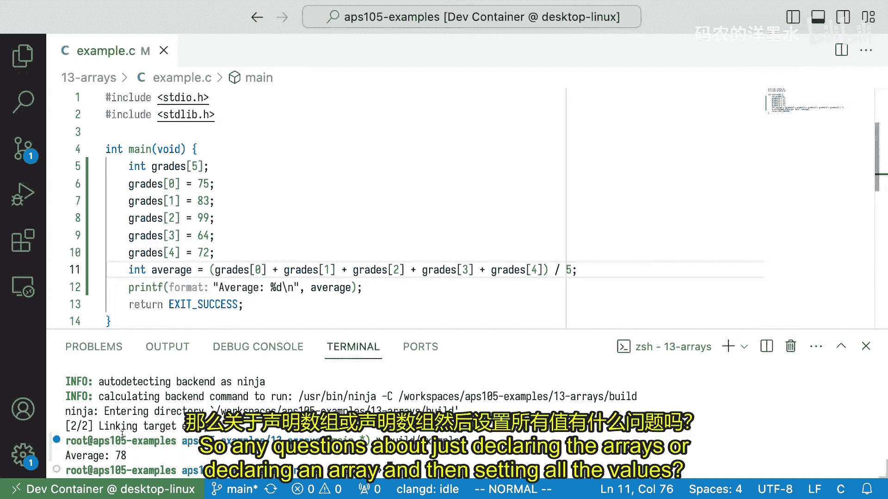
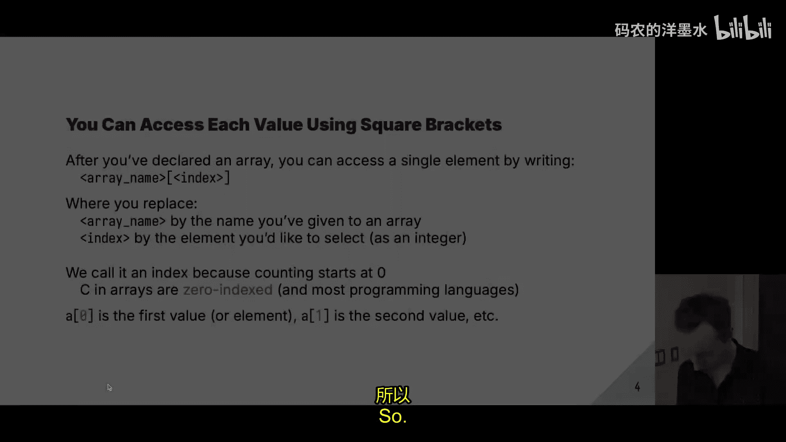
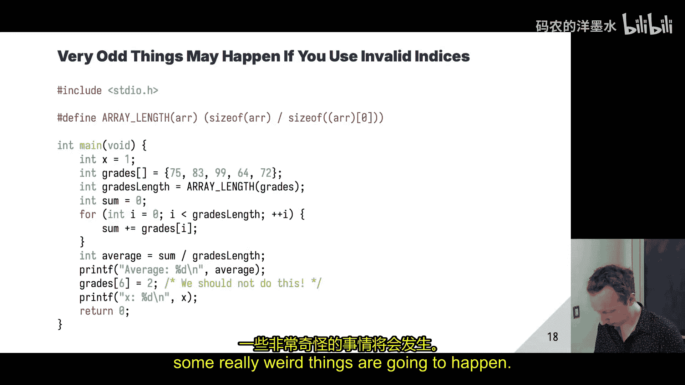
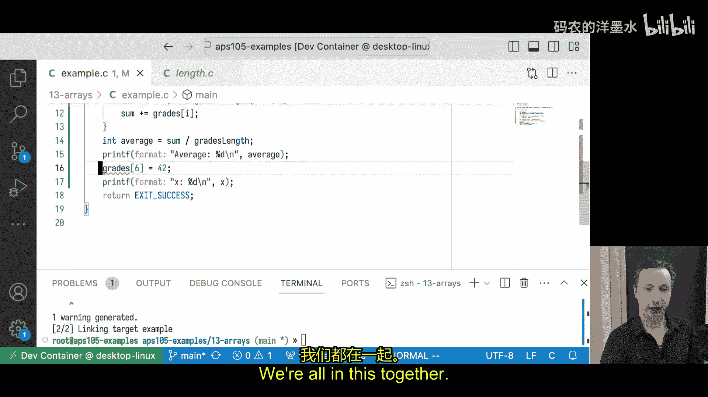

# C语言编程：13：数组 🧮



在本节课中，我们将要学习C语言中一个非常重要的概念——数组。数组允许我们一次性声明和管理一组相关的数据，这能极大地简化我们的代码，尤其是在处理多个同类型变量时。

## 概述：为什么需要数组？

上一节我们介绍了循环，它帮助我们高效地处理重复性操作。但如果我们有多个相关的变量需要处理呢？例如，计算五个成绩的平均分。使用我们目前的知识，需要声明五个独立的变量，然后手动将它们相加并除以5。这不仅繁琐，而且在需要添加新成绩时，代码会变得难以维护。本节中，我们来看看如何使用数组来解决这个问题。

## 数组的声明与访问

数组是一组相关值的集合。我们可以一次性声明多个相同类型的变量。

**声明数组的语法**如下：
```c
类型 数组名[数组大小];
```
*   `类型`：数组中每个元素的类型（如 `int`）。
*   `数组名`：这组数据的名称。
*   `数组大小`：一个整数，表示要创建多少个该类型的值。





**访问数组元素的语法**如下：
```c
数组名[索引]
```
*   `索引`：一个整数，用于选择数组中的特定元素。

需要注意的是，C语言中的数组是**零索引**的，这意味着第一个元素的索引是0，第二个是1，依此类推。对于一个大小为 `N` 的数组，有效的索引范围是 `0` 到 `N-1`。

## 使用数组改进平均分计算

让我们用数组来重写计算五个成绩平均分的例子。

以下是使用数组的代码：
```c
#include <stdio.h>

int main(void) {
    int grades[5];
    grades[0] = 75;
    grades[1] = 85;
    grades[2] = 99;
    grades[3] = 64;
    grades[4] = 72;

    int sum = 0;
    for (int index = 0; index < 5; index++) {
        sum += grades[index];
    }
    int average = sum / 5;
    printf("Average: %d\n", average);
    return 0;
}
```
现在，我们不再需要声明五个独立的变量，而是声明了一个包含五个整数的数组。这为后续的优化奠定了基础。

## 结合循环与数组

观察上面的代码，我们发现计算总和时，我们重复地写了 `grades[0]`、`grades[1]`... 这正是循环可以发挥作用的地方。我们可以使用一个 `for` 循环来遍历数组的所有元素。

以下是结合循环遍历数组的代码：
```c
int sum = 0;
for (int index = 0; index < 5; index++) {
    sum = sum + grades[index]; // 或者 sum += grades[index];
}
int average = sum / 5;
```
通过循环，我们消除了重复的代码。现在，无论数组中有多少个成绩，计算总和的逻辑都保持不变。

## 消除“魔法数字”并使用 `#define`

在上面的代码中，数字 `5` 出现了多次（数组大小、循环边界、除数）。这种直接出现在代码中的字面值常被称为“魔法数字”，它们使得代码难以理解和维护。如果我们要添加一个成绩，需要修改多处。

我们可以使用 `#define` 预处理器指令来给这个“魔法数字”起一个名字。

以下是使用 `#define` 的示例：
```c
#include <stdio.h>
#define GRADES_LENGTH 5

int main(void) {
    int grades[GRADES_LENGTH];
    // ... 初始化成绩 ...
    int sum = 0;
    for (int index = 0; index < GRADES_LENGTH; index++) {
        sum += grades[index];
    }
    int average = sum / GRADES_LENGTH;
    // ...
    return 0;
}
```
现在，如果需要修改成绩的数量，我们只需更改 `#define GRADES_LENGTH` 这一处的值即可。`#define` 会在编译前进行简单的文本替换，将代码中所有的 `GRADES_LENGTH` 替换为定义的值。

## 数组的初始化与自动长度计算

在声明数组的同时，我们可以直接初始化它。

以下是声明时初始化数组的语法：
```c
类型 数组名[大小] = {值1, 值2, 值3, ...};
```
更棒的是，如果我们提供了初始值列表，C语言可以自动推断数组的大小，此时可以省略方括号中的大小。

以下是自动推断数组大小的示例：
```c
int grades[] = {75, 85, 99, 64, 72}; // C会自动计算数组长度为5
```
为了在代码中动态获取这个长度，我们可以使用一个宏（一种高级的 `#define`）：

```c
#define ARRAY_LENGTH(arr) (sizeof(arr) / sizeof(arr[0]))
```
这个宏的原理是：用整个数组占用的总字节数 `sizeof(arr)`，除以单个元素占用的字节数 `sizeof(arr[0])`，结果就是数组中元素的个数。

以下是使用自动长度计算的完整示例：
```c
#include <stdio.h>
#define ARRAY_LENGTH(arr) (sizeof(arr) / sizeof(arr[0]))

int main(void) {
    int grades[] = {75, 85, 99, 64, 72}; // 自动推断长度为5
    int sum = 0;
    for (int index = 0; index < ARRAY_LENGTH(grades); index++) {
        sum += grades[index];
    }
    int average = sum / ARRAY_LENGTH(grades);
    printf("Average: %d\n", average);
    return 0;
}
```
现在，添加新成绩变得极其简单：只需在初始化列表中加入一个新值，其他所有部分（循环边界、平均值计算）都会自动适应新的数组长度。




## 数组的边界与内存安全 ⚠️

我们必须确保只访问数组的有效索引（0 到 `长度-1`）。访问数组边界之外的内存是**未定义行为**，会导致不可预测的结果，程序可能崩溃、输出错误数据，或者看似正常地运行（但潜藏危机）。

以下是一个演示越界访问危险的例子：
```c
#include <stdio.h>
int main(void) {
    int x = 1;
    int grades[5] = {0};
    grades[6] = 42; // 错误！访问了第7个元素，但数组只有5个。
    printf("x = %d\n", x); // x的值可能被意外修改！
    return 0;
}
```
在上面的代码中，`grades[6]` 的赋值可能恰好覆盖了变量 `x` 在内存中的位置，导致 `x` 的值被意外更改。编译器可能不会阻止这类错误，因此程序员必须格外小心。

## 总结

本节课中我们一起学习了C语言中数组的核心概念：
1.  **数组的声明与初始化**：用于管理一组相同类型的数据。
2.  **零索引与元素访问**：数组索引从0开始，通过 `数组名[索引]` 访问元素。
3.  **数组与循环的结合**：使用 `for` 循环可以高效地遍历和处理数组中的所有元素。
4.  **使用 `#define` 消除魔法数字**：提高代码的可读性和可维护性。
5.  **数组的自动长度计算**：通过初始化列表和 `ARRAY_LENGTH` 宏，可以写出更灵活、更安全的代码。
6.  **数组的边界安全**：必须始终确保数组访问在有效索引范围内，否则会导致未定义行为。



掌握数组是理解更复杂数据结构（如字符串、多维数组）的基础。在下一讲中，我们将探讨数组在内存中的布局，这有助于理解为什么越界访问会导致如此奇怪的问题。