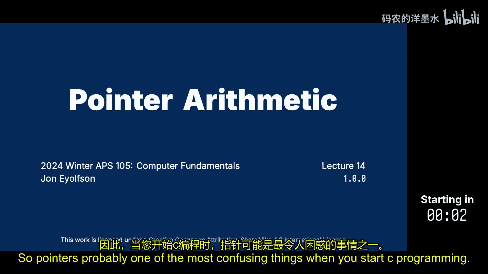
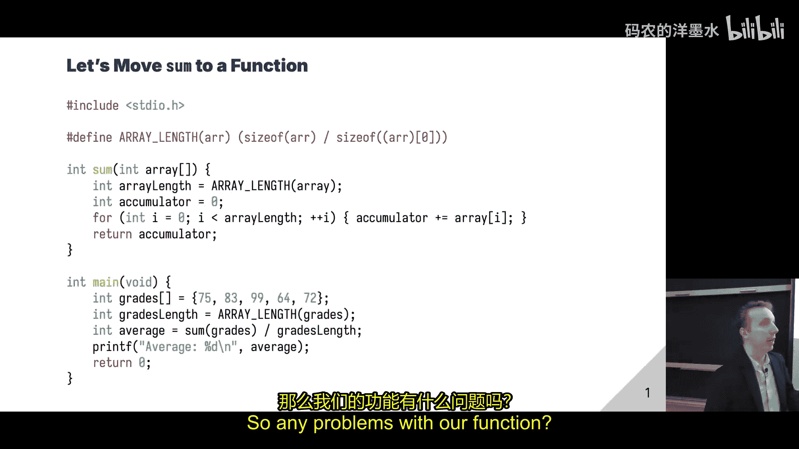
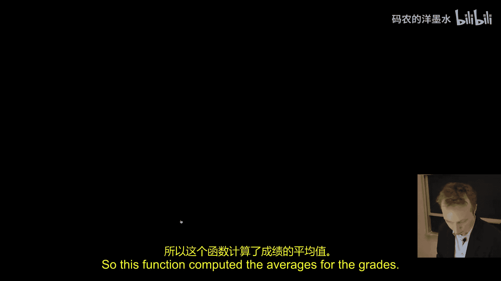
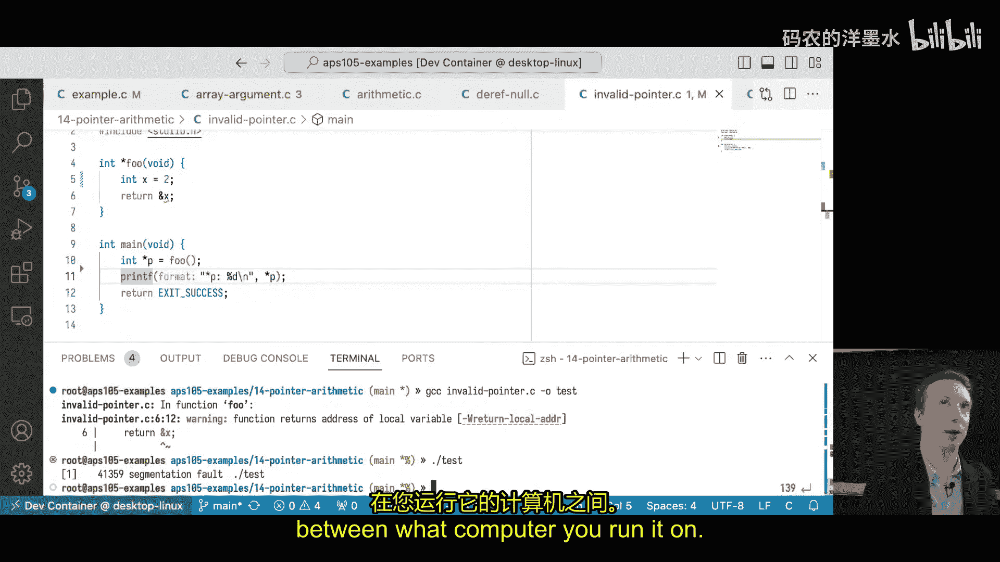
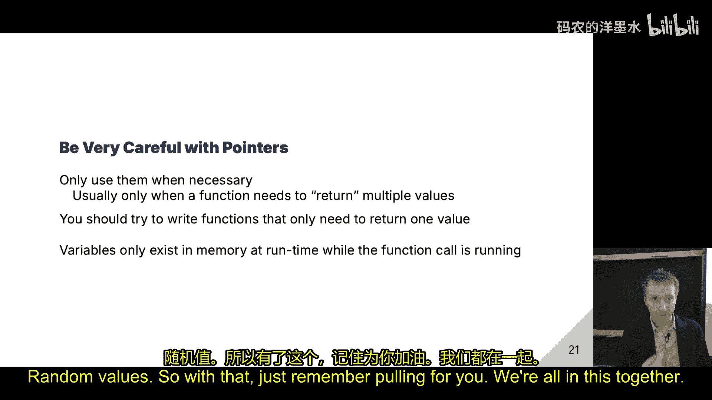

# C语言编程：第14讲：指针算术运算








在本节课中，我们将深入学习指针，特别是指针的算术运算。我们将通过一系列示例和“反面教材”来理解指针如何工作，以及在使用指针时必须遵守的规则和需要避免的陷阱。

## 概述：从数组求和函数说起

上一节我们介绍了指针的基本概念。本节中，我们来看看如何将数组操作封装成函数，并在这个过程中揭示一个关于数组和指针的重要特性。

首先，我们有一个计算成绩平均值的程序。为了代码复用，我们尝试将计算数组和的循环提取到一个独立的 `sum` 函数中。

```c
// 最初的尝试：一个看似合理的sum函数
int sum(int array[]) {
    int acc = 0;
    for (int i = 0; i < sizeof(array) / sizeof(array[0]); i++) {
        acc += array[i];
    }
    return acc;
}
```

然而，当我们调用这个函数时，结果却出错了。平均值从预期的78变成了31。调试发现，函数内部 `sizeof(array)` 的值是8（一个指针的大小），而不是整个数组的大小（20字节）。这意味着循环只处理了前两个元素。

## 数组在内存中的布局与“退化”

为什么会出现这种情况？要理解这一点，我们需要知道C语言中数组在内存中是如何存储的。

*   **数组是连续的**：数组的所有元素在内存中是连续存放的，中间没有空隙。
*   **数组名是指针**：在大多数上下文中，数组名会被“退化”为一个指向其第一个元素的指针。它只保存数组的起始地址。

因此，当我们将数组作为参数传递给函数时，传递的并不是整个数组的副本，而是**数组起始地址的一个副本**。函数接收到的只是一个指针（例如 `int*`），它丢失了原始数组长度的信息。

所以，我们之前写的 `sum` 函数中，参数 `int array[]` 实际上等价于 `int* array`。`sizeof(array)` 计算的是指针变量本身的大小（在64位系统上通常是8字节），而不是整个数组的大小。

## 指针算术运算

既然数组在函数中退化为指针，我们如何通过这个指针访问数组的其他元素呢？这就要用到指针算术运算。

指针算术运算的规则是：**对指针进行加/减整数运算时，移动的字节数会自动乘以指针所指向类型的大小**。

以下是核心公式：
`address = pointer + (index * sizeof(type))`

具体示例如下：

*   `int* a;` `a + i` 的结果地址是 `a + i * sizeof(int)` (即 `a + i * 4`)。
*   `double* b;` `b + i` 的结果地址是 `b + i * sizeof(double)` (即 `b + i * 8`)。
*   `char* c;` `c + i` 的结果地址是 `c + i * sizeof(char)` (即 `c + i * 1`)。

**重要提示**：指针只能进行加法和减法运算，乘法和除法是非法的。

## 数组下标与指针运算的等价性

理解了指针算术后，我们会发现一个关键点：**数组下标访问 `array[index]` 在底层完全等价于 `*(array + index)`**。

例如，`grades[1]` 和 `*(grades + 1)` 访问的是同一个内存位置。数组下标语法只是为了方便而提供的语法糖，其本质就是指针算术运算和间接寻址。

**核心建议**：在代码中，你应该始终使用直观的数组下标语法 `[]` 来访问元素。如果你发现自己正在手动进行指针算术运算（例如 `*(ptr + i)`），那么很可能你做错了，或者正在引入不必要的复杂性和风险。

## 修正函数：传递数组长度

现在我们可以修正之前的 `sum` 函数了。由于函数无法通过指针得知数组长度，我们必须将长度作为一个额外的参数显式传递进去。

```c
// 正确的sum函数
int sum(int array[], int array_length) {
    int acc = 0;
    for (int i = 0; i < array_length; i++) {
        acc += array[i];
    }
    return acc;
}

// 调用时
int total = sum(grades, GRADES_LENGTH);
```

这是一个重要的编程原则：**任何接收数组作为参数的函数，通常也需要接收该数组的长度作为参数**。

## 危险的演示：指针算术的滥用

为了更深入地理解内存布局，我们来看一个危险且不推荐在实际编程中使用的例子。这个例子展示了如果变量在内存中恰好连续排列，通过指针算术可能意外修改其他变量。

```c
int x = 1; // 假设地址为 0x1FFC
int y = 2; // 地址为 0x1FF8 (比x低4字节)
int z = 3; // 地址为 0x1FF4 (比y低4字节)
int* p = &z; // p 指向 z

// 危险操作：p + 2 将向前移动 2 * sizeof(int) = 8 字节
// 如果变量连续，这将指向 x 的地址
*(p + 2) = 4; // 这实际上修改了 x 的值！

printf("%d, %d, %d\n", x, y, z); // 可能输出 4, 2, 3
```

**关键点**：这种行为是**未定义**的。变量在内存中的排列方式（是否连续、是否有间隙）取决于编译器、系统架构和优化设置。这段代码在一台机器上可能“碰巧”工作，在另一台机器上可能导致程序崩溃或产生随机结果。**绝对不要编写依赖此类内存布局的代码**。

## 指针的初始化与NULL值

未初始化的指针包含随机地址，解引用它们会导致不可预测的行为。良好的习惯是总是初始化指针。

如果你暂时不知道指针应该指向哪里，可以将其初始化为 `NULL`。`NULL` 是一个特殊的指针值，表示“不指向任何地方”（通常是地址0）。

```c
int* p = NULL;
```

解引用一个 `NULL` 指针是明确无效的操作，通常会导致程序立即崩溃（段错误）。这听起来很糟糕，但实际上比悄无声息地访问随机内存要好，因为它能立即暴露问题，便于调试。

```c
int* p = NULL;
printf("%d\n", *p); // 几乎肯定会导致 Segmentation fault
```

## 返回指向局部变量的指针

这是一个常见的错误。函数内的局部变量在其作用域（即函数执行期间）内有效。一旦函数返回，这些变量的内存可能被回收并作他用。

```c
int* bad_function() {
    int x = 10;
    return &x; // 错误：返回了局部变量 x 的地址
}

int main() {
    int* ptr = bad_function();
    printf("%d\n", *ptr); // 未定义行为！可能打印10，可能打印垃圾值，也可能崩溃。
    return 0;
}
```

`ptr` 现在是一个“悬垂指针”，它指向的内存已经不再有效。访问它的结果是未定义的，完全不可靠。

但是，返回指向调用者有效内存的指针是安全的，例如：

```c
int* max_pointer(int* a, int* b) {
    if (*a >= *b) {
        return a; // 返回指向main函数中变量的指针
    } else {
        return b;
    }
}

int main() {
    int x = 1, y = 2;
    int* p = max_pointer(&x, &y); // p 指向 y，而 y 在 main 中有效
    printf("max is %d\n", *p); // 安全，输出 2
    return 0;
}
```

## 其他注意事项

以下是使用指针时需要注意的其他细节：




*   **函数参数中的 `int array[]` 与 `int* array`**：在函数参数列表中，两者完全等价。但使用 `int array[]` 能更清晰地表达“这是一个指向数组（多个元素）的指针”的意图，而 `int* array` 可能仅表示指向单个整数的指针。建议使用数组语法以增强可读性。
*   **变量声明中的星号`*`**：在一条语句中声明多个指针时要小心。`int* x, y;` 声明了 `x` 是一个 `int` 指针，但 `y` 只是一个普通的 `int`。星号 `*` 只修饰紧随其后的变量名。为了避免混淆，最安全的做法是每行只声明一个变量。

## 总结

本节课中我们一起学习了指针算术运算以及相关的核心概念和陷阱。

我们了解到：
1.  数组在传递给函数时会退化为指向其首元素的指针，同时丢失长度信息。因此，操作数组的函数通常需要显式接收数组长度参数。
2.  指针算术运算会根据指针类型自动缩放，`array[i]` 等价于 `*(array + i)`。在实际编程中应优先使用数组下标语法。
3.  绝对不要编写依赖特定内存布局（如变量连续存放）的代码，因为这是未定义行为，不可移植且极其危险。
4.  始终初始化指针，对于暂无指向的指针，使用 `NULL` 进行初始化。
5.  切勿返回指向局部变量的指针，这将产生悬垂指针，导致未定义行为。
6.  指针是强大的工具，但也容易出错。一个重要的原则是：**如果可能，尽量避免使用指针；如果必须使用，务必格外小心。**



记住，谨慎使用指针，你的程序将会更加健壮和可靠。