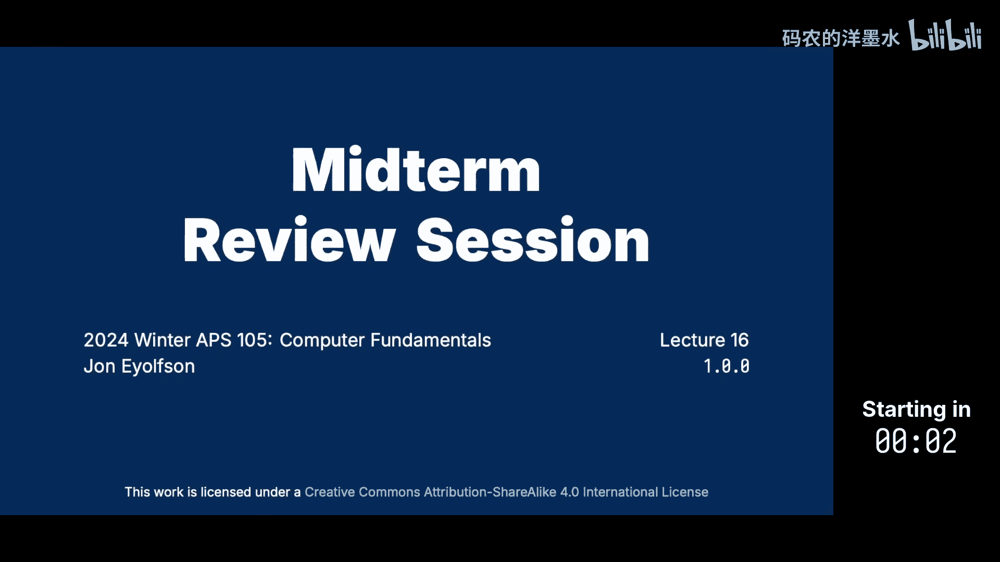
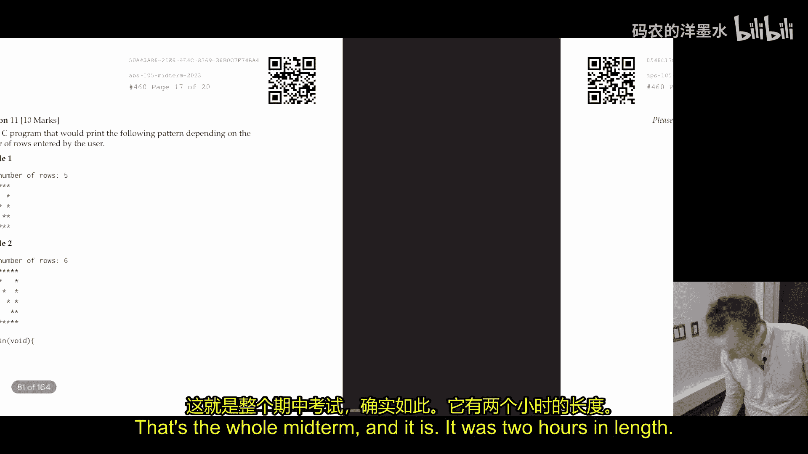
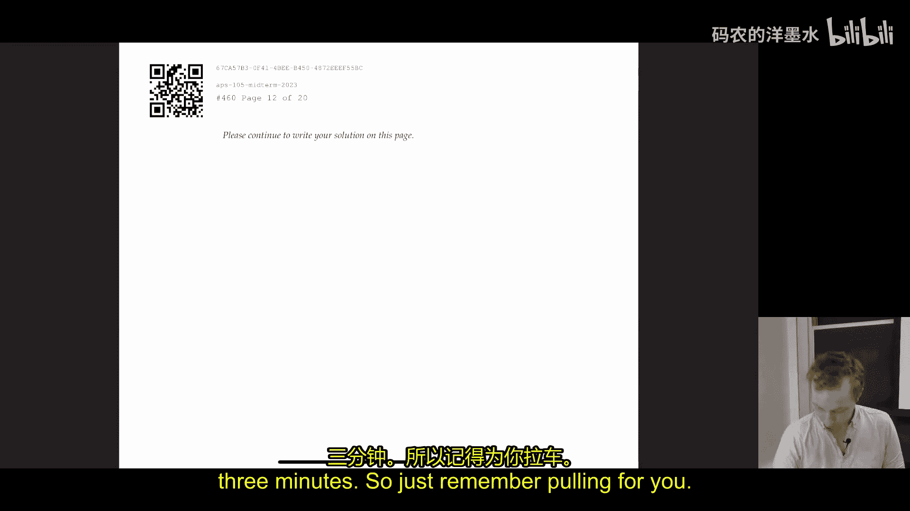

# 【全集】多伦多大学 C语言编程 中英字幕 1080P p16 Lecture 16 - 期中复习课part1 -BV1gikKB3EZW_p16-

Alrighty， I back to 105， so midterm is coming up。Probably sooner than we would like it。

 And the midterm is hard as all get out。 So we will start practicing early， and we'll start just。

I didn't see any particular questions。 So either people haven't looked at the midterms yet or they're all good。

 So just in case we will start going through in like reverse chronological order and we'll have all week。

Since we're a bit ahead。 and if we need to go ahead and brush up on something or there's something we may have skipped。

 we can take it up with this， so。This is just done live。So no slides today， we just get into it。

So here is the 2023 exam。 And I was talking to past students of this course and not to scare you。

 but like their average was like 50% or something like that。

 So we're gonna to do a lot better than that because we have like a whole week to practice。

And hopefully， at least the questions I've set so far， they're not too bad。

 So let's see if we can get through this。 I think it's lengthy。 It's like two hours as well。

 So let's see how much of this exam we can get through in just 50 minutes。So first question。

 write a single C statement that adds a square root of each digit in a two digit number。

 So we'll just assume that our input is always two digits， and it's in a variable called nu。

In the same statement， declare and assign the result to a double variable name square。 So。

 for example， if none is 64， then you should assign the value square root of 6 and square root of 4。

So anyone recall how to get the digits out。 So if we have an integer nu and has the value 64。

How do I get the four out of it。第二。Yeah， moded by 10， right？ So that number mod 10。

 that gives me the remainder left over。 If I did the actual division by 10， and that would be 0 to 9。

 so。If in order to get the4， that's 10 or sorry， nu mod 10。 and to get the other one。

 since we only have two digits that can just be， since we're using integer division。

 just nu divided by 10。 and then we'll get the essentially， we'll get the 1s column。So。To do that。

This is an easy three mark question。 whoops。 So it said wed define a double。Called square。

So we can do that。 And then it handly gives us the square root function from the math library。

 So we get square root。Of nu， which is the input divided by 10 plus。Yesし。Square root of nu。Moud 10。

That's it。 Yay， three marks。All right， our confidence is soaring， any questions about that？Allright。

 confidence is soaring。 Let's see。 Next question。 Write， a single state。

 single cease statement that declares a bull。Variable name positive odd and a science true to it。

 If and only if the value of the variable is positive is a positive odd number。So。Also， three marks。

 so。What is the true statement I need to do to get numb as positive。Yeah。

So if it's if it's greater than zero。0 is。Its be good than zero。Yeah， so if nu is greater than 0。

 that gets that's a positive part。 And then what about if it's an odd number。

 How do I check if it's an odd number。Few ways to do that。 So， yeahep。MoYeah， if mod 2 equals one。

 So if I do numb。Moud2。Is equal equal。 So if I just do single equals， that's an assignment statement。

 Not good。 So we want， if we want true statement， we have to use equal equals。

So that means it is odd。 I could also write， So remember， in this case。

We're making sure numb is also positive， so we don't get any weird things with mod， but sometimes。

Another way to write that if we want， is that nu mod 2 does not equal to 0。

 So because it'll either be one or 0。 And remember。

 we get that weird thing where the result the mod could be like a negative。

 if it's a negative number and all that stuff， but。In this case， it's positive anyways。 So mod 2。

 it's either going be 1 or0。 So these two things actually mean the same thing。 So it doesn't matter。

And。I want this bull positive odd to be true。 only if both these things are true。

 So what is the logic statement I have to do to connect these two things together。 Yeah， and， right。

 and and is just two a per sands。So。We just got bo， positive。Od。We assign that to be numb。

Greater than0 and and none。We can take the first answer。So nu mod 2 is equal to one。

 And if I want to make sure that I don't have to remember the precedes or anything like that。

 I can just go ahead and throw this in parentheses if I want。 But turns out works the way we expect。

Alright， we've got six marks。 questions about that。Things may go downhill。Alright。

 so this one is a bit weird。So says you have a sequence of 10 line of code that part of a C program。

Right on the table， which of the following lines result in an error and explain the reason indicate only the line。

 indicate only the lines in error。Alright， wordings a bit strange， but basically。

 just write down lines that have an error in it。 So line 1。Can I do all this stuff？Yeah。

 so I'm just declaring a bunch of variables。 And remember。

 this is taking advantage of that silly rule about the comma。 So I is going to be like a natural int。

 So if I wrote this out on separate lines， it would be int I。We get intj。In K。

And then we'd have int pointer。P。Int pointer Q。 So that just does it all in one line。Not in there。

 We can do something like that。Alright， this has an integer array of。1，2，3，4，5，6，7，8，9。

We're allowed to do that C will go ahead， we don't have to say the size of the array。

 C will figure it out for us， in this case the size or the length of that array is9。

So that is all good。All right。Line 3， so remember。Arays are just represented essentially by a pointer to the first element。

 so well we can convert an array like an array to ints to just a pointer to an int so can we're allowed to do something like that so we can say P equals array so starts at the start of the array。

So here we can do this as well。 So this will let us access。This value， So index 1，2，3。F， five， six。

So this lets us access this value。 So just this array at index 5。 So that gives us 6。

 And then we take the address of it。 So we essentially have whoops。 That's an eraser， yikes。

So we essentially have Q is equal to a pointer to this6。So we're allowed to do that， too。

Now we say p equals Q plus 1。 So we're doing some pointer arithmetic here。

 which is fun because Q is a pointer to an integer。😊，So。Q is currently pointing to the 6。

 So Q plus 1 means we go forward one integer。 So that means P is pointing to the7 here。

So we're also allowed to do that。Alright， then it says P equals Q。So Q is still pointing at 6。

 So it says Q-2。 So we're allowed to minus。 That means we go backwards too。 So now after that， oops。

 let me get a more precise eraser。So Q is pointing to 6。 And if we go backwards to from Q。

 we're now pointing at 4。Right。Alright， then we say array equals 8。Not allowed to do that。

 We define the array in this function。 Were not allowed to try and redessign it。

 An array is an array。 You can't just。Make a new one。 So line 7 is an error。Cannot。Reassign。Aray。

All right。So now we're at line。8， so 8 is P， which is currently pointing at 4。Plus 2。

 which brings us a pointer back to 6。 And then it deres it。 So we get the value at that location。

 So that is 6。 So I will be equal to 6。 That's fine。Now we have K equals array P。 So P， remember。

 is a pointer。To an integer。 And well， for an index， we need an integer。 So this is also an error。

 So line 9 has an error index。Must。Be。And。Not。In star， something like that。Then line 10。

C will let you do this。 But technically， it's， I guess， an error because we're out of bounds， right。

 So this array has 9 elements in it and things start at 0。 So arrays will start at 0。

 So we are allowed to index all the way up to。8， so if we try an index element 9 beyond the length of the array。

 So that's an error。As we discovered， the compiler will let us do it。

 So this doesn't say what type of error。 Like if it's a runtime error or compiler error or whatever。

 So if there's a definite no no， I guess we have to state it。So questions about those three。Alright。

We're still all right， ish。Alright， here's where it starts to get weird because this code is like really ill advised。

 So this is just asking you to so far， we're not really writing any code。 It's just。

Write the output of the following C program in the box found in the code below da da da。

So we have a main。We have two arrays。 And if you see this one， just with。A zero initializer。

 It fills that whole thing up with zeros。 turns out doesn't really matter in this question。And then。

We declare an integer called P， and we have a four loop that starts at my array。

 So that's essentially a pointer。 So it starts at the start of my array。And for some reason。

 uses pointer arithmetic the whole time。 So it goes up to my array plus 5， which is just。

Beyond the end of the array。 But it makes sure it's less than that。 And then plus， plus I， which。

Since it's a pointer， it will go like p equals p plus 1， so it will move it forward one integer。

So this will essentially in the for loop， P， will start here。Then go to here， then here， then here。

 then here， and then it'll stop。So。If we go through the for loop， first thing it's pointing at is 2。

 So we de referenceence it to get the value at 2。In this case。

 it just checks essentially if it's even。 So if the value mod 2 is equal to 0 means it's even。

 So in this case， it's2 even。Hopefully。It's like the most even number you can get。

 So if we go into the if statement。So this does a weird pointer arithmetic， but。

It essentially just fills in the value。 So this takes the current pointer P and then subtracts my array。

 So it essentially gives you the number of ints。Between those addresses。 So in this case。My array。

 you can think of it as a pointer to here， so my array。And then P。 So if you do P minus my array。

 it's basically how many ints are between this。 So in this case right now。

 P minus array is equal to 0 because there's no integers between。 It's pointing at the same thing。

So this would be 0。 So all we do is we set。Another array at index 0 to be equal to the current value pointed at。

 which is 2。 And then we just print the same thing。So， we print。That same thing。

 So it's just the index and then the value。So we would see printed out another。Z equals2。Alright。

 questions about that。 It's a bit weird。 I don't think we've seen like where we just do pointer arithmetictic between two pointers and get a number。

 but it's essentially。What we had before， like if we took a pointer and we added or subtracted one or two or whatever to it。

 we got a new pointer back。 So this is just the same thing except we're doing the arithmetic on two pointers and it tells us how many。

 in this case， how many ints are between them。All right。Wow， that's a lot of things pointing places。

 Allright， so that's the first iteration of the loop。 Next iteration of the loop P， whoops。

Reduce the point arithmetic on P。 It goes to 4。Oh， okay，4， the value at P is even。

 So because it's a4。 Then we do the same old pointer arithmetic。Let me erase that。So now。

 in this case， my array is still pointing to the beginning of the array because well。

 we can't change the array and P is pointing to the next element。

 So the number of ints between P and my array in this case is one。

 If we do the point arithmetic on that。 So we'd get another one equals essentially。

That value that P is pointing to， which is 4。So， we would get another。1。Equals4。Alright。

 questions so far。Bit weird with the double， with the two pointers。对。So next iteration， loop。

P is going to be pointing to 5， not even。 So we won't go inside the if statement。

 So we'll just go to the next we'll just increment P again。P goes， whoops。P goes to 7。

That's not even Then P goes to 8。And then， okay， well， oops，8 is even so。This line is true。 Now。

 P minus my array is 1，2，3，4。 So we're  four integers away now。 So we would get。Another。4。Equals8。

All right， questions about that。Other than being kind of weird。Alright。

 And if you wrote something like this， I would probably be very displeased， because， well。

Shouldn't do point arithmetic。 This thing should probably just go from like， I。I less than 5 plus。

 plus I oops。And then， just do。Another I equals。Like my array。Like。

 that would probably read a lot better if you just used array indexes the whole time and not use point arithmetic。

 So I don't know。 Maybe this is to confuse you and。

Discourage you from ever writing something like this because you've spent like 10 or 15 minutes on on the exam。

All right， it's a fun one。The following program has a function named。

 I'll make that bigger name find largest digit that should return the largest digit in the int nu。

 However， this function has errors and does not return what it should。

 You are required to fix the function。 Find largest digit such that the output produced is in the is the required output shown below fill in the table with the line number and its correction。

Per error found， leave other lines blank if necessary。

 you will lose marks for any errors indicated incorrectly。So。Here's some examples，Actually， so。

What it should return for this。Should return 9。 So it's just the largest digit of any digit in that number For this。

 it should return 9。 and for this， it should return 7。So。It only ask you to look at the function， so。

With that function， where are my issues。Yeah， course obvious technology should be greater than you。

Yeah， so the first obvious one is。Well， numb shouldn't be less than 0。

 I should be going through this。 while nu is greater than 0。 So I have some digits left。

 So that would be one correction。 So this should be numb。Greater than zero，Uo。Yeah。Ret。

 which is at 9 to be 0。Started。Yeah， so this。This largest digit， this looks a bit suspect， too。

 So the largest digit is 9。 And if I look at the rest of the code。

 if I initially set largest digit to 9， well， digit。From here。

Is always going to be some number between 0 and 9， So it will never be bigger。

 And this function will just always return 9 all of the time。

 It doesn't matter what number you give it。 So that is also an error。 the current largest digit。

 What should it be。If I haven't seen it before， yeah。Yeah， oh， oh， that was a0。 Yeah，0， right。

Ld it's digit。I should set it equal to0， not 9。All right， any other mistakes here？Someone knew， yeah。

The order of the if。So。Not you。Yep。Yeah， in line 9。Num， I shouldn't be using numb。

 I should be comparing it to the digit。Because if I compare it to numb， well， let's。

With the examples。 So say none was in。Like。90， something like that。 first time through。

 I might say equal to 0。 Some weird things might happen。

 I should only be looking at the current digit， so。3 errors， Anything else。

Looks like it probably works though。Those are， our three errors。 So we would just you know。

 write them out。 So what we had， line 4， line 6 and line 9。 So those would be our three errors。

 Can we do some student math。 Oh， they tried to get you。 So it's worth four marks， not three marks。

 So they tried to trip you up a little bit。 So you can't like。

Trying to figure out if you're right or not from the number of marks it's worth。

 So that's a trick I used to use。 doesn't always work。 Sometimes， you know， if I've used or。

If other professors used that when they were students， they probably are have。

They probably just want to screw with you， so。Alright。 oh， here's a good， fun one。

So write the output。 So so far， we haven't had to write any code， thankfully。

 although that will probably change。 So write the output of the Fall C program in the box found below the code。

😊，All right。So。For this one。I'm just going to blindly follow the rules。

 So remember when we were going through examples and。We had variables living in memory。

 and I drew them at the bottom。 I'll do the same thing here。 So initially。

We're going to start executing our code at main because that is how C works。

 And we create three variables， so。I'm currently。Here in Maine。

And I'm going to create three variables， all in a row。So I'm going to have a with the value5。

Be with the value。6 and C with the value 3。And then。We create a variable called P。

We have no idea what it is yet。And then we go ahead and we call modify。

 So we're doing a function call。 It's C。 So everything is passed by value， right。

 So it gets a copy of all the values we pass to it， so。It will get a copy of the address of A。

 a copy of the address of B and a copy of C。So how we like to write it out。

Is we can draw a new little line because it will be a new function scope as well。

 So we'll call it modify。And will。Write the arguments as they appear in this function。 So I have。

The see and modify。I have a B。And I have an A。So。From here。

 we can get their values because there'll be copies of whatever they are。 So C is currently3。

 So we get a copy of three in modify。B。Matches up to this B。 So match them up like that。

So B in the function gets the address of B in main。 So this is just an address。And it points。

Actually， I'll make it a different color。And it points to B。Mains B， right？So a is also an address。

And it points。Two means a。Everyone， okay with that before we start executing stuff in modify。

All right。So let us erase all of this。So remember all the variables in here。A modifies values。

C mod 2， Whats C modd 2。One， right， does one equal one。Sure does one does equal one。

 at least in this universe。So it wants us to print out or wants us to write out things that get printed。

 So we would execute this line。 So we'd execute。In the。So we'd print out in the if statement。

And then we have to evaluate this line。 So what currently is。The value at a， yeah。Yeah。

 so this would be the same as。The value currently pointed to by a is 5。 So that's。It's highlight， so。

D referencing a in modify gives us that value that value 5。 So we get here。F times。-1。 So that's。

If we compute that， that's -5。 So we're updating the value at a to B -5。 So this right here。

 what we're pointing to because we're dereencing it。Wow， I shouldn't have eraed everything。

 That was the wrong tool。Let's move that over。And we update it to -5。And now here。We go through B。

So we go through B， find what B points at， and we update this value to 7。Right， so we dereence B。

 and we chain assign its value to 7。 So this gets updated。As well。So all good so far。 survive that。

Alright， so now we hit this print statement。 So we have to write out what things are。

 So it prints out。The value at a。Equals something。The value at B。Equals something。And then。C equals。

Something。So。What is D reference a equal。Negative5， right？What is D reference B equal。7， right。

 And what does C equal to in modify。3。All right， questions about that before we carry on。

Aren't pointers great。 Alright， so now we get this fun。

 This says we update the value or we update the address of a to point to the same thing that B is pointing to。

 So in this case， B is pointing to that 7。 So after that line， we reassigned。

 So we're changing A to also point to the same thing。😊，So。B is currently pointing to that 7。

 So now A is currently pointing through that7 as well。Now， in the next line。When we de reference a。

 So right。Here， when we de reference a， what value do I get。Seven， right？

So this will be equal to 7 plus 5。 Oh， What 7 plus 5。This is higher than my limit。12， all right。

 You guys are way smart than me。 All right，12。So that is 12。 So we'll update the value at a to 12。

 So currently， the value。through pointer A in modify is pointing to B or is pointing to the7。

Or mains be， and we're updating it what to 12。All right， and then。We're changing。

C in modify equal to C plus 7。 So currently。C is equal to 3， which is this one since we're in modify。

So， we'll be updating。Let's see how good my math is 3，3 plus 7 is 10， right， yeah。Allright， math。

Alright， and then it returns B。 So it returns a pointer to。Whatever B is currently pointing to。

 which is mains B， which is there just to confuse you。 And it turns out， well。

The value we get from the function。Yeah， well， let's just reassign it。

 So we return a pointer to whatever that modifies B is currently pointing to。

And that goes into the variable P。So now main or modify is done。嗯，P。Get set to an address。

And it points to that B。 Turns out we don't actually use that P ever again。

 But that's what it's pointing to just in case。Alright， so now we print off ABC and。ABC， right。

 whoops。So a equals something， B equals something。C equals something。 All right， what was a equal。

Negative 5， right？So we're just reading them from over here。 So B， what's B 12。And C is still 3。

 right， C doesn't change to 10 or something like that， because， well。When we change it here。

 we changed modify C， not main C。 So we wouldn't see C equal to 10 ever。

 Wed see C equals 3 both times。So questions about that。All right。Oh。

 we even had a page for draft paper。 didnn't eat it。 Allright， this question is， hellello wordy。

 I'm skipping it。 I don't like it。嗯。Alright， we can do this one。

 So this is like one of the first programming questions， and they are 10 marks。So。

This says implement a function named dot product that gets the dot product between two vectors or two arrays。

 that Sometimes we call them the same thing。We haven't discussed that yet。

 but they're essentially the same thing。 The function receives two arrays。

Each having the positive integer elements of the vector。

 each array is terminated by the value negative one。 This value is not an element。

 and it can only be used to determine the size of the array。So we are determining the size of an。

 It ends with negative  one， and that tells us not to go any further。So we don't need the size。

 it's kind of implicitly in there。 So to get the dot product between two vectors。

 their sizes should match， if their sizes match， the function should calculate the dot product between the vectors by getting the cumulative sum of the products of their individual elements。

 If their sizes do not match， the function should return negative1。For example。S equals， yeah。

 we have like two arrays， values， ABC and another with D， E， F， the dot product should be。

This math thing。Their sizes match， and the function should return an int。Alright。

 so this gives us a better example。If we have some array， A， equal to 1，2，3， negative 1。And。

Another array A。Alright， they shouldn't have done that。 This should be called。Aray B。

 So correcting the exam live。So if we have these two， we should get the result 6。If we have， again。

 array A。Equal to this， an array。B。Equal to this， and the function should return negative one because the size of one array is larger than the other。

So。Lots of ways to go about this problem。 Some are longer than others。So the。One way， the solution。

Suggest is to， like。Count how many elements there are until you hit。

Like calculate the length of the array of the first array so you just iterate through it until you get a value negative1 and then you get its length from wherever you stop at and then you do the same thing for the next array。

 get its length and then check if they're equal to each other if they're not equal to each other。

 you return negative one if they are equal to each other well then you forward the length of the array。

 you just go through it and then you sum all their products together and you can do it in two steps so。

We can kind of do it。In a single step， if we're a bit smarter and it will save us some space。So。What。

So how would we go about starting this problem。Yeah。

And what we didn't do is that we can't initially have a ex statement。Mmhm。Which is that。

If the land of is be。I don't myphone。So we don't know the length of them yet。 can can。S多。hy did the。

Yeah， we can。 So one solution， if you don't want to calculate the size of the array。

 So I'll show just a different solution。So one thing you can actually do here is， well。

 I'll just try and iterate through them。 So I'll just。

Try and iterate through both these arrays until I see a negative one in either of them。

 So I could just say in index。Equals0。And maybe I create a variable cold result where I'll just go ahead and I'll assume I can just sum everything together and get the dot product。

 So if this was just， you know， a normal array and they were the same size。

 we could probably write something like this。Pluss， plus I。So we could probably just say result。

Plus equals， like array。A at I。Times array。So。This would be our solution。

 assuming we know the length of the array and they're both equal， right。

So that's not too bad to write yourself。 And， well， that would get you some marks， too。

 if you just wrote that。So that didn't take very long。So what I can do for this question is， okay。

 it's a little bit different。 I can essentially， I don't actually know the length。

And maybe I only want to iterate through this array once。 Well， I'll just。Hope for the best， so。

I will iterate through it。 So I'll do like wellow， in this case。

 because I don't know essentially how long I'm going to go through it。So I'll just guess。

 maybe I say something like， wow。Aray A index。Does not equal to negative1。And， and。Ray。Index。

Does not equal N one。So I just keep on going through that when they're both not equal to negative one。

 So if any， if I hit either of being negative 1， I immediately break out of this while loop， right。

 And if I wanted to， I could rewrite this。To， I could use the Morgan law on this and rewrite it if I thought I was ugly。

 so I could just say not。And just flip the conditions。So array index。Equ equal to negative1 or。Rib B。

Index。Equal equal negative1。They're both the same thing， right。

One may be more clearer than the other。 I don't know what your preference is。So basically。

 I just go through it。 If I see either value is negative  one， then I just ghetto that loop。

Otherwise， I can just assume that I， otherwise， the values， neither value is negative  one。

 So I can just do result plus equals array。A at index。Plus， array。B at index。Right。子。Oh， sorry。

 This is a multiply hip。Yeah， they'。いいや、あなたね。Yeah， okay， so。Now， at this point。

 let's just go through an example that should return negative  one。 So if it's something like this。

I would break out of the loop。Let's write the in to Cs。 So this is index。0，1，2，3，4。 and this is 0，1。

2，3。So if I walk through the code that I have now， So say， I get rid of。

Let's get rid of this a clear space。So how my code currently works is it will go through and。

At index 0， neither of the values in either of those arrays is equal to negative one。

 So it would do result。Plus equals。1 times1。 So that would be。This term。 And then。

It would go through again。Then it would do two times  two， then three times 2。

 and will eventually end the loop。When index is equal to3， right？

So we'll break out of this loop when index is equal to 3。 But turns out that the length。

Are not equal in this case， right？So if we break out the loop with the index equal to three because。

Aray B in this case， was shorter than array A。Well， we can check if their lengths are equal by just。

If they're equal。Whatever the index is， we broke out of the loop width。 Well the index。

In both arrays should be equal to negative one， right， If it's equal to negative one in both。

 that means there's the same length。So here， I do not know if both of the arrays are the same length。

 but I can check。 So if。Aray。That index is equal to negative 1。And。Ara。B。Index。

Is equal to negative 1。Then I know both the arrays are the same length。

 And then I can just simply return。Result。And then if they're not， oh， God， where at the bottom。

 I just return negative 1。Right， and now you can just do it all in one step。 Allright， that code。

 I will show you a better version of that code。Because。I ran out a room。

I should have taken this page， but yeah， I didn't， so。I will just leave that up for a bit。

So here is the 1 I wrote。 So yeah， there's solution to these two。

 If you look at the solution for the dot product， like I said， there's many ways of doing this。

One's not better than the other， but this one's a lot shorter than the other ones。

 So if you can just。Try and。Do it and try and do multiple things at once that will help。 But again。

 it needs practice， so。If you。Are somewhat confused about this one， doing it all in one step。

 or maybe you couldn't have thought of that。 Well， other solutions。

 So you can just iterate until you hit a negative one， calculate the length。

Maybe write a little helper function that you know， returns you the length of the array。

 And then you call it on both。 and you see if the array lengths are equal or not。

 And then you go ahead and， you know， then you。Do the dot product， assuming they are the same。

 D da da。Al right， Any questions on that one， because I don't think。Yeah。

 I don't think in four minutes， I could answer another one。So I'll go through them really， really。

 really quick。 If you want to tell me on discord which one is more interesting than the other。

 So this one， Question 9。 So this has dynamic arrays。We don't have to worry about this one。

 So we haven't for this semester， we won't do dynamic arrays before the midterm。 So think。Thank Jeus。

 And then this one。 So this is like a UPC code or a bar code。

 It just gives you a whole bunch of rules and says， like。Using these rules。

 how do you get the last digit？ So it's another， you know， implement a function。

We can go over that later。 And then I believe this is the final question。

 It's like a whole program where you take a user input of like the number of rows。

 And then you're supposed to go ahead and come up with how to print this pattern of stars based off these two examples。

 and then。That's the whole midterm。 And it is， it was two hours in length。

And， you know， we only had an hour。 We explained through a bunch of them。 I skipped， well。

 I skipped three questions， but still， that's not like over half of the exam， so。Yeah。

 I guess we can end early because there's no way I can do another question，3 minutes。

 So just remember， pulling for you。 We're on this together。

