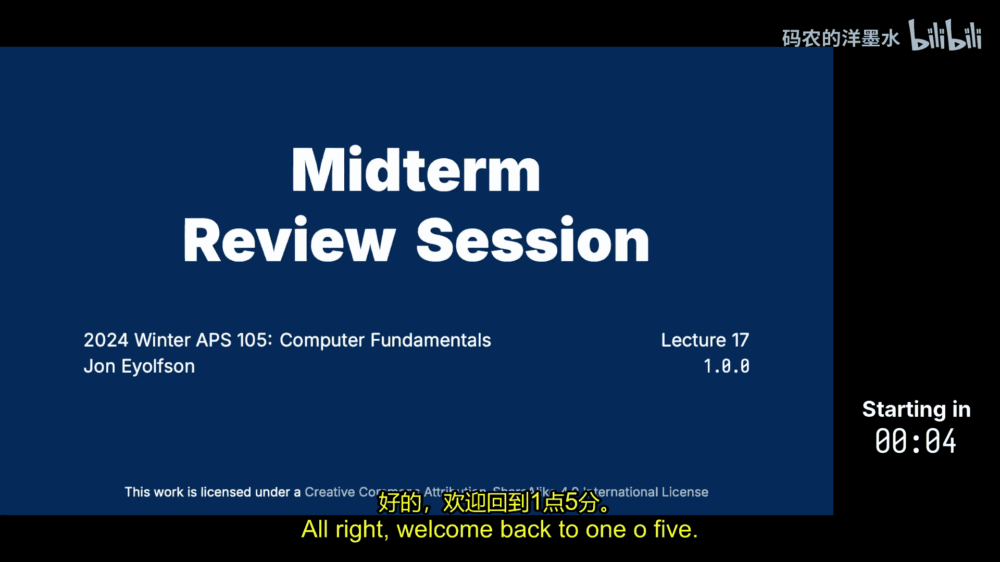
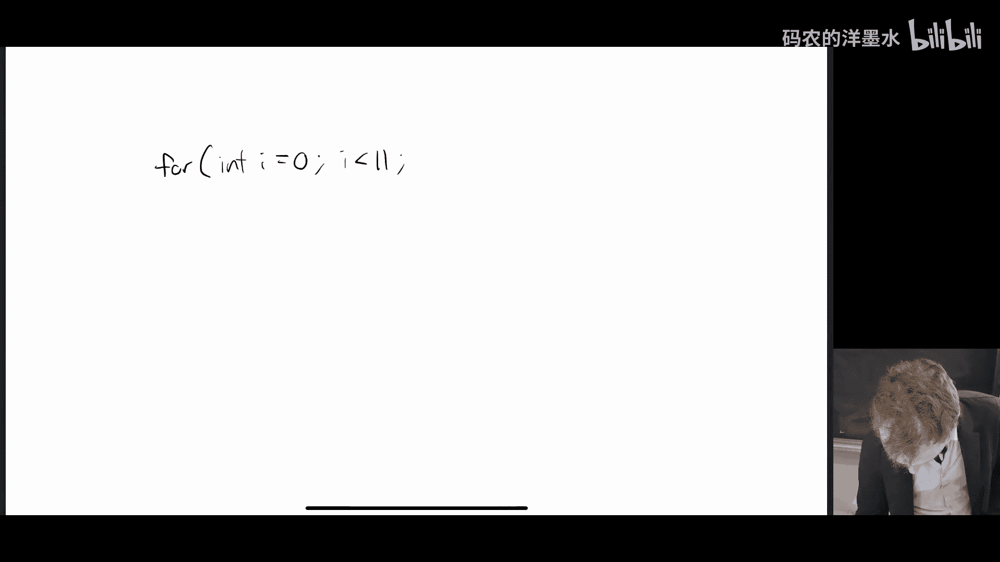
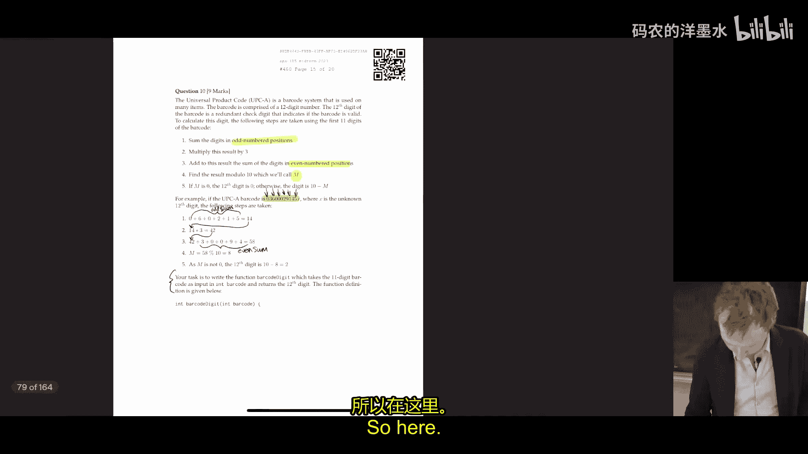
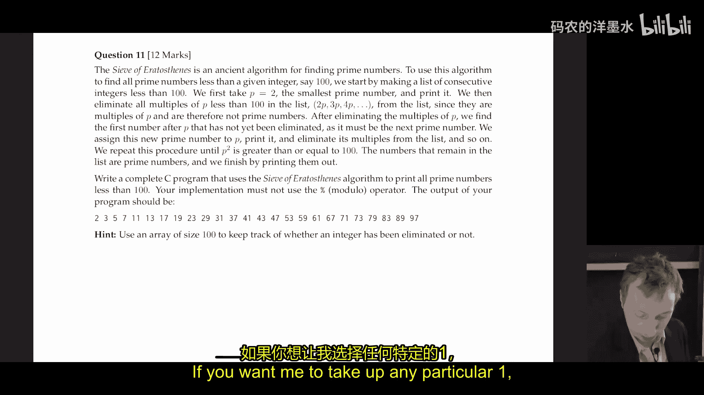

# 【全集】多伦多大学 C语言编程 中英字幕 1080P p17 Lecture 17 - 期中复习课part2 -BV1gikKB3EZW_p17-

All right， welcome back to 105， so how are we feeling about the midterm。If。Allright， well。

 that's good。 We get to do more practice。 So just warning if you think it's too easy so far。

 still practice and go through the other one。 So there's not solutions to like the 2020 if anyone's looked at them yet。

So we can do that one after this 2023。But again， just practice， practice， practice。

 that's the only way to kind of learn programming and kind of get good at it。So again。

Just doing it live。Alright， so we left off。 We were done。 We skipped one question， because。

We haven't covered that yet， we don't cover it before the midterm this semester。

 so we only have two programming questions left， which is pretty good。So。

Next one is the universal product code barcode system used on lots of items， has a 12 digit number。

 the 12th digit is kind of like a check on the other digit so there's a formula to calculate it so if you know how to calculate it given the other 11 you can go ahead and check what the12th is supposed to be if it doesn't match what it's supposed to be。

 your barcodes probably wrong so here were the rules for it。

So first rule is to sum all the digits in odd numbered positions， then multiply that result by three。

 add the result to the sum of the digits in even numbered positions。 So by looking at this。

We need to calculate the value of at least two things。 So we got the sum of the odd。

 and then a sum of the even。And then were supposed to multiply the odd by three。

Then add the result to some of the digits to get the even， then find the result mod 10。

 So we get some answer called M。 And then if M 0， then the 12 digit 0， Otherwise。

 the 12th digit is 10 minus M。So if we look at the steps， they give us an example。So。

Our goal is to write a function that takes an 11 digit number and then calculates that final 12 digit。

 which is what it says at the bottom。 should said that at the top。

We are taking 11 digit barcode input。 That's just an integer。

 And we're supposed to calculate the 12th digit。 So for this example。This is our 11 digit number。

And we're calculating x here。So。The sum of all of the odd numbered positions are like 5，1。2，0。6，0。

 so those are are odd numbers。So。This is what we would calculate。

 We probably want to put it in a variable called odd sum or something like that。And then， here。

We take the result， multiply it by3， we get 42， and then 42。

 we add to here is the sum of all of the even numbers。

 so we need to be able to come up with the even sum and then pass that， we get the result mod 10。

 check if it's equal to  zero and then do something with that。So。

Any questions about the thinking for that one。So we should be able to do this by just looking through the input and essentially calculating the even sum and the odd sum lots of ways to do this。

So。Any thoughts as to what we should do to solve this， to get the even sum and the odd sum。Yeah。

get the end， you start dividing and weigh then。やて。Because you know't like these。Right。Yeah， so。This。

 we have 11 numbers。 We might think， okay， while we have to do something。

 we have to go through each digit of this and either add it to even or add it to some。

 So I might start with that。 I know that there's 11 digits。 So probably brings me to a four loop。

 So I should like have a four loop that goes over every single digit。So I might do something like。

 just write。Let's see how much room we have for。And I equals 0。For I is less than 11。

Plus， plus， I。So here。

In our function， we it's called int barcode digit。 And we get like the barcode as an int。

 So that should be our 11 digit number。 So if we want to go through each digit well。

 to get the current digit， we could do like int digit。Equals。Barcode。Moud 10。

So that will give us the last digit right， so that will give us the last digit。

 and then we captured it in a variable called a digit so we could do something with it in this for loop and to just get rid of the digit and update the barcode。

 I could do barcode。Actually， I'll just write out a longer version。

 and I could do barcode equals barcode。Divided by 10， which is integer division。

 So get rid of the last digit。 So I'm just going to do something with that digit now。

So if I look at this， I might see， okay， well， the first digit here， that's part of my odd sum。

So I want to， I might want to create a variable called。Int。Awesome。Started off at  zero。

 Let's make an even sum。And we can start that at 0。So here， okay， well。

 I either want to add this digit to an even sum or an odd sum。

 So maybe I need something to keep track of that。 So maybe I start off with a bull。

 I create a boolean。I look at this and I note that my first digit is odd。

 so maybe I'm just keeping track of what some I add this digit to。 So maybe I'll call it Bo is odd。

And then I'll set it to true， initially。So then here I can check， okay， well， if。Is。Od。

Then maybe I want to do odd some。Plus equals。Digit。And maybe I can spell digit。

Sppelling is going to be the hardest part of this exam。All right， so。If I do that， okay。

 if I just have it as it's written right now， the next time through the loop， Well。

 is odd is still going to be true。 So it would just keep on adding over to is odd over and over again。

 So I should probably make sure that I said is odd。Equal to false。And then， I can have。

An L statement here。 So if the current digit is shouldn't be added to the odd sum。

 Well then otherwise， it should be added to the even sum。 and again， I can't spell。

So even some plus equals digit。And I could do is odd。Equals true。All right， are we good with that？

So after this， so this will go through all 11 digits。Extract the digit。

 and then either it will add the digit to the odd sum or the even sum。

 and it will start adding it to the odds。 So in this example。I would do like。

 I would add 5 to the odd sum， then 4 to the even， then  one to the odd。

 then 9 to the even until we're done， right， So I got。I essentially got。

This calculated and this calculated， whoops， not the 42。I got those two calculated right。All right。

 so with that。I can just follow the direction， so。I have the odd number sum。

 so I can just multiply it by 3。 and then I add that to the sum of the even numbered digits。

 And then I find the whole mod of that。 So maybe I just know create a variable called。In value。

And that should be equal to here the odd sum times 3 plus the even sum。So， I would have。Od。Some。

Times3 plus the even sum。Allright， we're good with that。 So that gets us all the way to this 58 here。

 So I now have the 58。 Now I can calculate M。 So M is just whatever the result we got， mod 10。

So now we could just say int。M equals value。Moude，10。And then， it tells us that。If M is not 0。

 then the 12th digit is。10 minus8， like 10 minus M， whatever that is。

 otherwise if the digit is  zero， well then the last digit  zero。So I could put in here。If。

M equal equal0， then return。0。Otherwise， I will return。10 minus M。Boom， that's their whole function。

So questions about that。So so there was an actual shorter way to write that。

 The solution has a like slightly shorter way that still uses this for loop。

 but a slightly smarter way to do this one is。Again， you probably， I mean。

 it's the exam so you probably don't want to go back and think about and try and save two lines。

 but just in case to have another point of view。It could also look like this。

 so I could just have a while loops， so while the barcode is greater than0。

Then I know that there's still another digit I have to handle。

 and I can just get rid of the variable and just do the odd sum because I'll always go odd even。

 odd even。 So well， I can just do the odd first， then the even。

 and just keep on doing that over and over and over again until eventually barcode is equal to0。

 So I don't have any digits left and I don't really care about like anything invalid。

 So if barcode happens to be 0， then0 mod 10 is just0。

 So I'm not really breaking the summer or anything like that。 so。

All I have to do is I could do that and do it a bit shorter。The solution。

 I think they have a for loop above this， so they do this thing 11 times。

 which would be like 22 digits， which is a bit weird， but again， it doesn't break anything。

 it just runs more than it has to。So that is another one。All right。

You had to change the input too long， right？は。Yeah， I think。I'm pretty sure it doesn't fit， yeah。

 so I put it as long， but they assumed it fit。Yeah， it technically doesn't fit。What can you do？

I wouldn't expect to late。 Yeah， there are only four types you have to know for the exam。

 just double int， char and bo。And don't worry about other things。

 Yep is the exam graded basically sorry。So based on function。Is it have to be efficient？No。

 just functionality for the list and。Even if it your syntax isn't exactly right。

 it's like the thought process of solving the problem。So。Should be all right。I's1 variable。Yeah。

 like you could have written a billion variables for everything。

 your only limit here is like you only have two hours to write， right。You probably so。

If your solution is longer than it needs to be， that's fine。

 But if it takes you like half an hour to write it。Probably don't want to do that。All right。

 I've seen requests for this one。 This one looks fun。

So ready to see a program that would print the following pattern based off the number of rows entered by the user。

So。All we have here is just tells you we input the number of rows， and we have some type of pattern。

 so。The first part is gonna be easy。 It's just to get some input so I could do like print F。Enter。

Number。Love rose。You can't see the screen。 There we go， right。Alright， so I should start over again。

 Alright， so write a C program that would print the following。

 depending on the number of rows inputted by the user。 So we have five rows。

 We're supposed to draw that weird thing。 and then we're also to if we get an input of6。

 we're supposed to draw that thing。So。Without even looking at it。

So without even having to think about the pattern， while we have to get some input。

 we have to get the number of rows， so I can just do the easy part before I have to think of anything more complicated so I could just do print F enter number of rows。

And then create a variable called， I don't know， number。Maybe I just call it numb rows。

And then I can do my scan F。It's an integer。And then give it the address of nu rows so it can go ahead and update the value for me。

Alright， so that would be at least one mark。 So that's good。 Didn't even have to think for that。

 And it's out to 10。 Allright。So now I have to think about how the hell do I print that pattern and what even is that pattern。

 So I'll give you a sec to look at it and see if you can think of how you would write a program that would print。

This。So some things to note as a hint。 So just think about like the number of different lines and。

Maybe probably。🤢，Some relationship between like the rows and the columns for each of the like distinct lines in that。

 because there seems to be like。A line across the top。 A line across the bottom。

A line along the side， a line along this side， and then like a diagonal up this way and a diagonal down that way。

Wow， that just look like colored barf now， nice。essentially， that's like。1，2，3，4，5。

 Let's like six different lines there。Alright， any thoughts or easy ways to get。

Some of the lines without trying too hard the frame。There are easy conditions for that。いう顔です。Or the。

Yeah， yeah。 So here probably our first step is yeah。

 to figure out like the number of columns we have， right。 So here， if I have five rows。So I row1。

 two， three，4， five。Should probably figure out if there's a relationship between that and the number of columns。

 So here there's。1，2，3，4，5。s，7，8，9。And then if I look at this one， this one has six rows。ToTo do。

 and it will have。It will have was 11。So 1，2，3，4，5，6，7，8，9，10，11。 okay， so this has 11 columns。

So it was a relationship between like the number of rows and number of columns。

 It's probably the first thing we should get。Yeah。The number of columns is twice the number。😔，Yeah。

 so the number of columns。Is。Twice the number of rows。inus1。So with that， okay。

 I know the number of rows and number of columns， I should probably just have a for loop that goes over every single cell。

 so I go over every row and then I go over every column and then in that I should probably have an if statement that figures out if I need to print a star or I need to print off a space。

So。I could do four。It。Re。Equals one， I'll just keep it at one just because we're humans and we probably like that a bit better。

And then I could go row less than or equal to which。I guess on the exam。

 you would not be penalized for that， but you're not allowed to write that signal。

 or you have to do two characters。So here row up to or equal nu rows。Plus， plus row。

And then I can have another four loop， so four。My auntt call。Equals one。

Call is less than or equal to。那么。Rose。Multipied by 2 minus-1。And then， plus， plus。Call。And then。

 within this for loop。I need to figure out when I need to print in asterisk versus when I need to print a space。

 basically， right。So questions about that fun for Lou。All right， so。

Can anyone tell me what the condition is to essentially print the line at the top。

So is there anything that's common between all of those asterisks in terms of like what row and column they are in？

They're on the same row， which row。One， so they're on the first row。 So I can just check。 So if。

And I'll probably have to add a whole lot of things。

 But one of the things that means I print a star is if row is equal to is row equal equal1。

So I'll save some space because I know I have to print a lot of crap， so I would print。E。A star。

And then here， after every row， I should remember， I have to print F。A new line。Alright。

 so that gets me my line at the top for the line at the bottom， it's basically the last row， right。

 So this line。Here is the last row。 so I could just add that to my if statement。 So if the row is1。

 I definitely want to print a star， or if the row is equal to nu rows。Which means it's the last row。

 So if it's the last row， then I also want to print a star。And then here I could just do else。Print。

F。And just print a space。Alright， so other ones。 Okay， well， the other easy ones are the sides。

 So this is the first column， right， so。Or。If the column is one， then I can print a star。Okay， well。

 what about？This one。 So this is the last column。 So we know what the last column is。

 It's the last column is numb rows。Times 2-1。 So I could just say or column equal equal to nu。Rose。

Times 2。us1。All right， so now that gives us。Those four， right？So that wasn't too bad。

 If you stopped right now， you would probably get a majority of the marks without having to figure out the diagonal line。

 So that's pretty good。But if we want to figure out the diagonal line， well。

 there's probably a relationship between the row and the column we have to figure out。

 So maybe it helps if we just go ahead and we try to figure out what the relationship actually is。

So if we look at this diagonal line。Everything that has a star in it。 Well。

 I have a star in the first row at 1，2，3，4，5，6。 So at。Roe。Call。

 I'll just write out whatever pairs gives me a gives me a star。 So it was。Row 6 column or row1。

 column 6。And then in row 2， it was in column 5。 in row 3， it was in column 4。

 So it just keeps on going down on row。4， it was column。3。On row 5， it was column 2 on row 6。

 it was column 1， which got us to that one， right。So we can come up with some type of relationship between this these numbers。

 so。sically。OrWell， I'll give you a sec to think about that。 So okay， anyone think about what the。

Relationship is between the numbers in terms of calm and row。And。Probably none rows。

Being6 probably has to do with it as well。 because in this one。

 if we did the same thing where we did row calm， well， the first one was at one。1，2，3，4，5。 So it was。

Row 1 column 5， and 2，3，4，5。4，3，2，1， something， something like that。

Any thoughts of their relationship yet？To nuos plus one。Okay， we can try。

 So if column is equal to nu rows。P。So row plus column。So numbers rows。So row plus column。

Is equal to nu rows。Plus one， okay。Yeah， so that could be my other condition。 So here。If。

Row plus call。Is equal to nu。Rose。Plus one。Then that also means I need to print a star。And then you。

 am I okay to leave the last diagonal for you to do， You can do that one。Alright。

 we seem seem okay because next exam is kind of bad， so。And open that。 so I can give you。

Another solution just so you can have it to print。 So here is another way to do it。

 So if I didn't want to just do。Essentially just took his solution。

 which was row plus call equals number was -1 for that bottom left diagonal and just made it so they could call equal equal to something。

 So the final solution would look something like this so。

This would draw all the stars across the top so the first row， this is the bottom。

 and then this is that bottom left diagonal， and then this is the bottom right diagonal that comes up and then this is the left side and then this is the right side。

 So those are all the conditions I print a star and otherwise I print a space and at the end of everyone I just have a new line just to make sure that it works。

 we can see that it does。Indeeded work if we go ahead and try that。

 so we get that fun little pattern but。If you ran out of time on the exam。

Maybe figuring out the diagonal lines， take too much time。

Make it so that like it was it was pretty fast once we got to like this。And。If you did that。

 your solution would look like this， which is like most of the way there。

 and I didn't really have to think that hard。All right， so。Also， anyone looked at the exams。

 the past exams， by the way， yet， by yourself？So。At least unless I'm missing something。

 the 2021 does not have any solutions。 And that was the one that is infamous。

 So talking to fourth years， this is the one that I know for sure， their average was 50。

 and they still talk about when， the questions today， this day。 So they got scarred by it。

 So let's see if we can do it。😔，All right， ready for pain。All right。So。Let's start this off， so。

Question1， I'm going to leave because that is the only thing that is easy。Alright， next question is。

 what is the output of the following program， So we just have main in N N starts at 0。

The condition of the what or this for loop goes while。And does not equal 0。 And then I subtract。

2 from N。 So what is the output of this program。Or anyone want give me like the。

 what's the first line this is gonna print。9ine。All right。What's the second lions going to print？

Sorry。7even， whats the next line。5，3。Yeah， this loop's not gonna stop。 So I don't know why they。

So it's kind of impossible to write the output。 So I imagine at some point。

 you're allowed to just write dot， dot dot。 So it only stops when n is exactly equal to 0。

At least for the foreseeable future， n will not be exactly 0。

 So this will just keep on going over and over again。 If you， if you have an infinite loop like this。

 I would suggest stopping after like Max 10， so。After a while， it's an infinite loop。

 just stop writing because。Technically， you could spend your whole exam just answering this question。

 if you just went until you couldn't write anymore。

 you could actually spend the whole two hours on this。 So that was fun。 Allright， yeah。

 so is there any computer limit thatll stop that。justSo it will keep printing and then eventually right。

 it can't represent a number so we'll get so negative that it's with it。

 it's like over the limit and then it might so depending on some computers they have different rules this one it would like loop back to the most positive value and start subtracting and then maybe we get lucky and it hits zero probably don't it just does it again and again and again and again and again and it might。

At some point， it might be really negative。 Go up to really positive。 start going down again。

 So why theyt know， So this year， this was a year that they decided to not like students。Alright。

 so this one says if。Use count is declared as a variable of int type。

 and X and Y are both declared as variables of the int pointer type。 Okay。

 so I don't like reading that。 That means we have int use count。We have an int star Y。

And we have an int star X。 And I don't know why I wrote Y first instead of x doesn't really matter。

Alright， so it says we have these three variables。Say which of these statements call compile time warnings or compile time errors。

 So first one is。Okay， so。X is a pointer to an int， and I am trying to de referenceence use count。

 Use count is an integer。 So is this an error a warning or good。

So I can only dereference pointers is use count a pointer。Hopefully， no。

 So this is just straight up air。2。Next one is I create some variable called P。

 which is a pointer to an int， and then assign it equal to x， which is also a pointer to an int。

 so that one's fine。Next1， I have。APoer to an ink queue and try and assign it to Ampersand the address of y。

 So the type of this is going to be like int star star， So C will if' as long as it's a pointer。

 C will just let you assign one pointer to another。

And just issue you a warning that you're probably doing something bad。

 You probably don't need to know this level of weird seaness， but。

This will just be a warning so you can assign， you can just change the type of pointers if you want。

 C will convert it for you and just warn you that， hey， your types don't quite match up。

 Probably you're doing something wrong。Then the last line is our multi assigned statement。

 So in here， the type of use count。 So I take the address of an int。

 So the type of this is going to be。In star。So I can assign that to Y。

 and then the result of that is going to be the same address of use count。

 and then I can go ahead and assign that to X， so that is also A OK。All right。

Kind of weird Yeah I like this second line like and I would say last line。Inpointer。Or actually， oh。

 sorry， these are。Yeah， these are pointers on last lines。Yep。Alright， oh。

 this question is like real fun because I got some of this one wrong in the first time through。

 So they like， really want to trick you on this。 So here we have， it says。

 consider sets of code embedded in the following。 So for each of these， like one2。😊，So basically。

 in each case， all we want to do is embed like this here。And then say what is going to be printed。

 A K， what's going to be the value of I at the end of it。 So for the first one。

If we just put i plus plus here。What is going to be the value of I that's printed？4， right？Boom，4。

Alright， it's what about for this line。 Web both if we put minus minus I。2， allright。

 so they don't got yes so far。What about if we put。I equals J divided by 10。0， all right。

 we are sharp because this is essentially， well， this is integer division。

 so truncated integer division。 So it would take what the number should be， which is like 0。

3 and then just chop this off。 doesn't matter what the value is， doesn't round doesn't do anything。

So we get zero。 All right， what about the next one， What about four。Alright，9， right。

 So if I take a double and I do int， it just truncates it。 So I just get。The int 9。All right。

 let see how sharp you are for number five。6。哎。ThreeSo it's either three or six。Any， let's。

 let's do a I'll give you like a few seconds to think about。

 and we can do a fun poll to see where we'd stand on the three verse 6。All right。

 how many threes we got？Okay， good majority。 How many sixers。All right， the Sixers are correct。So。

 this。Just a single。It's a single equal sign， so that's assignment statement。

 it's not just a boolean operator right， so what this will do is it will assign 6 to I and then the result of this is going to be 6 and if they ask you what the value of j was well6 is not0。

 so 6 is true because of the weird Boolean conversion， so this would also execute this line。

 but it doesn't ask you about J。So the answer to this is six。So this was their first trick。All right。

How about for the next line？So what happens if I put6 here。8， so we got an8。Or what？3。

So we got a three。Any other options？What about。Any sixers？All right。

 no one seems convinced about the six。So why someone want to tell me why it's three？

There's going to be。Yeah。Yeah。Yeah， so in this case。

 because I have int int I equals something in my for loop right。

 that declares a new variable called I that exists only in the scope of the for loop。

 So it shadows this I。 so you can't access a anymore。

 so it creates a new variable called I that only exists in the loop， updates it all the way to6。

 and then it's gone by the end of the loop。 So it doesn't actually touch the original I。

 So it would be3。So because we shadow it。 So what would be the answer if I deleted this， though。

So if I delete。That int。 Well， the I refers to this I。 So we're actually updating that I。

 So it will go through and I will be equal to1。 Then I will be equal to 2， then 3 then 4。

 da all the way up to 6。Then that condition is going to be false， and then it's going to actually be。

Six in that case， if I get rid of that int。Fun， right， We have to。Remember that thing shadow， yay。

 yeah。Yeah， so， so after a for loop， you're allowed to just have an expression。

 but just one that executes。For each iteration of the loop。But it's like。Really kind of hard to read。

 and leads to some。Some accents， but it's the same thing as doing this。But， typically。

This is also like， if I just see a single。A single statement after four loop without any curly brackets。

 you shouldn't write that because if you try and like add something off。 So like。

 say I want to do something like minus minus J after that。 Well。

 I meant to put it as body of the loop， but it's going to only execute after the loop's done because I kind of assume it's in brackets。

 but it's not。 So its generally a poor thing to do。

 but I guess they did that because they wanted to fit it on a line instead of doing a line break。

 Don't ask me why I didn't write this， don't blame me。 This is like this is before I was here。

All right， questions about that。Alright， so， yeah， I think this is the exam where they got like a solid 50。

So。Here's a program that is not too bad， which is basically where most of the marks came from。

 So it says just write the output of the following program。 So it would start。At Maine。

 declares some cont。Variable called T sides。 It's equal to 5， defines an int。

Does a skip space of T size。 So let's see what skipspace does。So this four loop， okay， well。

It takes an input N， and it executes n times and prints n spaces。

 So I know that this prints n spaces。 And then in this case， n is equal to 5。

 So I guess in the output， I would just write spaces like this。Here maybe I make them a bit bigger。

So 1，2，3，4，5。 So that would be my spaces from here。 And then it's a new line。

 So any other input I should just write on a different line。Then here we have a four loop。

 So it goes from I equals 0 all the way up to t size -2， which I'll just write that as3。

 So goes all the way up to I is less than 3。 So this loop is going to。Go for I equals 0。

 then I equals1， then I equals 2。So what happens when we have I equals to 0。 Okay， well。

 we'll have T size -1。 So this is a K4。 I'll just write 4 because I know T size ist going to change。

So I'm supposed to print four minus I spaces。 so first time through this loop。

 I can just write to the side， I is equal to zero， so I should print off four spaces， right。

 four spaces on a new line。So I'd get one， two， three。everyone okay so far？All right。

So next function is print left。 So print left gets I plus 1。 So in this case。Oh， whoop， sorry。 here。

 I forgot the star。So sorry， on this line here， after printing five spaces。

 I'm supposed to print star than a new line。 so sorry I forgot that I thought it was just a new line。

All right。So now here we have print left with I plus1。 So it's going to have the value 1。

 So what does print left do Okay， well。It executes this for loop N times and prints just a。

Forward slash。Or a slash， I guess it's just a forward or slash。 So in this case。

 it would print one slash。Okay， so that's the end of that function。 Now， it prints a straight line。

And now it will do print right with equal to one and print right。Prints backslash backslash。

 so that won't actually print a backslash because that a backslash is like an escape code。

 So remember like we tell it oh backslash end， that's ASI representation of hitting enter So if I just do backslash by itself。

 that's escape code， so it doesn't know what else you meant。

 So if I want to print off a literal backslash， that means backslash backslash like literal backslash character。

 that's what I meant。 So it would only print off just one like that。All right。

 and then print a new line。I could also represent new lines here if I wanted to。

 I do a little space character， but you probably don't want to write that on the exam。All right。

 questions about where we got this far。All right， not too bad。Oh， Jesus， Okay， that was mostly， okay。

 let's do this quick。 So next time， through the loop。I'm going to skip space， essentially。

This was four whoops。So I'm gonna to skip spaces。Come on。4 minus I。 So in this case。

 I is equal to one。 so itll be three spaces。And then I'll print two forward slashes。

 the one thing here， and then two back slashes， then next time through the loop。I print 3。

And then I believe I am done at that point， right？And then next time time through， I do skip space。

 So T size is 5，1，2，3，4，5。 And then I print off a little st。 and it looks like this。

 It looks like a Christmas tree， cool。😊，Yay， all right， so。Yeah， we only have two minutes。

 So I'll just show you the next ones and let me know if there's one you want to focus on。 Otherwise。

 I will do them quickly。 So next question approximates E by essentially writing a loop。

This one is literally insane。 This is the one they've been talking about forever。

 So you're supposed to figure out how many bits are in an integer without using size of。Good luck。

 So try that yourself。 Get back to me。 This one， you're getting a array of 6 integers。

 and you're supposed to print them out in order of their second last digit。

 So in order of this digit in all of them， whoops， so。😊，2，6。 in this case， it'd be 0，1，9。

 So you're supposed to print them out in order。Next question， find a Pythagorean triple。

That one's not too bad。This one is slightly bad， it's like find the largest subar sum in this array。

🤢，So that's fun。 And then this one is a lot of text， so。😊，Have a look at this。

 this is a 2021 so again。No one's really been using it。

 but let me know one on Discord or whatever if you want me to take up any particular one and just remember。

 Bo foer， we're on this together。

