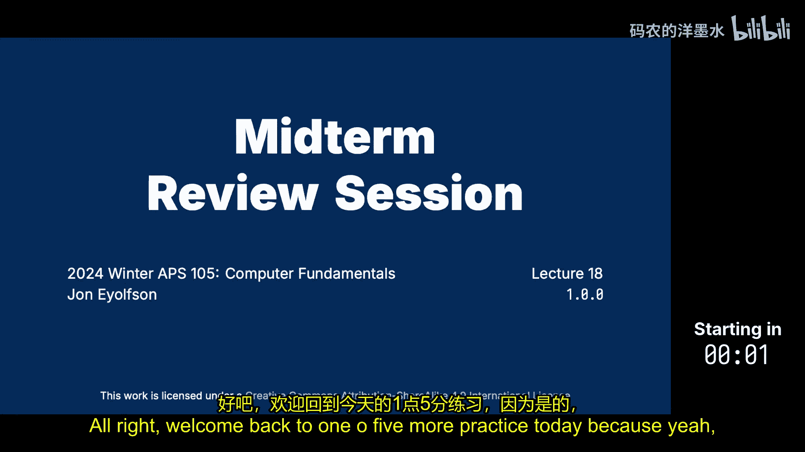
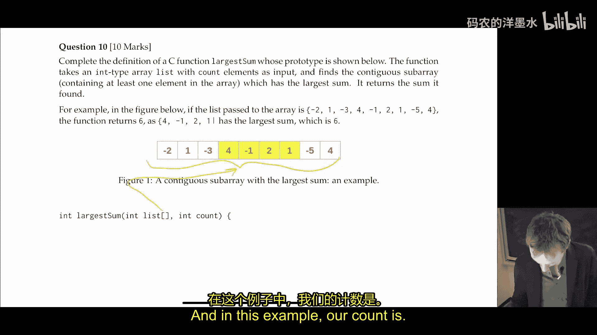
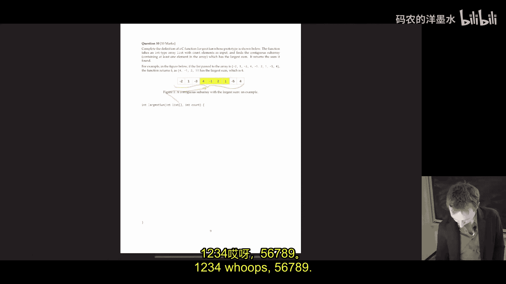
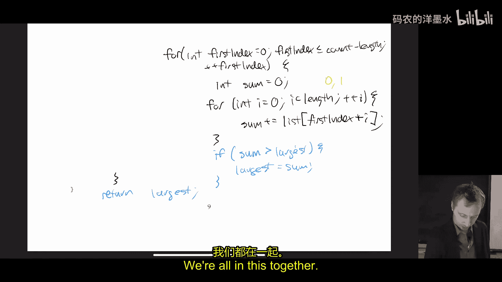

# 【全集】多伦多大学 C语言编程 中英字幕 1080P p18 Lecture 18 - 期中复习课part3 -BV1gikKB3EZW_p18-

。

All right， welcome back to 105， more practice today because yeah， we could use it。

But it's definitely almost reading week， it's probably your last class before you get to be actually free。

 so let us get to it。So next question， so we didn't start the programming questions again。

 this is the 2020 exam， so this is the infamous one where the average was about 50。

So let's see what we can do。This is next the first programming question。

 so the value of the math constant E can be expressed using infant series E to the blah， blah， blah。

 write a C program that approximates E by approximating the value of that infant series。

But it should stop adding terms until that value is less 0。01。

Your program should print the approximation to E and the number of terms used to determine the approximation。

 The terms of the series are。1。Then one divide by one factorial。

 then one over two factorial and so on。 So if we wanted to simplify this too， we could just say。

 well，0 factorial is also one。 So if we just write that instead。

 looks like it lends itself more easily to a loop So we should just have a loop here。

 we can see the bottom increases all the time。 So it's like n。

1 over n factorial plus1 over n plus1 factorial。and we start with n equals to zero。

So looking at this， we need。Probably to define a function so we can compute a factorial。We can just。

 I'll just do that quick so we could create a function in this case。 Well。

 we'll eventually get a double out。 so we may as well just say it returns a double and we can say fact with some int n。

W's not a function declaration， so we can。Create a function called factorial。

 May as well save yourself the writing， not write out factorial， Just write fact。

 And that would be something like double。 So we're producing like a product because， you know， and。

N factorial is equal to n times n minus-1。And。That n-2 all the way up to well。

 essentially two times1。 So I can just do the short version of that and do product。

Equal to zero that or equal to1， that'll go ahead and sum all of my products together。

 and then I could just have a simple four loop so for four。And。Call it X。Equals 2。

 So I can just start at 2。 I don't need to multiply by one or anything。 I can just say term。 oops。

 sorry， X is less than or equal to n。And then， plus plus x。They can to say product。Times equals。X。

Return product。Alright， something like that。 So that would be my factorial function。

 So any questions about that， I'm just making it return a double because I know I'm going to have to use a double later。

 Yeah you same。对。Yeah。Like it's not going to do the。Condition train。でか。

So when so how the for loop works is， you know， it'll。Take。This condition。

 and then always execute that。 So it will execute that first and then check the condition。

 And then if it's true， then it does this， so。If we give it like one or something like that。

 it just won't go into the loop， it would set x equal to2。

 then check this two less than or equal to one， and then that would be false so it wouldn't even bother going into the body。

That so yeah， that's a good thing to think about what happens if n is like 0 or n is one。

 So we want one back out of it and。That works with this。All right。So， for our main。Oh yeah。

 and then another question so y plus plus x not x plus plus， so again。

 remember that the post fix is the weird one that always like returns a value that was the original one in the for loop。

 the expression here。The value is not used for anything。 All we care about is that changes the value。

 so here I could write x plus plus plus plus x doesn't matter。

 but the default rule should be unless you actually need the old value out of that expression。

 always prefer this one because well。When it does matter， it might make your program really。

 really slow for no reason。 So pretty much always prefer the prefix version。All right。

 so then we could have int Ma。So it takes a void， and we're trying to calculate the value of E here so I can just create a variable。

So called E。And then initialize it to 0。 So now I basically just want to just write a loop that computes。

The next term。 So I'll keep track of what term I'm going to compute by just saying， oh。

 let's just create a variable called n。 So I could just say int n equals 0， something like that。

 And then maybe I just have a。Value called term。So the value of the current term。

 and maybe I'll just set it equal to one because， well， that's the value of the first term。So。

In my wild loop， I could just do while。And then user their condition。 So while the term is less than。

0。01。 So well。Term is greater than。Or equal to 0。01。 I just want to keep on computing the next term。

 So I would add。The current term to E。Then， increment， and。And then I can compute the next term。

 which would be something like one divided by the factorial of whatever end currently is。

So I could just have my loop that'll go for as long as I need to to actually compute the value based off what it told me。

 so I just keep on going until my term is less than that。

It wants me to print the approximation of E and also the number of terms used to determine the approximation。

 so I can just create another value for that。 so I could just do like in nu terms。

And while you're writing the exam， I would suggest you'd like just flip to the back page and write space between your lines。

 so if you need to do stuff like this and insert stuff， you don't have as ugly writing as I have。

So what I call it numb terms， let's just say I initialize it to one， and then I add the term to it。

 and then each time through the loop， I would just increment numb terms。

And then I print it at the end， all that stuff， My writing's terrible。

 but so this question isn't too bad。So。I might have an off by one area here I。

I can check that later and post it for you on Discord， but this isn't the hard question。

 So this is the infamous question。 So I want to go through them too。

 So you have the solution for them。 And then you can ask on discord and all that。So this question。

 they still talk about it to this day。 So it says an int in C is represented and stored with a certain number of bits inside the memory of a computer。

 This number can differ depending on the actual computer。

 say the number of bits is n and the bits are indexed0 to n minus1。

 the rightmost bit in the binary representation is bit0。

 So remember when we had columns that was like the two to the0 column So that was initially one。

 and they called the least significant bit。 I used that word to when we were talking about how an integers represented。

And so conversely， the leftmost bit is bit n minus1。

 and it is the most significant bit in a n bit integer。

 n n bit n minus1 is used to represent the sign。When bit n -1 is a 1， the integer is negative。

 Otherwise the integer is positive， then it says。Write a C program to determine how many number of bits are used to represent a s integer of size N I given computer。

 For example， on a computer that uses 32 B to represent an it type integer。

 Your program will print n equals 32。 You are not allowed to use size of。

 and your program should just make use of loops。Any ideas？I would probably say that。Yeah。

 kind of yeah。Keep on dividing by2， until so。Until it hits one。Let's say we can start off。 So that's。

A good idea， but it's going to be easier to go the other way。

What's saying is if we have like all these bits， So we have like bit n minus-1 all the way here over to 0。

We know that if this bit is one， then the number should be like a one， right。

So what we can do is essentially， if this is like the sign bit。

 So this is like what the sign should be。 how we can think about it is we can just try and move this one。

Column by column by column by column by column by column by column until it eventually makes it to the sign bit and that changes to be a negative number。

 So your way would be like we start off with a negative number and then just start dividing it。

 which is close， but it's gonna to be easier to just start with one because we know there should be at least one bit in another。

 So it yeah and then we can count the number of bits from them until it turns to zero。But。

This is a weird question， because if you want to know the size of an int。

 you would just use sides of int， and then you'd be done。But。If you were to think of that。

 So if you didn't think of that， don't feel bad because I looked at that。 And well。

 when the fourth year， fourth year student told me about their trauma。

 as they do still remember this， so。😔，Yeah， that says something。 They were like， yeah， we。

 I still remember this。 And I， whenever they told me I was like， yeah， that's weird。

 Why would you ever have to do that。But。What we can do using this idea。Oops。Is。

Our program could start with just some int。callled X。 And then it's the idea we have up here。

 so we could start with the value 1。 and then we know we could have a integer called n that keeps track of the number of bits。

 and we're essentially going to try and move it oops， move this bit up by one each time。

So each time we move it up， that's another number it can represent。

 And we're just going keep doing that until it becomes negative。 So we don't know。

How long we have to do this for， so we probably want a while loop。

 so we could do while X is positive。 So when x is greater than1。

 how would I just move this one up a column？So if this was like。If this was a base 10 number。

 and I gave you， let's say， I't know， sayy I gave you the digit 2。

 I told you to move the two up one column。 What you have to do to move it up one column。So。

So it's like the1 column。The ones column and the hundreds column。

So if I just gave you the number two and I said， okay， just move it。

Another column so that you got the number。20。What did I have to do to the two to get a 20。Yeah。

 multiply by 10， right？ And if I multiply by 10 again， I get 200。 So I moved it up another column。

 Well， that works with base 10 numbers。 Computers are base 2。

 So if I want to move this bit up one column， I just multiply by 2。 so I could do X。Mus equals2。

 and then I could do plus plus n。So that way， I'm just。Trying to move it up a column。

 And then I stop whenever I see it flips negative。 And then I know I'm at the last bit so I can stop and。

Then I can just print off however main number of bits I have。And equals。D。😔。

And then we can make a fully functioning program return zero this。So this would be the full solution。

In first year， there'd be no way in hell I would get that。So don't to so yeah。

 don't have to worry about that。 but yeah， so main thing with these。

 a lot of it is just going to be reading the question coming up with a plan before。And most of them。

 it'll be like。There'll be some combination of like a loop and if statement， something like that。

 that's the main constructs we know。So that was， that was a one。All right。

And there'll also be some question probably involving a raises like one or two or something like that。

All right。So this program is a bit more doable if you get the right idea。 So it says。

 given an array of 6 integers， write a function that prints them in order of the second digit from the right。

😊，In the manner shown。 So， for example， if the array held all these elements。

 so we want to be able to extract whatever the second digit from the right is。

 So for the first number， it would be a6。The next number， it should be a 2。 and for the next number。

 it would be a6。What would be the second digit from the right for this number。Z right， yeah。

 so just be a0。And then here itd be a one。 here it would be a three。So we're supposed to print them。

In order。I guess ascending order。Yeah， I guess that's what it says。Based off the example。

 So I should be able to print off something like this。 Or there's one number that has。

There's a six here and here， so I could flip this order to either solution would be valid。So。

Also says you should print out the commas as shown， so。Usually。

The way I like doing this is I think about what I should print if there's just one number。

 So if there's only one number， you know， I would just print a5， and then for every other number。

 it would be like， I'd have to do a comma and then a space and then the number。 So those are my。

Two cases for printing， which probably means I need a boolean to keep track of whether or not I need to print a comma in the space or not。

 so that's another thing we should probably keep an eye on。嗯。Other than that。Oh， yeah。

 sorry explain the space one more so。When we。Have to print these numbers with commas between them。

 right， There's six numbers， but there's gonna be  five commas。

 So while we're gonna do something for each of the six numbers。 We're gonna print the numbers。

 So we also have to decide what we're gonna do with the commas。

 So one thing you can do since there's one less comma than numbers。East way I think about it is。

If there was only one number I wouldn't even need to print a comma right。

 so for the first number just print the number and then for any other number。

 you would print like the comma space and then the number。

 so comma space number that's like the common pattern between all of these and then they end here so the first one is a bit special because it's just the number and then comma space number。

All right， so。When you think about this one。We want to print them in order。

 So one thing we can do is maybe we think about， okay， well， I need to print them in order。

 Like I can't just go over the array and then。Check what the second list digit is and like。

 decide whether or not。To print it by just going over the array first， I need to know。

I need to kind of respect my order。 So I might need a loop that goes over the digits in order first。

 So for this question， how I would probably think about it is I probably need to go over the digits like in order。

 like one。0，1，2，3。The the the the the。And then。For each of these digits。

 I can like look at my array and see if the number has that second lowest digit。

 So if I can look at the zeros I'd say， oh， do I need to print any zero。

 So I could look over the array。 In this case， I would be like no， don't need to print that。 No。

 don't need to print that。 No， don't need to print that。 Oh， okay I should print that。

 And then I would look at the rest of them， don't need to print that because it's not a zero。

 don't need to print that because it's not a zero， and then I could see， oh okay。

 now do I need to print any ones， go through it， check if there's any ones。 then okay， done the ones。

 do the twos do go over to the nines So。I did that in order so I could probably do something like。

Okay， I'm gonna leave myself some room so we can fix up the print， so。

First thing we want to do is go over the digits in order so I could start at digit 0 and go all the way up to whoops。

Digit is less than 10， or I could say less than or equal to9， whatever makes you feel better。So。

And we can just ignore the space for now。 So this is for every digit。

 So I need to see if I need to print。The element in the array。

 So let's give ourselves some space here， so I could say。

So now I just have to iterate over every single element of the array。

I equals 0 all the way up to the length of the array， which they don't have that macro or anything。

 They just tell you that。The array is always six integers， so you just got believe them。

So we could go all the way up to I is less than 6 plus plus I。All right。

 so then we just need to figure out what the second digit of the current current array element is。So。

 let's assume。And usually， I like to get like some examples of say， our first digit is。269。

 So how do I get the second digit out of that number？Yeah。Mod 100 divide by 10。 So yeah。

 Mo 100 would give me this， and I can divide by 10。 So that is a perfectly good thing to do。

So the current number I'm looking at is called array， and I'm looking at array I。So mod 100。😔。

Divide by 10。So I could do that if you thought of it a different way。

 there's more than one way to do it。 So you could do like。Another version of it。You could do array。

Hi。Divided by 10， so that will chop off this nine， so you get 29 and then you could just mod 10 that。

So those two things， both the same way to get the second digit， whatever you think of on the exam。

 just write it， don't worry about it。 you don't have to like simplify it or do anything with it。

So after that， all we have to do is like check oops。So。If the second digit。Is the same as the digit。

 so it matches。The digit in the order， I'm going through them。 So 0，1，2，3 did it does。

 So if it matches， that means I should print this number now。

 so we won't worry about the comma for now and we can do that in a second。

So I would just print off the number and just say I print off the number。

 they're going to be all smed together if I would actually run this。

But this gets us most of the way there， right？So this would just print off all the numbers all sed together。

 but they would be in the correct order。In this case， I would get exactly this。

 So if I want to go ahead and。Obey their comma rules Well I probably need to just create a boolean that just says。

 hey， am I praying the first number or not because well that's the like we did when we argued about what's different between all them when we print them for the first one we should probably just print the number for the rest of them to have a comma in a space so I don't know which one I'm going to have to print first so maybe I just say a bo and then I call it wow first print。

🤢，And then， I say。It's I'll just set to true initially。And then in here。

I know I have to print a number。In this if statement。 So I have to expand this a little bit。So。

Ohoops。So。If I need to print off this digit， I should probably check if。

 let me get back to the color。So if this is first print。

Then I just print off just the digit by itself。And then I would set like first print。Equal to fourth。

And then。It will just not。 Itll only print the first digit without anything else。

 And then in the else branch， I can just do like print F。Commer， space。The digit， and then array。Ai。

And then we're done。So if you ran out of time， then you could go ahead and you could just。

Not worry about the commas。 You'd probably get most of the grade for having like your two loops and everything。

 so you can。If you are tight on time， you can do that。 if you leave space。

 if you have enough room to write it。 So I'd probably recommend doing something like that。

 So questions about this once So I'll zoom out so we can see it。有。Sorry。No。

 we don't need to do it for the last digit。 So the last digit's just the number by itself。

So's like there's no comma after the last digit or anything。So here。So for all these numbers。

 it would be like the first one here is just the number by itself。

 and then everything after it is comm space digit all the way up up to and including the last one。

 right？They're all the same。So， you could。So that's the way you could also think about it。 Like。

 you could always print like。诶。Coma space until you get to the last one and then just print a digit。

 but usually I don't like doing that because sometimes you might not know when the last one is and if you only have one well then you just want to print just a number by itself。

Many more。If you like。Where is like。Im sorry。And just like。Yeah， theres， there's other ways to do it。

 like create another array and try and put them in order or something like that。

 So you could do that， but you're probably gonna run out of time。

So there's more than one way to do that for this。 You probably w to do。Do the easiest thing possible。

And。Yeah， so for the mod，100 divide 1s， so。Yeah， there's a question and discord。

 So the mod 100 of a number that will just essentially give you the last two digits。

 and then dividing by 10 will always just chop off the last digit because truncated integer division。

 it just goes away。All right， so now oh， this question。So Pythagan triple is a triple of integers， X。

 Y， Z， such that。X to the power of 2 plus y to the power 2 equals z to the power of 2。

 completete this function that takes a single positive integer x。

So we can highlight what our arguments are。So we want a single positive integer X。As an argument。

 and then print three positive integer values， X， Y， and Z， such that。Well。

 they have to follow all these rules， so。Knowing this。

All we can do is like just check whether or not we have a Pythagorean triple and we know the range of values for y。

 so we would know X and we have a range for y so we can just check them all until we find something that fits if not。

 while we have like there's only a bounded number of them， we can be so we can just try them all and。

If we。Happened to find one， we can just say hey， we found one。

 print it off and just end the function otherwise， you know we just say what's it say， it says。

Just print。 No solution exists if it doesn't。And。If there is one， it wants us to just print off X， Y。

 and Z， and it doesn't seem to be too concerned about the format。So。

The way this equation is set up to。Well， since。X is positive。And。

We have some positive number plus some other positive number equals Z then。

This condition will always hold， so we don't really need to know x is greater than Z。

 it will definitely be greater than Z， sorry， Canada。So。So for this。We know all the values of y。

 so we can just do them in order if we want。 So what's the first value of I that is greater than 0。

Hopefully one， so we could have our for loop。So we could do int Y。

Equals1 all the way up to y equals 100。Plus， plus y。

And then we can just try and find the solution to this Pythagorean triple。 So essentially。

 we have to do some algebra， I guess， So if we want to solve for Z。

 well we just take the square root of both sides。 So it's something like this。Right。And we know X。

 we know， well， we're trying to guess y and we know how to do a square root if you didn't just make up some function if you don't know it just so you can complete the question。

So。If we wanted to solve for what or Z， it'd probably be like double Z equals。Square root。

Of x times x。 So that's just x to the power of  two。 if you want to use like。Pow X2， go for it。

 you don't have to again， more than one way to do these types of questions， whatever。

 whatever you remember at the time。So I would just do something like that。

So what it wants is it wants to make sure that it is an integer。 So we know that。X is an integer。

 and y is an integer。 So we want to make sure that。Z is actually an integer because right now。

 it's a double right where it returns a double。 We might get like 1。1， something like that。

 So any ideas how we would check if a double is an integer。Yeah。So create an integer value。

 let's call it I。So just assign sign equal to the double。And then so what the。

 what does this line do。If I assign a double equal to integer。Yeah， it'll just truncate it， right。

 So if I get something like 1。14， it would truncate it to like one well， just one。

 just one straight up， oops。Allright， so I try and smush it into a。Wow， what the hell。 Okay。

 so I try and smush it into a variable called I。 And that what you want me to do with it。

So check if I is equal to Z。So， if I do that。I'm comparing a double to an integer。

 so it would convert this integer back to a double。 So just put 0。0 at the end。 So in this case。

 it would like compare 1。0 equal equal to 4。1， something like that。 And in that case， well。

 that's false。 So we know that that Z is not an integer。

 So we're just trying to make sure that it is actually an integer。 So if they're the same。

 then we could go ahead and say， okay， well we found our。Whatever triple， we could print。Man。

 this exam has a lot of writing。 just print F。 You've I would if you want to practice just write print F like 5000 times。

 and then you can go faster。Alright， so we print off our three。Numbers so。X， Y。

 and I guess I'll just use I。Or I could use Z and that convert it to double， whatever。

 And then I can just return after I print。 So after I found the triple， I can just return。

 I don't need to look for any other ones， there should be only one valid solution anyways。

 So don't have to try again。 And if this one is。Confusing other ways， you can do it。

Is one of the other ways I wrote it， I said if。Z is equal to。If you remember that function。

 this means the same thing。 So the double Z is equal to if I just take the double and trunnccate it。

 maybe that's easier to read than the integer conversions。Mean the same thing。

 but I could rewrite my if statement that way if I wanted to。And then here， if I make it to the end。

 so I try all the whys。 I don't find a solution， then I can just print。E。It said no solution。

And then a new line。All right， questions about that one， yeah。So you want z equal equal to。In Z。

 yeah， that would be fine。So that's another way to write the of statement if you want。

All mean all mean the same thing just。Whatever makes you feel good。To。

And then some question that I'll take up later about using a void function。

 we should only use pointers。So I'll take that up after， but any questions about this one？Alright。

 let's see if we can get squeeze another one in。Oh， this one's fun。

So complete the definition of a C function， largest sum whose prototype is shown below。

The function takes an int array type list with count elements。D。

List in this example would be this full thing。And in this example， our count is。

1，2，3，4， whoops。

5，6，7，8，9。So in this example， the count would be 9 for that array。 right， I hope there's 9 elements。

 yes。All right。So it says takes a array list with count elements。

 finds the largest contiguous sub array containing at least one element in the array。

 which has the largest sum。It returns the summit found。 for example， in the figure below。

 if the list pass to the array is what it says。The reflection returns 6 as this highlighted part is the largest sum。

 which is 6。4 plus negative 1 plus 2 plus1 is the largest sum。

 So if I tried another sum of numbers like this， this is like negative 2 plus 1， negative 3。

 So that's what negative4。 So that would be not the largest sum of all this。 So。For this。

 easiest thing to do is probably think about， okay。

I should probably just compute all the sums of all the sub arrays。

 so I need to figure out how many subars there are， including， I assume。

 is including the actual array， and says。It has to have at least one element。

 so it could have an element。 So I could have， you know， a length of just one as my sub。

 So I could compute the sum of this， the sum of this， the sum of this， the sum of this， this， this。

 this， this， this。So I have 9 choices for like subs of length1。 And then I might also be like， okay。

 well， what about subs of length 2， Well， then I have to do this。These， these two， these two。

 these two， these two。These two， these two like this。And go all the way through them。 And then for。

Length 3， it's like this， this， this。This， this。I'm just getting messy now， something like that。So。

You might develop a pattern for this。 So it's like， if I'm doing sub arrays of length， like。

It my sub array length。Is three， well I start computing like the sum of three elements。

 starting at zero， and then starting at one， and then starting at two， then three， then four，5， six。

 and then I stop at six because I would just go all the way to the end there and then I have three。

And then。So。You might just。Have a loop。 And here， you know the array length。

 because it tells you that the entire array length is count。

So if I think about it that way it's like how many different lengths like you just break it up into parts so you can have multiple four loops。

 so the first part could be like okay， well， I need to compute the sum of different lengths of subs so I can just say。

Let's use black。So you could say four， I need to compute different lengths。

 so maybe I just make my loop variable length。Started equal to one because I have to compute at least one element。

 and then I could go all the way up to length is less than or equal to count。

 which is like every element in the array。All right， so that。Let's put an end bracket down there。So。

 that gets me。Part of the way there。 So that gets me the idea of， okay， well， I started at one。

 and I have to compute the sum of。All of the sub arrays of length 1， so。Here。

 if there's subs of length 1， I have to start at index 0， index 1， index 2，3，4，5，6，7，8。 Like。

 I have to go through all of them， right。So。I might notice that no matter what the length of sub I'm computing is。

 I always start at index 0， right？ So I might just say， okay， well， what is my first index。

So the first index would always be 0， no matter what the big length of the array is。

 If I'm computing all of it， I still have to start at index  0。

 And then I have to go all the way up to essentially。So， in this case。If。I'm doing it。

 and my length is equal to one。And my count is always going to be equal to 9。

 I should go all the way up， essentially， to。E， which would be。In this case， since the count was 9。

I can argue that I need to go all the way up to。 I could just guess， count minus length。

 Like I need to go all the way up to that index and include everything。 and to。

Give yourself a sandy check。 I would check at least two cases。 So that's when length is equal to one。

So let's see what we need to go up to when length is equal to 2。 So I'm computing。Like this。This。

 this， this， this， this， this， and this might notice that there's eight different pairs of that。

 and I have to go all the way up to seven。So I go up to7。

My last sum of two elements is index 7 plus 8。My guess of going up to count minus length seems to be correct because count is still nine。

 minus length in this case is 2， which is seven， and that's what I have to go up to。

So you kind of have to relate them together so I could say first。So the first index。

Is less than or equal to the count。Minus the length I'm currently at。

 and my writing is getting worse by the minute。So do not write your exam standing up。

If you can avoid it。So some oops。So something like that。

 So now I know what the first index I need to start off， and I know how big my array length is。

 so I can compute now my sum。So initially， if I sum everything together。

 good initial value for it is 0。 So I could say， I have another loop。 Oh God。

 this is loops on loops on loop。 So I have to compute the sum。Of。In the case of two。

 like I have to compute this sum， so I know how many elements I have to go。

 so it is0 up to and not including the length。 and then I just kind of shift them over by the starting index。

So I could say four int equals0。Wops。In equals0， yeah， that's not good。

 I have to give it a name for int I equals0 to I is less than the length of the submarray。

Then I just have to do some plus equals。So it's called list。And then。Everything starts at。

First index。So it's this first index。Plus。Aye。W。Or you could say i plus first index。

 whatever you want。To sanity check that， you can say， okay， if the length is currently。Let's say two。

 then save my first index。 Well， it could go all the way up to7。So if it's 7， I want to add together。

Or index 7 plus index 8。 So here。My length is 2， So I would be going from 0 then  two for this loop。

 And then in this case， since first index is equal to 7， I would add together。List 7。Plus， list。8。

Something like that this。But this question is pretty long。 So that gets us our sum。

 So we're almost there。 So remember， the point of the question was to get the longest or largest sum。

 so。If I need to get the largest sum。Maybe I just。I'm thankful I gave myself room。

 so I'll need a variable to keep track of it。I don't know what it is initially。

 So maybe I just give it just some super negative value。

 So I just say something like that doesn't matter。No， you haven't learned that。

 but there's like a macro that's like the most negative value you can get if you wanted to。

 But for the purposes of this， probably negative some large number gets the idea across。

So I go through， I calculate the sum。 after I calculate the sum， I just need to check if。The。

 the sum。Is greater than the largest I've seen so far。Then the largest is equal to the sum。

And then after that， I believe I'm done。 So then I just say， return。Largest。

And that would be done at the very end of the loop。 So it would be something like that。W。

 that's a lot writing。 All right， any questions about that。 I thankfully made it through it。😊，第二。

Is it durable do you have。Just iterate the array。Okay。Like basically the first index there。

You basically sum up from。I today。And then every time you add something， wait。あのね。

You check if it's greater than your。And that way。two embassies。没有。所以。It was one the another。

 just like two messages。Yeah。W it。You could just go from I。Jay， in terms of some of it。

That gives you like another。Yeah， I'd have to get back to you because I can't。Yeah。

 I can't think of that off the top of my head， but。Like it's an exam。

 So first first thing you can think of， right that。 All right， we are now out of time。

 So just remember pulling for you。 We're all in this together。

