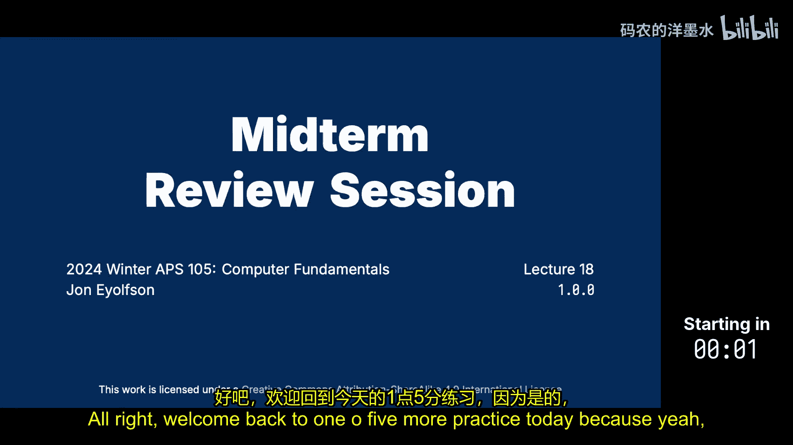
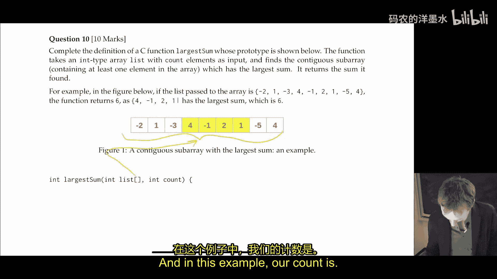
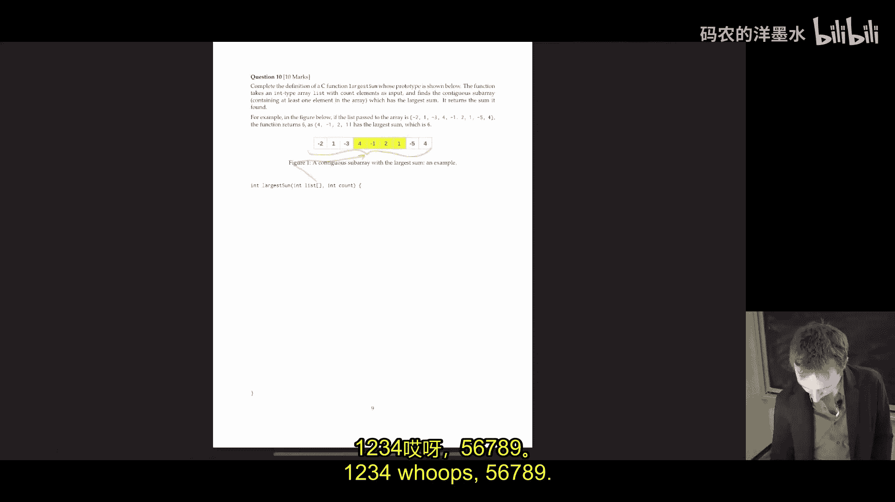
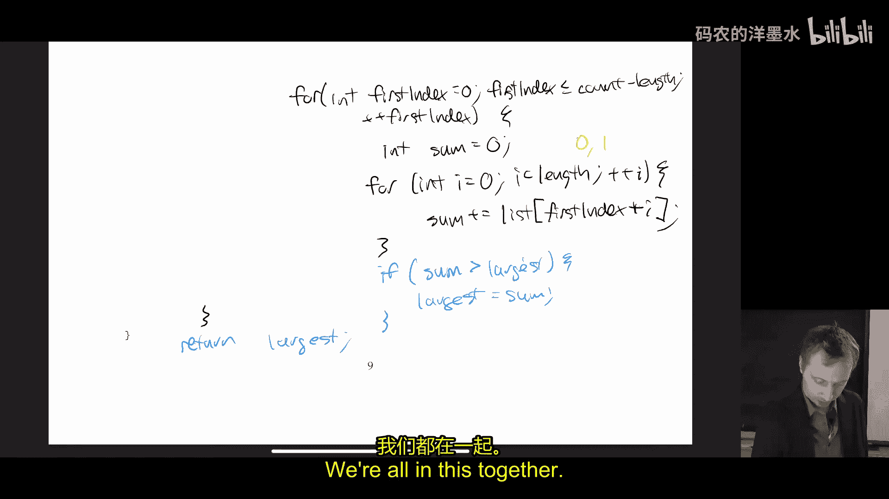

# C语言编程：18：期中复习课 Part 3



在本节课中，我们将继续复习期中考试可能遇到的编程题目。我们将通过分析几道典型的考题，学习如何将问题分解、设计算法并使用C语言实现。这些题目涵盖了循环、数组、函数和位运算等多个核心概念。

## 问题一：计算数学常数e的近似值

数学常数e可以用无穷级数表示：`e = 1 + 1/1! + 1/2! + 1/3! + ...`。我们的任务是编写一个C程序来近似计算e的值，当级数项的值小于0.01时停止累加。程序需要输出e的近似值以及用于计算该近似值的项数。

首先，我们需要一个计算阶乘的函数。阶乘的公式是 `n! = n * (n-1) * ... * 2 * 1`。

```c
double factorial(int n) {
    double product = 1.0;
    for (int x = 2; x <= n; ++x) {
        product *= x;
    }
    return product;
}
```

接下来，在主函数中，我们使用循环来累加级数项，直到当前项的值小于0.01。

```c
int main(void) {
    double e = 0.0;
    double term = 1.0; // 第一项 1/0! = 1
    int n = 0;
    int num_terms = 0;

    while (term >= 0.01) {
        e += term;          // 累加当前项
        num_terms++;        // 项数加一
        n++;                // 准备计算下一项
        term = 1.0 / factorial(n); // 计算新的项 1/n!
    }

    printf("e的近似值: %f\n", e);
    printf("使用的项数: %d\n", num_terms);
    return 0;
}
```

**核心思路**：初始化e和第一项，在循环中累加，每次循环后计算下一项（`1/n!`），直到项值小于阈值。

---

上一节我们介绍了如何通过循环和函数求解数学问题，本节中我们来看看一个关于计算机底层表示的有趣问题。

## 问题二：不使用sizeof确定int类型的位数

题目要求编写程序，在不使用`sizeof`运算符的情况下，确定当前计算机上`int`类型使用的比特位数。例如，在32位系统上，程序应输出`n = 32`。

思路是利用整数的二进制表示特性。对于一个有符号整数，其最高位（第n-1位）是符号位。我们可以从数值1（二进制`...0001`）开始，不断将其左移（乘以2），直到这个数变为负数，此时左移的次数就等于整数位数减一。

```c
int main(void) {
    int x = 1;
    int n = 0;

    // 当x为正数时，持续左移
    while (x > 0) {
        x *= 2; // 等价于 x = x << 1， 将比特左移一位
        n++;
    }

    // 循环结束时，x因溢出变为负数，n即为比特位数
    printf("n = %d\n", n);
    return 0;
}
```

**核心思路**：从1开始，通过不断乘以2（左移）来“推动”那个唯一的`1`比特向高位移动。当它移动到符号位时，数值由正变负，移动的次数即为总位数。

---

理解了底层表示后，我们回到数组操作。下面这个问题考察我们如何根据特定规则处理和排序数组元素。

## 问题三：按右起第二位数字排序并打印数组

给定一个包含6个整数的数组，编写一个函数，按照每个数字的**右起第二位数字**（十位数）的升序来打印它们，并按要求用逗号和空格分隔。

例如，数组 `{269, 321, 426, 500, 812, 943}`，其十位数分别是6, 2, 6, 0, 1, 3。按升序打印结果为 `500, 812, 321, 943, 269, 426`。

以下是解决此问题的一种方法：

```c
void printBySecondDigit(int arr[6]) {
    int firstPrinted = 1; // 标记是否是第一个打印的数字

    // 外层循环：遍历所有可能的十位数（0到9）
    for (int digit = 0; digit <= 9; ++digit) {
        // 内层循环：遍历数组中的每个元素
        for (int i = 0; i < 6; ++i) {
            // 提取当前数字的十位数
            int secondDigit = (arr[i] / 10) % 10;

            // 如果十位数匹配当前正在查找的digit
            if (secondDigit == digit) {
                if (firstPrinted) {
                    // 打印第一个数字，前面不加逗号
                    printf("%d", arr[i]);
                    firstPrinted = 0;
                } else {
                    // 打印后续数字，前面加逗号和空格
                    printf(", %d", arr[i]);
                }
            }
        }
    }
    printf("\n"); // 打印换行
}
```

**核心思路**：我们不是直接对数组排序，而是利用十位数只有0-9这10种可能。外层循环按顺序（0,1,2...9）查找十位数，内层循环检查数组中的每个数字。当找到匹配的数字时，就按照格式要求打印它。使用`firstPrinted`标志来控制是否打印前置的逗号。

---

处理完数组排序，我们来看一个涉及数学计算和条件判断的函数实现。

## 问题四：寻找毕达哥拉斯三元组

毕达哥拉斯三元组是满足 `x² + y² = z²` 的三个正整数。编写一个函数，接受一个正整数 `x`，寻找满足以下条件的 `y` 和 `z`：
1.  `y` 是1到100之间的整数。
2.  `z` 是正整数。
3.  如果找到，打印 `x, y, z`；否则打印“No solution exists”。

```c
void findPythagoreanTriple(int x) {
    for (int y = 1; y <= 100; ++y) {
        // 计算 z = sqrt(x*x + y*y)
        double z_double = sqrt(x * x + y * y);
        int z_int = (int)z_double; // 将double强制转换为int，会截断小数部分

        // 检查z_int的平方是否严格等于 x² + y²
        if (z_int * z_int == x * x + y * y) {
            // 确保z是正整数（条件已满足）
            printf("%d %d %d\n", x, y, z_int);
            return; // 找到一组解即返回
        }
    }
    // 循环结束未找到解
    printf("No solution exists\n");
}
```

**核心思路**：在给定`x`和`y`范围（1-100）内进行遍历。对每一对`(x, y)`，计算`z = sqrt(x² + y²)`。通过将`z`强制转换为整数再平方，与原值比较，可以判断`z`是否为整数解。找到第一组解后立即打印并返回。

---

最后，我们挑战一个更复杂的算法问题，它要求我们找出数组中具有最大和的连续子数组。





## 问题五：寻找最大子数组和

编写一个函数，接收一个整数数组和其长度，找出该数组中**和最大**的连续子数组（至少包含一个元素），并返回这个最大和。

例如，数组 `[ -2, 1, -3, 4, -1, 2, 1, -5, 4 ]` 中，和最大的连续子数组是 `[4, -1, 2, 1]`，其和为6。

最直观的方法是暴力枚举所有可能的子数组：

```c
int largest_sum(int list[], int count) {
    int largest = -1000000; // 初始化为一个非常小的数

    // 外层循环：子数组的长度，从1到整个数组长度count
    for (int length = 1; length <= count; ++length) {
        // 中层循环：子数组的起始索引
        for (int start = 0; start <= count - length; ++start) {
            int sum = 0;
            // 内层循环：计算从start开始，长度为length的子数组的和
            for (int i = 0; i < length; ++i) {
                sum += list[start + i];
            }
            // 更新遇到的最大和
            if (sum > largest) {
                largest = sum;
            }
        }
    }
    return largest;
}
```

**核心思路**：使用三层循环。
1.  第一层循环遍历所有可能的子数组长度（1到`count`）。
2.  第二层循环遍历给定长度下，所有可能的起始位置（0到`count - length`）。
3.  第三层循环计算从当前起始位置开始、指定长度的子数组的元素和。
4.  在计算每个子数组和之后，与当前记录的最大值`largest`比较并更新。

这种方法枚举了所有子数组，确保了正确性，但对于大的数组可能效率较低。在考试中，清晰正确的逻辑比极致优化更重要。

---

本节课中我们一起学习了五道典型的C语言编程考题。我们从计算数学常数e的近似值开始，练习了循环和函数的使用。接着，我们探索了如何在不使用`sizeof`的情况下确定`int`的位数，理解了整数的底层表示。然后，我们解决了按特定规则（十位数）打印数组的问题，巩固了嵌套循环和条件判断。之后，我们通过寻找毕达哥拉斯三元组，结合了循环、数学计算和类型转换。最后，我们挑战了寻找最大子数组和的经典问题，实践了多层循环和算法设计。



应对编程考题的关键在于：仔细阅读题目、将复杂问题分解为小步骤、先规划再编码，并优先保证代码的正确性和清晰度。祝你复习顺利！