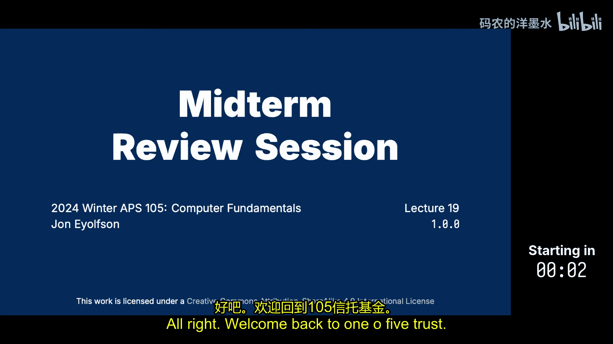
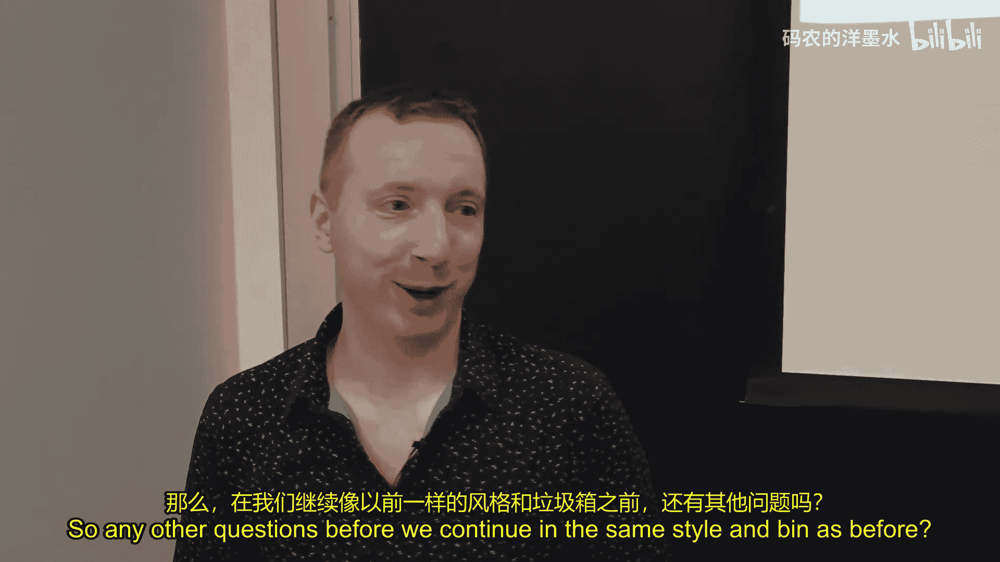
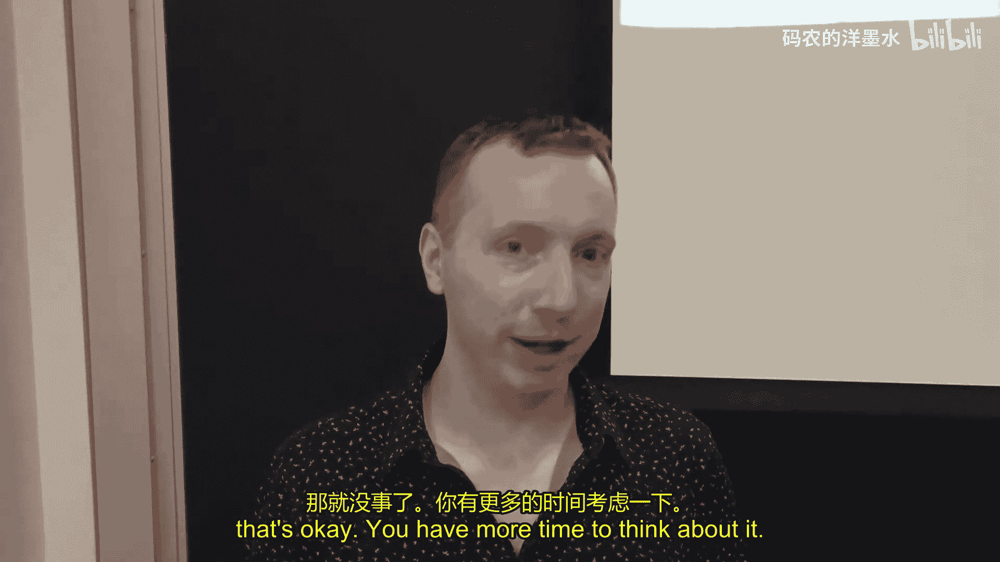
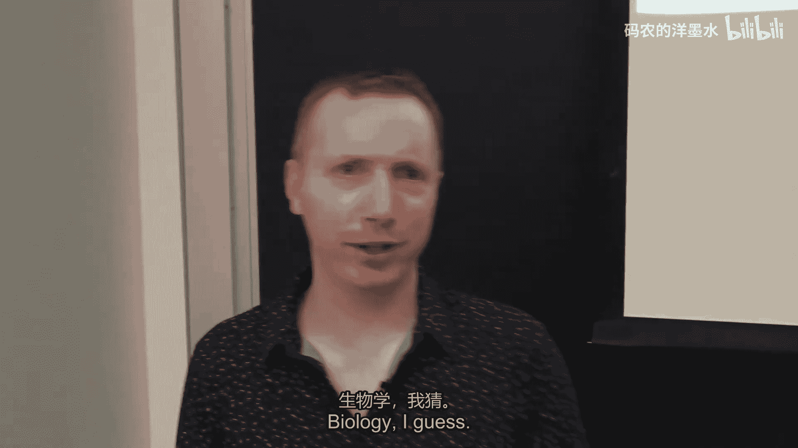
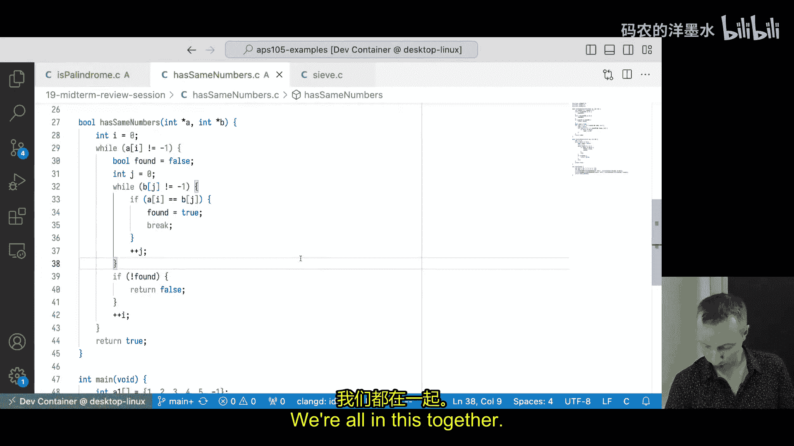

# C语言编程：19：期中复习课 Part 4



在本节课中，我们将继续复习期中考试可能涉及的核心概念，通过分析往届考题来巩固对C语言基础、逻辑运算、函数、指针和数组的理解。我们将逐一解析题目，并提供清晰的解题思路和代码示例。



---



## 概述



本节复习课将涵盖多种题型，包括编写单条C语句、简化布尔表达式、分析程序输出、重构函数以及解决涉及指针和数组的编程问题。我们将通过具体的例题，帮助你掌握解题技巧，为考试做好准备。

## 编写单条C语句

首先，我们来看如何编写单条C语句来满足特定要求。这类题目通常要求声明变量并进行计算。

**题目**：编写一条C语句，声明一个名为 `number` 的 `double` 类型变量，并将其初始化为 `66.6` 到 `99.9` 之间的一个随机数（包含两端）。

**解题思路**：标准库函数 `rand()` 返回一个整数。要生成指定范围内的随机浮点数，可以先生成一个整数范围内的随机数，然后通过除法转换为浮点数。

**核心公式**：生成 `[a, b]` 范围内随机整数的公式为：
```
rand() % (b - a + 1) + a
```
对于浮点数，可以先在放大的整数范围（如 `[666, 999]`）内生成随机数，再除以 `10.0` 进行缩放。

**代码示例**：
```c
double number = (rand() % 334 + 666) / 10.0;
```
或者：
```c
double number = rand() % 334 / 10.0 + 66.6;
```

---

## 简化布尔表达式

上一节我们介绍了如何编写语句，本节中我们来看看如何运用德摩根定律来简化复杂的布尔表达式。

**题目**：假设已有变量声明，请编写一条更简单的C语句（使用更少的布尔条件和关系运算符），使其与以下语句等价：
```c
!(x <= y && y <= z)
```

**解题思路**：应用德摩根定律，将逻辑非分配到每个条件上，并改变逻辑运算符。

**德摩根定律**：
```
!(A && B) 等价于 !A || !B
```
将定律应用于题目：
1.  首先应用定律：`!(x <= y) || !(y <= z)`
2.  然后简化每个条件：`(x > y) || (y > z)`

**最终简化语句**：
```c
(x > y) || (y > z)
```

---

## 分析程序输出

接下来，我们通过分析一个函数调用的过程，来理解程序执行的流程和变量的变化。

**题目**：以下C程序会打印什么？
（程序涉及一个检查阿姆斯特朗数的函数 `isArmstrongNumber` 和多次调用。）

**解题思路**：需要手动模拟程序执行，跟踪 `main` 函数和 `isArmstrongNumber` 函数中变量的值。关键在于理解 `while` 循环如何分解数字并计算各位数字的立方和。

**模拟过程要点**：
1.  `isArmstrongNumber(152)`：计算 `1^3 + 5^3 + 2^3 = 1 + 125 + 8 = 134`，不等于152，返回 `false`。
2.  `isArmstrongNumber(413)`：计算 `4^3 + 1^3 + 3^3 = 64 + 1 + 27 = 92`，不等于413，返回 `false`。
3.  由于两个函数调用都返回 `false`，程序执行 `else` 分支。

**程序输出**：
```
152 and 413 are not Armstrong numbers.
```

---

## 重构函数

现在，我们来看如何重构一个函数，以减少其返回语句的数量。

**题目**：以下函数接收三个不同的字符，返回中间的那个字符（按ASCII码顺序）。请重写该函数，使其只使用一个 `return` 语句和一个 `if` 语句（可包含 `else if` 和 `else`）。
```c
char middle(char a, char b, char c) {
    if ((a < b && b < c) || (c < b && b < a)) return b;
    if ((b < a && a < c) || (c < a && a < b)) return a;
    return c;
}
```

**解题思路**：我们可以引入一个临时变量 `mid` 来存储结果，通过一系列条件判断为其赋值，最后统一返回这个变量。

**重构后的代码**：
```c
char middle(char a, char b, char c) {
    char mid;
    if ((a < b && b < c) || (c < b && b < a)) {
        mid = b;
    } else if ((b < a && a < c) || (c < a && a < b)) {
        mid = a;
    } else {
        mid = c;
    }
    return mid;
}
```

---

## 指针与数组操作

指针是C语言中的难点。本节我们将通过一个综合例题，学习如何跟踪指针操作对内存中数据的影响。

**题目**：分析以下程序段，指出其打印的所有内容。
（程序涉及整数变量、数组、指针声明、指针运算、解引用和赋值。）

**解题步骤**：
1.  **绘制内存状态图**：列出所有变量及其初始值。
    *   `first = 1`, `second = 2`
    *   `data = {10, 20, 30, 0}`
    *   `third = &second` (指向 `second`)
    *   `fourth = &first` (指向 `first`)
    *   `fifth = data + first` => `data + 1` (指向 `data[1]`，即20)
2.  **逐步执行语句**：
    *   `(*third)++`：`second` 从2变为3。
    *   `(*fourth)++`：`first` 从1变为2。
    *   `data[second] = *fifth + first + *third + *fourth`：
        *   `second` 现在是3，所以是 `data[3]`。
        *   `*fifth` 是20。
        *   `first` 是2，`*third` 是3，`*fourth` 是2。
        *   计算：`20 + 2 + 3 + 2 = 27`，因此 `data[3]` 从0变为27。
3.  **确定打印内容**：
    *   `printf` 打印变量：`2 3 3 2 20`
    *   循环打印数组：`10 20 30 27`

**最终输出**：
```
2 3 3 2 20
10 20 30 27
```

---

## 编程问题：判断回文

考试中常包含小型编程题。以下是判断字符数组是否为回文的经典问题。

**题目**：完成函数 `isPalindrome` 的定义。该函数接收一个字符数组 `sequence` 及其大小 `size`，如果该序列是回文（正读反读都一样）则返回 `true`，否则返回 `false`。假设数组至少有一个元素。

**解题思路**：只需比较数组前半部分和后半部分对称位置的字符是否相等。如果发现任何一对不相等，则不是回文。

**代码实现**：
```c
bool isPalindrome(const char sequence[], int size) {
    for (int i = 0; i < size / 2; i++) {
        if (sequence[i] != sequence[size - i - 1]) {
            return false; // 发现不匹配字符，不是回文
        }
    }
    return true; // 所有对称字符都匹配，是回文
}
```
**说明**：循环只运行到 `size / 2`。对于奇数长度，中间字符无需比较；对于单元素数组，循环条件 `0 < 0.5` 为假，直接返回 `true`。

---

## 编程问题：比较数组集合

最后，我们看一个更复杂的编程问题，它涉及遍历以特定标记结尾的数组。

**题目**：完成函数 `hasSameNumbers`。它接收两个数组的地址，每个数组的末尾由一个负数标记，其余元素为正整数。如果两个数组包含**完全相同的整数集合**（顺序可以任意，每个数组内无重复），则返回 `true`，否则返回 `false`。

**解题思路**：遍历第一个数组的每个有效元素（直到遇到负数），对于每个元素，在第二个数组中查找是否存在。如果找不到，则集合不同。由于数组内无重复，此方法有效。

**代码实现**：
```c
bool hasSameNumbers(const int a[], const int b[]) {
    int i = 0;
    // 遍历数组a的所有有效元素
    while (a[i] >= 0) {
        int found = 0; // 标记是否在b中找到当前元素
        int j = 0;
        // 在数组b中查找a[i]
        while (b[j] >= 0) {
            if (a[i] == b[j]) {
                found = 1;
                break; // 找到即可跳出内层循环
            }
            j++;
        }
        if (!found) { // 如果在b中没找到a[i]
            return false;
        }
        i++;
    }
    // 还需要检查b中是否有a中没有的元素？由于无重复且集合相同，若a遍历完，b中剩余元素必然在a中已检查过或为负数标记。
    // 但严谨起见，可以同样遍历b检查a，或者检查两数组有效长度是否相等。简单实现可假设题目暗示两数组若集合相同则有效长度相等。
    return true;
}
```
**关键点**：使用嵌套循环进行查找。外层遍历数组a，内层在数组b中线性查找。使用 `found` 标志记录查找结果。

---

## 总结

本节课中我们一起学习了多种期中考试常见题型的解法：
1.  **编写单条C语句**：运用公式和类型转换实现特定功能。
2.  **简化布尔表达式**：应用德摩根定律来优化逻辑判断。
3.  **分析程序输出**：通过细致地手动模拟执行过程来理解代码行为。
4.  **重构函数**：使用临时变量和条件链来合并返回点。
5.  **理解指针操作**：通过画图跟踪变量和指针状态的变化。
6.  **实现算法函数**：例如判断回文和比较无序集合，重点在于掌握循环和条件判断的运用。



希望这些例题和解析能帮助你巩固知识，建立信心。祝你在考试中取得好成绩！