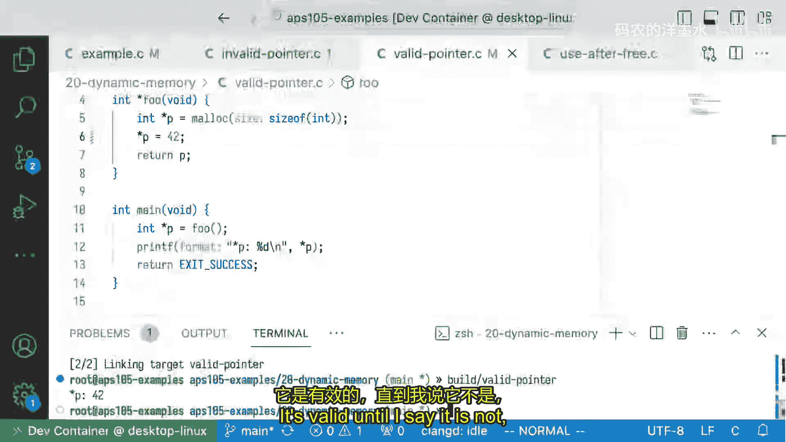
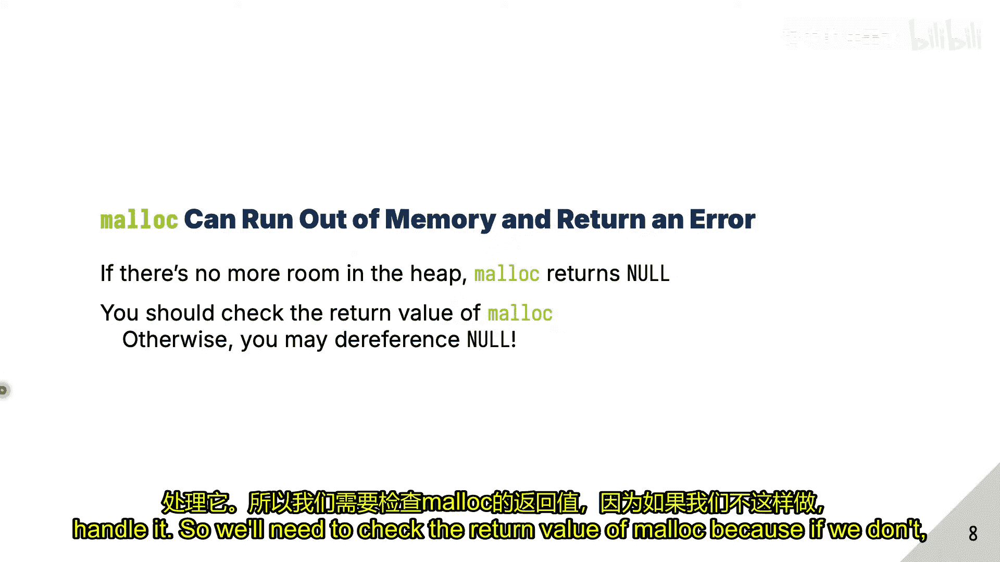
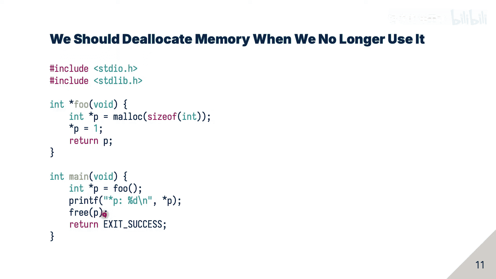
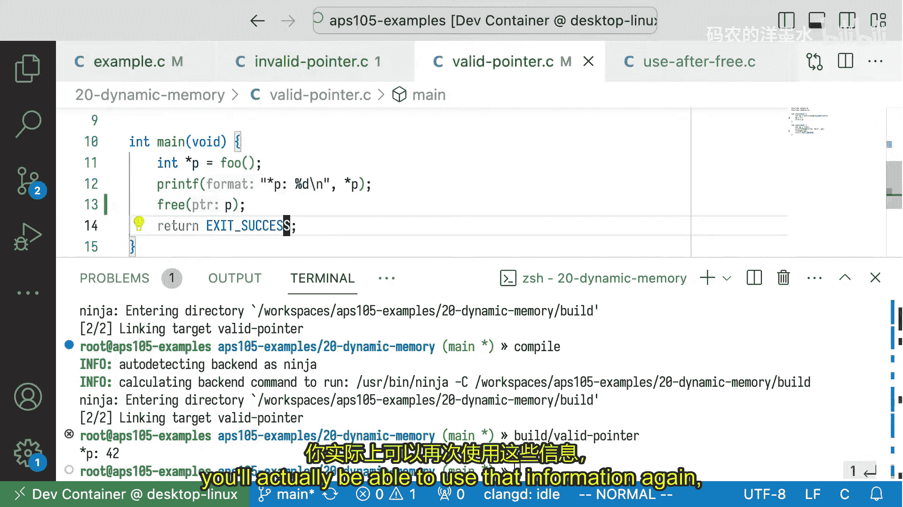
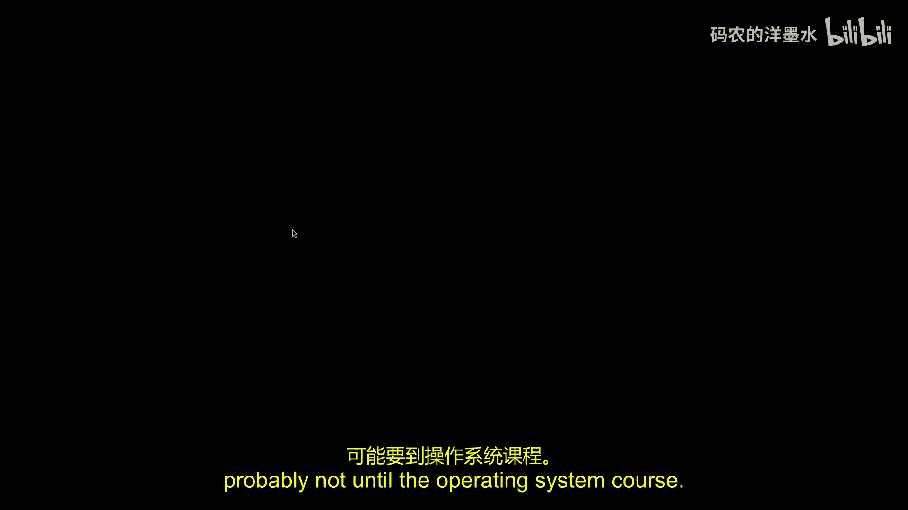
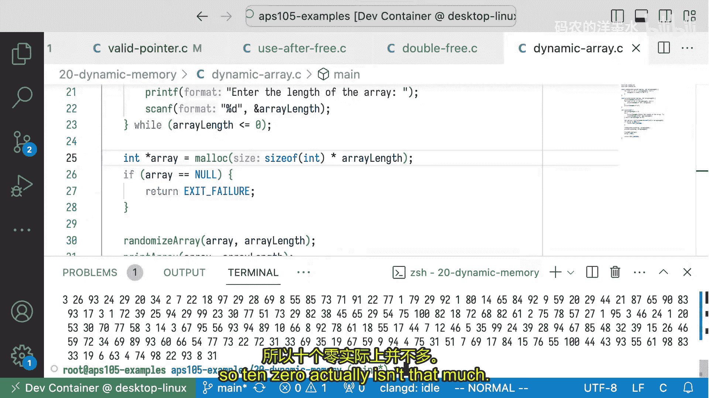
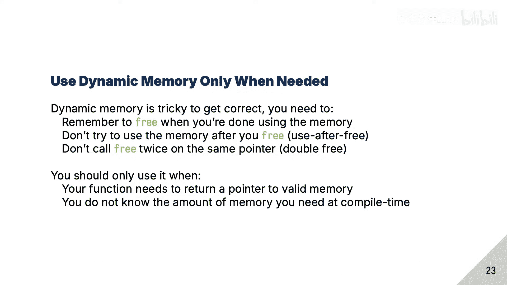

# 【全集】多伦多大学 C语言编程 中英字幕 1080P p20 Lecture 20 - 动态内存 -BV1gikKB3EZW_p20-

。

Allright， the camera's gone crazy， nice， so。Welcome back to APS 105。

 so back to regularly scheduled programming and we need to remember where we actually left off in terms of content before we spent like a week and a bit actually doing practice。

So。And this thing is broken。All right， so remember where we're at before。Where。

We had local variables and they only exist while the function actually ran。

 so if we had some code that looks like this，Very bad things happen。 So let's see what would happen。

So we started off by executing main so this should be reviewed。

 This is like the last piece of content we left off of So we would have a region of memory here。

 it's technically called the stack don't really need to know that for that course。

 but today we'll be talking about other regions of memory so I will be specific and say that any of the variables in a function are going to be on the stack So here we have main that is executing and the first thing main executings is variable declaration of P。

 which is a pointer to an int and then we call fo and fo returns a pointer to an int。

So we would set aside some space for P on the stack， which will hold an address。

 but right now we don't know what the value is because we need to actually call the function F。

 so we would start executing fo so that would。Is a new function。 So we are in a new scope and。

Any of the variables that were in Maine are now no longer accessible in P。

So P declares a integer called x， assigns a value equal to 1。

 so that would go on the stack so now there's a value1 and it's given by the name X。

 and then we return the address of x so a address that points to this value1 so if we so we're returning a pointer that will point to this x and whenever we return from the function。

 well turns out x no longer exists， it gets essentially deleted so in main we would have P which is just some address now pointing to wherever x was。

But because poo isn't running anymore， it doesn't actually exist。

 So when we go ahead and we run this。So when we go ahead and we run this。

 we got a whole bunch of weird results before。 But just to make sure， let's see what happens today。

 So today seems to give a segmentation fault。 So I'm trying to access some address that I'm not actually allowed to access。

So we get a segmentation fault， which essentially means that we have some invalid memory。

 So we're going to solve this issue today。 So this is like， oh， okay。

 I want to actually return a pointer to memory that didn't exist in main before the call。

 But with the tools we know how to do right now， we don't actually know how to do this。

 But at the end of the day， we will。 And this lecture is so。

Discourge that even the White House doesn't want you to know how to do these things。 So this is like。

One of the reasons why programming in C is hard。So。Just as a warning。So。

What we want to do here is we want to return a pointer to memory that is created in that function。

 so any variables in a function are allocated， so allocated is just a fancy word for saying created in memory they're created on the stack and whatever that function ends。

 they disappear they disappear we can no longer use them so previously in that example in X only exist in memory as long as we are running fo。

 we can't actually if we have a pointer to it and foo's no longer running， it is now no longer valid。

So this is getting into the danger land of C so we can actually explicitly allocate memory if we want。

 so there's another region of memory that C can use and it's unrelated to the current running function this region of memory is called the heap and it's from the literal word heap like this is a heap of garbage like this is just a lot of things that's all it means so it's just a large amount of you might hear this word come up in data structures or other things later。

 but in terms of memory， the heap is just a region of memory that you can just use to store information。

So how do we actually use this Well you can request memory from the heap using a function called malloc。

 so it's function prototype it's in the C standard library。

 It is called malloc it takes a single argument with this new type here so usually we saw like int cha double or bull。

 So this is a new type that you don't have to actually know for this course it's just how they define malloc so there's a size underscore T type and size underscore T it's basically just a positive integer type whose size actually varies on your machine。

 So if you have a 32 bit machine it is 32 Bs or 4 bytes if you have a 64 B machine it is8 bys or 64 Bs。

But basically， just think of it as an integer and it's always going to be positive because， well。

 if I'm allocating space， if I need memory， I can't have negative memory。

 like I can't just like take away memory so it has to be positive。 and I can't really just say。

 give me zero bytes of memory。 that also doesn't work。

So the size argument there is how many contiguous bytes to allocate in the heap。

 so if I say give me four bytes， I will get four bytes in memory all in a row， all contiguous。

 so remember that's what that means arrays are also contiguous。

 so they're packed together all in a row。So after Maloc returns here it returns a void pointer or aK just a pointer and it's up to you to know what that type is based off what you're actually going to use this memory for so it just returns a pointer to the starting address and after that you can use size contiguous bytes so today we're going to start off by just using it to solve the problem we have before and just create a int which is just four bytes。

So other things you might see in software， you might see the term API come up again。

 so I'd be remiss if I didn't tell you what means so it stands for application programming interface basically it tells you how to use a library like what functions and what types and things are in it So a valid thing to say is you might just say hey。

 what's the malloc API and that means someone just wants you to tell them what this is。

 So malloc is a function that takes one argument that's the number of bytes to allocate and it returns a pointer。

 So that would be like the malloc API kind of describes what it does and we'll see what malloc does basically it's just。

Requesting some bytes of memory that we can go ahead and use that aren't tied directly to a function。

So。Let's go ahead and if we wanted to use malloc to create a pointer to an int so we could create an int pointer。

 call it P and then assign it equal to malloc So malloc is requesting some bytes of memory So in order to properly store an it we need four bytes in a row。

 So instead of just remembering how many bytes are in an int。

 that's why we taught you what size of is。 So just to be clear you just in order to hold a or an int。

 Well we need。This many bytes of。Space， so in the case of an integer， we would need 4 by。

 Don't have to remember itself。 We should always just use size of， so。

This will have malloc return essentially a pointer to4 B。

 And we're going to use those four B as an integer。 So this memory will be on the heap。

 So it's like we already took the address of it or something。 So the value it's pointing to， however。

 is。Going to be undefined， so that is another word that you'll come up。

That you'll see when we talk about C programming， and that means it could be any value you cant。

 you have no idea what it could be。No way you should depend on it same way as if I just like do in x and I try and use x。

 that value is also undefined， I have no idea what it could be。

So you can initialize a value by dereencing it。 And that's typically what we would do， right。

 We're requesting some memory so we can actually use that value。 We can actually dereference P。

 It's going to be valid。 It's going to represent an int。

 We should probably initialize it to some value。So。We can change our function before。

 so before we were trying to return the address to an integer that didn't exist。In mainine。

 And we wanted to create it in fo。 So we couldn't just return the address of like a local variable because it doesn't exist when fo is done。

 So in this case， we have to use malloc to request some memory。 So in this case。

 instead of doing in X， I have to be explicit， and I have to say， okay， well C。

 thanks for helping me out before by just giving me four B for an integer。

 if it was just a normal variable。 But I actually need to request some memory on the heap。

 So I would declare a。Pointer to an int called P。 and then assign it equal to the result of malloc after I request 4 B of information。

 So after this。P is a valid pointer。 So it's actually pointing to valid memory。

 I just don't know what the value is。 So on the next line， I can go ahead and just update the value。

 So we can walk through what would happen in this case now。 So we would start executing at main。

Maine has its own local variable P。It would go on mains stack and we don't know the value of it because we are doing a function called theF。

 So info same rules as before， it would have a new scope。

 It would create its own variables that only it can access。 So in this case， F would also have a P。

And we assign it to Maoc。 So what malloc is going to do is essentially grab us space for an integer that is somewhere else in memory and that somewhere else in memory is called the heap。

 So P will be an address because it's still a pointer， pointers are basically just address。

 but instead of pointing to something like。This P in main or some other variable。

 if we declared an x， instead of pointing to that， it points to the value on the heap。

And because we just called malloc， we don't know what the value is。

 So I just put a question mark there。 So any questions about that so far。

 So fun new region of memory called the Heap。 Yep， if you were repeatedly called that function and then reasign。

What do you lose？Yeah， so the question is if I just like repeatedly。

Call malloc in a loop or something and just update P going forth。 Yeah。

 then I would lose access to it right， because I no longer I like overwrote the value of the pointer。

 So now I don't have access to it。 And then your memory is essentially lost。

 You just wasted all of that memory。 And has anyone ever used Chrome。

Or a web browser that uses like gigabytes and gigabytes of memory。Boom。

 that that is the reason why because while they just use it， they forget to。

 we don't know how to do it yet， but there's a way to tell your computer that I'm done with this memory。

 go ahead and use it for something else。But we'll come up to that。We'll come up to that a bit later。

And yeah， Maoc is literally just saying， grab me some memory to use that I can access。

 make sure it's valid。If you use it through the pointer， you are allowed to do it， do that。

 So it's just some random bytes of memory， somewhere else in memory that。

You will learn in much later courses for now。 it's just some memory somewhere else that always exists until you tell it you're done with it and we'll see that。

A bit later。So right now， if I dereence P， that means I'm accessing the value that P is pointing to。

 so that would be this random value on the heap and I assign it equal to1。

 so after this line this is what my memory looks like。 So questions about this。So now if I return P。

 right， I'm just returning an address and that address is going to  point to one。

 So the address will still point to one。 But when we return， we get a copy of it， so。

Foo would return a copy of that address， but that address still points to one。 So in main。

 P would just point to that same he value。 So now if I go ahead and print。

 I should be able to print exactly the value that we had before。 So do。So here is that code。

 So exact same thing we had before。 But now if I run it， I will not get a segmentation fault。

 I'll just see one because I wrote the value of one to it。 It's still valid，'s still a valid pointer。

 And if I change this to。Whatever value， something like 42。And I go ahead and I run it again。 Well。

 it's 42。 It's still valid。 It's not just。It's not invalid memory that I'm not allowed to use anymore。

 it's valid until I say it is not， which well go into in a second， but whoops。

And any questions about this so far。

And yeah， so one question， how big is the heap， So the heap。

 basically as much memory as your computer has， if your operating system is actually working correctly。

 so should be as much memory as your computer can handle Sometimes it might actually be more because operating systems are quite smart。

 but that's EC 344。Which is a fun course， I'm not biased at all because I also teach that。Alright。

 any other questions with this before we actually get into more of the fun issues with this。

 And I will show you something that will help you identify these issues because。Yeah， and by Ram。

 I mean， yeah， by memory， I mean Ram， but there's some tricks it can do where it can store some information on an SSD if it needs to。

 it's just slow Again， don't worry yourself about it。

 It's essentially you can think of it as just RA。 So the heap should be most of the Ram spots until your computer actually runs out of memory。

So hopefully no one's actually has anyone actually like seen out of memory when they've been using their computer。

 okay， one， so that's basically the program was calling Maoc over and over again。

 and then you ran out of physical memory and well， can't do anything without memory。So， with that。

So Maloc， if we， if our system actually runs out of memory， Maloc will tell us about it。

 So because we're requesting memory and we may run out of memory。 It might return an error。

 which is something slightly new for us。 So if there's no more room on the heap， Aka。

 my computer has run out of Ram。 then Maloc returns null。

 So that means malloc cannot find memory for you。 It's out of memory too bad。

 You get to handle handle it。 So we'll need to check the return value of malloc。

 because if we don't how I wrote this before。

Put oops。

How I wrote this before， potentially， malloc could return null。 And if Maoc returns null。

 and I D reference it。Boom， I get a segmentation fault again， right。

 so I might have an error in here where if my program actually。

 like if my computer runs out of memory， this program is just going to crash and I might want to try and handle it a bit better than just a good old segmentation fault。

ち。So。Now we get to actually say to see that we are done with that memory and if creating some new memory is called allocating。

 well saying you're done with it is called deallocating。So previously。

 we didn't have to do this because when a function returns， all the variables disappear。

 that basically means that all the variables were delocated for us。

 So that is part of what C does for you。 So they're no longer valid。

 that like C can go ahead and reuse the memory that you use for your variables in the function automatically。

 you don't have to do anything special。 So when we say the memory is delocd。

 That means you're done using it。 It's not valid anymore。 you shouldn't touch it。

 It can be used for other purposes。 and you don't know what those purposes are going to be。

 So if you touch it， well， you're going to have a very， very， very hard time trying to debug it。

So for memory allocated with malloc， I have since I requested it。 well。

 C does not know when I am done with it， so I have to tell it when I am done with it。

 So we have to deallocate it ourselves。 and how we do that is theres a function for that。

 And it is called free。So its function prototype， it's also in the C Standard Library。It's just free。

 it takes one argument， which is a pointer， and the rule is that pointer argument needs to be the one that Maloc returned to you。

And afterwards， if I call free on that pointer， well then all that space is given back to your operating system and it can be reused for other purposes。

 and afterwards， just like what we had before。 it is now invalid to use that memory again。

 so that memory pointed to by pointer is now no longer valid and free does not return anything。

 and yes， void star means just an arbitrary pointer because C doesn't really care what you use the memory for that's up to you。

Yeah。All right。So， with free oops。So。Oh， also， a nice thing。

 nice thing about free is if the value of pointer is none。 So if the first argument is just null。

 then free does nothing。 So there's no worry about like dereencing null or anything with free。

 if you're trying free null， that just means I'm trying to free nothing。

 So C smart enough to know that， oh， okay， well， I don't have to do anything。

 The function called does nothing。And yeah， some other questions， if I forget to free space。

 will my RA just never be able to use that memory ever again and the answer to that is well。

 what happens with Chrome， it just grows bigger and bigger and bigger and you're not allowed to use that memory again so you have the same issue right？

So as long as your program is running and it has allocated memory for it， you cannot take it away。

 so your operating system will get rid of memory your program' is using when it's done executing。

 but other than that it has to keep it around and if you just malloc over and over again you can go ahead and just waste all the memory on your machine。

And spoiler alert， you know， when you submitted your lab and then the servers went down something。

 so some master's student malllocked a lot of space and their program didn't finish and then the computer ran out of memory。

Yay， so that is a thing that can happen。So what we should do is we should deallocate memory whenever we're no whenever we no longer need to use it anymore and it is up to you to make that judgment call the compiler C can't really help you here。

 So in that same case， well， in Ialoc and then I return that pointer back and then in main I use that pointer to actually read whatever the value was。

 And then that is the last time I actually need that memory。

 So technically I should free it right when I'm done。 So。I just free it。 I'm done with it。

 and now I can no longer dereence P again without getting some weird result。

If I did。So let's assume that we did。

Here I could be like okay， free P， that's good。 so now I freed my memory。But now。

 if I try to use it again， now I am using memory that is now no longer valid， so。Well。

 we might get a random value。 We might get a segmentation fault。

 We don't actually know what we're going to get。 So if we go ahead and run that。

We get negative a gigantic number。And that negative gigantic number seems to change every time I execute it。

 so we are no longer and now allowed to use that。And then question。

 can you re explain what it means when returning automatically dereences so returning does not automatically dereferences。

Returning like this variable， P and P automatically des not D references。

 So like this local variable。P inF， whenever this function returns。

 I'm now no longer allowed to use it， I can't if I return a pointer to it。

 like what we had before when we return the address of X X only exists as long as F exists。

 so it was not valid to actually use a pointer to it here。All right。Any other questions， yeah。

Is there a reason that after you？Meory you got like a random number as opposed to like a segment。

Yeah， so the question is， is there any reason why I got a negative number as opposed to segmentation fault？

There is a reason for it， but I cannot explain it to you until third year。Basically。

 that memory is still sitting around and we can reuse it。

 but it just wrote some random stuff there for the meantime。

Segmentation fault means like you were like wildly off on your address and you've never used it before。

 This is I've used it before， but I gave it back and they just wrote some random stuff。

 It was used for something else， so I have no idea what the value would be。Okay。

 any other questions with that。 So this。Bad news， do not use memory after you free it for the same reason that we shouldn't use。

 the address of X whenever x no longer exists anymore。ちち。All right，Forgetting to delocate memory。

That has a name。 That name is called a memory leak。 So this is like the web browser problem。

 So your program uses more memory than it actually needs to function。 It's just wasting space。

 It's costing you money and you might run out of memory sooner than you would like。

 So this is a large problem when your program runs for a long time。

 So anything you write in this course。😊，While it doesn't take that long to actually run all the memory goes back to the operating system whenever it's done running。

 So it's not a big deal。 But later， if your program runs for a web browser。

 how many people have had their web browser open for days， months， weeks， like years。

 So that is just running constantly and if they even make a little mistake， you know。

 even if they forget to free a few bytes here and there， Well。

 if you run something for like months without restarting it， then it's going to eventually。

Run out of memory， might slow down other programs， might prevent you from actually running something。

So。These things are notoriously hard to figure out and identify。 So luckily。

 I can show you a little tool that will help you when you are writing programs。

So there is a tool called Valgrind to help detect some memory issues。

 so if you normally run your program on a terminal， like here I did build valid pointer。

So to use velgrind， all I have to do is type velgrid in front of it。

 and then it will go ahead and analyze my my program for me while it is running for memory errors。

 So if I go back to this。So let's go back to the version where I just didn't free my memory， right。

 I just malllocked。 I used it。 I didn't free it at the end。And if I run it， you know。

 doesn't look like anything's bad。 and it's 42。 I have no issues whatsoever。

 But if I go ahead and I run velgriin in front of it。

 it tells me that there are some issues So here it has a leak summary。

 So that's basically memory that your program has mallloed， but you haven't freed yet。

 So it will actually。Analyze your program to make sure that you freed everything by the time your program is done。

 So here it says leak summary definitely lost， which means I have leak some memory。

 I forgot to free something， so。So it gives me a bit of information here。

 And it says rerun with leak check equals full to see details of leaked memory。

 So if I go ahead and I run it。What that means is it wants you to run it like this。

So we do valgrin and then dash dash leak dash check equals full。 and then our program。

 It will give us some more information to help us identify why we had a memory leak。

 So we run it and then we see here four blocks or four bytes in one blocks are definitely lost in record some things we don't really have to care about and here it will show us here some memory addresses and then some functions。

 But what really matters is we start from the bottom and then it tells you what function called what And that is the malloc that was never freed。

 So this is saying in main at line 11。 So this line right here。

 So this is like file name and then colon and then line number。 So 1111。 So it's saying。

Maine was executing at line 11， and then it calledFo from there， so it was doing this。

And it says info On line 5， this is the malloc that you never freed。 so now I know that， oh crap。

 well， this gives me a nice little hint that it was this malloc that had the problem so okay。

 I can't free it here because， well， I'm going to use it later， so I should probably use a free here。

So in this example。Doesn't help too much because there's only one malloc。

 so there's only one possible thing it could be， but if you write a more complicated program with mallocs all over the place。

 then it will actually save you a lot， a lot of time。And。In the output。

 you might have noticed some number there。 Don't worry about that number is basically to identify your program。

 You don't need to know it。 You can just ignore it， so。

Only thing that is really important is in the leak summary。

 If there's something that says definitely lost， it means you mall something and you forgot to free it。

So。Here is just， so you have it on the slides if we want more information about the memory leaks。

So like I said， this tells you what malloc you forgot to free。And then。Like I said。

 this means that main called F。 and then fo called malloc。

 This line number doesn't matter because I don't know where this file is。 So therefore。

 all we really care is that our malloc。Atline 5 of our program is the one that leaked。

Then we have a question， does malloc affect efficiency What if I choose to use malloc instead of the stack。

Maoc is technically a little bit slower and it's also harder to get right because we also have to remember how to free it and everything like that。

 So if you don't need to use malloc， do not use malloc。

 use if you can just use variables in a function， just use those。

 you don't have to remember to free them or anything like that and they are technically also a bit faster。

So here is our example。 So we also forgot to do another thing。

 So we did not check the value of malloc， like what malloc returned。

 because it could have returned null， right， It could have returned null。

 that means we are out of memory。 So instead of just letting that null。

Go in our program until we eventually seg fault。 Good practice is to check if it's null。

 and then we can use this new function called exit。

 So this new function called exit will stop our program immediately。

 and it's pretty much it's exactly like returning from main。 So main returns an int。

 This int tells the operating system what happened to our program。 usually it's exit success。

 that means all good。 But now we have a case where it is not good。

 So we can exit And then we can give it the integer exit failure。 That means something bad happened。

 So don't expect don't expect that my program actually ran all the way。 it failed in some way。😊。

So the exit function immediately ends your program， it is also in the C standard library。

 the other sections may not go over this so you shouldn't actually need to know this for the exam。

 but it is a handy thing to know so exit just takes an int status exactly like what main returns。

 so it behaves exactly the same way as returning from Maine except you can put it anywhere in your program you would like。

Stops your program from running。 And then that status tells the operating system if there is an issue with your program for this course。

 if you have like an exit， it would typically only have what we had here， which is exit exit failure。

 I ran out of memory。 I don't know how to proceed now。

 like the next line does even make sense if I don't have any memory。And then for this course。

 mostly we just use exit success or exit failure。And then we have a question。

 what really is a difference if I put exit failure at the end of mainine。

 So if I put exit failure instead of main， that tells the operating system that， hey。

 my program probably didn't work as you expect it to。

 but we don't really know how to use that or get that information out of the operating system。

 So likely what will happen is a big pile of nothing。Let's see if I can show the difference。So。

If I want to do exit failure instead， whoops， I can spell fill。So if I look at it。

 exit failure is just the number one， oh， whoops。All right。

If I do exit failure instead of exit success， exit failure is just the number one。

 if I compile my program doesn't really look any different。If I run it。

Doesn't really look any different。 The only difference here is see this one。

That's where that one comes up。 So that's all it tells you。

 But it's up to you to know that if you see this one。

 you should expect that this program didn't actually work。

 And there is this one right in the bottom right corner that you probably don't see。

 But that's all it really does。 And it's up to you and your operating system to decide what to do with that information。

But as you get more experience doing this and go in other courses。

 you'll actually be able to use that information again。

 probably not until the operating system course。

All right， so。Like I said before， so we saw this example， we shouldn't use memory after we free it。

 we just got a random negative value， so what was happening was well we malllocked。

 so we got a new address that points to some unknown value on the heap。

 but it is currently pointing a valid memory I can dereference it， set the value equal to 14。

 and then free it after I free it， that memory is no longer valid， just poof disappears。

 gets reused for something else， but that pointer is still pointing to it and we saw when we read it。

 we got just some random negative value。And then while we'd print off some random value， exit。

 and then we'd be done。So the value。It's another thing that is undefined。 So on my machine。

 I got large negative values that were slightly different every time when you run it。

 you might get something different。 It's also possible a segmentation fault depending on the operating system。

 but probably pretty rare。So that issue is called use after free。

 So I'm trying to use memory mallo gave me after I freed it。

 So you might also hear that P is what's called a dangling pointer So it's a pointer just to some random invalid place in memory。

 So a good practice to have just to save yourself is after you free a pointer。

 you can just set it equal to null and that way， well if you try and use it。

 you'll get a segmentation fault， which will be easier to debug then just having a random value but that's about the best you can do in that case。

So。You see a segmentation fault instead of an undefined value， not the best， but， you know。

 it could be worse。So some other bad things to do。 You are also not allowed to call free twice on the same pointer。

 So if I call free P free P again， well， I get a runtime error like。Free。

 double free detected in T cash2。 What the hell does that mean， Don't worry about it。

 It's some weird implementation detail。 All you have to worry about is doublele free happened。

 You are not allowed to do that。😡，So。Luckily， Valgrind can actually help you also debug the previous two issues。

 so it will tell you about use after free， and it will tell you about double freeze as well。

 which is nice and useful so。If we had something like this where we free the memory and then we try and use it。

 well， if we go ahead and we try and use it， we get like that random negative value again。

 but if I go ahead and I'm trying to debug it， I have no idea what's going on。

 my program is complicated。 Well I could use velgrind。

 and then it will actually give me some handy information that might be a bit hard to read。

 but it's better than nothing。So it gives us a whole bunch of information。 So it tells you。

What happened to the memory。 So I tried to read a value in memory。

 It tells me the line number that I tried to read it。 So it was line。

8 and the read basically refers to this dereencing。 So I'm like accessing the memory。 I'm reading it。

 I'm trying to access it is what that means。 So it says invalid read。

 So that basically means I was not allowed to de reference this。 It is not pointing to valid memory。

 It is invalid。 and then it tells me that the address。 So this is the address that's stored in P。

So it says the address is 0 bys。 A K A。 I freed it inside of a block that I freed。

 and it tells me where I freed it。 So it tells me where the free function is。

 but this tells me where I freed it。 So it tells me that， hey， you jerk。 you freed it on line 7。

 So why did you use it on line 8。 And then it also tells me where I malloced it。

 So it says I malloced it on line 5。 So it says you malled it on line 5。

 and then you got rid of it on line 7。 and then you used it on line 8。

 So gives you a whole bunch of information。But it's just a bit hard to read， but。

That's better than just seeing a random negative value and going what the hell。

Will help you a little bit， I hope。Allright， so any questions about that。

 So it'll also help with double freeze， but double freeze are a bit more obvious because you get an error anyways。

 but I'll leave it to you。 You can run it with double freeze。

 It'll tell you what two free calls happened。All right。

Any questions so far before we do a more complicated example。Alright。

 then let's ramp it up a little bit。 So let's just define some functions that work on arrays。

 We'll do some more review。 So let's say I write a function。

 so it takes a pointer to something that I want to represent an array。

 and then I have an array length。 So I just iterate over every single element of the array and just assign it a random value in this case between0 and 100。

Then I write another function to go ahead and print an array。

 So I just print array and then just print all the digits。 So everyone。

 okay with these two functions。They should be okay。But now we have the fun thing of using malloc， so。

Before remember when I had grades and I had to like the best I could do was。

Give C5 numbers and then it could go ahead and figure out the size of the array for me， well。

 what would I have to do if the user inputs the size of the array？🤢。

So if the user inputs the size of the array， I can't tell C has no idea how big it's going to be。

 I don't know how many elements it actually needs to contain beforehand， and yet it's one to 100。

I think I said that if I didn't， I'm bad。But yeah， this will be  one to 100。Alright。

 so if I want to go ahead and ask the user for an array of any size， well。Remember in an array。

 all of the ints are contiguous and malloc gives me a contiguous block of memory。

 So before when I had like 5 ins， well， when we did size of the array in the function。

 it was defined in。 Well， each int is 4 B。 And if I had five of them， I had 20 B。

 And they were all in a row。 So there is no reason I can't just ask malloc for 20 B if I want to and then use that as an array。

 So what I can do is I can dynamically allocate an array。

 I don't need to tell see what the length is ahead of time。 There's no way for it to figure out。

 because it's going to depend on user input in this case。

 So here I'll just declare a variable called array length。 And I will allow the user to set it。

 I'll make sure that it is greater than0。 And then here。😊，In my array。

 I can malloc and then while I can do some math inside of it。

 So if I'm using if I'm creating an array of integers， well， I have to take the size of an integer。

 So the size of each individual element times the length of the array。 So if I input 5 Well。

 I need five integers or 20 bytes if I input 6。 well then I need 24 and then my math is terrible pass N。

 and then I can check hey is the array is the pointer I got back from malloc equal to null if it is。

 then I ran out of memory so I could just return exit failure because I'm currently in main So that will end my program otherwise well I can initialize the array by just assigning it to random values and then print the array and then after I'm done with printing the array I'm no longer going to use it so I can free it and then I can do my good practice of setting it to null even though it's the last line and it doesn't。

Matter， better to be safe than sorry and just get in the habit of it。

So if I go back and I run this now。So。Here is that same program。 If I go ahead and run it。

I can just input the length of the array 5， and then it prints me five integers that are randomly assigned。

 yep。Does the memory that malloc allocates for the array？ConuousYeah， yeah。

 so Maloc always gives you contiguous bytes in a row。 So same as arrays。

 which is why I can use it as an array And it's the same， same idea。 Yeah cast。

Vvoid point or return by Mellon。So the question is。

 do I need to cast the void pointer returned by malloc to an int pointer like here。

So you can do that， it turns out that the void pointer rules in C is it will automatically cast it to any other type of pointer。

 so I could write that if I wanted to， but turns out C will do that for me automatically because。

 well， avoid void pointer is kind of useless and the rule is it'll automatically cast it to anything else。

So in here， yeah I could just ask， now I can ask for like 10 elements， gives me 10 elements。

 and I'll get the same order because I did not set the seed in this function。

 but here I could even ask for100， ask for 100 elements， that's 400 bytes， well， still works。

 just gives me 400 bytes。Next question it's like， oh， yeah， how much memory can I use。

 It's it's like 10000。 Well fine。 gives me 10000。 doesn't matter。

 It can use any number we want as long as we don't run out of memory。 You can do the math。

 gigabyte of memory is a lot of memory。 So 10000 actually isn't that much。 So turns out it works。

All right， any quick questions before we wrap up？

All right， then let's wrap up。Dynamic memory useful。

 but you should only use it when you need it because it is tricky to get right。 In fact。

 it is so tricky to get right。 That's why I was talking about before the White House actually discourages this type of programming。

 So good to know how it works。 But best to avoid it whenever possible， because if we do it。

 we have to remember a lot of rules。 We have to remember to free the memory when we're done using it。

 Otherwise， it's a memory leak。 We have to make sure we don't try to use the memory after we free it。

 That's a use after free。 We have to make sure we don't call free twice。 That is a double free。

 and we should remember we should only use it when we absolutely have to。 So the only。😊。

Main two conditions where we actually absolutely have to use it is when your function needs to return a pointer to valid memory that did not exist before the function。

 and also if you just don't know how many memory， how much memory you need at compile time， well。

 then you can only figure it out at runtime and you have to use a dynamic allocation because well you just don't know ahead of time。

So with that， just remember， pulling for you， we're all in this together。

